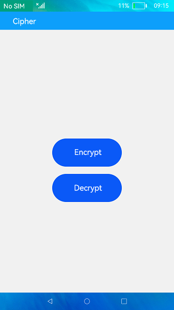
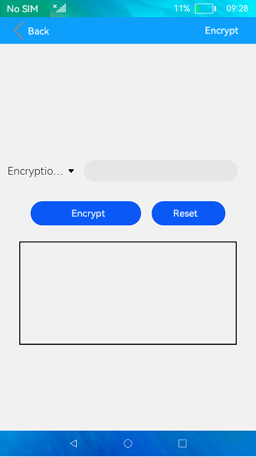
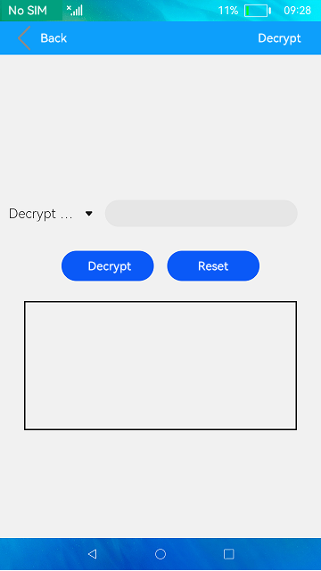

# Cipher

### Introduction

This sample shows how to use [@system.cipher](https://gitcode.com/openharmony/docs/blob/master/en/application-dev/reference/apis-crypto-architecture-kit/js-apis-system-cipher.md) to implement string encryption and decryption, including the RSA and AES algorithms.

RSA: A public-key cryptosystem that uses different encryption and decryption keys. Deriving the decryption key from the known encryption key is computationally infeasible.

AES: An advanced encryption standard in cryptography, also called Rijndael. It is a block encryption standard adopted by the U.S. federal government.

### Preview

|Home|Encryption|Decryption|
|--------------------------------|--------------------------------|--------------------------------|
||  ||

### Usage

1. On the home screen, touch the **Encryption** button. On the encryption screen, select an encryption algorithm from the **Encryption Algorithm** drop-down list box, enter the content to be encrypted in the text box, and touch the **Encryption** button. The encrypted content is displayed in the text box below.

2. Touch the **Reset** button to clear the content in the text box.

3. Touch the **Decrypt** button on the home screen. On the decryption screen, select a decryption algorithm from the **Decrypt Algorithm** drop-down list box, enter the content to be decrypted in the text box, and touch the **Decrypt** button. The decrypted content is displayed in the text box below.

4. Touch the **Reset** button to clear the content in the text box.

### Project Directory

```
entry/src/main/ets/
|---common
|   |---Decrypt.ets                        // Decryption page
|   |---Encryption.ets                     // Encryption page
|---entryability
|   |---EntryAbility.ts                    // Entry class
|---model
|   |---CipherModel.ts                     // Encryption and decryption methods
|   |---Logger.ts                          // Logging utility
|---pages
|   |---Index.ets                          // Home page
|   |---Second.ets                         // Encryption and decryption page
entry/src/ohosTest/ets/
|---TestRunner
|   |---OpenHarmonyTestRunner.ts           // Test runner
|---test
|   |---*.test.ets                         // Test cases. For details, see ohosTest.md
|---testability                            // Test helper page and ability
|---utils                                  // Test utility
```

### Implementation

* The encryption and decryption functions are encapsulated in the CipherModel class of [CipherModel.ts](entry/src/main/ets/model/CipherModel.ts). The encryption page [Encryption.ets](entry/src/main/ets/common/Encryption.ets) and decryption page [Decrypt.ets](entry/src/main/ets/common/Decrypt.ets) select an algorithm from the drop-down list box and call the corresponding method.
    * RSA encryption and decryption: Call [cipher.rsa](https://gitcode.com/openharmony/docs/blob/master/en/application-dev/reference/apis-crypto-architecture-kit/js-apis-system-cipher.md) with RSA/None/OAEPWithSHA256AndMGF1Padding.
    * AES encryption and decryption: Call [cipher.aes](https://gitcode.com/openharmony/docs/blob/master/en/application-dev/reference/apis-crypto-architecture-kit/js-apis-system-cipher.md) with AES/CBC/PKCS5Padding.
    * Page navigation: The home page [Index.ets](entry/src/main/ets/pages/Index.ets) uses [router.push](https://gitcode.com/openharmony/docs/blob/master/en/application-dev/reference/apis-arkui/js-apis-router.md) to navigate to [Second.ets](entry/src/main/ets/pages/Second.ets), which renders the encryption or decryption component based on the parameter.
    * Empty input: When the input is empty, [prompt.showToast](https://gitcode.com/openharmony/docs/blob/master/en/application-dev/reference/apis-arkui/js-apis-prompt.md) is called to display a toast.

### Required Permissions

N/A.

### Dependency

N/A.

### Constraints

1. This sample can only be run on standard-system devices, with device types of default and tablet.

2. This sample is developed based on the Stage model and adapted to the API version 26 SDK (SDK version: 26.0.0).

3. This sample requires DevEco Studio 26 or later to compile and run.

### Download

To download the sample project only, run the following commands:

```
git init
git config core.sparsecheckout true
echo code/BasicFeature/Security/Cipher/ > .git/info/sparse-checkout
git remote add origin https://gitcode.com/openharmony/applications_app_samples.git
git pull origin master
```
