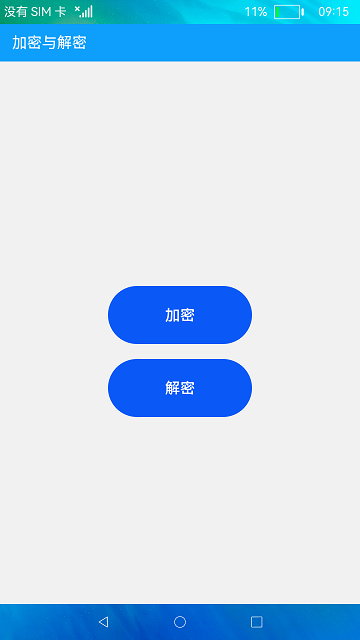
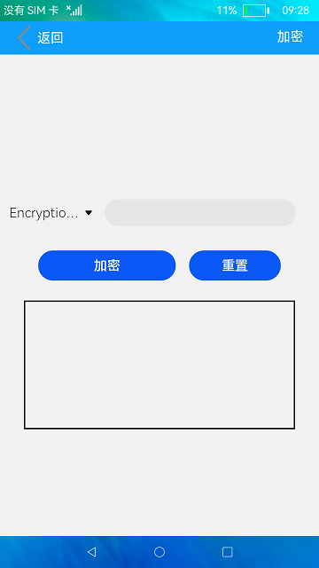
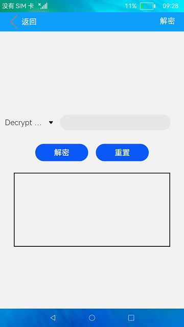

# 加解密

### 介绍

本示例使用[@system.cipher](https://gitcode.com/openharmony/docs/blob/master/zh-cn/application-dev/reference/apis-crypto-architecture-kit/js-apis-system-cipher.md)相关接口实现了字符串加解密算法，包括RSA加密算法与AES加密算法。

RSA加密算法：RSA公开密钥密码体制是一种使用不同的加密密钥与解密密钥，由已知加密密钥推导出解密密钥在计算上是不可行的密码体制。

AES加密算法：AES密码学中的高级加密标准，又称Rijndael加密法，是美国联邦政府采用的一种区块加密标准。

### 效果预览

|主页|加密页面|解密页面|
|--------------------------------|--------------------------------|--------------------------------|
||  ||

使用说明

1. 点击主页面的**加密**按钮，在加密页面中点击**加密算法**下拉选择加密算法，在输入框中输入待加密的内容，点击**加密**按钮，下方文本框中显示加密后内容。

2. 点击**重置**按钮，清除文本框中内容。

3. 点击主页面的**解密**按钮，在解密页面中点击**解密算法**下拉选择解密算法，在输入框中输入待解密的内容，点击**解密**按钮，下方文本框中显示解密后内容。

4. 点击**重置**按钮，清除文本框中内容。

### 工程目录

```
entry/src/main/ets/
|---common
|   |---Decrypt.ets                        // 解密页面
|   |---Encryption.ets                     // 加密页面
|---entryability
|   |---EntryAbility.ts                    // 程序入口
|---model
|   |---CipherModel.ts                     // 加密与解密方法
|   |---Logger.ts                          // 日志工具
|---pages
|   |---Index.ets                          // 首页
|   |---Second.ets                         // 加密与解密页面
entry/src/ohosTest/ets/
|---TestRunner
|   |---OpenHarmonyTestRunner.ts           // 测试运行器
|---test
|   |---*.test.ets                         // 测试用例，详见ohosTest.md
|---testability                            // 测试辅助页面与能力
|---utils                                  // 测试工具
```

### 具体实现

* 加解密功能封装在[CipherModel.ts](entry/src/main/ets/model/CipherModel.ts)的CipherModel类中，加密页面[Encryption.ets](entry/src/main/ets/common/Encryption.ets)与解密页面[Decrypt.ets](entry/src/main/ets/common/Decrypt.ets)通过下拉框选择算法并调用对应方法。
    * RSA加密与解密：调用[cipher.rsa](https://gitcode.com/openharmony/docs/blob/master/zh-cn/application-dev/reference/apis-crypto-architecture-kit/js-apis-system-cipher.md)接口，使用RSA/None/OAEPWithSHA256AndMGF1Padding填充方式。
    * AES加密与解密：调用[cipher.aes](https://gitcode.com/openharmony/docs/blob/master/zh-cn/application-dev/reference/apis-crypto-architecture-kit/js-apis-system-cipher.md)接口，使用AES/CBC/PKCS5Padding填充方式。
    * 页面跳转：首页[Index.ets](entry/src/main/ets/pages/Index.ets)使用[router.push](https://gitcode.com/openharmony/docs/blob/master/zh-cn/application-dev/reference/apis-arkui/js-apis-router.md)跳转到[Second.ets](entry/src/main/ets/pages/Second.ets)，Second.ets根据参数渲染加密或解密组件。
    * 空输入提示：输入为空时使用[prompt.showToast](https://gitcode.com/openharmony/docs/blob/master/zh-cn/application-dev/reference/apis-arkui/js-apis-prompt.md)弹出提示。

### 相关权限

不涉及。

### 依赖

不涉及。

### 约束与限制

1. 本示例仅支持在标准系统上运行，支持设备类型：default，tablet。

2. 本示例基于Stage模型开发，已适配API version 26版本SDK，SDK版本号：26.0.0。

3. 本示例需要使用DevEco Studio 26及以上版本才可编译运行。

### 下载

如需单独下载本工程，执行如下命令：

```
git init
git config core.sparsecheckout true
echo code/BasicFeature/Security/Cipher/ > .git/info/sparse-checkout
git remote add origin https://gitcode.com/openharmony/applications_app_samples.git
git pull origin master
```
