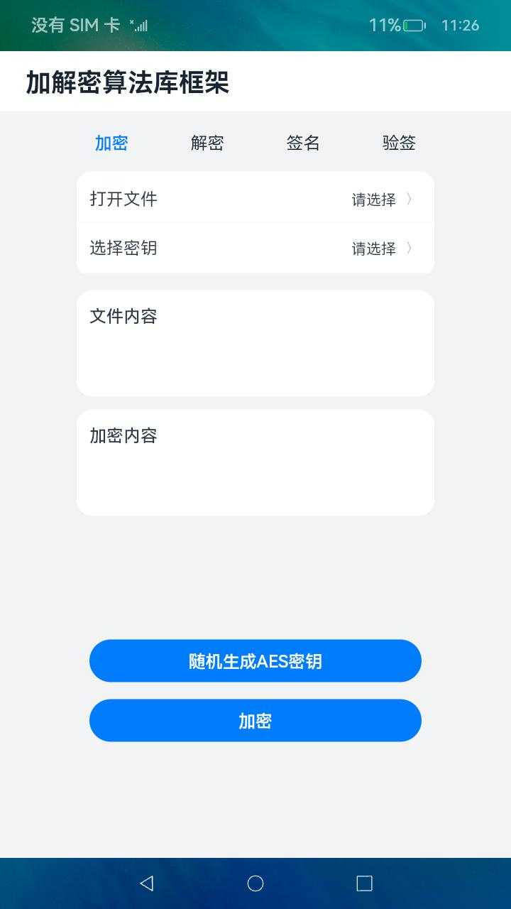
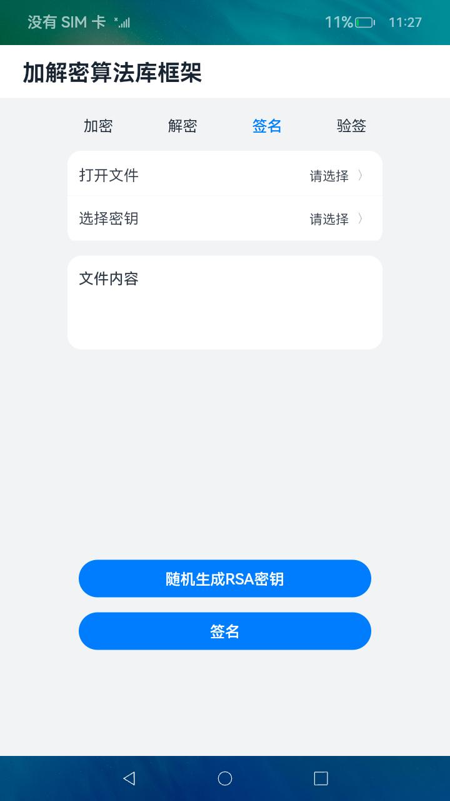
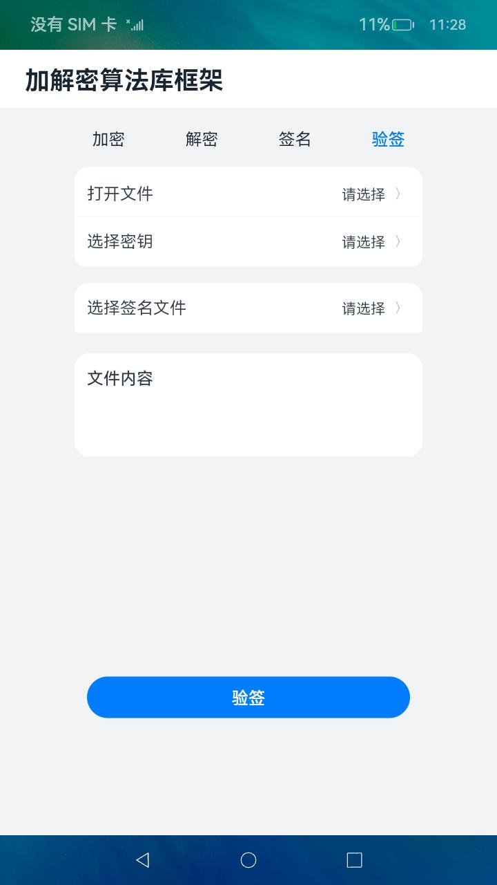

# Crypto Framework

### Introduction

This sample shows how [@ohos.security.cryptoFramework](https://gitcode.com/openharmony/docs/blob/master/en/application-dev/reference/apis-crypto-architecture-kit/js-apis-cryptoFramework.md) works to implement the functions of encrypting, decrypting, signing, and verifying text files. The implementation scenarios are as follows:

1. To encrypt and store a local text file, the app calls Crypto Framework to select a key file and encrypt the local text file. The key file can be created with Crypto Framework.

2. To decrypt a stored local text file, the app calls Crypto Framework to select a key file and decrypt the local text file. The key file can be created with Crypto Framework.

3. To sign a stored local text file, the app calls Crypto Framework to select a key file and sign the local text file for integrity. The key file can be created with Crypto Framework.

4. To verify the signature integrity of a stored local text file, the app calls Crypto Framework to select a key file and a signature file, and then verifies the file. The key file can be created with Crypto Framework.

### Preview

| Encrypt screen | Decrypt screen | Sign screen | Verify screen |
|--------------------------------------|--------------------------------------|-----------------------------------|-------------------------------------|
|  |  |  |  |

### Usage

1. On the home screen, touch the **Encrypt** tab. On the encrypt screen, touch **Open File** to select a text file through the file chooser. The app automatically returns to the encrypt screen, and the file content is displayed in the **File Content** text box. Touch **Select Key** to select a key file. If there is no key file, touch **Generate AES Key Randomly** on the encrypt screen to generate a key and save the key file through the file chooser. After selecting the text file and the key file, touch **Encrypt** to complete the encryption and save the ciphertext file through the file chooser. The encrypted content is displayed in the **Encrypted Content** text box below.

2. On the home screen, touch the **Decrypt** tab. On the decrypt screen, touch **Open File** to select a text file through the file chooser. The app automatically returns to the decrypt screen, and the file content is displayed in the **File Content** text box. Touch **Select Key** to select the same key file used for encryption. After selecting the text file and the key file, touch **Decrypt** to complete the decryption and save the plaintext file through the file chooser. The decrypted content is displayed in the **Decrypted Content** text box below.

3. On the home screen, touch the **Sign** tab. On the sign screen, touch **Open File** to select a text file through the file chooser. The app automatically returns to the sign screen, and the file content is displayed in the **File Content** text box. Touch **Select Key** to select a key file. If there is no key file, touch **Generate RSA Key Randomly** on the sign screen to generate a key and save the key file through the file chooser. Note that RSA key generation takes a long time. After selecting the text file and the key file, touch **Sign** to complete the integrity signature and save the signature file through the file chooser.

4. On the home screen, touch the **Verify** tab. On the verify screen, touch **Open File** to select a text file through the file chooser. The app automatically returns to the verify screen, and the file content is displayed in the **File Content** text box. Touch **Select Key** to select a key file that matches the signature, and touch **Select Signature File** to select the signature file saved when signing through the file chooser. After selecting the text file, the key file, and the signature file, touch **Verify** to complete the signature verification.

### Project Directory

```
entry/src/main/ets/
|---cryptoframework
|   |---CryptoOperation.ts                                    // Encapsulates the algorithm capabilities of Crypto Framework
|---entryability
|   |---EntryAbility.ts
|---pages
|   |---Index.ets                                             // Home screen
|---tab
|   |---Decrypt.ets                                           // Decrypt tab
|   |---Encrypt.ets                                           // Encrypt tab
|   |---Sign.ets                                              // Sign tab
|   |---Verify.ets                                            // Verify tab
|---textfilemanager
|   |---TextFileManager.ts                                    // Encapsulates file read and write capabilities
|---util
|   |---Logger.ts                                             // Logging utility
entry/src/ohosTest/ets/
|---TestRunner
|   |---OpenHarmonyTestRunner.ts                              // Test runner
|---test
|   |---List.test.ets                                         // Test entry that registers all 54 test suites
|   |---CryptoVolumeHelper.ets                                // Shared test utility
|   |---AesKeyCore.test.ets                                   // AES key logic suite
|   |---AesCipherCore.test.ets                                // AES encryption and decryption logic suite
|   |---RsaKeyCore.test.ets                                   // RSA key logic suite
|   |---RsaSignVerifyCore.test.ets                            // RSA sign and verify logic suite
|   |---TextFileCore.test.ets                                 // Text file read and write logic suite
|   |---CryptoUi.test.ets                                     // Encrypt/decrypt/sign/verify UI suite
|   |---48 more suite files (AES/RSA/text-file input domains, state sequences, and supplementary suites) // See the suite table in ohosTest.md
|---testability
|   |---TestAbility.ets
```

### Implementation

The encrypt, decrypt, sign, and verify capabilities for text files are encapsulated in CryptoOperation. For details, see [CryptoOperation.ts](entry/src/main/ets/cryptoframework/CryptoOperation.ts).

* Encrypt a text file: in [Encrypt.ets](entry/src/main/ets/tab/Encrypt.ets), touch **Open File** and **Select Key** in sequence to select the plaintext file and the key file through filePicker, then touch **Encrypt** to encrypt the text content and save the ciphertext file through filePicker. To generate a key file, touch **Generate AES Key Randomly**, which calls [cryptoFramework.symKeyGenerator](https://gitcode.com/openharmony/docs/blob/master/en/application-dev/reference/apis-crypto-architecture-kit/js-apis-cryptoFramework.md#symkeygenerator) to generate an AES key, and saves the key file through filePicker. The encryption uses [cryptoFramework.Cipher](https://gitcode.com/openharmony/docs/blob/master/en/application-dev/reference/apis-crypto-architecture-kit/js-apis-cryptoFramework.md#cipher).

* Decrypt a text file: in [Decrypt.ets](entry/src/main/ets/tab/Decrypt.ets), touch **Open File** and **Select Key** in sequence to select the ciphertext file and the key file through filePicker, then touch **Decrypt** to decrypt the text content and save the plaintext file through filePicker. The decryption uses [cryptoFramework.Cipher](https://gitcode.com/openharmony/docs/blob/master/en/application-dev/reference/apis-crypto-architecture-kit/js-apis-cryptoFramework.md#cipher).

* Sign a text file: in [Sign.ets](entry/src/main/ets/tab/Sign.ets), touch **Open File** and **Select Key** in sequence to select the text file and the key file through filePicker, then touch **Sign** to complete the integrity signature and save the signature file through filePicker. To generate a key file, touch **Generate RSA Key Randomly**, which calls [cryptoFramework.asyKeyGenerator](https://gitcode.com/openharmony/docs/blob/master/en/application-dev/reference/apis-crypto-architecture-kit/js-apis-cryptoFramework.md#asykeygenerator) to generate an RSA key, and saves the key file through filePicker. The signing uses [cryptoFramework.Sign](https://gitcode.com/openharmony/docs/blob/master/en/application-dev/reference/apis-crypto-architecture-kit/js-apis-cryptoFramework.md#sign).

* Verify a text file: in [Verify.ets](entry/src/main/ets/tab/Verify.ets), touch **Open File**, **Select Key**, and **Select Signature File** in sequence to select the text file, the key file, and the signature file through filePicker, then touch **Verify** to verify the text content and display the result. The verification uses [cryptoFramework.Verify](https://gitcode.com/openharmony/docs/blob/master/en/application-dev/reference/apis-crypto-architecture-kit/js-apis-cryptoFramework.md#verify).

### Testing

This sample provides automated ohosTest tests: 54 suites and 1959 cases in total, covering AES/RSA key generation, encryption and decryption, signing and verification, text file read and write, and the main UI flows. The test entry and suite registration are in [List.test.ets](entry/src/ohosTest/ets/test/List.test.ets). For the suite list and execution results, see [ohosTest.md](ohosTest.md).

* Test module: entry_test; bundle name: com.samples.cryptoframework
* Test runner: /ets/TestRunner/OpenHarmonyTestRunner
* How to run: use the entry@ohosTest run configuration in DevEco Studio, or pass the parameter list on the command line: bundle name com.samples.cryptoframework, module entry_test, runner /ets/TestRunner/OpenHarmonyTestRunner, per-case timeout (60000 ms is recommended for RSA suites, 45000 ms for UI suites, and 30000 ms for the rest). Optionally append a class parameter to run a specific suite or a specific case in the suite name#case name form.


### Required Permissions

N/A.

### Dependency

* filePicker [@ohos.file.picker](https://gitcode.com/openharmony/docs/blob/master/en/application-dev/reference/apis-core-file-kit/js-apis-file-picker.md)

* File management [@ohos.file.fs](https://gitcode.com/openharmony/docs/blob/master/en/application-dev/reference/apis-core-file-kit/js-apis-file-fs.md)

* UI Ability Context [@ohos.app.ability.common](https://gitcode.com/openharmony/docs/blob/master/en/application-dev/reference/apis-ability-kit/js-apis-app-ability-common.md)

### Constraints

1. This sample can be run only on standard-system devices (deviceTypes: default and tablet).

2. This sample is adapted to API 26, with compileSdkVersion 26.0.0.

3. This sample requires DevEco Studio 26 or later to compile and run.

4. Files saved through filePicker, such as newly generated keys, are updated in real time. Files pushed directly to the folder require a device restart to refresh the display.

5. The text file content currently supports English characters only. As a demonstration, the text length that can be used successfully does not exceed 8,000 bytes.

### Download

To download this project separately, run the following commands:

```
git init
git config core.sparsecheckout true
echo code/BasicFeature/Security/CryptoFramework/ > .git/info/sparse-checkout
git remote add origin https://gitcode.com/openharmony/applications_app_samples.git
git pull origin master

```
