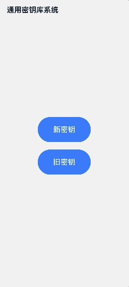
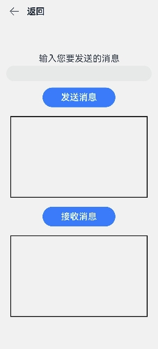
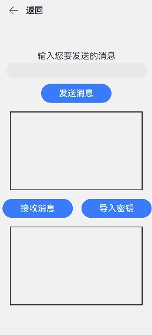
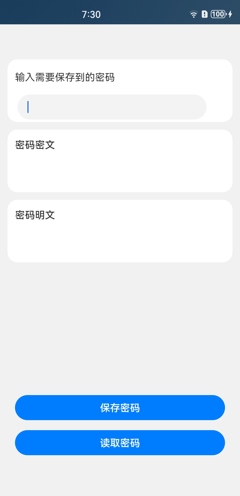

# Harmony Universal Keystore Service

### Introduction

This sample shows how [@ohos.security.huks](https://docs.openharmony.cn/pages/v4.0/en/application-dev/reference/apis/js-apis-huks.md) works to implement encryption and decryption of arbitrary input content.

The implementation scenarios are as follows:

1. Using a new key for message encryption and decryption transmission: Use the HUKS generated key API to generate a new key locally, simulating the scenario where the device encrypts the sent message and decrypts the received message.

2. Using an old key for message encryption and decryption transmission: Use the HUKS import key API to import an old key, simulating the scenario of encrypting the sent message on the old device and decrypting the received message on the new device.

3. Using minimum access control for password encryption and decryption: Use the HUKS generated key API to generate a new key locally, simulating the scenario where the device encrypts the password and decrypts the received password.

### Preview

| Main page | New key message encryption/decryption page | Old key message encryption/decryption page | Minimum access control save/read password page |
|-----------------------------------|--------------------|------------------------------------|----------------------------------------------|
|  |  |  |  |

### Usage

1. Click the **New Key** button on the main page, enter the message content to be sent in the input box of the new key page, and click the **Send Message** button. The encrypted message content is displayed in the text box below. Then click the **Receive Message** button, and the decrypted message content is displayed in the text box below.

2. Click the **Old Key** button on the main page, enter the message content to be sent in the input box of the old key page, and click the **Send Message** button. The encrypted message content is displayed in the text box below. Then click the **Import Key** button, and a pop-up window prompts that the key is imported successfully. Then click the **Receive Message** button, and the decrypted message content is displayed in the text box below.

3. Click the **Minimum Access Control** button on the main page, enter the password content to be saved in the input box of the new key page, and click the **Save Password** button. The encrypted password content is displayed in the text box below. Record the lock screen password. Then click the **Read Password** button and, after entering the PIN code (lock screen password, which needs to be recorded in advance), the decrypted message content is displayed in the text box below.

### Project Directory

```
entry/src/main/ets/
|---common
|   |---NewKey.ets                                            // New key component
|   |---OldKey.ets                                            // Old key component
|   |---MinAccessControl.ets                                  // Minimum access control component
|---entryability
|   |---EntryAbility.ts
|---model
|   |---HuksModel.ts                                          // Universal keystore model file
|   |---Logger.ts                                             // Logging utility
|---pages
|   |---Index.ets                                             // Home page
|   |---SelectPage.ets                                        // Page selection interface
```

### Implementation

The APIs for encrypting and decrypting messages using a new key, an old key, and minimum access control are encapsulated in HuksModel. For details, see [HuksModel.ts](entry/src/main/ets/model/HuksModel.ts).

* Encrypting with a new key: in [NewKey.ets](entry/src/main/ets/common/NewKey.ets), the encryption function is called through HuksModel.encryptData to encrypt the message content to be sent. The key properties for key generation and encryption are set. Before encryption, the key generation API [huks.generateKeyItem](https://docs.openharmony.cn/pages/v4.0/en/application-dev/reference/apis/js-apis-huks.md#huksgeneratekeyitem9) is called to generate the AES key used for encryption. The three-phase APIs [huks.initSession, huks.updateSession, huks.finishSession](https://docs.openharmony.cn/pages/v4.0/en/application-dev/reference/apis/js-apis-huks.md#huksinitsession9) are used to complete the encryption.

* Decrypting with a new key: in [NewKey.ets](entry/src/main/ets/common/NewKey.ets), the decryption function is called through HuksModel.decryptData to decrypt the received message. The key properties for decryption are set. The key used for encryption is used to decrypt the message, also through the three-phase APIs. After decryption, the key deletion API [huks.deleteKeyItem](https://docs.openharmony.cn/pages/v4.0/en/application-dev/reference/apis/js-apis-huks.md#huksdeletekeyitem9) is called to delete the locally stored key.

* Encrypting with an old key: in [OldKey.ets](entry/src/main/ets/common/OldKey.ets), the encryption function is called through HuksModel.encryptDataUserOldKey to encrypt the message content to be sent. The key properties for encryption are set. The three-phase APIs are used with the locally stored old key to complete the encryption.

* Decrypting with an old key: in [OldKey.ets](entry/src/main/ets/common/OldKey.ets), the decryption function is called through HuksModel.decryptDataUserOldKey to decrypt the received message, simulating importing the encryption key of the old device to the new device. The three-phase APIs are used to complete the decryption. The key is deleted after decryption.

* Managing passwords with minimum access control: in [MinAccessControl.ets](entry/src/main/ets/common/MinAccessControl.ets), an SM2 key is generated through huksModel.encryptDataUseSm2, and the encryption function is called to encrypt the password content. The key properties for encryption are set. The two-phase APIs are used with the locally stored old key to complete the encryption. When reading the password (requires the system lock screen password to be set first), the IAM PIN (lock screen password) API is called for authentication.

### Required Permissions

ohos.permission.ACCESS_BIOMETRIC

### Dependency

None.

### Constraints

1. This sample can only be run on standard-system devices.

2. This sample supports API version 26.0.0 SDK.

3. This sample requires DevEco Studio 26 or later to compile and run.

4. If this sample is run on a device without a device certificate, run the 'hdc shell setenforce 0' command on the local command line in advance to ensure that the sample functions properly.

### Testing

This project provides automated ohosTest tests covering the encryption/decryption APIs, key import, and page interactions, with 62 test suites and 2141 test cases in total. For the suite and case list, see [ohosTest.md](ohosTest.md).

Test environment: standard-system device (API 26.0.0), DevEco Studio 26.

How to run: use the `entry@ohosTest` run configuration in DevEco Studio, or run in batches with the parameter list (bundle name `com.samples.huks`, module name `entry_test`, runner path `/ets/TestRunner/OpenHarmonyTestRunner`, case timeout) and append `-s class <suite name>` to select a test suite.

### Download

To download this project separately, run the following commands:

```
git init
git config core.sparsecheckout true
echo code/BasicFeature/Security/Huks/ > .git/info/sparse-checkout
git remote add origin https://gitcode.com/openharmony/applications_app_samples.git
git pull origin master
```
