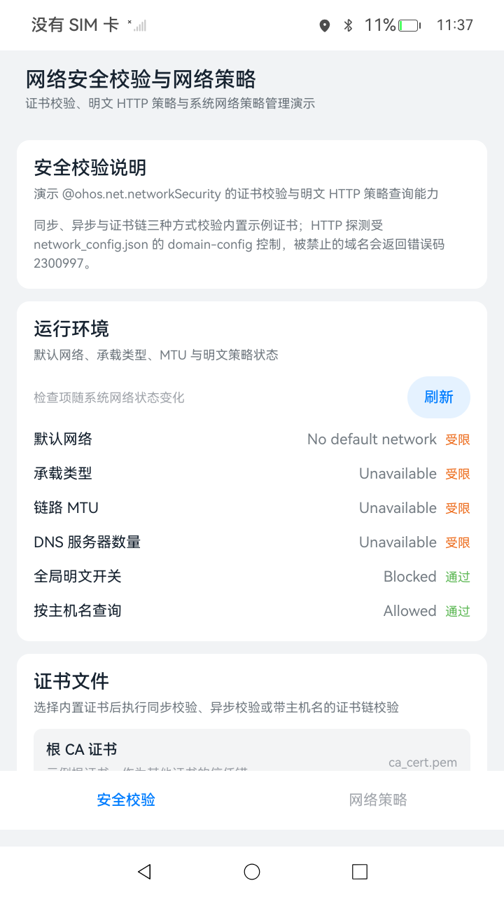

# 网络安全校验与网络策略

## 介绍

本示例演示 OpenHarmony 网络安全校验与网络策略管理能力，代码拆分为可复用的 Library 特性模块和 entry 场景模块。

- 使用 [@kit.NetworkKit](https://gitcode.com/openharmony/docs/blob/master/zh-cn/application-dev/reference/apis-network-kit/Readme-CN.md) 中的 networkSecurity 完成证书同步校验、异步校验与证书链校验，查询明文 HTTP 策略；使用 policy 读取应用网络访问策略、后台联网策略、UID 策略、流量配额、信任名单与策略事件；使用 http 发起明文 HTTP 探测；使用 connection 读取默认网络与链路信息。
- 使用 [@kit.DeviceCertificateKit](https://gitcode.com/openharmony/docs/blob/master/zh-cn/application-dev/reference/apis-device-certificate-kit/Readme-CN.md) 中的 cert 解析 X.509 证书元数据。
- 使用 [@kit.PerformanceAnalysisKit](https://gitcode.com/openharmony/docs/blob/master/zh-cn/application-dev/reference/apis-performance-analysis-kit/Readme-CN.md) 中的 hilog 输出运行日志。
- 使用 [@kit.ArkTS](https://gitcode.com/openharmony/docs/blob/master/zh-cn/application-dev/reference/apis-arkts/Readme-CN.md) 中的 util 完成 PEM 文本解码与编码。
- 使用 [@kit.AbilityKit](https://gitcode.com/openharmony/docs/blob/master/zh-cn/application-dev/reference/apis-ability-kit/Readme-CN.md) 中的 common 与 bundleManager 获取应用上下文与自身 UID。

接口文档：

- [@ohos.net.networkSecurity](https://gitcode.com/openharmony/docs/blob/master/zh-cn/application-dev/reference/apis-network-kit/js-apis-networkSecurity.md)
- [@ohos.net.policy](https://gitcode.com/openharmony/docs/blob/master/zh-cn/application-dev/reference/apis-network-kit/js-apis-net-policy.md)
- [@ohos.net.http](https://gitcode.com/openharmony/docs/blob/master/zh-cn/application-dev/reference/apis-network-kit/js-apis-http.md)
- [@ohos.net.connection](https://gitcode.com/openharmony/docs/blob/master/zh-cn/application-dev/reference/apis-network-kit/js-apis-net-connection.md)
- [@ohos.security.cert](https://gitcode.com/openharmony/docs/blob/master/zh-cn/application-dev/reference/apis-device-certificate-kit/js-apis-cert.md)

主要功能如下：

- 证书校验：对内置 PEM 证书执行同步校验、异步校验，以及带主机名校验的证书链校验，并统计耗时。
- 证书元数据解析：读取证书的颁发者、生效时间、过期时间、版本与序列号。
- 明文 HTTP 查询：查询全局明文开关，并按主机名判断明文访问是否被允许。
- 明文 HTTP 探测：对允许域与禁止域发起真实 HTTP 请求，演示 2300997 明文拦截。
- 网络环境自检：展示默认网络、承载类型、链路 MTU、DNS 服务器数量与明文策略可用性。
- 应用网络访问策略：通过公开接口读取 Wi-Fi 与蜂窝网络访问策略，并跳转系统网络访问设置页。
- 系统网络策略：后台联网策略、UID 策略、流量配额、电量与休眠信任名单、策略事件监听。
- 应用策略联动：已安装应用列表与应用详情页，UID 应用选择器，事件一键定位，应用维度聚合查看与配置三类策略。
- 错误码解读：把 networkSecurity、http 与 policy 的返回码映射为标题、原因与处理建议。
- 操作日志：记录最近 50 条操作，并同步输出到 hilog。

## 效果预览

手机端使用底部页签，包含“安全校验”与“网络策略”两个页签；平板端切换为左侧导航，导航宽度 200vp，右侧为对应页面内容。安全校验页自上而下为说明、运行环境、证书文件、明文 HTTP 策略、HTTP 探测、错误码解读与操作日志卡片；网络策略页为系统接口说明、应用网络访问策略、后台联网策略、UID 策略、流量配额、电量与休眠信任名单、策略事件监听与操作日志卡片。

网络策略页提供“已安装应用”入口，点击后推入应用列表页（支持搜索过滤与加载、空态、受限提示三种降级态）；点击应用行推入应用详情页，聚合展示该应用的 Wi-Fi 与蜂窝访问策略、UID 策略与后台联网策略，并提供“允许/拒绝/清除”操作按钮；UID 策略卡的“选择应用”按钮打开可搜索的应用选择面板；策略事件行携带 UID 时可点击 UID 文本直达对应应用详情页。



### 使用说明

1. 启动应用，默认进入“安全校验”页，顶部显示应用标题“网络安全校验与网络策略”与副标题。
2. 在“运行环境”卡片查看默认网络、承载类型、链路 MTU、DNS 服务器数量、全局明文开关与按主机名查询能力，点击“刷新”重新检测。
3. 在“证书文件”卡片选择根 CA 证书、服务器证书、自签名证书或过期证书，查看颁发者、生效时间、过期时间、版本与序列号。
4. 点击“同步校验”或“异步校验”，结果区显示返回码、结果说明与耗时；选择自签名证书时，因缺少可信信任锚会返回非 0 错误码。
5. 点击“链校验”，以服务器证书、根 CA 与主机名 netsecurity.sample.com 构建并校验证书链；选择过期证书后执行任意校验，会因有效期结束返回错误码。
6. 在“明文 HTTP 策略”卡片点击“查询”读取全局明文开关；在输入框填写主机名后点击“查询”，或直接点击 www.example.com、www.iana.org 快捷按钮。
7. 在“HTTP 探测”卡片点击“探测允许域名”，对 http://www.example.com 发起请求；点击“探测禁止域名”，对 http://www.iana.org 发起请求，后者被策略拦截并返回 2300997。
8. 切换底部页签，平板端点击左侧导航，进入“网络策略”页，查看公开接口读取的 Wi-Fi 与蜂窝网络访问策略，点击“刷新”重新读取，点击“打开系统设置”跳转系统网络访问设置页。
9. 在系统签名设备上继续演示“允许后台联网”开关、“UID 策略”的查询与设置、“应用演示配额”“重置策略”“恢复全部”、“加入信任名单”与“开始监听”。
10. 查看页面底部“操作日志”与“错误码解读”卡片；日志按时间倒序保留最近 50 条，点击“清空”清空当前页面的日志。
11. 在网络策略页点击“已安装应用”进入应用列表，按应用名或包名过滤并进入应用详情页查看三类策略，执行“允许/拒绝/清除”UID 策略操作；在 UID 策略卡点击“选择应用”，搜索并点选应用后自动回填 UID 并触发查询；策略事件行携带 UID 时点击 UID 文本直达对应应用详情页。

## 工程目录

```text
NetworkSecurity/
|--- AppScope                                     // 应用级配置，包名 com.samples.networksecurity
|--- entry                                        // 场景模块，依赖 Library
|   |--- src/main/ets
|   |   |--- entryability/EntryAbility.ets        // 应用入口
|   |   |--- pages/Index.ets                      // 唯一入口页面
|   |   |--- networksecurity
|   |   |   |--- MainPage.ets                     // 一多布局导航容器
|   |   |   |--- pages
|   |   |   |   |--- SecurityPage.ets             // 安全校验页面
|   |   |   |   |--- PolicyPage.ets               // 网络策略页面
|   |   |   |   |--- AppListPage.ets              // 已安装应用列表页与路由助手
|   |   |   |   |--- AppDetailPage.ets            // 应用详情页
|   |   |   |--- viewmodel
|   |   |   |   |--- SecurityViewModel.ets        // 安全校验状态与操作编排
|   |   |   |   |--- PolicyViewModel.ets          // 网络策略状态与操作编排
|   |   |   |   |--- AppListViewModel.ets         // 应用列表状态与过滤
|   |   |   |   |--- AppDetailViewModel.ets       // 应用详情状态与策略编排
|   |--- src/main/resources
|   |   |--- base/profile/network_config.json     // 明文 HTTP 与信任锚策略
|   |   |--- rawfile/certs
|   |   |   |--- ca_cert.json                     // 根 CA 证书 PEM 文本
|   |   |   |--- server_cert.json                 // 服务器证书 PEM 文本
|   |   |   |--- self_signed_cert.json            // 自签名证书 PEM 文本
|   |   |   |--- expired_cert.json                // 过期证书 PEM 文本
|   |--- src/ohosTest/ets/test
|   |   |--- NetworkSecurity.test.ets             // UI 自动化用例
|   |   |--- List.test.ets                        // 测试入口
|--- Library                                      // 特性模块，可独立编译为 HAR
|   |--- Index.ets                                // 对外导出
|   |--- src/main/ets/networksecurity
|   |   |--- security
|   |   |   |--- CertFileService.ets              // 证书读取与元数据解析
|   |   |   |--- CertVerifyService.ets            // 证书同步、异步与链校验
|   |   |   |--- CleartextService.ets             // 明文 HTTP 策略查询
|   |   |   |--- HttpProbeService.ets             // 明文 HTTP 探测
|   |   |   |--- EnvironmentService.ets           // 网络环境自检
|   |   |   |--- SecurityErrorCodeMap.ets         // 安全类错误码字典
|   |   |   |--- SecurityTypes.ets                // 安全类数据模型
|   |   |--- policy
|   |   |   |--- AccessPolicyService.ets          // 应用网络访问策略
|   |   |   |--- AppListService.ets               // 已安装应用列表
|   |   |   |--- AppTypes.ets                     // 应用列表数据模型
|   |   |   |--- BackgroundPolicyService.ets      // 后台联网策略
|   |   |   |--- UidPolicyService.ets             // UID 策略
|   |   |   |--- QuotaPolicyService.ets           // 流量配额
|   |   |   |--- TrustlistService.ets             // 电量与休眠信任名单
|   |   |   |--- PolicyEventService.ets           // 策略事件订阅
|   |   |   |--- PolicyErrorCodeMap.ets           // 策略类错误码字典
|   |   |   |--- PolicyTypes.ets                  // 策略类数据模型与枚举文案
|   |   |--- components
|   |   |   |--- SectionCard.ets                  // 分区卡片
|   |   |   |--- InfoRow.ets                      // 标签与数值行
|   |   |   |--- SwitchRow.ets                    // 带说明的开关行
|   |   |   |--- LogPanel.ets                     // 操作日志面板
|   |   |--- model/LogTypes.ets                   // 日志条目与插入逻辑
|   |   |--- utils
|   |   |   |--- Logger.ets                       // hilog 封装
|   |   |   |--- Format.ets                       // 耗时、字节与 UID 列表格式化
|   |--- src/main/resources                        // 字符串、颜色与尺寸资源
```

## 具体实现

网络安全校验与网络策略的封装位于 Library 模块，对外接口统一在 [Index.ets](https://gitcode.com/openharmony/applications_app_samples/blob/master/code/BasicFeature/Security/NetworkSecurity/Library/Index.ets) 中导出，场景层以静态类方法调用。

### 特性封装（Library）

- 证书校验：[CertVerifyService.ets](https://gitcode.com/openharmony/applications_app_samples/blob/master/code/BasicFeature/Security/NetworkSecurity/Library/src/main/ets/networksecurity/security/CertVerifyService.ets) 封装 networkSecurity.certVerificationSync、networkSecurity.certVerification 与 networkSecurity.verifyCertChain。同步与异步校验把 PEM 文本包装为 CertBlob（CERT_TYPE_PEM），返回码 0 表示通过，非零返回码或 BusinessError 的错误码写入 CertVerifyResult；链校验返回解析后的证书链长度与主机名。三个方法都用 Date.now 记录耗时，结果中包含 elapsedMs。
- 证书读取与解析：[CertFileService.ets](https://gitcode.com/openharmony/applications_app_samples/blob/master/code/BasicFeature/Security/NetworkSecurity/Library/src/main/ets/networksecurity/security/CertFileService.ets) 使用 resourceManager.getRawFileContentSync 读取 rawfile 中的 JSON 文本，通过 util.TextDecoder 解码后用 JSON.parse 还原 PEM 字符串；解析时用 cert.createX509Cert 创建 X509Cert，读取 getIssuerName、getNotBeforeTime、getNotAfterTime、getVersion 与 getSerialNumber。
- 明文策略查询：[CleartextService.ets](https://gitcode.com/openharmony/applications_app_samples/blob/master/code/BasicFeature/Security/NetworkSecurity/Library/src/main/ets/networksecurity/security/CleartextService.ets) 封装 networkSecurity.isCleartextPermitted 与 networkSecurity.isCleartextPermittedByHostName；主机名为空时跳过查询，平台调用失败时记录日志并返回 false，不向页面抛异常。
- HTTP 探测：[HttpProbeService.ets](https://gitcode.com/openharmony/applications_app_samples/blob/master/code/BasicFeature/Security/NetworkSecurity/Library/src/main/ets/networksecurity/security/HttpProbeService.ets) 通过 http.createHttp().request 发起 GET 请求，连接与读取超时均为 10 秒，200 至 399 视为成功；捕获 BusinessError 后单独识别 2300997，返回“明文流量被网络安全策略拦截”的说明，请求对象在 finally 中调用 destroy 释放。
- 网络环境自检：[EnvironmentService.ets](https://gitcode.com/openharmony/applications_app_samples/blob/master/code/BasicFeature/Security/NetworkSecurity/Library/src/main/ets/networksecurity/security/EnvironmentService.ets) 使用 connection.getDefaultNetSync 获取默认网络，用 connection.getNetCapabilitiesSync 读取承载类型，用 connection.getConnectionProperties 读取 MTU 与 DNS 数量，再追加全局明文开关与按主机名查询两项检查，共六项。
- 应用网络访问策略：[AccessPolicyService.ets](https://gitcode.com/openharmony/applications_app_samples/blob/master/code/BasicFeature/Security/NetworkSecurity/Library/src/main/ets/networksecurity/policy/AccessPolicyService.ets) 调用公开接口 policy.getNetAccessPolicy 读取 Wi-Fi 与蜂窝网络访问策略，调用 policy.showAppNetPolicySettings 打开系统网络访问设置页；另封装系统接口 policy.getNetworkAccessPolicy，按 UID 读取访问策略。公开接口读取失败时返回 loaded 为 false 的安全视图，系统接口的错误向上抛出。
- 已安装应用列表：[AppListService.ets](https://gitcode.com/openharmony/applications_app_samples/blob/master/code/BasicFeature/Security/NetworkSecurity/Library/src/main/ets/networksecurity/policy/AppListService.ets) 封装 bundleManager.getAllBundleInfo（GET_BUNDLE_INFO_WITH_APPLICATION），从 ApplicationInfo 读取应用名、包名、UID 与图标资源；查询失败返回 loaded 为 false 的安全视图，不向页面抛异常。
- 后台联网策略：[BackgroundPolicyService.ets](https://gitcode.com/openharmony/applications_app_samples/blob/master/code/BasicFeature/Security/NetworkSecurity/Library/src/main/ets/networksecurity/policy/BackgroundPolicyService.ets) 封装 policy.isBackgroundAllowed、policy.setBackgroundAllowed 与 policy.getBackgroundPolicyByUid。
- UID 策略：[UidPolicyService.ets](https://gitcode.com/openharmony/applications_app_samples/blob/master/code/BasicFeature/Security/NetworkSecurity/Library/src/main/ets/networksecurity/policy/UidPolicyService.ets) 封装 policy.setPolicyByUid、policy.getPolicyByUid、policy.getUidsByPolicy 与重载的 policy.isUidNetAllowed（计量网络与指定网卡两种入参）。
- 流量配额：[QuotaPolicyService.ets](https://gitcode.com/openharmony/applications_app_samples/blob/master/code/BasicFeature/Security/NetworkSecurity/Library/src/main/ets/networksecurity/policy/QuotaPolicyService.ets) 通过 policy.setNetQuotaPolicies 写入蜂窝网络演示配额，周期为 M1，警告阈值 100 MB，限制阈值 200 MB，超限动作为仅提醒；读取使用 policy.getNetQuotaPolicies，另封装 policy.resetPolicies、policy.restoreAllPolicies 与 policy.updateRemindPolicy。
- 信任名单：[TrustlistService.ets](https://gitcode.com/openharmony/applications_app_samples/blob/master/code/BasicFeature/Security/NetworkSecurity/Library/src/main/ets/networksecurity/policy/TrustlistService.ets) 调用 policy.setDeviceIdleTrustlist 与 policy.setPowerSaveTrustlist 加入白名单，调用对应的 get 接口读取当前名单；读取失败时返回空名单并标记 loaded 为 false。
- 策略事件：[PolicyEventService.ets](https://gitcode.com/openharmony/applications_app_samples/blob/master/code/BasicFeature/Security/NetworkSecurity/Library/src/main/ets/networksecurity/policy/PolicyEventService.ets) 订阅 netUidPolicyChange、netUidRuleChange、netMeteredIfacesChange、netQuotaPolicyChange、netBackgroundPolicyChange 五类事件，把数值型负载转换为英文说明后交给页面回调，UID 策略与 UID 规则事件回调额外携带负载 UID；注册失败时先注销已注册的监听再抛出错误，stop 中逐个注销监听。
- 错误码字典：[SecurityErrorCodeMap.ets](https://gitcode.com/openharmony/applications_app_samples/blob/master/code/BasicFeature/Security/NetworkSecurity/Library/src/main/ets/networksecurity/security/SecurityErrorCodeMap.ets) 收录 201、202、401、2300997、2305001、2305002、2305004、2305007、2305009、2305010、2305011、2305012、2305018、2305069；[PolicyErrorCodeMap.ets](https://gitcode.com/openharmony/applications_app_samples/blob/master/code/BasicFeature/Security/NetworkSecurity/Library/src/main/ets/networksecurity/policy/PolicyErrorCodeMap.ets) 收录 201、202、401、2100001、2100002、2100003，并提供 isSystemRestricted 判断调用是否因缺少系统权限被拒绝。两个字典都返回标题、原因、建议与级别，未收录的返回码使用“未知错误码”说明。
- 数据模型：[SecurityTypes.ets](https://gitcode.com/openharmony/applications_app_samples/blob/master/code/BasicFeature/Security/NetworkSecurity/Library/src/main/ets/networksecurity/security/SecurityTypes.ets) 定义 CertFileItem、CertMeta、CertVerifyResult、CleartextResult、HttpProbeResult、EnvironmentCheck 与 SecurityErrorExplain；[PolicyTypes.ets](https://gitcode.com/openharmony/applications_app_samples/blob/master/code/BasicFeature/Security/NetworkSecurity/Library/src/main/ets/networksecurity/policy/PolicyTypes.ets) 定义访问策略、后台策略、UID 策略、配额、信任名单、策略事件视图以及枚举文案转换函数；[AppTypes.ets](https://gitcode.com/openharmony/applications_app_samples/blob/master/code/BasicFeature/Security/NetworkSecurity/Library/src/main/ets/networksecurity/policy/AppTypes.ets) 定义 AppInfoItem、AppListView 与 AppDetailParam。

### 场景使用（entry）

- 页面装配：[MainPage.ets](https://gitcode.com/openharmony/applications_app_samples/blob/master/code/BasicFeature/Security/NetworkSecurity/entry/src/main/ets/networksecurity/MainPage.ets) 使用 Navigation 包裹整体页面，通过 GridRow 的 onBreakpointChange 判断断点，小屏使用 Tabs 底部页签，中屏与大屏使用左侧导航；平板布局中两个页面常驻，通过 visibility 切换显示；navDestination 注册“AppListPage”与“AppDetailPage”路由，页面跳转通过 NsNav 共享 NavPathStack。
- 安全校验页：[SecurityPage.ets](https://gitcode.com/openharmony/applications_app_samples/blob/master/code/BasicFeature/Security/NetworkSecurity/entry/src/main/ets/networksecurity/pages/SecurityPage.ets) 在 aboutToAppear 中获取 UIAbilityContext 并绑定 ViewModel，运行环境、证书列表、探测结果与日志均用 Repeat 渲染；证书校验结果、错误码解读与探测结果分别读取 ViewModel 中的 lastResult、SecurityErrorCodeMap 与 probeResults。
- 安全校验状态：[SecurityViewModel.ets](https://gitcode.com/openharmony/applications_app_samples/blob/master/code/BasicFeature/Security/NetworkSecurity/entry/src/main/ets/networksecurity/viewmodel/SecurityViewModel.ets) 使用 @ObservedV2 与 @Trace 维护检查项、证书列表、选中项、证书元数据、最近校验结果、明文查询结果、主机名输入、探测结果与日志；bind 时加载内置证书、执行环境自检并默认选中服务器证书，证书链校验固定使用 netsecurity.sample.com 主机名，HTTP 探测结果最多保留 4 条。
- 网络策略页：[PolicyPage.ets](https://gitcode.com/openharmony/applications_app_samples/blob/master/code/BasicFeature/Security/NetworkSecurity/entry/src/main/ets/networksecurity/pages/PolicyPage.ets) 展示系统接口状态、公开访问策略、后台策略开关、UID 输入与策略按钮、配额操作与列表、信任名单与策略事件列表，页面销毁时调用 stopEvents 注销监听。
- 网络策略状态：[PolicyViewModel.ets](https://gitcode.com/openharmony/applications_app_samples/blob/master/code/BasicFeature/Security/NetworkSecurity/entry/src/main/ets/networksecurity/viewmodel/PolicyViewModel.ets) 使用 @Trace 维护各卡片视图状态与日志；bind 时通过 bundleManager.getBundleInfoForSelfSync 读取自身 UID 作为默认输入，所有系统接口调用统一经过 run 方法，捕获 BusinessError 后由 handleError 判断 201、202，置 systemAvailable 为 false 并写入受限日志，页面保持可用；策略事件回调把负载 UID 填入事件条目。
- 应用列表：[AppListPage.ets](https://gitcode.com/openharmony/applications_app_samples/blob/master/code/BasicFeature/Security/NetworkSecurity/entry/src/main/ets/networksecurity/pages/AppListPage.ets) 使用 Repeat 懒加载应用行并渲染搜索、加载、空态与受限提示四种状态；[AppListViewModel.ets](https://gitcode.com/openharmony/applications_app_samples/blob/master/code/BasicFeature/Security/NetworkSecurity/entry/src/main/ets/networksecurity/viewmodel/AppListViewModel.ets) 使用 @ObservedV2 与 @Trace 维护列表、关键字与忙碌状态，@Computed 计算过滤结果。
- 应用详情：[AppDetailPage.ets](https://gitcode.com/openharmony/applications_app_samples/blob/master/code/BasicFeature/Security/NetworkSecurity/entry/src/main/ets/networksecurity/pages/AppDetailPage.ets) 展示应用概览与三类策略卡片，UID 策略卡提供“允许/拒绝/清除”按钮；[AppDetailViewModel.ets](https://gitcode.com/openharmony/applications_app_samples/blob/master/code/BasicFeature/Security/NetworkSecurity/entry/src/main/ets/networksecurity/viewmodel/AppDetailViewModel.ets) 复用 Library 三类策略服务按 UID 查询，通过 getBundleNameByUidSync、列表匹配与裸 UID 三级解析应用名，应用策略后重查并留痕，受限调用转为日志。
- 日志收集：[LogTypes.ets](https://gitcode.com/openharmony/applications_app_samples/blob/master/code/BasicFeature/Security/NetworkSecurity/Library/src/main/ets/networksecurity/model/LogTypes.ets) 定义 LogEntry 与 appendLog，新日志插入首位并裁剪到上限；两个 ViewModel 分别保留最近 50 条日志，策略事件保留最近 30 条，[LogPanel.ets](https://gitcode.com/openharmony/applications_app_samples/blob/master/code/BasicFeature/Security/NetworkSecurity/Library/src/main/ets/networksecurity/components/LogPanel.ets) 按级别着色展示并提供“清空”按钮。
- 界面组件：[SectionCard.ets](https://gitcode.com/openharmony/applications_app_samples/blob/master/code/BasicFeature/Security/NetworkSecurity/Library/src/main/ets/networksecurity/components/SectionCard.ets)、[InfoRow.ets](https://gitcode.com/openharmony/applications_app_samples/blob/master/code/BasicFeature/Security/NetworkSecurity/Library/src/main/ets/networksecurity/components/InfoRow.ets) 与 [SwitchRow.ets](https://gitcode.com/openharmony/applications_app_samples/blob/master/code/BasicFeature/Security/NetworkSecurity/Library/src/main/ets/networksecurity/components/SwitchRow.ets) 统一两个页面的卡片、信息行与开关样式，并通过 idPrefix 生成组件 id。

### 配置与证书

[network_config.json](https://gitcode.com/openharmony/applications_app_samples/blob/master/code/BasicFeature/Security/NetworkSecurity/entry/src/main/resources/base/profile/network_config.json) 描述示例期望的网络安全配置：base-config 的 cleartextTrafficPermitted 为 false，即默认禁止明文 HTTP，信任锚指向 /etc/security/certificates；domain-config 中 example.com 及其子域允许明文，iana.org 及其子域禁止明文。页面的明文查询与 HTTP 探测结果以设备实际生效的策略为准，配置内容与设备策略不一致时以设备为准。

四个内置证书位于 entry/src/main/resources/rawfile/certs，每份 .json 文件保存一个完整 PEM 字符串，JSON.parse 后恢复原始证书文本。页面仍以 .pem 名称标识证书，校验 API 的 PEM 编码方式不变。探测地址配置在 entry/src/main/resources/base/element/string.json 的 ns_sec_probe_allowed_url 与 ns_sec_probe_denied_url 中，修改域名时须同步核对 network_config.json 的明文规则。

| 证书显示名称 | 主体 | 用途 |
| --- | --- | --- |
| ca_cert.pem | Network Security Sample Root CA | 自签名根证书，作为服务器证书与过期证书的信任锚 |
| server_cert.pem | netsecurity.sample.com | 由根 CA 签发，SAN 包含 netsecurity.sample.com，用于演示链校验与主机名校验 |
| self_signed_cert.pem | self-signed.sample.com | 同主体自签名，缺少可信信任锚，校验应失败 |
| expired_cert.pem | netsecurity.sample.com | 有效期为 2020-01-01 至 2021-01-01，校验应因过期失败 |

## 相关权限

本示例已在 entry 模块的 module.json5 中声明以下权限：

```json5
"requestPermissions": [
  {
    "name": "ohos.permission.INTERNET"
  },
  {
    "name": "ohos.permission.GET_NETWORK_INFO"
  },
  {
    "name": "ohos.permission.MANAGE_NET_STRATEGY"
  },
  {
    "name": "ohos.permission.GET_INSTALLED_BUNDLE_LIST"
  },
  {
    "name": "ohos.permission.GET_BUNDLE_INFO"
  },
  {
    "name": "ohos.permission.GET_BUNDLE_INFO_PRIVILEGED"
  }
]
```

- ohos.permission.INTERNET：允许应用访问网络，用于 HTTP 探测。
- ohos.permission.GET_NETWORK_INFO：允许应用获取网络连接信息，用于运行环境自检。
- ohos.permission.MANAGE_NET_STRATEGY：允许应用获取网络策略信息或修改网络策略设置，权限级别为 system_basic，授权方式为系统授权，ACL 使能。
- ohos.permission.GET_INSTALLED_BUNDLE_LIST：允许应用查询已安装应用列表，用于应用列表页与应用选择器，权限级别为 system_basic，授权方式为系统授权，ACL 使能。
- ohos.permission.GET_BUNDLE_INFO：允许应用查询应用信息，用于 UID 到应用名的解析。
- ohos.permission.GET_BUNDLE_INFO_PRIVILEGED：用于通过 application.createModuleContext 的三参数重载创建目标应用的模块上下文，读取应用名称和图标。

权限定义参考 [系统应用权限列表](https://gitcode.com/openharmony/docs/blob/master/zh-cn/application-dev/security/AccessToken/permissions-for-system-apps.md) 与 [所有应用可申请权限列表](https://gitcode.com/openharmony/docs/blob/master/zh-cn/application-dev/security/AccessToken/permissions-for-all.md)。

MANAGE_NET_STRATEGY 属于 system_basic 级别，需要配置高权限签名，配置方法参考 [申请受限权限](https://gitcode.com/openharmony/docs/blob/master/zh-cn/application-dev/security/AccessToken/declare-permissions-in-acl.md)。

## 依赖

无。

## 约束与限制

1. 本示例仅支持标准系统上运行，支持设备为 RK3568 的手机与平板。
2. 本示例使用 API 26 版本 SDK，compileSdkVersion 与 targetSdkVersion 均为 26.0.0，DevEco Studio 需支持 API 26。
3. @ohos.net.policy 中除 getNetAccessPolicy()（API 26）与 showAppNetPolicySettings()（API 22）外全部为 @systemapi，必须使用 Full SDK 编译，并以 system_basic 级别签名（ohos.permission.MANAGE_NET_STRATEGY）安装。未替换 Full SDK 会编译失败；非系统签名设备调用这些接口会返回 202 或 201，页面以操作日志和“当前设备不具备系统权限，操作已跳过”提示降级，不会崩溃。
4. 替换 Full SDK 的方法参考 [Full SDK 编译指南](https://gitcode.com/openharmony/docs/blob/master/zh-cn/application-dev/faqs/full-sdk-compile-guide.md)，替换后在 DevEco Studio 的 SDK 配置中重新选择 Full SDK 并同步工程。
5. HTTP 探测依赖设备实际网络。无网络或域名解析失败时返回连接类错误码，属于预期结果；探测禁止域名时预期返回 2300997。
6. 明文查询与 HTTP 探测的结果取决于设备实际生效的网络安全配置，network_config.json 仅表示示例期望的策略内容。
7. UI 自动化用例位于 entry/src/ohosTest，运行前需连接真机、完成签名配置并安装测试包。

## 下载

如需单独下载本工程，执行如下命令：

```shell
git init
git config core.sparsecheckout true
echo code/BasicFeature/Security/NetworkSecurity/ > .git/info/sparse-checkout
git remote add origin https://gitcode.com/openharmony/applications_app_samples.git
git pull origin master
```
