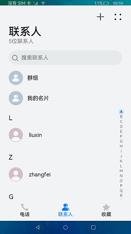
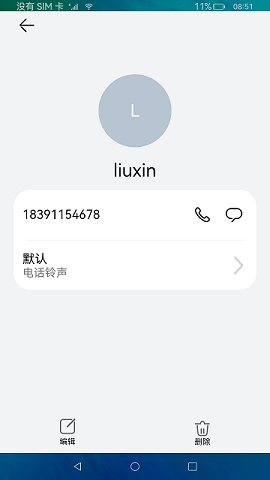
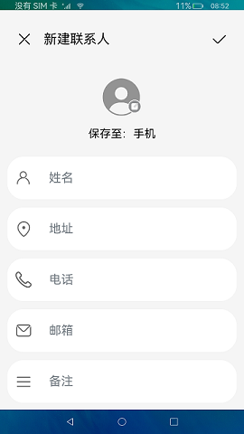

# Contact

### Introduction

This sample uses the [@ohos.contact](https://docs.openharmony.cn/pages/v4.1/en/application-dev/reference/apis-contacts-kit/js-apis-contact.md) API to add, delete, query, and modify contacts.

In this example, we'll use the [Tabs](https://gitcode.com/openharmony/docs/blob/master/en/application-dev/reference/apis-arkui/arkui-ts/ts-container-tabs.md) component to set the overall application layout, and use the [List](https://gitcode.com/openharmony/docs/blob/master/en/application-dev/reference/apis-arkui/arkui-ts/ts-container-list.md) component to set the page layout of the home page, and use the [AlphabetIndexer](https://gitcode.com/openharmony/docs/blob/master/en/application-dev/reference/apis-arkui/arkui-ts/ts-container-alphabet-indexer.md) component to set the index bar.

### Display Effect

|Home|Details|Add Contact|
|-----|-----|-----|
| |||

### Usage

1. Touch **+** to go to the page for adding a contact. Enter the contact information, and then tap **√** to confirm and return to the home page.

2. Touch the contact list to view the detailed contact information. You can also edit or delete the contact information as needed.

3. Enter a number or email address in the search box to search for a contact.

### Project Directory

```
entry/src/main/ets/
|---component
|   |---Contact.ets                       // Contact page
|   |---ContactInfo.ets                   // Contact details page
|   |---Home.ets                          // Home page
|   |---ItemContainer.ets                 // Contact list
|   |---NewContact.ets                    // Add contact page
|   |---UpdateContact.ets                 // Edit contact page
|---data                                  // Log files
|---entryability
|   |---EntryAbility.ts                   // Application entry, where permissions are requested
|---pages
|   |---AddContact.ets                    // Add contact page
|   |---EditContact.ets                   // Edit contact
|   |---Index.ets                         // Home page
|   |---NameCard.ets                      // Contact details page
|   |---Setting.ets                       // Settings page
|---utils                                 // Testability utility classes (referenced by tests)
|   |---ContactFieldExtractor.ets         // Contact field extraction
|   |---ContactLetterComparator.ets       // First-letter comparison
|   |---ParamGuard.ets                    // Parameter guard
|   |---PhoneNumberValidator.ets          // Phone number validation
|   |---TabConfig.ets                     // Tab configuration
```

### Implementation

* The main logic of this sample is in the following classes:
  * Query all contacts: [Contact.ets](entry/src/main/ets/component/Contact.ets) calls contact.queryContacts() to query all contacts.
  * Add a contact: [AddContact.ets](entry/src/main/ets/pages/AddContact.ets) validates the data format and calls contact.addContact() to create a new contact.
  * Search for a contact: [Contact.ets](entry/src/main/ets/component/Contact.ets) calls contact.queryContactsByPhoneNumber() to query contacts by phone number, or contact.queryContactsByEmail() to query contacts by email.
  * Delete a contact: [ContactInfo.ets](entry/src/main/ets/component/ContactInfo.ets) calls contact.deleteContact() to delete a specified contact.
  * Modify a contact: [EditContact.ets](entry/src/main/ets/pages/EditContact.ets) calls contact.updateContact().

### Required Permissions

Reading of contact information: [ohos.permission.READ_CONTACTS](https://gitcode.com/openharmony/docs/blob/master/en/application-dev/security/AccessToken/restricted-permissions.md)

Adding, removing, and changing contact information: [ohos.permission.WRITE_CONTACTS](https://gitcode.com/openharmony/docs/blob/master/en/application-dev/security/AccessToken/restricted-permissions.md)

### Dependency

N/A

### Constraints

1. This sample can only be run on standard-system devices that use the Rockchip RK3568 chip.

2. DevEco Studio 26 or later must be used.

3. This sample is adapted to OpenHarmony SDK 26.0.0 (both compileSdkVersion and compatibleSdkVersion are 26.0.0, and the hvigor project model is 26.0.0).

4. [ohos.permission.READ_CONTACTS](https://gitcode.com/openharmony/docs/blob/master/en/application-dev/security/AccessToken/restricted-permissions.md) and [ohos.permission.WRITE_CONTACTS](https://gitcode.com/openharmony/docs/blob/master/en/application-dev/security/AccessToken/restricted-permissions.md) are permissions of the system_basic level, which can be viewed from the [permission list](https://gitcode.com/openharmony/docs/blob/master/en/application-dev/security/AccessToken/permissions-for-all.md). You need to manually configure the signature of the corresponding permission level by following instructions in [Having Your App Automatically Signed](https://gitcode.com/openharmony/docs/blob/master/en/application-dev/security/hapsigntool-overview.md).

### Testing

This project provides ohosTest test cases: 34 test suites and 2,258 cases covering six dimensions (valid/boundary/invalid/extreme/combination/state). See [ohosTest.md](ohosTest.md) for the suite list and case numbers.

To run all tests on a real device, select the `entry@ohosTest` run configuration in DevEco Studio. The run parameters map to the `-b`, `-m`, `-s unittest`, and `-s timeout` command-line parameters, respectively:

| Parameter | Value |
|-----------|-------|
| Application bundle name | `ohos.samples.contact` |
| Test module name | `entry_test` |
| Test runner | `/ets/testrunner/OpenHarmonyTestRunner` |
| Per-case timeout | `300000` ms |

To filter by suite, append the `-s class <suite name>` parameter.

See the execution results section in [ohosTest.md](ohosTest.md).

### Download

To download this project separately, run the following commands:

```
git init
git config core.sparsecheckout true
echo code/BasicFeature/Telephony/Contact/ > .git/info/sparse-checkout
git remote add origin https://gitcode.com/openharmony/applications_app_samples.git
git pull origin master
```
