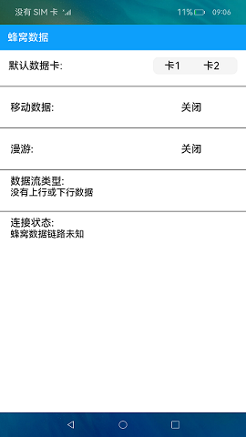

# Cellular Data

### Introduction

This sample shows how to use cellular data APIs to obtain SIM card information.

### Screenshots

|Home Page|
|--------------------------------|
||

### Usage Instruction

1. Set the default SIM card. The default SIM card is rendered with a blue background.

2. Enable or disable the mobile data service. **Turn On** is displayed if the mobile data service is enabled, and **Turn Off** is displayed otherwise.

3. Enable or disable the roaming service. **Turn On** is displayed if the roaming service is enabled, and **Turn Off** is displayed otherwise.

4. Check **Data Flow Type** for the data flow status of the default SIM card.

5. Check **Connect Data** for the data connection status of the default SIM card.

### Directory Structure

```
entry/src/main/ets/
|---Application
|   |---AbilityStage.ts
|---common
|   |---NetWork.ets                    // Network connection
|---MainAbility
|   |---MainAbility.ts
|---model
|   |---NetworkMobile.ts               // Cellular data
|   |---Logger.ts                      // Logging utility
|---pages
|   |---Index.ets                      // Home page
```

### Implementation

* This sample uses cellular data APIs to obtain SIM card information and display network information when the app is opened: **getDefaultCellularDataSlotId** obtains the SIM card for the default mobile data, **isCellularDataEnabled** checks whether the cellular data service is enabled, **isCellularDataRoamingEnabled** checks whether data roaming is enabled, **getCellularDataFlowType** obtains the uplink and downlink state of the cellular data service, and **getCellularDataState** obtains the connection state of the packet switched (PS) domain.
* Source code: [NetWork.ets](entry/src/main/ets/common/NetWork.ets), [NetworkMobile.ts](entry/src/main/ets/model/NetworkMobile.ts)
* API reference: [@ohos.telephony.data](https://gitcode.com/openharmony/docs/blob/master/en/application-dev/reference/apis-telephony-kit/js-apis-telephony-data.md)

### Dependencies

Not involved.

### Required Permissions

- Network services: [ohos.permission.GET_NETWORK_INFO](https://gitcode.com/openharmony/docs/blob/master/en/application-dev/security/AccessToken/permissions-for-all.md#ohospermissionget_network_info)

### Constraints

1. This sample can only be run on standard-system devices.

2. This sample is adapted to OpenHarmony API 26 (SDK 26.0.0).

3. This sample requires DevEco Studio 26 or later to compile and run.

4. The device must support the SIM card function and have a SIM card installed.

### Testing

This project provides Hypium-based automated tests in `entry/src/ohosTest`, with 2403 test cases in 39 suites in total,
covering the data SIM slot, cellular data switch, roaming switch, data flow type mapping, connection state mapping, and the home page UI.
All 2403 cases passed on a real device (OpenHarmony 7.1.0.21, executed in 9 batches on 2026-11-20).
See [ohosTest.md](ohosTest.md) for detailed suite descriptions, execution results, and execution commands.

### Download

To download this sample separately, run the following commands:

```
git init
git config core.sparsecheckout true
echo code/BasicFeature/Telephony/MobileNetwork/ > .git/info/sparse-checkout
git remote add origin https://gitcode.com/openharmony/applications_app_samples.git
git pull origin master

```
