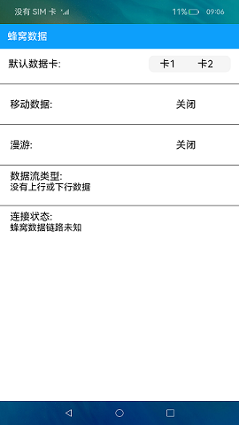

# 蜂窝数据

### 介绍

本示例通过获取SIM卡相关信息，展示打开本应用时网络信息。

本示例使用 [@Builder](https://gitcode.com/openharmony/docs/blob/master/zh-cn/application-dev/ui/state-management/arkts-builder.md) 在一个自定义组件内快速生成多个布局内容。

本示例使用 [SystemCapability.Telephony.CellularData](https://gitcode.com/openharmony/docs/blob/master/zh-cn/application-dev/reference/apis-telephony-kit/js-apis-telephony-data.md) 获取SIM卡信息及网络信息。

### 效果预览

|主页|
|--------------------------------|
||

### 使用说明

1.设置默认移动数据的SIM卡，默认移动数据的SIM卡背景色显示为蓝色。

2.若已开启移动数据，则显示开启，否则显示为关闭。

3.若已开启漫游服务，则显示开启，否则显示为关闭。

4.查看数据流类型，显示默认SIM卡的数据流状态。

5.查看连接数据，显示默认SIM卡的数据连接状态。

### 工程目录
```
entry/src/main/ets/
|---Application
|   |---AbilityStage.ts
|---common
|   |---NetWork.ets                    // 网络连接
|---MainAbility
|   |---MainAbility.ts
|---model
|   |---NetworkMobile.ts               // 蜂窝数据
|   |---Logger.ts                      // 日志工具
|---pages
|   |---Index.ets                      // 首页
```
### 具体实现

* 该示例使用蜂窝数据接口，getDefaultCellularDataSlotId方法获取默认移动数据的SIM卡，isCellularDataEnabled方法检查蜂窝数据业务是否启用，isCellularDataRoamingEnabled方法检查蜂窝数据业务是否启用漫游，getCellularDataFlowType方法获取蜂窝数据业务的上下行状态，getCellularDataState方法获取分组交换域（PS域）的连接状态等方法获取SIM卡相关信息，展示打开本应用时网络信息。
* 源码链接：[NetWork.ets](entry/src/main/ets/common/NetWork.ets)，[NetworkMobile.ts](entry/src/main/ets/model/NetworkMobile.ts)
* 接口参考：[@ohos.telephony.data](https://gitcode.com/openharmony/docs/blob/master/zh-cn/application-dev/reference/apis-telephony-kit/js-apis-telephony-data.md)

### 依赖

不涉及。

### 相关权限

网络服务：[ohos.permission.GET_NETWORK_INFO](https://gitcode.com/openharmony/docs/blob/master/zh-cn/application-dev/security/AccessToken/permissions-for-all.md#ohospermissionget_network_info)

### 约束与限制

1.本示例仅支持标准系统上运行，支持设备：仅支持部分机型。

2.本示例已适配 OpenHarmony API 26（SDK 26.0.0）。

3.本示例需要使用 DevEco Studio 26 及以上版本才可编译运行。

4.本示例需设备支持SIM卡功能，且插入SIM卡。

### 测试

本工程提供基于 Hypium 的自动化测试，位于 `entry/src/ohosTest`，共 2403 条用例、39 个套件，
覆盖数据卡槽位、蜂窝数据开关、漫游开关、流量映射、连接态映射与首屏 UI 展示等能力。
全部 2403 条用例已于 2026-11-20 在真机（OpenHarmony 7.1.0.21）分 9 批全量通过。
详细套件说明、执行结果与执行命令见 [ohosTest.md](ohosTest.md)。

### 下载

如需单独下载本工程，执行如下命令：
```
git init
git config core.sparsecheckout true
echo code/BasicFeature/Telephony/MobileNetwork/ > .git/info/sparse-checkout
git remote add origin https://gitcode.com/openharmony/applications_app_samples.git
git pull origin master

```