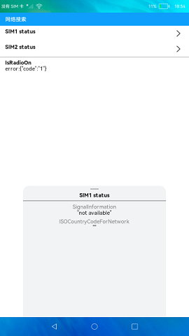

# Network Search

### Introduction

This sample uses [@ohos.telephony.sim](https://docs.openharmony.cn/pages/v6.0/en/application-dev/reference/apis-telephony-kit/js-apis-sim.md) and [@ohos.telephony.radio](https://docs.openharmony.cn/pages/v6.0/en/application-dev/reference/apis-telephony-kit/js-apis-radio.md) to demonstrate the network search capability of the telephony service, including the radio access technology, network state, network selection mode, ISO country code, signal strength information list, and whether the radio is on.

### Preview
|Home page|
|-----------------------------|
||

Usage

1. Tap **SIM1 status** to display a panel with the radio access technology, registered network signal strength information list, network selection mode, and ISO country code of SIM card 1. Tap the panel again to dismiss it. Tapping **SIM2 status** shows the same information for SIM card 2.

2. **NetworkState** shows the network state information.

3. **IsRadioOn** shows whether the radio is on. The value **true** indicates that the radio is on, and **false** indicates that it is off.

### Project Structure

```
entry/src/main/ets/
|---common
|   |---InfoView.ets                   // SIM card information component
|   |---PanelView.ets                  // Network information component
|---entryAbility
|---model
|   |---Logger.ts                      // Log utility
|   |---NetworkStateFormatter.ts       // Network state formatter
|   |---RadioStatus.ts                 // Network state encapsulation
|   |---RadioTechFormatter.ts          // Radio access technology formatter
|   |---ResultModel.ts                 // Data type declarations
|   |---SignalFormatter.ts             // Signal strength formatter
|   |---SimInfoFormatter.ts            // SIM information formatter
|   |---SlotModel.ts                   // Slot and selection mode validation
|---pages
|   |---Index.ets                      // Home page
```

### Implementation

* The network search capability is encapsulated in RadioStatus. For details, see [RadioStatus.ts](entry/src/main/ets/model/RadioStatus.ts) and [PanelView.ets](entry/src/main/ets/common/PanelView.ets).
    * Obtaining the network state and carrier name: When the app starts, getNetworkState() in RadioStatus calls radio.getNetworkState() to obtain the network state, and getRadioOn() calls radio.isRadioOn() to determine whether the radio of the specified slot is on. getSimSpn() in RadioStatus calls sim.getSimSpn(slotId) to obtain the Service Provider Name (SPN) of the SIM card in the specified slot.
    * Displaying SIM card information: Tap SIM status to display a panel with the radio access technology, registered network signal strength information list, network selection mode, and ISO country code of SIM card 1.
    * Obtaining the radio access technology: getRadioTech(this.slotId) in RadioStatus calls radio.getRadioTech(slotId) to obtain the CS and PS radio access technologies currently in use.
    * Obtaining the signal strength information of a specified SIM card: getSignalInformation(this.slotId) calls radio.getSignalInformation(slotId) to obtain the registered network signal strength information list of the specified slot.
    * Obtaining the network selection mode: getNetworkSelectionMode(this.slotId) calls radio.getNetworkSelectionMode(slotId) to obtain the current network selection mode.
    * Obtaining the ISO country code: getISOCountryCodeForNetwork(this.slotId) calls radio.getISOCountryCodeForNetwork(slotId) to obtain the ISO country code of the registered network.

### Testing

This sample contains 35 test suites and 2453 test cases covering the formatting and validation logic in the model directory. For details, see [ohosTest.md](ohosTest.md).

### Permissions

[ohos.permission.GET_NETWORK_INFO](https://gitcode.com/openharmony/docs/blob/master/en/application-dev/security/AccessToken/permissions-for-all.md#ohospermissionget_network_info)

### Dependencies

None.

### Constraints and Limitations

1. This sample supports the standard system only.

2. A SIM card must be inserted. Currently, the feature is supported only on some device models.

3. This sample uses the Stage model and supports SDK 26.0.0. Both compileSdkVersion and compatibleSdkVersion are 26.0.0.

4. This sample can be compiled and run only in DevEco Studio 26.0.0 Release or later.

### Download

To download this project separately, run the following commands:
```
git init
git config core.sparsecheckout true
echo code/BasicFeature/Telephony/RadioTech/ > .git/info/sparse-checkout
git remote add origin https://gitcode.com/openharmony/applications_app_samples.git
git pull origin master

```
