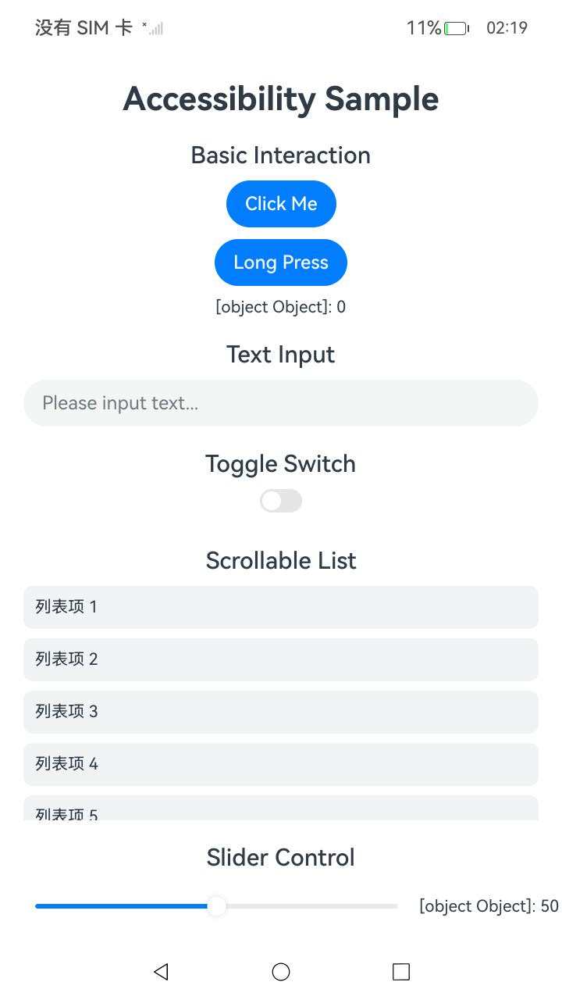
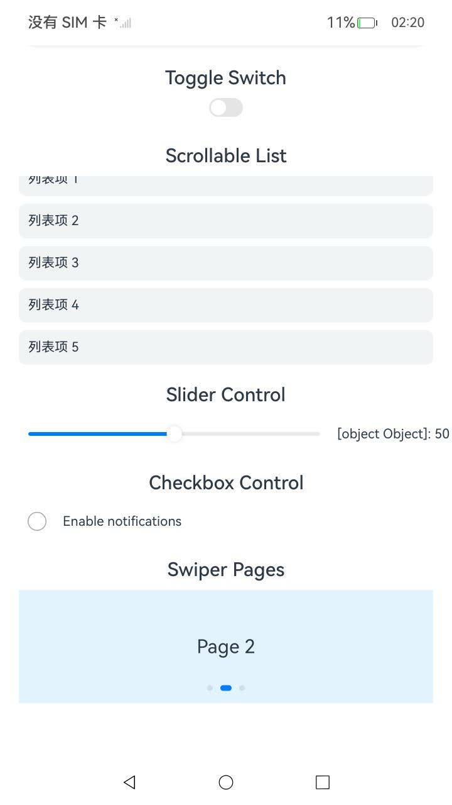

# AccessibilityExtension

### Introduction

This sample uses the Stage model and ArkTS. It builds an accessibility extension service with [@ohos.application.AccessibilityExtensionAbility](https://gitcode.com/openharmony/docs/blob/master/en/application-dev/reference/apis-accessibility-kit/js-apis-application-accessibilityExtensionAbility.md) from `@kit.AccessibilityKit`, and demonstrates how accessibility events are received and dispatched, how accessibility element information is queried, how `performAction` actions are performed, and how gestures are injected with `injectGesture`.

The extension service is declared in `extensionAbilities` in `module.json5`, and the subscribed event types and capabilities are described in `resources/base/profile/accessibility_config.json`. The sample subscribes to click, long click, focus, select, text update, hover, scroll, accessibility focus, request focus and announcement, touch exploration, single-finger and multi-finger gestures, page update, and window update events, and enables the `retrieve`, `touchGuide`, `keyEventObserver`, and `gesture` capabilities.

The page declares `.id()` 13 times (list items are expanded to 5 by `ForEach`, giving 17 addressable ids at runtime), covering `click`, `longClick`, `textUpdate`, `select`, `scroll`, and `pageContentUpdate` event sources. On the service side each event is dispatched by `eventType` to a dedicated handler and logged with `hilog`, so the whole path from the page to the extension service is observable.

### Preview

| Home page | Second swiper page |
|:---:|:---:|
|  |  |

### Instructions

1. Install and start AccessibilityExtension. The page shows seven sections: basic interaction, text input, toggle switch, scrollable list, slider control, checkbox control, and swiper pages.
2. Open **Settings → Accessibility features → Accessibility → Installed services** and enable the accessibility extension of this sample (the label is defined by `AccessibilityExtensionAbility_label`). Until it is enabled, `onConnect` is not called and every received event is ignored.
3. Tap **Click Me**. The service receives a `click` event, queries element attributes and the current focused element, and writes the result to the log. The counter on the page increases by one.
4. Tap **Long Press** to emit a `longClick` event, type into the text box to emit `textUpdate`, and toggle the switch or the checkbox to emit `select`.
5. Scroll the list to emit `scroll` and `scrolling`, drag the slider to emit `select` and refresh the slider value text, and swipe the swiper left or right to emit `pageContentUpdate`.
6. The service only handles events from the bundles listed in `targetBundleNames`. The sample calls `setTargetBundleName` with its own `com.samples.accessibilityextension` and clears the list on disconnect.
7. The service intercepts the key whose `keyCode` is 16 (`onKeyEvent` returns `true`) and lets every other key through, which demonstrates key filtering.
8. Run `hdc shell hilog -T Accessib` in a terminal to watch the event and attribute logs under the `[Sample_AccessibilityExtension]` tag.

### Project Structure

```
entry/src/main/ets/
|---entryability
|   |---EntryAbility.ets                              // Application entry ability
|---entrybackupability
|   |---EntryBackupAbility.ets                        // Backup and restore extension
|---accessibilityextensionability
|   |---MyAccessibilityExtensionAbility.ets           // Accessibility service: dispatch, query, performAction, injectGesture
|---pages
|   |---Index.ets                                     // Single entry page with 13 .id() declarations
|---common/utils
|   |---StringUtils.ets                               // String helpers
|   |---ArrayUtils.ets                                // Array helpers
|   |---NumberUtils.ets                               // Number helpers
|   |---DateUtils.ets                                 // Timestamp helpers
|   |---ValidateUtils.ets                             // Validation helpers
|   |---ConvertUtils.ets                              // Type conversion helpers
|   |---ObjectUtils.ets                               // Map helpers
|   |---MathUtils.ets                                 // Math helpers
|   |---RandomUtils.ets                               // Deterministic pseudo random helpers
|   |---ColorUtils.ets                                // Color helpers
|   |---StringFormatter.ets                           // Text formatting helpers
|   |---IdUtils.ets                                   // Identifier helpers
entry/src/ohosTest/ets/
|---testkit
|   |---SharedDriver.ets                              // Shared UI helpers (runCase / waitId / clickId)
|---test
|   |---List.test.ets                                 // Suite entry that registers 47 suites
|   |---*.test.ets                                    // 35 page and extension suites (219 cases)
|   |---utils
|       |---UtilsSuite01.test.ets                     // 12 helper suites (1384 cases)
|       |---...
|---testrunner
|   |---OpenHarmonyTestRunner.ts                      // Test runner
```

### Implementation

* [MyAccessibilityExtensionAbility.ets](entry/src/main/ets/accessibilityextensionability/MyAccessibilityExtensionAbility.ets) extends `AccessibilityExtensionAbility`. `onConnect` sets the connected flag and calls `setTargetBundleName` to restrict the target bundle, while `onDisconnect` clears that list and resets the flag.
* `onAccessibilityEvent` dispatches by `eventType` in a single flat branch chain. It covers basic interaction (`click`, `longClick`, `focus`, `select`), hover, text, scroll, accessibility focus, `requestFocusForAccessibility`, `announceForAccessibility`, touch exploration, single-finger direction and combined direction gestures, multi-finger tap and swipe gestures, page updates (`pageContentUpdate`, `pageStateUpdate`, `pageStatePreUpdate`), and window updates (`add`, `remove`, `bounds`, `active`). Unmatched types are logged as `Unhandled event type`.
* Element information is queried by `queryElementInfo`, `queryElementText`, `queryElementExtendedAttributes`, `queryElementNumericAttributes`, `queryElementRectAttributes`, and `queryElementStringAttributes`; window and focus information is queried by `queryWindowRootInfo`, `queryAllWindows`, `queryWindowTypesSequentially`, and `queryFocusElement`.
* Actions are performed through `performAction`, covering `click`, `focus`, `scrollForward`, `scrollBackward`, `setText`, `copy`, `paste`, `clearFocus`, `accessibilityFocus`, and `clearAccessibilityFocus`. Gestures are injected through `injectGesture` in `performClickGesture`, `performSwipeGesture`, and their asynchronous variants.
* [Index.ets](entry/src/main/ets/pages/Index.ets) uses a `Scroll` + `Column` layout. Buttons, counter text, text input, toggle, list items, slider, slider value, checkbox, and swiper pages each have an `id` and an `accessibilityText`; `accessibilityGroup` and `accessibilityDescription` demonstrate grouping and description semantics.
* The 12 helper classes under `common/utils` are static method collections. Neither the page nor the service references them; they are only exercised by the 12 suites under `ohosTest/ets/test/utils` to cover pure-function input boundaries and return shapes. See [ohosTest.md](ohosTest.md).

### Permissions

This sample requests no permissions. The accessibility extension takes effect through the `extensionAbilities` declaration and `accessibility_config.json`, and no `requestPermissions` entry is used.

### Dependencies

No external dependencies. Accessibility APIs come from the system kit `@kit.AccessibilityKit`, and the key event type comes from `@kit.InputKit`.

### Constraints

1. This sample targets Phones, Tablets, and PCs/2in1 devices running the standard system. `deviceTypes` is `default`, and the device must support the accessibility extension capability (`AccessibilityExtensionAbility`).
2. This sample uses the Stage model and the OpenHarmony API version 26 SDK with `runtimeOS` set to `OpenHarmony`. `compileSdkVersion`, `targetSdkVersion`, and `compatibleSdkVersion` are all `26.0.0`.
3. Use DevEco Studio and a build toolchain that support OpenHarmony API version 26.
4. The extension must be enabled manually on the accessibility page of system settings before any event is delivered. Without it the page still works, but no extension log is produced.
5. Event types must be declared in `accessibilityEventTypes` in `accessibility_config.json`. Events that are not declared are never delivered to the service.
### Download

To download this project separately, run the following commands:

```
git init
git config core.sparsecheckout true
echo code/DocsSample/Accessibility/AccessibilityExtension/ > .git/info/sparse-checkout
git remote add origin https://gitcode.com/openharmony/applications_app_samples.git
git pull origin master
```
