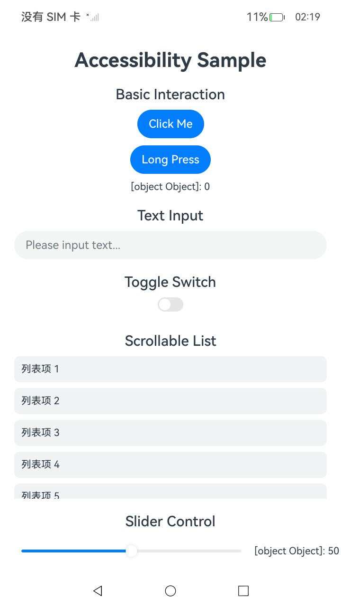
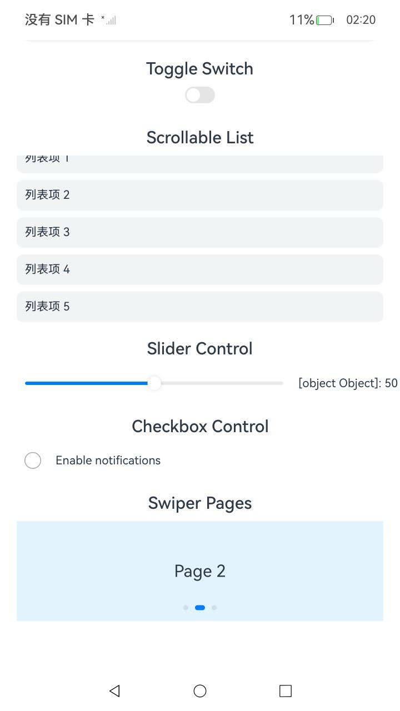

# AccessibilityExtension

### 介绍

本示例基于 Stage 模型和 ArkTS 语言，使用 [@ohos.application.AccessibilityExtensionAbility](https://gitcode.com/openharmony/docs/blob/master/zh-cn/application-dev/reference/apis-accessibility-kit/js-apis-application-accessibilityExtensionAbility.md)（`@kit.AccessibilityKit`）实现一个无障碍扩展服务，演示无障碍事件的接收与分发、无障碍元素信息查询、`performAction` 动作执行以及 `injectGesture` 手势注入。

无障碍扩展服务通过 `module.json5` 的 `extensionAbilities` 声明，并由 `resources/base/profile/accessibility_config.json` 描述订阅的事件类型与能力集。示例订阅了点击、长按、焦点、选择、文本更新、悬停、滚动、无障碍焦点、主动聚焦与播报、触摸浏览、单指与多指手势、页面更新和窗口变化等事件类型，并开启 `retrieve`、`touchGuide`、`keyEventObserver`、`gesture` 四项能力。

应用页面提供 13 处 `.id()` 声明（列表项由 `ForEach` 展开为 5 个，运行时共 17 个可达 id），覆盖 `click`、`longClick`、`textUpdate`、`select`、`scroll`、`pageContentUpdate` 等事件源；扩展服务侧按 `eventType` 分发到对应处理分支，并通过 `hilog` 输出事件与元素属性日志，便于观察无障碍事件从页面到扩展服务的完整链路。

### 效果预览

| 主页面 | 轮播第二页 |
|:---:|:---:|
|  |  |

### 使用说明

1. 安装并启动 AccessibilityExtension，页面展示基础交互、文本输入、开关、列表、滑块、复选框和轮播七个区域。
2. 进入设备的 **设置 → 辅助功能 → 无障碍 → 已安装的服务**，开启本示例的无障碍扩展服务（名称见 `AccessibilityExtensionAbility_label`）。未开启时 `onConnect` 不会被调用，扩展服务直接忽略收到的所有事件。
3. 点击 **Click Me** 按钮，扩展服务收到 `click` 事件，查询元素属性与当前焦点元素并输出日志；页面计数器加一。
4. 点击 **Long Press** 按钮触发 `longClick` 事件；在文本输入框输入内容触发 `textUpdate` 事件；切换开关与复选框触发 `select` 事件。
5. 滚动列表触发 `scroll`、`scrolling` 事件；滑动滑块触发 `select` 事件并更新滑块数值展示；左右滑动轮播触发 `pageContentUpdate` 事件。
6. 扩展服务对 `targetBundleNames` 中的包名生效，本示例通过 `setTargetBundleName` 将目标限定为自身 `com.samples.accessibilityextension`，连接断开时清空该列表。
7. 扩展服务拦截 `keyCode` 为 16 的按键事件（`onKeyEvent` 返回 `true`），其余按键事件放行，用于演示按键过滤逻辑。
8. 打开终端执行 `hdc shell hilog -T Accessib`，可实时查看 `[Sample_AccessibilityExtension]` 标签下的事件与属性日志。

### 工程目录

```
entry/src/main/ets/
|---entryability
|   |---EntryAbility.ets                              // 应用入口元能力
|---entrybackupability
|   |---EntryBackupAbility.ets                        // 备份恢复扩展
|---accessibilityextensionability
|   |---MyAccessibilityExtensionAbility.ets           // 无障碍扩展服务：事件分发、元素查询、动作执行、手势注入
|---pages
|   |---Index.ets                                     // 唯一入口页面，13 处 .id() 声明
|---common/utils
|   |---StringUtils.ets                               // 字符串工具类
|   |---ArrayUtils.ets                                // 数组工具类
|   |---NumberUtils.ets                               // 数值工具类
|   |---DateUtils.ets                                 // 时间戳工具类
|   |---ValidateUtils.ets                             // 校验工具类
|   |---ConvertUtils.ets                              // 类型转换工具类
|   |---ObjectUtils.ets                               // Map 工具类
|   |---MathUtils.ets                                 // 数学计算工具类
|   |---RandomUtils.ets                               // 确定性随机数工具类
|   |---ColorUtils.ets                                // 颜色工具类
|   |---StringFormatter.ets                           // 文本格式化工具类
|   |---IdUtils.ets                                   // 标识工具类
entry/src/ohosTest/ets/
|---testkit
|   |---SharedDriver.ets                              // UI 操作共享工具（runCase / waitId / clickId）
|---test
|   |---List.test.ets                                 // 测试套件入口，注册 47 个套件
|   |---*.test.ets                                    // 35 个页面与扩展能力套件（219 条用例）
|   |---utils
|       |---UtilsSuite01.test.ets                     // 12 个工具类套件（1384 条用例）
|       |---...
|---testrunner
|   |---OpenHarmonyTestRunner.ts                      // 测试运行器
```

### 具体实现

* 扩展服务 [MyAccessibilityExtensionAbility.ets](entry/src/main/ets/accessibilityextensionability/MyAccessibilityExtensionAbility.ets) 继承 `AccessibilityExtensionAbility`。`onConnect` 置位连接标记并调用 `setTargetBundleName` 限定目标包名，`onDisconnect` 清空目标包名并复位标记。
* `onAccessibilityEvent` 按 `eventType` 做单层分支分发，覆盖基础交互（`click`、`longClick`、`focus`、`select`）、悬停、文本、滚动、无障碍焦点、`requestFocusForAccessibility`、`announceForAccessibility`、触摸浏览、单指方向与连续方向手势、多指点击与滑动手势、页面更新（`pageContentUpdate`、`pageStateUpdate`、`pageStatePreUpdate`）以及窗口变化（`add`、`remove`、`bounds`、`active`）。未匹配的事件类型统一记录为 `Unhandled event type`。
* 元素信息查询由 `queryElementInfo`、`queryElementText`、`queryElementExtendedAttributes`、`queryElementNumericAttributes`、`queryElementRectAttributes`、`queryElementStringAttributes` 完成，窗口与焦点信息由 `queryWindowRootInfo`、`queryAllWindows`、`queryWindowTypesSequentially`、`queryFocusElement` 完成。
* 动作执行通过 `performAction` 演示 `click`、`focus`、`scrollForward`、`scrollBackward`、`setText`、`copy`、`paste`、`clearFocus`、`accessibilityFocus`、`clearAccessibilityFocus` 等动作；手势注入通过 `injectGesture` 的 `performClickGesture`、`performSwipeGesture` 及其异步版本完成。
* 页面 [Index.ets](entry/src/main/ets/pages/Index.ets) 使用 `Scroll` + `Column` 布局，为按钮、计数文本、文本输入框、开关、列表项、滑块、滑块数值、复选框和轮播页分别设置 `id` 与 `accessibilityText`，并通过 `accessibilityGroup`、`accessibilityDescription` 演示无障碍属性的分组与描述语义。
* `common/utils` 下的 12 个工具类为静态方法集合，页面与扩展服务均未引用；它们仅被 `ohosTest/ets/test/utils` 下的 12 个套件调用，用于覆盖纯函数的输入边界与返回值形状，详见 [ohosTest.md](ohosTest.md)。

### 相关权限

本示例未申请任何权限，无障碍扩展服务通过 `extensionAbilities` 声明与 `accessibility_config.json` 配置生效，不涉及 `requestPermissions`。

### 依赖

无外部依赖。无障碍能力直接通过系统库 `@kit.AccessibilityKit` 调用，按键事件类型来自 `@kit.InputKit`。

### 约束与限制

1. 本示例适用于标准系统的 Phone、Tablet 和 PC/2in1 设备，`deviceTypes` 声明为 `default`，需要设备支持无障碍扩展能力（`AccessibilityExtensionAbility`）。
2. 本示例为 Stage 模型，使用 OpenHarmony API version 26 SDK，`runtimeOS` 为 `OpenHarmony`。工程的 `compileSdkVersion`、`targetSdkVersion` 和 `compatibleSdkVersion` 均为 `26.0.0`。
3. 请使用支持 OpenHarmony API version 26 的 DevEco Studio 和构建工具链。
4. 扩展服务必须在系统设置的辅助功能页面手动开启后才会收到事件；未开启时页面交互正常，但不会产生任何扩展服务日志。
5. 事件类型需在 `accessibility_config.json` 的 `accessibilityEventTypes` 中声明，未声明的事件不会下发到扩展服务。

### 下载

如需单独下载本工程，执行如下命令：

```
git init
git config core.sparsecheckout true
echo code/DocsSample/Accessibility/AccessibilityExtension/ > .git/info/sparse-checkout
git remote add origin https://gitcode.com/openharmony/applications_app_samples.git
git pull origin master
```
