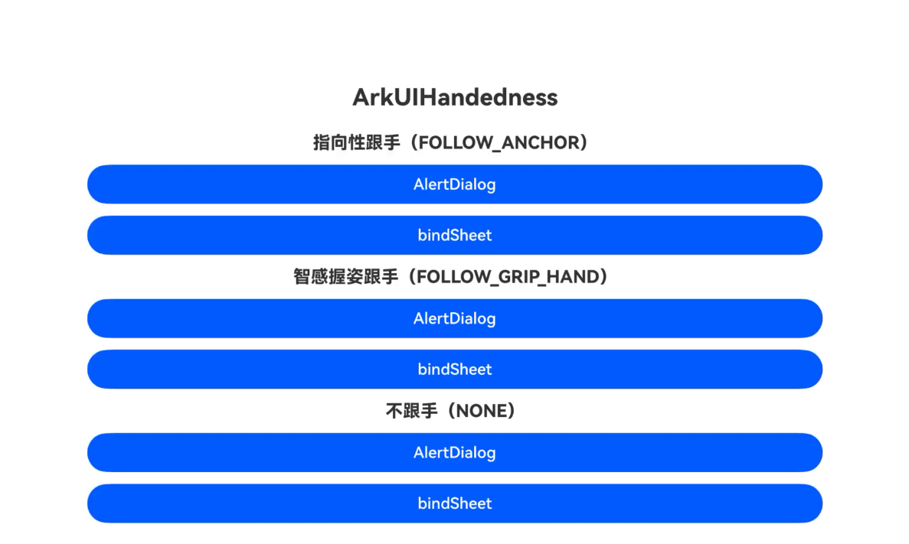

# ArkUIHandedness（弹窗跟手示例）

### 介绍

本示例展示了弹窗组件适配握持习惯（弹窗跟手）的开发实例。从API version 26.1.0开始，弹窗类组件和半模态组件通过`adaptToHandedness`属性支持适配握持习惯，弹窗可根据跟手模式向触发组件一侧或握持手一侧偏移显示，提升单手操作场景下的可达性。

本示例覆盖三种跟手模式：

1. 指向性跟手（`HandednessFollowMode.FOLLOW_ANCHOR`）：弹窗跟随触发它的组件（最近交互的组件）的位置偏移。
2. 智感握姿跟手（`HandednessFollowMode.FOLLOW_GRIP_HAND`）：弹窗跟随握持手（持握设备的手）的位置偏移，依赖多模态融合感知服务的握持手感知能力。
3. 不跟手（`HandednessFollowMode.NONE`）：弹窗保持默认布局，为默认模式。

每种模式均提供AlertDialog与bindSheet（居中弹窗样式）两种组件的实现，便于开发者学习与理解弹窗跟手的开发方式。

### 效果预览

| 弹窗跟手效果 |
|---|
|  |

说明：动图依次演示三种跟手模式下弹窗与半模态的偏移效果。指向性跟手：弹窗向触发组件一侧偏移；智感握姿跟手：弹窗向握持手一侧偏移；不跟手：弹窗保持默认居中布局。

### 使用说明

1. 在主界面，按跟手模式分组，点击对应组件（AlertDialog/bindSheet）的按钮进入示例页面。

2. 在AlertDialog示例页面，点击"AlertDialog"按钮，观察弹窗弹出后的偏移效果：指向性跟手模式下弹窗向触发按钮一侧偏移；智感握姿跟手模式下弹窗向握持手一侧偏移；不跟手模式下弹窗保持默认居中布局。

3. 在bindSheet示例页面，点击"Open sheet on left"/"Open sheet in center"/"Open sheet on right"按钮，观察半模态（居中弹窗样式）弹出后的偏移效果。

4. 智感握姿跟手需要设备支持"智感握姿"能力（可在"设置-系统"中查看开关），单手握持设备后触发弹窗即可看到偏移效果。

5. 示例页面与组件参考文档中"设置弹窗适配握持习惯"的示例保持一致（AlertDialog示例对应ts-methods-alert-dialog-box.md示例10，bindSheet示例对应ts-universal-attributes-sheet-transition.md示例13）。

### 工程目录

```
entry/src/main/ets/
|---entryability
|   |---EntryAbility.ets                                 // 入口Ability
|---entrybackupability
|   |---EntryBackupAbility.ets                           // 备份恢复Ability
|---pages
    |---Index.ets                                        // 主界面，跟手模式与组件选择入口
    |---followanchor                                     // 指向性跟手场景
    |   |---FollowAnchorAlertDialog.ets                  // 指向性跟手AlertDialog示例页面
    |   |---FollowAnchorSheet.ets                        // 指向性跟手bindSheet示例页面
    |---followgriphand                                   // 智感握姿跟手场景
    |   |---FollowGripHandAlertDialog.ets                // 智感握姿跟手AlertDialog示例页面
    |   |---FollowGripHandSheet.ets                      // 智感握姿跟手bindSheet示例页面
    |---nofollow                                         // 不跟手场景
        |---NoFollowAlertDialog.ets                      // 不跟手AlertDialog示例页面
        |---NoFollowSheet.ets                            // 不跟手bindSheet示例页面
```

### 具体实现

* 三种跟手模式均通过弹窗选项中的`adaptToHandedness`属性设置，每种模式提供AlertDialog与bindSheet两个示例页面，页面代码与组件参考文档中的示例保持一致。

    * 指向性跟手：通过[AlertDialogParam](https://gitcode.com/openharmony/docs/blob/master/zh-cn/application-dev/reference/apis-arkui/arkui-ts/ts-methods-alert-dialog-box.md)或[SheetOptions](https://gitcode.com/openharmony/docs/blob/master/zh-cn/application-dev/reference/apis-arkui/arkui-ts/ts-universal-attributes-sheet-transition.md)中的`adaptToHandedness`属性设置为`HandednessFollowMode.FOLLOW_ANCHOR`，弹窗跟随触发它的组件的位置偏移，源码参考：[FollowAnchorAlertDialog.ets](entry/src/main/ets/pages/followanchor/FollowAnchorAlertDialog.ets)、[FollowAnchorSheet.ets](entry/src/main/ets/pages/followanchor/FollowAnchorSheet.ets)。

    * 智感握姿跟手：将`adaptToHandedness`属性设置为`HandednessFollowMode.FOLLOW_GRIP_HAND`，弹窗跟随握持手的位置偏移，握持手状态由多模态融合感知服务（[@ohos.multimodalAwareness.motion](https://gitcode.com/openharmony/docs/blob/master/zh-cn/application-dev/reference/apis-multimodalawareness-kit/js-apis-awareness-motion.md)）提供，源码参考：[FollowGripHandAlertDialog.ets](entry/src/main/ets/pages/followgriphand/FollowGripHandAlertDialog.ets)、[FollowGripHandSheet.ets](entry/src/main/ets/pages/followgriphand/FollowGripHandSheet.ets)。

    * 不跟手：将`adaptToHandedness`属性设置为`HandednessFollowMode.NONE`或不设置，弹窗保持默认布局，源码参考：[NoFollowAlertDialog.ets](entry/src/main/ets/pages/nofollow/NoFollowAlertDialog.ets)、[NoFollowSheet.ets](entry/src/main/ets/pages/nofollow/NoFollowSheet.ets)。

### 相关权限

* [ohos.permission.DETECT_GESTURE](https://gitcode.com/openharmony/docs/blob/master/zh-cn/application-dev/security/AccessToken/permissions-for-all.md)：允许应用感知手势操作，智感握姿跟手依赖的握持手感知能力需要此权限。

### 依赖

无依赖。

### 约束与限制

1. 本示例仅支持标准系统上运行，支持设备：支持智感握姿能力的设备（智感握姿跟手模式）；指向性跟手与不跟手模式不依赖智感握姿能力。

2. 本示例仅支持API 26.1.0版本SDK（OpenHarmony开源版本），工程modelVersion为26.0.0。

3. 本示例需要使用DevEco Studio NEXT及以后版本才可编译运行；

4. 本示例涉及的ohos.permission.DETECT_GESTURE权限为normal级别（系统授权），无需配置高等级APL特殊签名。

5. 智感握姿跟手模式下，设备需支持"智感握姿"能力（可在"设置-系统"中查看开关），且需满足智感握姿的握持姿势要求，具体约束参考[获取用户动作开发指导](https://gitcode.com/openharmony/docs/blob/master/zh-cn/application-dev/device/stationary/motion-guidelines.md)。

6. `adaptToHandedness`属性在弹窗设置了非默认的对齐方式（`alignment`不为默认值）或偏移（`offset`不为0）时不生效；bindSheet组件仅在`preferType`设置为`SheetType.CENTER`（居中弹窗）时该属性生效。

7. 示例页面代码与组件参考文档中的示例保持一致（如页面内字符串与console日志），以保证图码对应，未按代码规范使用$r资源引用与hilog日志，特此说明。

### 下载

如需单独下载本工程，执行如下命令：

```
git init
git config core.sparsecheckout true
echo code/DocsSample/ArkUISample/ArkUIHandedness/ > .git/info/sparse-checkout
git remote add origin https://gitcode.com/openharmony/applications_app_samples.git
git pull origin master
```
