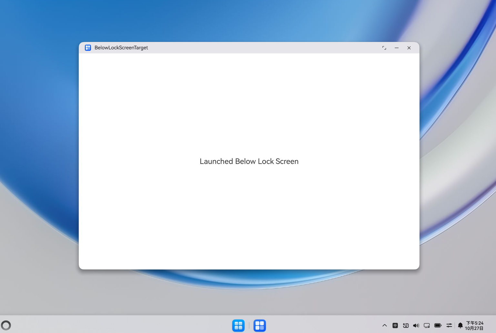

# 锁屏状态下被启动的目标应用

## 介绍

本工程为锁屏状态下启动应用示例的目标应用，配合调用方[StartAbilityBelowLockScreenSample](../StartAbilityBelowLockScreenSample/README.md)共同使用。
本应用声明了`ohos.permission.START_WINDOW_BELOW_LOCK_SCREEN`权限，允许在PC/2in1设备锁屏状态下被启动。
被拉起后，延时3秒加载页面内容，模拟锁屏状态下应用启动并加载界面的场景。

## 效果预览

|  |
|------------------------------|

使用说明：

1. 安装编译生成的hap包。
2. 通过调用方应用[StartAbilityBelowLockScreenSample](../StartAbilityBelowLockScreenSample/README.md)拉起本应用。
3. 本应用被启动后，等待3秒钟页面加载完成，显示"Launched Below Lock Screen"文本。

## 工程目录

```
BelowLockScreenTargetSample
├──entry/src/main/ets
│  │  ├──entryability
│  │  │  ├──EntryAbility.ets
|  |  ├──entrybackupability
|  |  |  ├──EntryBackupAbility.ets
│  │  ├──pages
│  │     ├──Index.ets               // 主界面
```

## 相关权限

| 权限名称 | 权限说明 |
| -------- | -------- |
| ohos.permission.START_WINDOW_BELOW_LOCK_SCREEN | 允许应用在锁屏状态下被启动 |

## 依赖

需配合调用方应用[StartAbilityBelowLockScreenSample](../StartAbilityBelowLockScreenSample/README.md)共同使用。

## 约束和限制

1. 本示例支持标准系统上运行，支持设备：华为电脑。
2. 本示例API Version 21及以上版本SDK。
3. 本示例已支持使DevEco Studio 6.0.2 Release (构建版本：6.0.2.650)编译运行。

## 下载

如需单独下载本工程，执行如下命令：

```
git init
git config core.sparsecheckout true
echo code/DocsSample/ArkUISample/ArkUIWindowSamples/BelowLockScreenTargetSample > .git/info/sparse-checkout
git remote add origin https://gitcode.com/openharmony/applications_app_samples.git
git pull origin master
```
