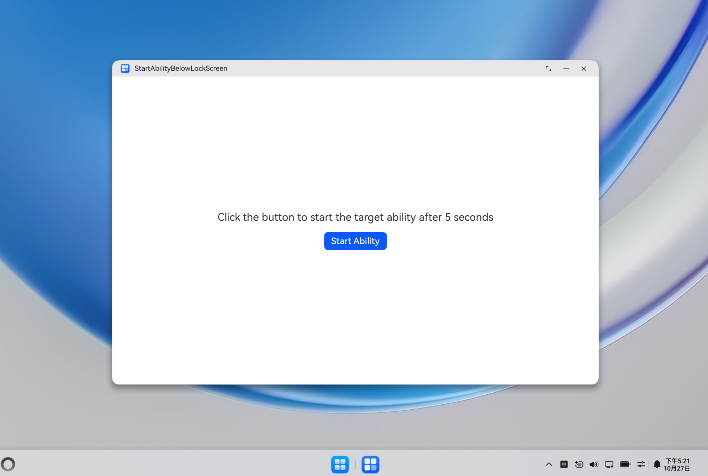

# 锁屏状态下拉起目标应用

## 介绍

本工程为锁屏状态下启动应用示例的调用方应用A，配合目标应用B（[BelowLockScreenTargetSample](../BelowLockScreenTargetSample/README.md)）共同使用。
通过点击按钮，延时5秒后调用startAbility()接口拉起应用B，模拟在PC/2in1设备锁屏状态下收到日程提醒等事件时，拉起目标应用的场景。

## 效果预览

|  |
|------------------------------|

使用说明：

1. 安装编译生成的本应用hap包以及应用B的hap包，打开本应用。
2. 点击"Start Ability"按钮，开始5秒倒计时。在倒计时期间，将设备锁屏。
3. 等待5秒钟后，自动拉起应用B。
4. 解锁设备，可看到应用B已显示在屏幕上。

## 工程目录

```
StartAbilityBelowLockScreenSample
├──entry/src/main/ets
│  │  ├──entryability
│  │  │  ├──EntryAbility.ets
|  |  ├──entrybackupability
|  |  |  ├──EntryBackupAbility.ets
│  │  ├──pages
│  │     ├──Index.ets               // 主界面
```

## 相关权限

不涉及。

## 依赖

需配合目标应用[BelowLockScreenTargetSample](../BelowLockScreenTargetSample/README.md)共同使用。

## 约束和限制

1. 本示例支持标准系统上运行，支持设备：华为电脑。
2. 本示例API Version 21及以上版本SDK。
3. 本示例已支持使DevEco Studio 6.0.2 Release (构建版本：6.0.2.650)编译运行。

## 下载

如需单独下载本工程，执行如下命令：

```
git init
git config core.sparsecheckout true
echo code/DocsSample/ArkUISample/ArkUIWindowSamples/StartAbilityBelowLockScreenSample > .git/info/sparse-checkout
git remote add origin https://gitcode.com/openharmony/applications_app_samples.git
git pull origin master
```
