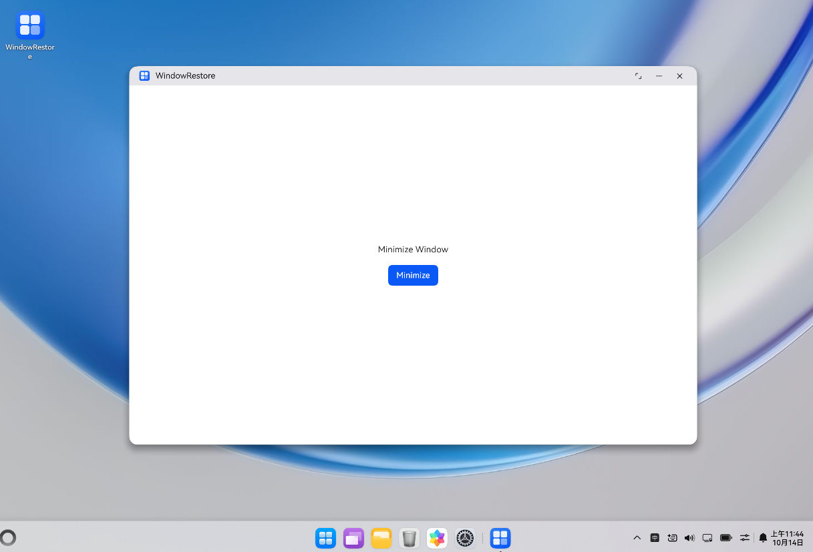

# 主窗最小化与恢复

## 介绍

本工程主要实现了对以下指南文档[窗口生命周期实践案例](https://gitcode.com/openharmony/docs/blob/master/zh-cn/application-dev/windowmanager/window-lifecycle-practical-case.md)
中示例代码片段的工程化，通过该工程可体验在PC/2in1设备上点击按钮调用minimize()接口使主窗进入后台状态，延时后调用restore()
接口将主窗口恢复到前台显示。

## 效果预览

|  |
|------------------------------|

使用说明：

1. 安装编译生成的hap包,打开应用。
2. 点击"Minimize"按钮，主窗口进入后台状态。
3. 等待5秒钟后，主窗口自动恢复到前台显示。

## 工程目录

```
WindowRestoreSample
├──entry/src/main/ets
│  │  ├──entryability
│  │  │  ├──EntryAbility.ets
|  |  ├──entrybackupability
|  |  |  ├──EntryBackupAbility.ets
│  │  ├──pages
│  │     ├──Index.ets               // 主界面
```

## 相关权限

不涉及。

## 依赖

不涉及。

## 约束和限制

1. 本示例支持标准系统上运行，支持设备： 华为电脑、电脑模式下的平板。
2. 本示例API Version 23及以上版本SDK。
3. 本示例已支持使DevEco Studio 6.0.2 Release (构建版本：6.0.2.650)编译运行。

## 下载

如需单独下载本工程，执行如下命令：

```
git init
git config core.sparsecheckout true
echo code/DocsSample/ArkUISample/ArkUIWindowSamples/WindowRestoreSample > .git/info/sparse-checkout
git remote add origin https://gitcode.com/openharmony/applications_app_samples.git
git pull origin master
```
