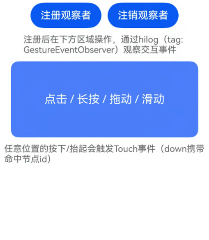

# 监听全局手势（GestureEventObserver）

### 介绍

本示例对应《监听全局手势》开发指南，基于[ui_info_collection.h](https://gitcode.com/openharmony/docs/blob/master/zh-cn/application-dev/reference/apis-arkui/capi-ui-info-collection-h.md)中的交互事件观察者接口进行构建，展示通过Native接口注册、注销交互事件观察者，全局感知点击、长按、拖动、捏合、旋转、快滑、统一拖拽和原始触摸共9类交互事件的方法，以帮助开发者更好地理解UI信息采集C-API的用法。

### 效果预览

| 监听全局手势示例                                 |
|------------------------------------|
|  |

### 使用说明

1. 点击“注册观察者”按钮，Native侧调用注册接口，开始感知当前UI实例上的交互事件。

2. 在“点击 / 长按 / 拖动 / 滑动”区域执行点击、长按、拖动、滑动等操作，任意位置的按下/抬起会触发原始触摸事件；事件JSON（含命中节点信息）会打印在hilog日志中（tag: GestureEventObserver）。

3. 点击“注销观察者”按钮，停止感知。

### 工程目录

```
entry/src/main/
|---cpp
|   |---NativeEntry.cpp                       // 交互事件观察者实现
|   |---NativeEntry.h
|   |---napi_init.cpp                         // 模块注册
|   |---CMakeLists.txt
|---ets
|   |---entryability
|   |       |---EntryAbility.ets
|   |---pages
|   |       |---Index.ets                     // 应用主页面
```

### 具体实现

1. ArkTS侧通过`this.getUIContext()`获取UIContext，调用Native模块注册的`registerObserver`接口。

2. Native侧通过[OH_ArkUI_GetContextFromNapiValue](https://gitcode.com/openharmony/docs/blob/master/zh-cn/application-dev/reference/apis-arkui/capi-native-node-napi-h.md)从入参获取ArkUI_ContextHandle。

3. 通过[OH_ArkUI_NativeModule_UIInfoCollectionRegisterInteractionObserver](https://gitcode.com/openharmony/docs/blob/master/zh-cn/application-dev/reference/apis-arkui/capi-ui-info-collection-h.md)注册交互事件观察者，点击、长按、拖动、捏合、旋转、快滑、统一拖拽和原始触摸等事件通过回调以JSON通知；不再使用时调用[OH_ArkUI_NativeModule_UIInfoCollectionUnregisterInteractionObserver](https://gitcode.com/openharmony/docs/blob/master/zh-cn/application-dev/reference/apis-arkui/capi-ui-info-collection-h.md)注销观察者。

### 相关权限

不涉及。

### 依赖

不涉及。

### 约束与限制

1. 本示例涉及的接口从API版本26.1.0开始支持。

2. 本示例仅支持标准系统上运行。

### 下载

如需单独下载本工程，执行如下命令：

````
git init
git config core.sparsecheckout true
echo code/DocsSample/ArkUISample/GestureEventObserver > .git/info/sparse-checkout
git remote add origin https://gitcode.com/openharmony/applications_app_samples.git
git pull origin master
````
