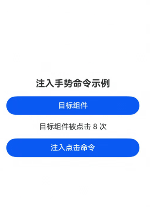

# Gesture Command Injection (InjectGestureCommand)

## Introduction

This sample corresponds to the *Gesture Command Injection* development guide. It demonstrates how to inject gesture commands (click, scroll, content switch, back press, and key) into a UI instance through native APIs.

## Preview

| Gesture Command Injection |
| --- |
|  |

## Implementation

1. On the ArkTS side, obtain the UIContext by using this.getUIContext() and call the injectClick API registered by the native module.

2. On the native side, obtain the ArkUI_ContextHandle from the input parameter by using OH_ArkUI_GetContextFromNapiValue.

3. Create a command object by using OH_ArkUI_NativeModule_UIJsonWrapperCreate, and then call OH_ArkUI_NativeModule_UIEventInjectRelaxedInteraction to inject the command. The execution result is reported through the completion callback.

## Usage

1. Tap "Inject Click Command" to inject a click into the current UI instance through the native interface.

2. When the injected click hits "Target Component", the target component's click callback is triggered, and the click count on the page increases by one. The injection result is also printed in the log.

## Project Directory

```
entry/src/main/
|---cpp
|   |---NativeEntry.cpp                       // Injection command implementation
|   |---NativeEntry.h
|   |---napi_init.cpp                         // Module registration
|   |---CMakeLists.txt
|---ets
|   |---entryability
|   |       |---EntryAbility.ets
|   |---pages
|   |       |---Index.ets                     // Application main page
```

## Permissions

None.

## Dependencies

None.

## Constraints

1. The APIs involved in this sample are supported since API version 26.1.0.

2. This sample runs only on standard systems.

## Download

To download this project, run the following commands:

```
git init
git config core.sparsecheckout true
echo code/DocsSample/ArkUISample/InjectGestureCommand > .git/info/sparse-checkout
git remote add origin https://gitcode.com/openharmony/applications_app_samples.git
git pull origin master
```