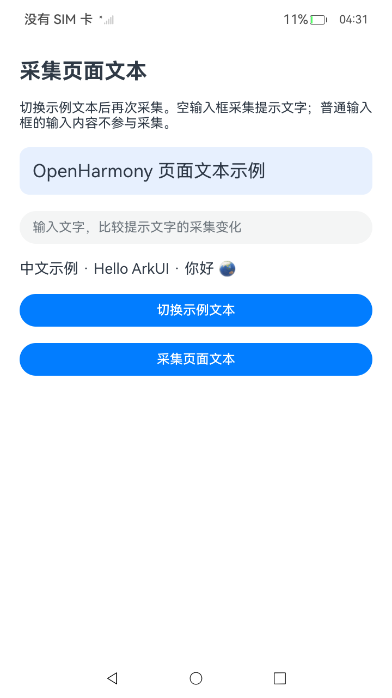
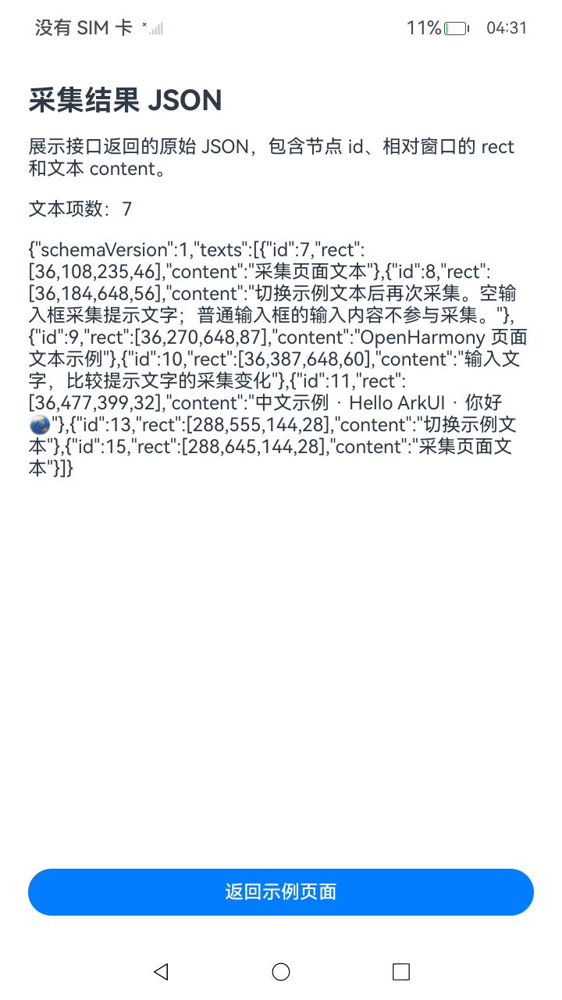

# ArkUI Native 页面文本采集

### 介绍

本示例使用 `OH_ArkUI_NativeModule_UIAgentGetPageText` 同步采集当前 ArkUI 页面中的文本，通过 Node-API 将结果传回 ArkTS，并在独立页面展示文本项数和原始 JSON。返回值包含 `schemaVersion` 和 `texts` 数组，每个文本项包含节点 `id`、相对于目标窗口的 `rect` 和文本 `content`。

本示例使用 [ui_info_collection.h](https://gitcode.com/openharmony/docs/blob/master/zh-cn/application-dev/reference/apis-arkui/capi-ui-info-collection-h.md)、[ui_json_wrapper.h](https://gitcode.com/openharmony/docs/blob/master/zh-cn/application-dev/reference/apis-arkui/capi-ui-json-wrapper-h.md) 和 [native_node_napi.h](https://gitcode.com/openharmony/docs/blob/master/zh-cn/application-dev/reference/apis-arkui/capi-native-node-napi-h.md) 等 C API，链接 `libace_ndk.z.so`。

### 效果预览

| 示例页面 | 采集结果 |
| --- | --- |
|  |  |

### 使用说明

1. 启动应用，查看普通文本、多语言文本和输入框。
2. 点击“采集页面文本”，查看接口返回的原始 JSON。
3. 点击“返回示例页面”，切换示例文本后再次采集，结果应包含新文本且不再包含旧文本。
4. 空输入框的提示文字参与采集；输入内容后，普通 `TextInput` 的提示文字和用户输入内容均不出现在结果中，这是当前引擎的文本采集规则。
5. 可多次返回并采集；采集发生在跳转结果页之前，避免结果 JSON 自身被重复采集。

接口返回错误时，示例页展示错误码和错误消息。日志标签为 `Sample_UIAgentGetPageText`，只记录结果字节数或错误，不打印采集到的页面文本。

### 工程目录

```text
AppScope/                              应用信息与应用名称资源
entry/src/main/
├── cpp/
│   ├── napi_init.cpp                   UIContext 转换、采集、JSON 复制与释放
│   ├── CMakeLists.txt                  Native 依赖配置
│   └── types/libpagetext/Index.d.ts    ArkTS 类型声明
├── ets/
│   ├── common/PageText.ets            返回类型和 schemaVersion 校验
│   ├── entryability/EntryAbility.ets  加载示例页
│   └── pages/
│       ├── Index.ets                  文本示例和采集入口
│       └── Result.ets                 原始 JSON 展示页
└── resources/                         中英文资源和页面配置
entry/src/ohosTest/                     设备 UI 自动化用例
ohosTest.md                            测试用例归档
```

### 具体实现

1. ArkTS 在按钮点击事件中调用 `getPageText(this.getUIContext())`，保证同步调用发生在 UI 线程。不要将其放入 Worker、TaskPool 或 Node-API 异步工作线程。
2. Native 使用 `OH_ArkUI_GetContextFromNapiValue` 获取当前页面对应的 `ArkUI_ContextHandle`，检查转换结果。转换接口当前会分配句柄且未提供公开销毁函数，因此桥接为同一个 `UIContext` 复用句柄，避免每次采集重复分配。缓存使用弱引用，并在每次调用时校验对象身份；不同 UI 实例不会共用句柄。不要自行 `delete` SDK 的不透明类型。
3. 将输出指针初始化为 `nullptr`，调用 `OH_ArkUI_NativeModule_UIAgentGetPageText(context, &pageText)` 并检查错误码。
4. 通过 `OH_ArkUI_NativeModule_UIJsonWrapperGetData` 和 `OH_ArkUI_NativeModule_UIJsonWrapperGetSize` 获取只读 UTF-8 JSON 及字节长度。
5. 使用 `napi_create_string_utf8` 将数据复制到 ArkTS 字符串。C++ `unique_ptr` 的自定义删除器调用 `OH_ArkUI_NativeModule_UIJsonWrapperDestroy`，在正常返回和错误返回时均释放包装对象。不能单独释放 `GetData` 返回的借用指针，也不能在销毁包装对象后访问它。
6. 在 [PageText.ets](entry/src/main/ets/common/PageText.ets) 中校验 `schemaVersion`，然后将已复制的字符串传给结果页。示例保留完整 JSON，不将字符数当成 UTF-8 字节数。

当前结果结构如下，数字和文本仅用于说明格式：

```json
{
  "schemaVersion": 1,
  "texts": [
    { "id": 42, "rect": [24, 160, 640, 60], "content": "OpenHarmony 页面文本示例" }
  ]
}
```

`id` 是 Native 节点的数字标识，不是 ArkTS `.id('sampleText')` 设置的字符串。`rect` 为 `[x, y, width, height]`，单位为物理像素，坐标相对于目标窗口。无文本时仍返回带 `schemaVersion` 的对象及空 `texts` 数组。Search、Counter 等复合组件有各自的采集规则，不宜将普通 `TextInput` 的行为外推为所有输入组件的行为。

接口同步执行，复杂页面可能阻塞 UI；SDK 声明指出超过 3 秒可能触发卡顿警告，超过 6 秒可能触发应用卡死事件。不要为了避免阻塞而移至异步工作线程。

主要错误包括参数无效、UI 上下文无效、Native 实现不可用和内部采集失败；具体错误码以配套 SDK 的 `error_code.h` 为准。Node-API 桥接保留底层返回的数值错误码，ArkTS 在 `catch` 中处理。

### 相关权限

本示例不申请额外权限。

### 依赖

无第三方运行时依赖。自动化测试使用 `@ohos/hypium`。

### 约束与限制

1. 本示例支持标准系统，支持设备：手机、平板。
2. 本示例需要使用包含上述公开接口的 **26.1.0** 或后续匹配版本 SDK，运行设备需提供与 SDK 匹配的实现。
3. 使用支持目标 SDK 的 DevEco Studio 打开本工程，构建并运行 `entry` 模块。
4. 页面文本采集必须在目标 UI 实例的 UI 线程同步调用。

测试用例及结果见 [ohosTest.md](ohosTest.md)。

### 下载

```shell
git init
git config core.sparsecheckout true
echo code/DocsSample/ArkUISample/UIAgentGetPageText/ > .git/info/sparse-checkout
git remote add origin https://gitcode.com/openharmony/applications_app_samples.git
git pull origin master
```
