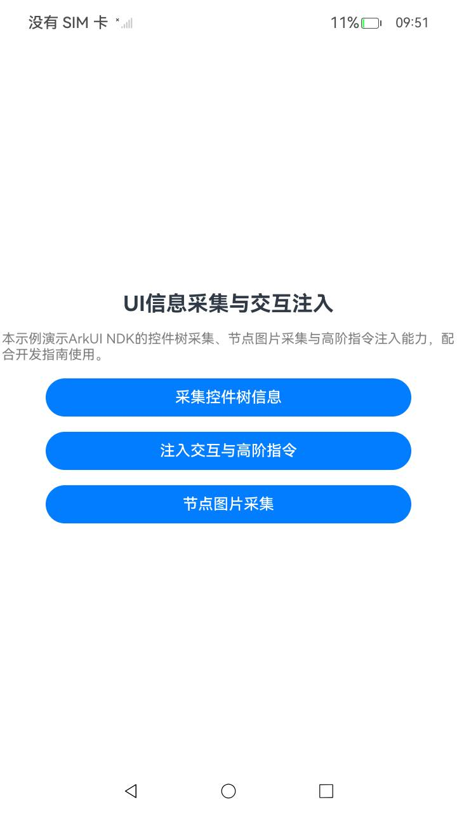
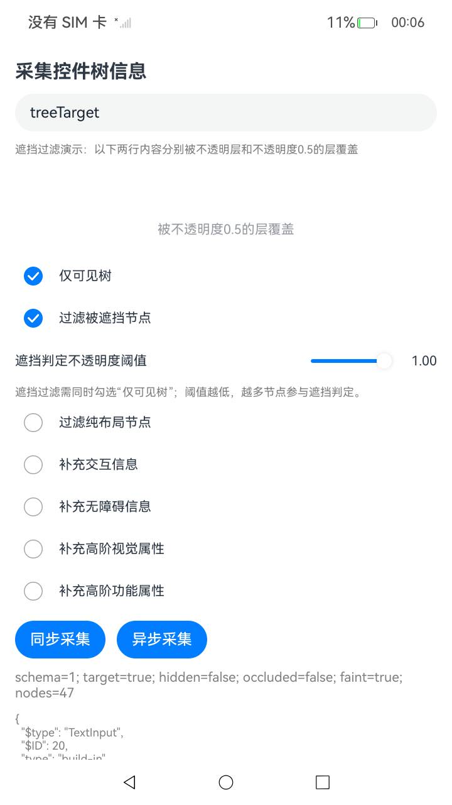
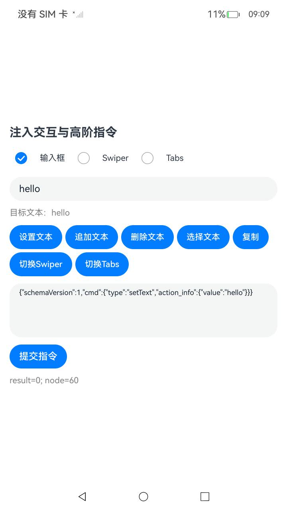
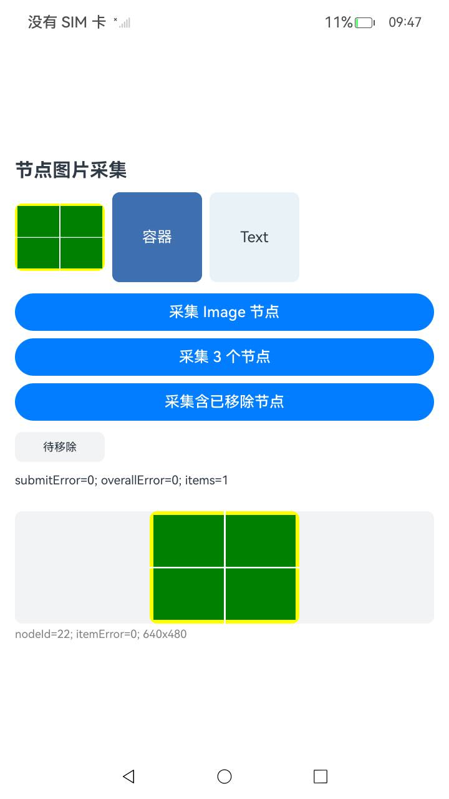

# UI信息采集与交互注入（UiInfoCollectionAndInjection）

### 介绍

本示例主要展示ArkUI NDK的UI信息采集与交互注入能力，使用[ui_info_collection.h](https://gitcode.com/openharmony/docs/blob/master/zh-cn/application-dev/reference/apis-arkui/capi-ui-info-collection-h.md)，[ui_json_wrapper.h](https://gitcode.com/openharmony/docs/blob/master/zh-cn/application-dev/reference/apis-arkui/capi-ui-json-wrapper-h.md)，[ui_event_injection.h](https://gitcode.com/openharmony/docs/blob/master/zh-cn/application-dev/reference/apis-arkui/capi-ui-event-injection-h.md)，[native_node_napi.h](https://gitcode.com/openharmony/docs/blob/master/zh-cn/application-dev/reference/apis-arkui/capi-native-node-napi-h.md)等C API，实现了控件树采集（全量树/可见树，纯布局过滤，遮挡过滤，交互/无障碍/高阶属性开关，同步/异步采集与节点解析定位），节点图片采集（按节点ID批量异步采集，Image节点返回完整源图，其他节点按节点边界采集，逐项消费PixelMap），以及向TextInput，Swiper，Tabs等组件提交七类高阶指令（setText，addText，deleteText，selectText，copy，swiperSwitch，tabsSwitch）的功能。

### 效果预览

|主页|控件树采集|指令注入|节点图片采集|
|--------------------------------|--------------------------------|--------------------------------|--------------------------------|
|||||

### 使用说明

1. 在主界面，点击"采集控件树信息"进入控件树采集页面；
2. 在采集页面，按需勾选六个采集选项，点击"同步采集"或"异步采集"，页面显示解析统计与目标节点JSON；
3. 在主界面，点击"注入交互与高阶指令"进入指令注入页面；
4. 在指令注入页面，选择目标组件类型（输入框/Swiper/Tabs），点击指令预设按钮载入JSON，可编辑后点击"提交指令"，页面显示执行结果码与目标组件当前状态。
5. 在主界面，点击"节点图片采集"进入节点图片采集页面，页面内有Image节点，容器节点和Text节点三个可采集目标，另有一个标记为"待移除"的节点用于演示批次中包含已移除节点；
6. 点击"采集 Image 节点"，页面显示受理结果，回调整体错误码与结果项信息，并展示取到的图片（尺寸为该Image的完整源图，不是页面上的显示尺寸）；
7. 点击"采集 3 个节点"，一次请求采集三个节点，页面按请求顺序显示三个结果项；
8. 点击"采集含已移除节点"，示例先取到"待移除"节点的节点ID再移除该节点，然后与Image节点一起提交同一个批次，该结果项的itemError显示为106410（节点不存在），Image节点的结果项仍返回图片，整体错误码为106414（部分失败）。

### 工程目录

```
entry/src/main/
|---cpp
|   |---napi_init.cpp                        // Native桥接：树采集，节点图片采集，指令注入与异步任务管理
|   |---types/libentry
|   |   |---Index.d.ts                        // Native导出与参数类型声明
|---ets
|   |---common
|   |   |---Collection.ets                    // 树结果字段模型，解析，查找与节点ID获取
|   |---entryability
|   |   |---EntryAbility.ets                  // 应用入口
|   |---pages
|       |---Index.ets                         // 首页入口
|       |---TreePage.ets                      // 控件树采集页面
|       |---CommandPage.ets                   // 指令注入页面
|       |---ImagePage.ets                     // 节点图片采集页面
|---resources
|   |---rawfile
|       |---ndk_image_source.png              // 被采集的源图，尺寸大于页面显示尺寸
|---ohosTest
    |---ets/test
        |---Index.test.ets                    // 控件树与指令注入的UI自动化用例
        |---Image.test.ets                    // 节点图片采集的UI自动化用例
        |---Ability.test.ets                  // 基础用例
        |---List.test.ets                     // 用例套件入口
```

### 具体实现

* 控件树采集的请求创建，选项配置，同步采集，异步采集与回调处理封装在[napi_init.cpp](entry/src/main/cpp/napi_init.cpp)中的CreateRequest，CollectTree，CollectTreeAsync与OnTree，调用OH_ArkUI_NativeModule_UIAgentTreeRequestCreate等公开接口，请求对象通过配套销毁函数管理；
* 节点图片采集的请求提交与结果消费封装在[napi_init.cpp](entry/src/main/cpp/napi_init.cpp)中的CollectImages与OnImages，调用OH_ArkUI_NativeModule_GetImagesByNodeIdAsync提交异步请求，在回调中按节点ID逐项调用OH_ArkUI_NativeModule_ImageCollectionTakeItemByNodeId取出结果，用OH_PixelmapNative_ConvertPixelmapNativeToNapi把PixelMap转成ArkTS对象，最后调用OH_ArkUI_NativeModule_ImageCollectionDestroy释放集合；同步受理结果与回调整体结果分别通过submitError和overallError返回，单项结果通过nodeId，itemError和尺寸返回；
* 节点图片采集所需的ArkUI Context通过页面内的NodeContent获得：页面在aboutToAppear中把NodeContent交给native侧，native创建一个空节点挂载到该NodeContent上，再调用OH_ArkUI_GetContextByNode从该节点取Context（ArkTS声明的节点取不到可用于采图的Context），实现见[napi_init.cpp](entry/src/main/cpp/napi_init.cpp)中的AttachImageAnchor与GetImageContext；
* 节点图片采集页面的目标节点声明与调用流程见[ImagePage.ets](entry/src/main/ets/pages/ImagePage.ets)中的capture方法，节点ID通过UIContext的getFrameNodeById与getUniqueId取得，页面按请求顺序渲染每个结果项；
* 树结果的字段模型，schemaVersion校验，按compid查找节点与节点ID获取封装在[Collection.ets](entry/src/main/ets/common/Collection.ets)中的parseTree，findNode与requireNodeId；
* 指令注入的JSON对象创建，提交与执行回调处理封装在[napi_init.cpp](entry/src/main/cpp/napi_init.cpp)中的InjectCommand与OnCommand，调用OH_ArkUI_NativeModule_UIJsonWrapperCreate与OH_ArkUI_NativeModule_UIEventInjectCompositeCommand；
* 页面交互与目标组件管理分别见[TreePage.ets](entry/src/main/ets/pages/TreePage.ets)与[CommandPage.ets](entry/src/main/ets/pages/CommandPage.ets)。

### 相关权限

无。

### 依赖

无。

### 约束与限制

1. 本示例仅支持标准系统上运行，支持设备：手机；
2. 本示例需要使用包含ui_info_collection.h，ui_json_wrapper.h，ui_event_injection.h公开头文件的26.1.0或后续匹配版本SDK才可编译运行；
3. 本示例的节点图片采集功能使用从26.1.0版本起提供的OH_ArkUI_NativeModule_GetImagesByNodeIdAsync，OH_ArkUI_NativeModule_ImageCollectionTakeItemByNodeId与OH_ArkUI_NativeModule_ImageCollectionDestroy，需使用声明并导出这三个符号的SDK与libace_ndk.z.so，运行设备的实现需与SDK匹配；
4. 本示例需要使用DevEco Studio 26.0.0.851及以上版本编译运行；
5. 控件树采集与指令注入必须在目标UI实例的UI线程调用，节点图片采集可以从任意线程提交，结果回调在目标UI实例的UI线程执行；同一UI实例上一次采图请求的回调未返回前，再次提交会被拒绝，具体约束见对应开发指南；
6. 节点图片采集返回的PixelMap由调用方释放，本示例在转换给ArkTS后即释放native对象，页面退出前后不持有集合。

### 下载

如需单独下载本工程，执行如下命令：

```
git init
git config core.sparsecheckout true
echo code/DocsSample/ArkUISample/UiInfoCollectionAndInjection/ > .git/info/sparse-checkout
git remote add origin https://gitcode.com/openharmony/applications_app_samples.git
git pull origin master
```
