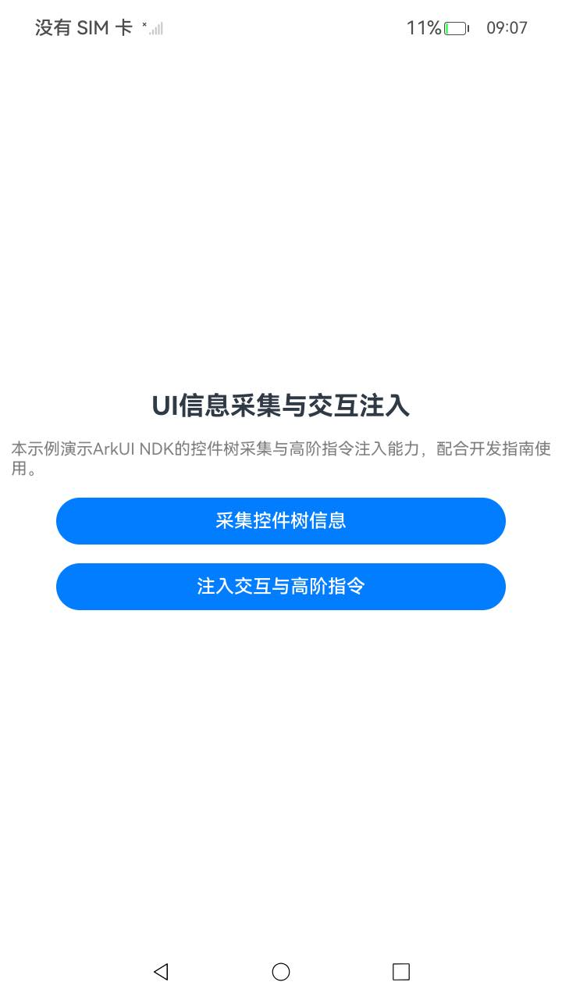
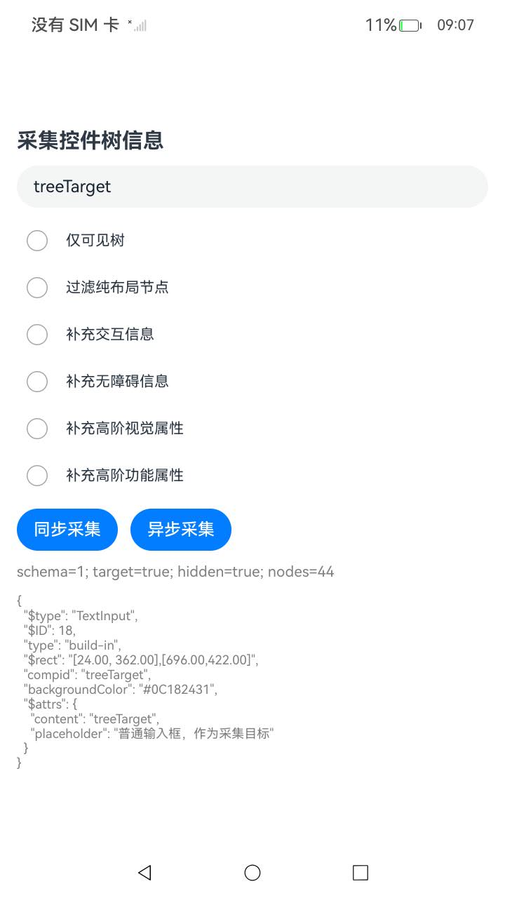
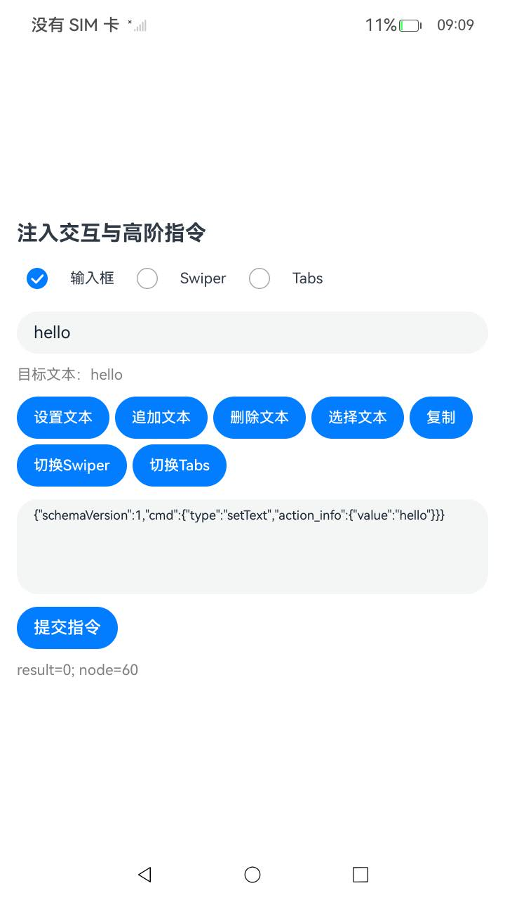

# UI信息采集与交互注入（UiInfoCollectionAndInjection）

### 介绍

本示例主要展示ArkUI NDK的UI信息采集与交互注入能力，使用[ui_info_collection.h](https://gitcode.com/openharmony/docs/blob/master/zh-cn/application-dev/reference/apis-arkui/capi-ui-info-collection-h.md)，[ui_json_wrapper.h](https://gitcode.com/openharmony/docs/blob/master/zh-cn/application-dev/reference/apis-arkui/capi-ui-json-wrapper-h.md)，[ui_event_injection.h](https://gitcode.com/openharmony/docs/blob/master/zh-cn/application-dev/reference/apis-arkui/capi-ui-event-injection-h.md)，[native_node_napi.h](https://gitcode.com/openharmony/docs/blob/master/zh-cn/application-dev/reference/apis-arkui/capi-native-node-napi-h.md)等C API，实现了控件树采集（全量树/可见树，纯布局过滤，遮挡过滤，交互/无障碍/高阶属性开关，同步/异步采集与节点解析定位）以及向TextInput，Swiper，Tabs等组件提交七类高阶指令（setText，addText，deleteText，selectText，copy，swiperSwitch，tabsSwitch）的功能。

### 效果预览

|主页|控件树采集|指令注入|
|--------------------------------|--------------------------------|--------------------------------|
||||

### 使用说明

1. 在主界面，点击"采集控件树信息"进入控件树采集页面；
2. 在采集页面，按需勾选六个采集选项，点击"同步采集"或"异步采集"，页面显示解析统计与目标节点JSON；
3. 在主界面，点击"注入交互与高阶指令"进入指令注入页面；
4. 在指令注入页面，选择目标组件类型（输入框/Swiper/Tabs），点击指令预设按钮载入JSON，可编辑后点击"提交指令"，页面显示执行结果码与目标组件当前状态。

### 工程目录

```
entry/src/main/
|---cpp
|   |---napi_init.cpp                        // Native桥接：树采集，指令注入与异步任务管理
|   |---types/libentry
|   |   |---Index.d.ts                        // Native导出与参数类型声明
|---ets
|   |---common
|   |   |---Collection.ets                    // 树结果字段模型，解析，查找与节点ID获取
|   |---entryability
|   |   |---EntryAbility.ets                  // 应用入口
|   |---pages
|       |---Index.ets                         // 首页入口
|       |---TreePage.ets                      // 控件树采集页面
|       |---CommandPage.ets                   // 指令注入页面
|---ohosTest
    |---ets/test
        |---index.test.ets                    // UI自动化用例
        |---Ability.test.ets                  // 基础用例
        |---List.test.ets                     // 用例套件入口
```

### 具体实现

* 控件树采集的请求创建，选项配置，同步采集，异步采集与回调处理封装在[napi_init.cpp](entry/src/main/cpp/napi_init.cpp)中的CreateRequest，CollectTree，CollectTreeAsync与OnTree，调用OH_ArkUI_NativeModule_UIAgentTreeRequestCreate等公开接口，请求对象通过配套销毁函数管理；
* 树结果的字段模型，schemaVersion校验，按compid查找节点与节点ID获取封装在[Collection.ets](entry/src/main/ets/common/Collection.ets)中的parseTree，findNode与requireNodeId；
* 指令注入的JSON对象创建，提交与执行回调处理封装在[napi_init.cpp](entry/src/main/cpp/napi_init.cpp)中的InjectCommand与OnCommand，调用OH_ArkUI_NativeModule_UIJsonWrapperCreate与OH_ArkUI_NativeModule_UIEventInjectCompositeCommand；
* 页面交互与目标组件管理分别见[TreePage.ets](entry/src/main/ets/pages/TreePage.ets)与[CommandPage.ets](entry/src/main/ets/pages/CommandPage.ets)。

### 相关权限

无。

### 依赖

无。

### 约束与限制

1. 本示例仅支持标准系统上运行，支持设备：手机；
2. 本示例需要使用包含ui_info_collection.h，ui_json_wrapper.h，ui_event_injection.h公开头文件的26.1.0或后续匹配版本SDK才可编译运行；
3. 本示例需要使用DevEco Studio 26.0.0.851及以上版本编译运行，运行设备需提供与SDK匹配的实现；
4. 控件树采集与指令注入必须在目标UI实例的UI线程调用，具体约束见对应开发指南。

### 下载

如需单独下载本工程，执行如下命令：

```
git init
git config core.sparsecheckout true
echo code/DocsSample/ArkUISample/UiInfoCollectionAndInjection/ > .git/info/sparse-checkout
git remote add origin https://gitcode.com/openharmony/applications_app_samples.git
git pull origin master
```
