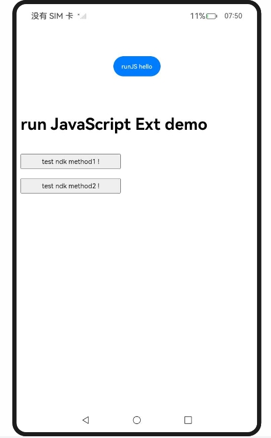

## 应用侧与前端页面的相互调用(C/C++)

### 介绍

1. 实现文档中提供的示例代码片段的工程化，确保示例代码与sample工程文件同源。文档链接：https://docs.openharmony.cn/pages/v6.0/zh-cn/application-dev/web/arkweb-ndk-jsbridge.md 。

### 效果预览

| 主页                                                         |
| ------------------------------------------------------------ |
|  |

使用说明

1. 点击 runJS hello按钮调用testNapi.runJavaScript。
2. 点击test Native Development Kit method1 !按钮调用testNdkProxyObjMethod1。
3. 点击test Native Development Kit method2 !按钮调用testNdkProxyObjMethod2。

### 工程目录

```
entry/src/main/
|---cpp										// cpp文件夹
|---ets
|---|---entryability
|---|---|---EntryAbility.ets
|---|---pages
|---|---|---Index.ets						// 首页
|---resources								// 静态资源
|---ohosTest
|---|---ets
|---|---|---tests
|---|---|---|---Ability.test.ets            // 自动化测试用例
```


### 具体实现
* 应用侧与前端页面的相互调用(C/C++)。参考源码：[Index.ets](./entry/src/main/ets/pages/Index.ets)、[hello.cpp](./entry/src/main/cpp/hello.cpp)
  * 在ArkTS侧自定义一个标识webTag，并将webTag通过Node-API传至应用Native侧。
  * 在Native侧，通过函数OH_ArkWeb_GetNativeAPI先获取API结构体，调用结构体里的Native API。
  * Native侧，通过ArkWeb_ComponentAPI注册组件生命周期回调。
  * 前端页面通过registerJavaScriptProxyEx将应用侧函数注册至前端页面，注册后在下次加载或者重新加载后生效。
  * 应用侧使用runJavaScript调用前端页面函数。

### 相关权限

无。

## 依赖

不涉及。

## 约束与限制

1. 本示例仅支持标准系统上运行，支持设备：RK3568。
2. 本示例支持API20版本SDK，SDK版本号(API Version 20 Release)。
3. 本示例需要使用DevEco Studio 版本号(6.0.0Release)及以上版本才可编译运行。

## 下载

如需单独下载本工程，执行如下命令：

```
git init
git config core.sparsecheckout true
echo code/DocsSample/ArkWeb/ArkWebJsInteraction/NdkJsBridgeEX > .git/info/sparse-checkout
git remote add origin https://gitcode.com/openharmony/applications_app_samples.git
git pull origin master
```