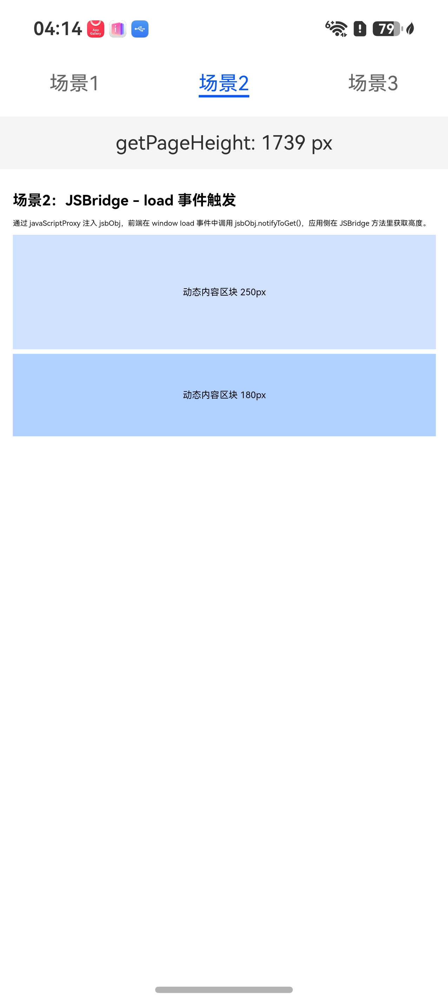

# 获取网页内容高度

### 介绍

1. 本工程主要实现了对以下指南文档中 https://developer.huawei.com/consumer/cn/doc/doccenter-capabilities/web-getpage-height 示例代码片段的工程化，主要目标是实现指南中示例代码需要与sample工程文件同源。

### Entry:

#### GetWebPageHeight

##### 介绍

1. 本示例主要介绍通过调用 [getPageHeight](https://developer.huawei.com/consumer/cn/doc/harmonyos-references/arkts-apis-webview-webviewcontroller#getpageheight) 获取当前网页内容的实际高度。开发者可以根据具体需求选择合适的方法。
2. 在网页加载过程中，获取的高度可能不够精确，特别是在网页还未渲染完成时。因为动态内容加载后会更新这个值。网页内容可能需要长时间加载。目前网站为优化首次加载速度，会使用动态网页加载技术，用户在看到网页首帧时，页面资源还在动态加载页面，特别是包含图片、动态内容的页面。
3. 非静态网页不建议在 onPageEnd、onPageVisible、onFirstContentfulPaint、onFirstMeaningfulPaint 事件等Web组件生命周期回调和Web性能指标回调中获取网页内容高度。需要根据当前网页的特点，通过JSBridge或延迟等方案，在前端特定的回调通知里获取当前网页内容的实际高度。
4. 本示例通过 Tabs 承载三个场景，每个场景在页面顶部横幅实时展示 getPageHeight() 的返回值。

##### 效果预览

| 场景1：静态页面                                        | 场景2：JSBridge回调                                   | 场景3：延迟获取                                        |
| ----------------------------------------------------- | ----------------------------------------------------- | ----------------------------------------------------- |
|  |  |  |

使用说明

1. 启动应用，进入主页，顶部有三个 Tab：场景1、场景2、场景3。
2. 场景1：普通静态展示页面。在 onPageEnd 回调中通过 getPageHeight() 获取高度，顶部横幅显示高度值（px）。
3. 场景2：复杂动态网页使用JSBridge传递特定回调。通过 javaScriptProxy 注入 jsbObj，前端在 window load 事件中调用 jsbObj.notifyToGet()，应用侧在 JSBridge 方法里获取高度，顶部横幅显示高度值（px）。
4. 场景3：无法使用JSBridge场景。在 onPageEnd 中通过 setTimeout 延迟 2 秒后获取高度，顶部横幅显示高度值（px）。

### 工程目录

```
entry/src/main/
|---ets
|---|---entryability
|---|---|---EntryAbility.ets
|---|---pages
|---|---|---Index.ets                        // 主页面，Tabs 承载三个场景
|---resources
|---|---rawfile
|---|---|---scene1_index.html                // 场景1：静态页面
|---|---|---scene2_index.html                // 场景2：load 事件触发
|---|---|---scene3_index.html                // 场景3：setTimeout 延迟获取
|---|---|---scene3_example.jpg               // 占位图片（延迟获取场景）
|---ohosTest
|---|---ets
|---|---|---tests
|---|---|---|---Ability.test.ets            // 自动化测试用例
```

### 具体实现

* Entry中实现三种场景下获取网页内容高度的功能。在Index.ets中通过Tabs组件承载三个场景，每个场景为独立的@Component子组件，各自持有独立的WebviewController。

  * **场景1：普通静态展示页面（Scene1Static）**
    * 在onPageEnd回调中调用getPageHeight()获取网页内容高度。
    * onPageEnd触发时DOM已解析但布局可能尚未完成，需短延迟（300ms）等待布局稳定后再取值，否则可能返回0。
    * 顶部Text横幅实时展示获取到的高度值。

  * **场景2：复杂动态网页使用JSBridge传递特定回调（Scene2JsBridge）**
    * 定义TestClass类，包含testController字段和notifyToGet()方法，方法内通过setTimeout延迟300ms后调用getPageHeight()获取高度。
    * 通过javaScriptProxy将TestClass实例以"jsbObj"名称注入前端，methodList包含"notifyToGet"。
    * 前端在window load事件中调用jsbObj.notifyToGet()，应用侧在JSBridge方法里获取高度。
    * TestClass通过onGetHeight回调将高度值传回Scene2JsBridge，更新顶部Text横幅显示。
    * 文档中还提供了另外两种前端触发方式的参考代码：大图片img.addEventListener('load', ...)适用于含大图片的网页；Promise.all + DOMContentLoaded适用于图片密集网页，等所有图片加载完。如需演示这两种方式，可参照文档中对应HTML代码块新增rawfile文件，并修改Scene2JsBridge中Web的src指向。

  * **场景3：无法使用JSBridge场景（Scene3SetTimeout）**
    * 在onPageEnd回调中通过setTimeout延迟2秒后调用getPageHeight()获取高度。
    * 延迟时间根据网页复杂度确定，等待异步资源加载完成后再获取更准确的高度。
    * 顶部Text横幅先显示"onPageEnd已触发，2s后获取..."中间态，2秒后更新为实际高度值。

* 在rawfile目录中存放各场景对应的HTML文件。
  * scene1_index.html：静态页面，包含标题、说明文字和三个固定高度的灰色区块（300/200/150px），用于直观展示页面高度。
  * scene2_index.html：动态网页，包含标题、说明文字和两个蓝色区块，在window load事件中调用jsbObj.notifyToGet()。
  * scene3_index.html：包含大图片的页面，配合setTimeout延迟获取，使onPageEnd时刻与2秒后高度产生差异。

### 相关权限

[ohos.permission.INTERNET](https://docs.openharmony.cn/pages/v5.0/zh-cn/application-dev/security/AccessToken/permissions-for-all.md#ohospermissioninternet)

### 依赖

不涉及。

### 约束与限制

1. 本示例仅支持标准系统上运行，支持设备：RK3568。
2. 本示例支持 API 26 版本 SDK，SDK 版本号（API Version 26 Release）。
3. 本示例已在 DevEco Studio 26.0.1 Beta1（内部版本号 #26.0.1.262）上验证通过。

### 下载

如需单独下载本工程，执行如下命令：

```
git init
git config core.sparsecheckout true
echo code/DocsSample/ArkWeb/ArkWebPageHeight > .git/info/sparse-checkout
git remote add origin https://gitee.com/openharmony/applications_app_samples.git
git pull origin master
```