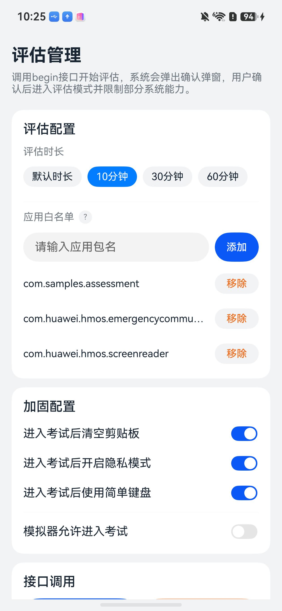

# 评估管理

## 介绍

本示例演示如何使用评估管理（Automatic Scene Configuration Kit）在应用中接入评估模式，覆盖开始评估、结束评估、评估状态查询、评估配置获取以及评估过程回调（onBegin、onInterrupted、onEnd）的完整流程。示例以一个在线答题场景承载这些接口：主页面配置评估参数并调用接口，进入评估模式后跳转到答题页面，答题页面根据评估时长倒计时，并在评估结束或被中断时保存作答结果并退出。

使用的包如下：

- [@ohos.customization.assessment（评估管理）](https://gitcode.com/openharmony/docs/blob/master/zh-cn/application-dev/reference/apis-assessment-kit/js-apis-customization-assessment.md)：提供begin、end、isActive、getConfiguration四个接口，以及AssessmentConfig、AssessmentError、AssessmentInterruptInfo、IAssessmentCallback、AssessmentErrorCode等类型。
- [@kit.AbilityKit](https://gitcode.com/openharmony/docs/blob/master/zh-cn/application-dev/reference/apis-ability-kit/Readme-CN.md)：提供UIAbilityContext，评估接口需要传入需要进入或退出评估模式的UIAbility上下文。
- [@kit.BasicServicesKit](https://gitcode.com/openharmony/docs/blob/master/zh-cn/application-dev/reference/apis-basic-services-kit/Readme-CN.md)：提供BusinessError用于处理接口抛出的业务错误，提供pasteboard用于清空剪贴板数据。
- [@kit.ArkUI](https://gitcode.com/openharmony/docs/blob/master/zh-cn/application-dev/reference/apis-arkui/Readme-CN.md)：提供router和promptAction用于页面跳转与结果提示，提供window用于设置窗口沉浸式与隐私模式。
- [@kit.IMEKit](https://gitcode.com/openharmony/docs/blob/master/zh-cn/application-dev/reference/apis-ime-kit/Readme-CN.md)：提供inputMethod，用于开启简单键盘模式。
- [@kit.PerformanceAnalysisKit](https://gitcode.com/openharmony/docs/blob/master/zh-cn/application-dev/reference/apis-performance-analysis-kit/Readme-CN.md)：提供hilog，用于打印示例日志。
- [@kit.TestKit](https://gitcode.com/openharmony/docs/blob/master/zh-cn/application-dev/reference/apis-test-kit/Readme-CN.md)：提供Driver与abilityDelegatorRegistry，用于UI自动化用例。

## 效果预览



| 主页面 | 答题页面 |
| -------- | -------- |
| 配置评估时长与应用白名单，调用begin、end、isActive、getConfiguration接口，查看评估状态与回调事件记录 | 显示剩余时间、题目与选项，交卷时调用end接口结束评估 |

## 使用说明

1. 在主页面"评估配置"卡片中，点击时长标签选择本次评估的最大时长，"默认时长"对应duration取值0，表示由系统按默认时长处理。
2. 在"评估配置"卡片的输入框中输入应用包名，点击"添加"按钮加入白名单，点击"移除"按钮从白名单中删除，白名单中的应用在评估模式下仍可运行。
3. 点击"开始评估"按钮调用begin接口，系统弹出确认弹窗，用户确认后进入评估模式，onBegin回调返回code为0，页面自动跳转到答题页面。
4. 在答题页面点击选项作答，点击"上一题"和"下一题"切换题目，页面顶部按评估时长倒计时。
5. 点击"交卷"按钮调用end接口结束评估，系统解除评估模式下的能力限制，onEnd回调触发后弹窗展示作答数量并返回主页面。
6. 评估被中断时（用户取消、超时退出、系统错误、环境异常），onInterrupted回调触发，答题页面弹窗展示中断原因并返回主页面。
7. 在主页面点击"查询评估状态"按钮调用isActive接口，点击"查询评估配置"按钮调用getConfiguration接口，结果展示在"状态信息"卡片中。
8. "状态信息"卡片的回调事件记录按时间倒序展示最近20条回调与接口调用结果，便于观察接口行为。

## 工程目录

```
entry/src/main/ets/
|---common
|   |---constants
|   |   |---AssessmentConstants.ets          // 日志标签、评估结果码、时长候选值、事件类型等常量
|   |---utils
|   |   |---ContextUtil.ets                  // 获取UIAbilityContext的工具类
|   |   |---Logger.ets                       // 日志工具类
|   |   |---ExamHardeningUtil.ets            // 应用侧加固工具类，含窗口沉浸式、隐私模式、清空剪贴板与简单键盘
|---entryability
|   |---EntryAbility.ets                     // 入口Ability，加载页面并设置沉浸式全屏窗口
|---entrybackupability
|   |---EntryBackupAbility.ets               // 备份扩展Ability
|---model                                    // Model层，纯数据结构
|   |---ExamQuestionModel.ets                // 题目数据模型与本地模拟题库
|   |---EventLogModel.ets                    // 回调事件日志数据模型
|---viewmodel                                // ViewModel层，@ObservedV2状态管理与业务逻辑
|   |---AssessmentViewModel.ets              // 评估管理状态与逻辑：封装begin/end/isActive/getConfiguration接口，
|   |                                         //   注册IAssessmentCallback，通过@Trace发布状态与事件，@Computed计算属性
|   |---ExamViewModel.ets                    // 答题状态与逻辑：题目导航、选项选择、倒计时管理，@Computed派生属性
|---view                                     // View层，@ComponentV2纯UI组件
|   |---TitleView.ets                        // 主页面标题区
|   |---ConfigView.ets                       // 评估配置卡片：时长选择、应用白名单增删
|   |---OperationView.ets                    // 操作按钮区：开始/结束/查询状态/查询配置
|   |---StatusView.ets                       // 状态信息卡片：评估状态、当前配置、回调事件记录
|   |---ExamHeaderView.ets                   // 答题页头部：标题与剩余时间倒计时
|   |---QuestionCardView.ets                 // 题目卡片：题干展示与选项选择
|   |---ExamOperationView.ets                // 答题操作区：上一题/下一题/交卷
|---pages                                    // 页面，组合View组件并连接ViewModel
|   |---IndexPage.ets                        // 主页面，通过AppStorageV2连接AssessmentViewModel，@Monitor监听回调事件
|   |---ExamPage.ets                         // 答题页面，连接AssessmentViewModel与ExamViewModel，倒计时与中断处理
entry/src/ohosTest/ets/test/
|---Assessment.test.ets                      // isActive与getConfiguration接口用例
|---AssessmentUi.test.ets                    // 主页面布局与交互的UI自动化用例
|---List.test.ets                            // 测试套件入口
```

## 具体实现

本示例采用MVVM（Model-View-ViewModel）架构，基于ArkUI状态管理V2版本（@ComponentV2、@ObservedV2、@Trace、@Param、@Event、@Monitor、@Computed）实现数据与视图的分层解耦。

评估管理的状态与逻辑封装在AssessmentViewModel中，源码参考：[AssessmentViewModel.ets](entry/src/main/ets/viewmodel/AssessmentViewModel.ets)

* AssessmentViewModel使用@ObservedV2装饰，通过@Trace标记isActive、duration、logs、eventType、eventCode、eventSeq等可观察属性，属性变化时自动触发绑定的UI组件刷新。
* 开始评估：begin方法中构造AssessmentConfig（duration与allowedApps），调用assessment.begin并传入IAssessmentCallback。回调对象在构造函数中创建，onBegin、onInterrupted、onEnd三个事件统一由handleBegin、handleInterrupted、handleEnd处理，更新@Trace属性并触发UI更新。
* 结束评估：end方法调用assessment.end，仅开启评估的应用可以结束该评估。
* 状态与配置查询：queryActive方法调用assessment.isActive并更新isActive属性，queryConfiguration方法调用assessment.getConfiguration并更新queryDuration与queryApps属性。
* 跨页面状态共享：通过AppStorageV2.connect(AssessmentViewModel, 'AssessmentViewModel', ...)在主页面与答题页面间共享同一个ViewModel实例，替代V1版本中通过AppStorage多键值传递的方式。
* @Computed计算isQueryConfigAvailable属性，避免在View层重复判断。

主页面的实现参考：[IndexPage.ets](entry/src/main/ets/pages/IndexPage.ets)

* 通过@Local连接AppStorageV2中的AssessmentViewModel实例，viewModel.isActive驱动"开始评估"与"结束评估"按钮的可用状态。
* 通过@Monitor('viewModel.eventSeq')监听回调事件，onBegin返回code为0时调用router.pushUrl跳转到答题页面，接口抛出业务错误时通过promptAction.showToast提示错误码。
* 页面组合TitleView、ConfigView、OperationView、StatusView四个子组件，通过@Param传递数据、@Event接收交互回调，实现View层职责分离。
* 页面根组件调用expandSafeArea延伸至状态栏与导航栏区域，配合EntryAbility中setWindowLayoutFullScreen实现沉浸式效果。

答题页面的实现参考：[ExamPage.ets](entry/src/main/ets/pages/ExamPage.ets)

* 通过@Local连接AppStorageV2中的AssessmentViewModel（共享评估状态）与ExamViewModel（页面私有答题状态）。
* aboutToAppear中初始化ExamViewModel的答案数组，按AssessmentViewModel.duration启动倒计时，并调用ExamHardeningUtil.applyHardening实施应用侧加固。
* 交卷时先调用examVM.submit统计已作答数量，再调用assessmentVM.end结束评估，等待onEnd回调后弹窗展示作答结果并返回主页面。
* 通过@Monitor('assessmentVM.eventSeq')监听onInterrupted与onEnd回调，按中断原因码展示对应描述。
* 页面组合ExamHeaderView、QuestionCardView、ExamOperationView三个子组件。

答题状态管理的实现参考：[ExamViewModel.ets](entry/src/main/ets/viewmodel/ExamViewModel.ets)

* @Trace标记currentIndex、answers、remainingSeconds等可观察属性，选项选择与题目导航时自动更新UI。
* @Computed派生questionCount、currentQuestion、canPrevious、canNext、formattedRemaining、isRemainingCritical等属性，减少View层计算逻辑。
* 内部管理setInterval定时器，startCountdown与stopCountdown控制倒计时生命周期。

应用侧加固的实现参考：[ExamHardeningUtil.ets](entry/src/main/ets/common/utils/ExamHardeningUtil.ets)

* 窗口沉浸式：通过window.getLastWindow获取当前窗口，调用setWindowLayoutFullScreen使内容延伸至状态栏与导航栏区域。
* 隐私模式：调用setWindowPrivacyMode禁止窗口被截屏与录屏，需申请ohos.permission.PRIVACY_WINDOW权限。
* 清空剪贴板：调用pasteboard.getSystemPasteboard().clearData清除残留数据，避免借助剪贴板传入答案。
* 简单键盘模式：调用inputMethod.setSimpleKeyboardEnabled将输入法面板限制为基础按键。
* 每项措施单独捕获异常并记录错误码与错误描述，单项失败不影响其余措施生效。

沉浸式窗口的实现参考：[EntryAbility.ets](entry/src/main/ets/entryability/EntryAbility.ets)

* onWindowStageCreate中加载页面后调用setupImmersiveWindow设置沉浸式窗口。
* setWindowLayoutFullScreen(true)使窗口布局延伸至全屏，覆盖状态栏与导航栏（所有设备生效）。
* setWindowMode(FULLSCREEN)在PC/2in1设备上进入全屏模式，隐藏标题栏与dock栏（try-catch保护，手机设备静默跳过）。
* setWindowDecorVisible(false)在PC/2in1设备上隐藏窗口装饰（最大化/最小化/关闭按钮），try-catch保护非PC设备。

## 相关权限

本示例需要申请以下权限：

- [ohos.permission.ASSESSMENT_CONFIGURATION](https://gitcode.com/openharmony/docs/blob/master/zh-cn/application-dev/security/AccessToken/restricted-permissions.md#ohospermissionassessment_configuration)：允许应用进入考试场景。权限级别为system_basic，授权方式为系统授权（system_grant），属于受限权限，需经审批后应用才可获得。
- [ohos.permission.PRIVACY_WINDOW](https://gitcode.com/openharmony/docs/blob/master/zh-cn/application-dev/security/AccessToken/permissions-for-all.md#ohospermissionprivacy_window)：允许应用将窗口设置为隐私窗口，禁止截屏录屏，用于答题页面的应用侧加固。权限级别为normal，授权方式为系统授权（system_grant）。

## 依赖

无

## 约束与限制

1. 本示例仅支持标准系统上运行，支持设备：Phone | PC/2in1 | Tablet。
2. 本示例涉及的评估管理接口起始版本为26.0.1，需使用API 26.0.1及以上版本SDK编译运行，工程compatibleSdkVersion配置为26.0.1。
3. 本示例仅可在Stage模型下使用。
4. 评估管理能力依赖设备侧的评估配置服务，若设备不支持，接口会抛出错误码801（Capability not supported），此时主页面仍可正常展示，回调事件记录中会记录对应的错误码。
5. 同一设备同一时间仅允许存在一个进行中的评估，重复调用begin接口会报错；仅开启评估的应用可以结束该评估。

## 下载

如需单独下载本工程，执行如下命令：

```text
git init
git config core.sparsecheckout true
echo code/DocsSample/AutomaticSceneConfigurationKit/Assessment/ > .git/info/sparse-checkout
git remote add origin https://gitcode.com/openharmony/applications_app_samples.git
git pull origin master
```
