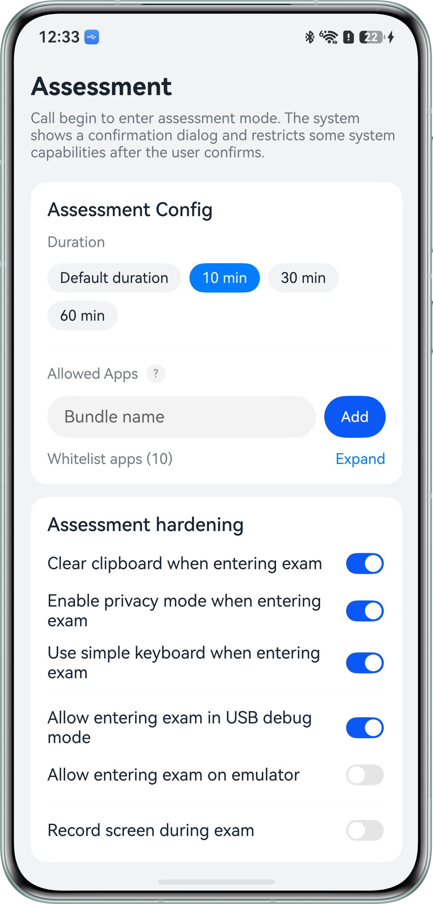
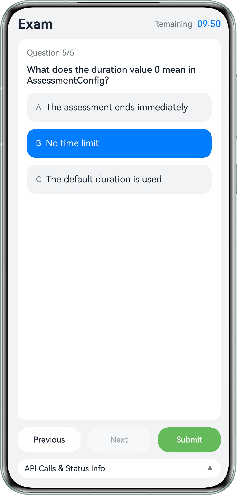

# Assessment Management

## Introduction

This sample demonstrates how to integrate assessment management (Automatic Scene Configuration Kit) into an app, covering the complete workflow of beginning an assessment, ending an assessment, querying the assessment status, retrieving the assessment configuration, and receiving assessment callbacks (onBegin, onInterrupted, and onEnd). An online quiz scenario carries these APIs: the home page configures the assessment parameters and invokes the APIs. After assessment mode is entered, the app navigates to the exam page, where a countdown runs based on the assessment duration. When the assessment ends or is interrupted, the answers are saved and the app exits the exam page.

The following packages are used:

- [@ohos.customization.assessment (Assessment)](https://gitcode.com/openharmony/docs/blob/master/en/application-dev/reference/apis-assessment-kit/js-apis-customization-assessment.md): provides the four APIs begin, end, isActive, and getConfiguration, as well as types such as AssessmentConfig, AssessmentError, AssessmentInterruptInfo, IAssessmentCallback, and AssessmentErrorCode.
- [@kit.AbilityKit](https://gitcode.com/openharmony/docs/blob/master/en/application-dev/reference/apis-ability-kit/Readme.md): provides UIAbilityContext. The assessment APIs require the UIAbility context of the ability that enters or exits assessment mode.
- [@kit.BasicServicesKit](https://gitcode.com/openharmony/docs/blob/master/en/application-dev/reference/apis-basic-services-kit/Readme.md): provides BusinessError for handling business errors thrown by the APIs, and pasteboard for clearing clipboard data.
- [@kit.ArkUI](https://gitcode.com/openharmony/docs/blob/master/en/application-dev/reference/apis-arkui/Readme.md): provides router and promptAction for page navigation and result prompts, and window for setting the immersive and privacy modes of the window.
- [@kit.IMEKit](https://gitcode.com/openharmony/docs/blob/master/en/application-dev/reference/apis-ime-kit/Readme.md): provides inputMethod for enabling simple keyboard mode.
- [@kit.PerformanceAnalysisKit](https://gitcode.com/openharmony/docs/blob/master/en/application-dev/reference/apis-performance-analysis-kit/Readme.md): provides hilog for printing sample logs.


## Screenshots
| Home page                                                            | Exam page                                                            |
|-----------------------------------------------------------------|----------------------------------------------------------------|
|  |  |


## How to Use

1. On the "Assessment Configuration" card of the home page, tap a duration tag to select the maximum duration for this assessment. "Default duration" corresponds to a duration value of 0, which means the system handles it with the default duration.
2. In the input box on the "Assessment Configuration" card, enter an app bundle name and tap "Add" to add it to the allowlist, or tap "Remove" to remove it from the allowlist. Apps in the allowlist can still run in assessment mode.
3. Tap "Start Assessment" to call the begin API. The system displays a confirmation dialog. After the user confirms, the app enters assessment mode, the onBegin callback returns code 0, and the page automatically navigates to the exam page.
4. On the exam page, tap an option to answer the question, and tap "Previous" and "Next" to switch between questions. The top of the page counts down based on the assessment duration.
5. Tap "Submit" to call the end API to finish the assessment. The system lifts the capability restrictions imposed in assessment mode. After the onEnd callback is triggered, a dialog displays the number of answered questions and the app returns to the home page.
6. When the assessment is interrupted (user cancellation, timeout exit, system error, or environment exception), the onInterrupted callback is triggered. The exam page displays the interruption reason in a dialog and returns to the home page.
7. On the home page, tap "Query Assessment Status" to call the isActive API, and tap "Query Assessment Configuration" to call the getConfiguration API. The results are displayed on the "Status Info" card.
8. The callback event records on the "Status Info" card display the latest 20 callbacks and API invocation results in reverse chronological order, making it easy to observe API behavior.

## Project Directory

```
entry/src/main/ets/
├──common
│  ├──constants
│  │  └──AssessmentConstants.ets          // Constants such as log tags, assessment result codes, duration candidates, and event types
│  ├──utils
│  │  ├──ContextUtil.ets                  // Utility class for obtaining the UIAbilityContext
│  │  ├──Logger.ets                       // Logging utility class
│  │  ├──ExamHardeningUtil.ets            // App-side hardening utility: immersive window, privacy mode, clipboard clearing, and simple keyboard
│  │  └──ScreenRecordUtil.ets             // App-side screen recording utility class
├──entryability
│  └──EntryAbility.ets                    // Entry ability, which loads pages
├──entrybackupability
│  └──EntryBackupAbility.ets              // Backup extension ability
├──model                                  // Model layer, pure data structures
│  ├──ExamQuestionModel.ets               // Question data model and local mock question bank
│  └──SettingModel.ets                    // Hardening configuration switch model
├──viewmodel                              // ViewModel layer, @ObservedV2 state management and business logic
│  ├──AssessmentViewModel.ets             // Assessment state and logic: wraps the begin/end/isActive/getConfiguration APIs
│  └──ExamViewModel.ets                   // Exam state and logic: question navigation, option selection, countdown management, @Computed derived properties
├──view                                   // View layer, @ComponentV2 pure UI components
│  ├──ConfigView.ets                      // Assessment configuration card: duration selection and allowlist management
│  ├──OperationView.ets                   // Operation button area: start/end, query status, query configuration
│  ├──StatusView.ets                      // Status info card: assessment status, current configuration, callback event records
│  ├──SettingView.ets                     // Hardening configuration area
│  ├──QuestionCardView.ets                // Question card: question text display and option selection
│  └──ExamOperationView.ets               // Exam operation area: previous/next/submit
└──pages                                  // Pages, which compose views and connect them to ViewModels
   ├──IndexPage.ets                       // Home page: connects AssessmentViewModel through AppStorageV2, @Monitor listens for callback events
   └──ExamPage.ets                        // Exam page: connects AssessmentViewModel and ExamViewModel, countdown and interruption handling
```

## Implementation Details

This sample adopts the MVVM (Model-View-ViewModel) architecture and is built on ArkUI state management V2 (@ComponentV2, @ObservedV2, @Trace, @Param, @Event, @Monitor, @Computed) to decouple data from views.

The assessment state and logic are encapsulated in AssessmentViewModel. For the source code, see [AssessmentViewModel.ets](entry/src/main/ets/viewmodel/AssessmentViewModel.ets).

* AssessmentViewModel is decorated with @ObservedV2. Observable properties such as isActive, duration, logs, eventType, eventCode, and eventSeq are marked with @Trace, so property changes automatically refresh the bound UI components.
* Starting an assessment: the begin method builds an AssessmentConfig (duration and allowedApps) and calls assessment.begin with an IAssessmentCallback. The callback object is created in the constructor, and the onBegin, onInterrupted, and onEnd events are handled uniformly by handleBegin, handleInterrupted, and handleEnd, which update the @Trace properties and trigger UI updates.
* Ending an assessment: the end method calls assessment.end. Only the app that started the assessment can end it.
* Status and configuration queries: the queryActive method calls assessment.isActive and updates the isActive property, and the queryConfiguration method calls assessment.getConfiguration and updates the queryDuration and queryApps properties.
* Cross-page state sharing: AppStorageV2.connect(AssessmentViewModel, 'AssessmentViewModel', ...) shares the same ViewModel instance between the home page and the exam page, replacing the V1 approach of passing multiple key-value pairs through AppStorage.
* @Computed derives the isQueryConfigAvailable property, avoiding repeated checks in the View layer.

For the implementation of the home page, see [IndexPage.ets](entry/src/main/ets/pages/IndexPage.ets).

* @Local connects the AssessmentViewModel instance from AppStorageV2. viewModel.isActive drives the enabled state of the "Start Assessment" and "End Assessment" buttons.
* @Monitor('viewModel.eventSeq') listens for callback events. When onBegin returns code 0, router.pushUrl navigates to the exam page. When an API throws a business error, promptAction.showToast displays the error code.
* The page composes the four child components ConfigView, SettingView, OperationView, and StatusView, passing data with @Param and receiving interaction callbacks with @Event to separate View-layer responsibilities.
* The page root component is a Navigation with a Mini title bar. It calls expandSafeArea to extend into the status bar area and uses ignoreLayoutSafeArea at the bottom to avoid the navigation bar, with page_bottom_padding reserved for the list content.

For the implementation of the exam page, see [ExamPage.ets](entry/src/main/ets/pages/ExamPage.ets).

* @Local connects AssessmentViewModel (shared assessment state) and ExamViewModel (page-private exam state) from AppStorageV2.
* In aboutToAppear, the page initializes the answer array of ExamViewModel, starts the countdown based on AssessmentViewModel.duration, and calls ExamHardeningUtil.applyHardening to apply app-side hardening.
* When submitting, a CustomContentDialogV2 custom dialog displays the number of answered questions for double confirmation. After the user confirms, assessmentVM.end ends the assessment. After the onEnd callback is triggered, a dialog displays the answering results and the app returns to the home page.
* @Monitor('assessmentVM.eventSeq') listens for the onInterrupted and onEnd callbacks and displays the corresponding description based on the interruption reason code.
* The page composes child components such as QuestionCardView and ExamOperationView, with the Navigation title bar showing the exam title and the remaining countdown.

For the implementation of exam state management, see [ExamViewModel.ets](entry/src/main/ets/viewmodel/ExamViewModel.ets).

* @Trace marks observable properties such as currentIndex, answers, and remainingSeconds. The UI updates automatically when an option is selected or a question is navigated to.
* @Computed derives properties such as questionCount, currentQuestion, canPrevious, canNext, formattedRemaining, and isRemainingCritical, reducing computation logic in the View layer.
* The internal setInterval timer is managed by startCountdown and stopCountdown, which control the countdown lifecycle.

For the implementation of app-side hardening, see [ExamHardeningUtil.ets](entry/src/main/ets/common/utils/ExamHardeningUtil.ets).

* Immersive window: window.getLastWindow obtains the current window, and setWindowSystemBarEnable disable status bar and navigation bar areas.
* Privacy mode: setWindowPrivacyMode prevents the window from being captured in screenshots or recordings. The ohos.permission.PRIVACY_WINDOW permission is required.
* Clearing the clipboard: pasteboard.getSystemPasteboard().clearData clears residual data to prevent answers from being brought in through the clipboard.
* Simple keyboard mode: inputMethod.setSimpleKeyboardEnabled restricts the input method panel to basic keys.
* Each measure catches exceptions separately and records the error code and description. A failure in one measure does not affect the others.

For the safe area adaptation of the pages, see [IndexPage.ets](entry/src/main/ets/pages/IndexPage.ets) and [ExamPage.ets](entry/src/main/ets/pages/ExamPage.ets).

* Both pages use Navigation as the root component, with a Mini title bar carrying the page title; the exam page title bar also shows the remaining countdown.
* expandSafeArea extends the pages into the system safe areas, ignoreLayoutSafeArea avoids the navigation bar at the bottom, and page_bottom_padding keeps the last list item from being covered.

## Required Permissions

This sample requires the following permissions:

- [ohos.permission.ASSESSMENT_CONFIGURATION](https://gitcode.com/openharmony/docs/blob/master/en/application-dev/security/AccessToken/restricted-permissions.md#ohospermissionassessment_configuration): allows an app to enter exam scenarios. The permission level is system_basic, and the authorization mode is system authorization (system_grant). It is a restricted permission that an app can obtain only after approval.
- [ohos.permission.PRIVACY_WINDOW](https://gitcode.com/openharmony/docs/blob/master/en/application-dev/security/AccessToken/permissions-for-all.md#ohospermissionprivacy_window): allows an app to set its window to privacy mode, disabling screenshots and screen recording. It is used for app-side hardening on the exam page. The permission level is normal, and the authorization mode is system authorization (system_grant).


## Constraints and Limitations
1. This sample can run only on standard systems. Supported devices: phones, tablets, and PCs.

2. HarmonyOS: HarmonyOS 6.0.1 Release and later.

3. DevEco Studio: DevEco Studio 6.1.0 Release and later.

4. HarmonyOS SDK: HarmonyOS SDK 6.1.0 Release and later.
