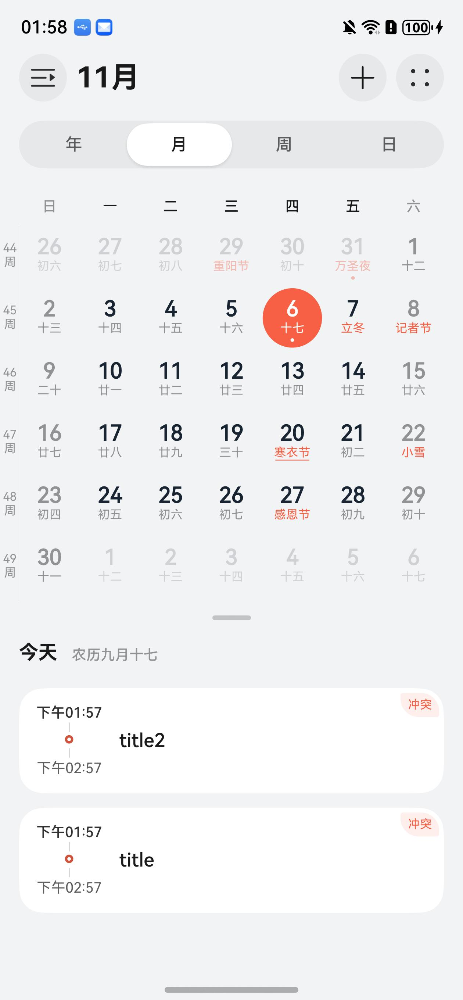

# CalendarEvent 测试用例归档

## 测试规模与覆盖

2026-11-20 扩充并检视：35个用例定义文件共52,643行、1085条逻辑用例；另有1条本地权限用例。行数只统计用例定义文件，不包含共享夹具和测试入口。35个逻辑套件均由[测试入口](entry/src/ohosTest/ets/test/List.test.ets)静态注册，保留完整Hypium启动引导。

| 用例组 | 数量 | 操作步骤与检查点 | 预期结果 | 本次结果 |
| --- | ---: | --- | --- | --- |
| 原生产逻辑 | 19 | 注入端口调用Session和PermissionGate，检查状态、参数与调用轨迹 | 状态及权限路由符合生产契约 | 设备通过 |
| Payload参数矩阵 | 120 | 在初始、重新配置、clear重建状态下执行创建、添加、编辑、修改；组合时间边界与事件ID | 账户、配置、完整日程参数及对象隔离正确，ID=0有效 | 设备通过 |
| Result结果矩阵 | 128 | 设置空、单项、多项、重复ID与中文标题结果；执行查询 | 返回数组和成员身份、顺序、固定筛选参数及选择状态正确 | 设备通过 |
| State状态矩阵 | 96 | 在创建中、配置中、就绪、选中、已删除、已清理及配置失败状态调用各操作 | 前置条件失败无端口副作用，允许操作及恢复路径正确 | 设备通过 |
| Failure错误矩阵 | 240 | 对各端口安排同步抛错、异步拒绝，并执行重试、clear和查询 | 原异常身份保持，选择状态不丢失，分支启动及恢复符合契约 | 设备通过 |
| Permission权限矩阵 | 242 | 组合权限名称、数组长度、授权码、完成顺序、invalidate与重入 | 只接受完整双授权，回调互斥，过期请求不改变当前状态 | 设备通过 |
| Race竞态矩阵 | 240 | 使用Pending精确控制创建、添加、删除、查询的完成全排列及跨clear时序 | 最新发起请求拥有选择权，迟到结果不覆盖新状态，实例隔离 | 设备通过 |
| 本地权限 | 1 | 输入反序全部授予、部分拒绝两种结果 | 返回true、false，并打印断言参数 | 主机通过 |

## 编码规范与检视修正

每条用例均有唯一大写`@tc.number`、与it名称一致的`@tc.name`、英文目的说明和有效断言；用例名称统一为`CalendarEvent<功能>_0001`形式。通过TestSupport集中记录begin/end及每次断言的实际值，补齐旧用例的显式类型、返回类型及type导入；不增加UI用例数量、不使用sleep调度竞态，也不修改生产日历业务或权限配置。

本次检视修复了用例命名、函数头说明和过时归档，并修正主机运行器把非Error异常值误判为成功、初始化失败未缓存和套件清理延迟的问题。设备测试日志统一使用hilog（DOMAIN=0xF811，TAG=[CalendarEventTest]），未使用console.*。

## 验证结果与复现

- 已在API26设备（OpenHarmony 7.1.0.22）执行ohosTest：`Tests run: 1085, Failure: 0, Error: 0, Pass: 1085, Ignore: 0`。
- 复现命令：`hdc shell aa test -b com.sample.calendarevent -m entry_test -s unittest OpenHarmonyTestRunner -s timeout 1200000`。
- 本地权限用例在主机执行通过；逻辑套件直接调用生产Session/Gate，只模拟SDK端口和必要枚举，不执行真实Calendar SDK、UI、权限弹框或数据库副作用。
- 1085条设备测试编号及名称唯一，元数据、有效断言、用例体长度和120字符行宽审计无问题。
- main和ohosTest均编译通过，并已完成设备安装与卸载验证。
- 本工程仅提交用例源码，不包含本地审计输出和签名材料；运行请使用DevEco Studio的ohosTest流程或上述`aa test`命令。

## 设备业务验收步骤

下表保留原业务验收步骤及效果截图。本次均未执行；自动化逻辑用例只校验生产契约，不能据此判定下表业务结果。

| 测试功能                                  | 预置条件                | 输入          | 预期输出                                                                                         | 是否自动 | 测试结果 |
|---------------------------------------|---------------------|-------------|----------------------------------------------------------------------------------------------| -------- | -------- |
| 拉起应用                                  | 设备正常运行              |             | 成功拉起应用                                                                                       | 是       | 未执行   |
| 弹出 允许“CalendarManager”读取和修改日程？ 权限申请弹框 | 位于CalendarEvent页面 | 点击‘允许’      |                                                                                              | 是       | 未执行   |
| 1，创建日历账户                              | 位于CalendarEvent页面   | 点击‘1，创建日历账户’ | 成功创建日历账户。 日历应用打开侧边栏，新增了‘MyCalendar’账户   | 是       | 未执行   |
| 2，创建日程                            | 位于CalendarEvent页面 | 点击‘2，创建日程 ’ | 成功创建日程。                                    | 是       | 未执行   |
| 3，修改日程                            | 位于CalendarEvent页面 | 点击‘3，修改日程’ | 成功修改日程。                                    | 是       | 未执行   |
| 4，查询所有日程                            | 位于CalendarEvent页面 | 点击‘4，查询所有日程’ | 成功查询所有日程。 观察日志打印 Succeeded in getting events, data -> [xxx]                              | 是       | 未执行   |
| 5，查询指定日程                            | 位于CalendarEvent页面 | 点击‘5，查询指定日程’ | 成功查询指定日程。 观察日志打印 Succeeded in getting events filter by time/eventId/title, data -> [xxx] | 是       | 未执行   |
| 6，删除指定日程                            | 位于CalendarEvent页面 | 点击‘6，删除指定日程’ | 成功删除指定日程。 观察日志打印 Succeeded in deleting event                                          | 是       | 未执行   |
