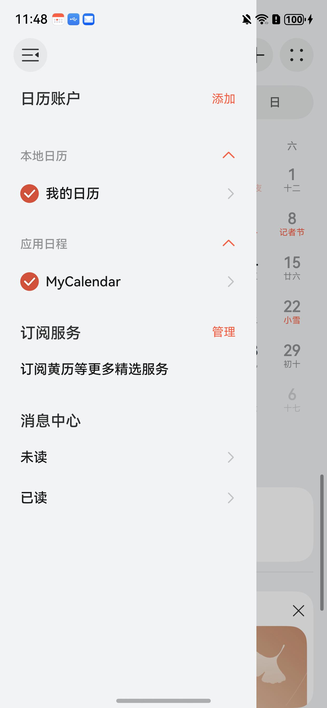

# CalendarManager 测试用例归档

## 历史设备用例记录

以下是工程已有记录，不是本轮设备执行结果；历史 Pass 和日志文本均未复测。本轮检测到连接设备，但未安装或运行应用，未验证权限弹框、UI、真实Hypium或Calendar SDK运行。

| 测试功能                                    | 预置条件                                  | 输入             | 预期输出                                                                                                | 是否自动 | 测试结果 |
|-----------------------------------------|---------------------------------------|----------------|-----------------------------------------------------------------------------------------------------| -------- | -------- |
| 拉起应用                                    | 设备正常运行                                |                | 成功拉起应用                                                                                              | 是       | 历史 Pass，本轮未测 |
| 弹出 允许“CalendarManager”读取和修改日程？ 权限申请弹框 | 位于CalendarManager页面                   | 点击‘允许’         |                                                                                                     | 是       | 历史 Pass，本轮未测 |
| 1，创建日历账户对象                              | 位于CalendarManager页面        | 点击‘1，创建日历账户对象’ | 成功创建日历账户。<br/>日历应用打开侧边栏，新增了‘MyCalendar’账户          | 是       | 历史 Pass，本轮未测 |
| 2，设置日历配置信息                              | 位于CalendarManager页面        | 点击‘2，设置日历配置信息’ | 成功设置日历配置信息。<br/>观察日志打印 Succeeded in setting config, data->{"enableReminder":true,"color":"#aabbcc"} | 是       | 历史 Pass，本轮未测 |
| 3，查询指定日历账户                              | 位于CalendarManager页面        | 点击‘3，查询指定日历账户’ | 成功查询指定日历账户。<br/>观察日志打印 Succeeded in getting calendar, data -> {"id":xx}                             | 是       | 历史 Pass，本轮未测 |
| 4，查询默认日历账户                              | 位于CalendarManager页面        | 点击‘4，查询默认日历账户’ | 成功查询默认日历账户。<br/>观察日志打印 Succeeded in getting calendar, data -> {"id":xx}                             | 是       | 历史 Pass，本轮未测 |
| 5，查询所有日历账户                              | 位于CalendarManager页面 | 点击‘5，查询所有日历账户’ | 成功查询所有日历账户。<br/>观察日志打印 Succeeded in getting all calendars, data -> [{"id":1},{"id":xx}]             | 是       | 历史 Pass，本轮未测 |
| 6，删除指定日历账户                              | 位于CalendarManager页面 | 点击‘6，删除指定日历账户’ | 成功删除MyCalendar日历账户，日历应用MyCalendar账户已删除。<br/>观察日志打印 Succeeded in deleting calendar                             | 是       | 历史 Pass，本轮未测 |

## 自动化用例统计

全部设备套件在 [List.test.ets](entry/src/ohosTest/ets/test/List.test.ets) 注册，共803个用例，其中796个为纯业务逻辑用例、6个为已有UI场景、1个为真实SDK场景；上表拉起应用和权限弹框属于预置步骤，不额外计为两个UI用例。此前已补充727个逻辑矩阵用例，本轮保留现有矩阵并加强断言，不重复生成或新增UI用例。

| 文件或分片族 | 用例数 | 本轮结果 |
| --- | ---: | --- |
| [Ability.test.ets](entry/src/ohosTest/ets/test/Ability.test.ets) | 6 | 保留已有有效断言和异步启动等待；本轮未修改、未在设备运行 |
| [CalendarManagerLogic.test.ets](entry/src/ohosTest/ets/test/CalendarManagerLogic.test.ets) | 17 | 保留业务场景和XTS元数据，本轮修正格式和显式类型；规范及HAP编译通过；本轮完整主机回归通过 |
| [CalendarManagerLifecycle.test.ets](entry/src/ohosTest/ets/test/CalendarManagerLifecycle.test.ets) | 40 | 规范及HAP编译通过；本轮完整主机回归通过 |
| [CalendarManagerErrorBoundary.test.ets](entry/src/ohosTest/ets/test/CalendarManagerErrorBoundary.test.ets) | 12 | 规范及HAP编译通过；本轮完整主机回归通过 |
| CalendarManagerSequence01～13.test.ets | 343 | 三步账户操作组合；规范及HAP编译通过；本轮完整主机回归通过 |
| CalendarManagerRecovery01～03.test.ets | 84 | 同步抛错与异步拒绝后的恢复；规范及HAP编译通过；本轮完整主机回归通过 |
| CalendarManagerPermutation01～07.test.ets | 180 | 权限请求结果、完成顺序和失效；规范及HAP编译通过；本轮完整主机回归通过 |
| CalendarManagerValidation01～04.test.ets | 120 | 权限名称与授权码边界；规范及HAP编译通过；本轮完整主机回归通过 |
| [CalendarManagerSdk.test.ets](entry/src/ohosTest/ets/test/CalendarManagerSdk.test.ets) | 1 | 修复断言失败跳过清理的问题；未在设备运行 |
| [LocalUnit.test.ets](entry/src/test/LocalUnit.test.ets) | 1 | 独立本地套件，不计入803个设备用例；真实SDK类型检查通过；本轮完整主机回归通过 |

既有727个矩阵用例均直接调用生产 `CalendarAccountSession`、`CalendarPermissionGate` 或 `hasCalendarPermissions`，不维护生产业务的测试镜像。原有40个生命周期与12个异常边界场景继续保留，不重复计入727例新增量。全部803个设备用例及1个本地用例按用户提供的XTS手册核验：唯一编号、每接口0100递增、名称0001递增、英文目的、name/it/TAG一致、分类字段与位标志、有效assertEqual和异常传播；全部测试目录ETS文件不超过120列。原17个基础用例为满足命名要求重命名，业务场景未减少，映射见 [.validation/baseline-name-mapping.json](.validation/baseline-name-mapping.json)。

### 727个逻辑矩阵用例

入口为 [CalendarManagerMatrix.test.ets](entry/src/ohosTest/ets/test/CalendarManagerMatrix.test.ets)，通过27个分片在设备List中注册。每个分片内编号从0100开始按100递增，名称从0001开始按1递增；全局唯一性已检查。完整编号、名称、英文目的和静态断言数量见 [.validation/matrix-format-check.json](.validation/matrix-format-check.json)，生成输入清单见 [.validation/matrix-manifest.json](.validation/matrix-manifest.json)。这些本地验证文件不随代码提交；每例元数据和步骤同时保存在对应ETS源码中。

| 分片 | 数量与用例名称范围 | 操作步骤 | 预期结果 |
| --- | --- | --- | --- |
| CalendarManagerSequence01～12 | 每片28例，testCalendarManagerSequenceXX0001～XX0028 | 先创建种子句柄，再执行三步操作；枚举创建、删除、清理、指定查询、默认查询、列表查询、配置共7³种组合 | 调用轨迹、返回身份、配置目标和参数符合预先推导结果；查询不收养句柄，清理不删用户数据，最终删除的对象就是实际创建句柄 |
| CalendarManagerSequence13 | 7例，testCalendarManagerSequence130001～130007 | 执行剩余三步组合 | 同上，合计343例，不遗漏组合 |
| CalendarManagerRecovery01～03 | 每片28例，testCalendarManagerRecoveryXX0001～XX0028 | 对六种非清理操作分别注入同步抛错或异步拒绝，然后执行七种恢复操作，合计6×2×7 | 必须实际发生预期错误，验证消息和同一错误对象；保留或释放正确所有权；后续创建、配置、查询、删除正常恢复 |
| CalendarManagerPermutation01～06 | 每片27例，testCalendarManagerPermutationXX0001～XX0027 | 连续发起三个权限请求，枚举授权、拒绝、失败共3³种结果及全部六种完成顺序 | 返回本次原结果或原错误，仅最后发起且仍有效的请求触发对应回调；旧请求不污染新结果 |
| CalendarManagerPermutation07 | 18例，testCalendarManagerPermutation070001～070018 | 三个请求均授权、均拒绝或均失败，发起后失效，枚举六种完成顺序 | 请求结果和错误仍正确传播，但所有失效请求均不触发回调；挂起操作最终释放 |
| CalendarManagerValidation01～04 | 每片30例，testCalendarManagerValidationXX0001～XX0030 | 十二种权限列表形态与十种授权码形态做笛卡尔积 | 仅精确双权限、两个成功授权码通过；重复、未知、数量不符及非成功码拒绝，输入列表不被修改，权限门返回原对象 |

`XX`表示两位分片号。测试值包含反序权限、重复权限、空名称、大小写和空白差异，以及NaN、Infinity、负数、非零码和长度差异；不是只更换普通值的重复断言。每例都打印TAG开始/结束和断言实际值，结束日志在finally执行，意外错误向框架传播。记录型端口仅验证真实生产逻辑，不代表Calendar SDK调用成功。

### 原有17个逻辑用例

| 用例名称 | 操作步骤 | 预期结果 |
| --- | --- | --- |
| testCalendarManagerBaseline0001 | 获取固定账户 | 名称、类型和显示名称符合账户契约 |
| testCalendarManagerBaseline0002 | 连续创建后完成请求 | 共用同一请求且只创建一次 |
| testCalendarManagerBaseline0003 | 拒绝创建后重试 | 失败传播，重试成功 |
| testCalendarManagerBaseline0004 | 未创建时删除，再查询账户 | 拒绝删除且不把查询句柄据为己有 |
| testCalendarManagerBaseline0005 | 创建，拒绝删除，再重试 | 保留同一可删除句柄 |
| testCalendarManagerBaseline0006 | 创建后清理会话 | 不调用数据删除接口 |
| testCalendarManagerBaseline0007 | 挂起创建，清理，再完成创建 | 迟到句柄不能被删除 |
| testCalendarManagerBaseline0008 | 按账户查询后配置 | 提醒与颜色传给查得的端口 |
| testCalendarManagerBaseline0009 | 令配置查询失败 | 错误传播，setter不调用 |
| testCalendarManagerBaseline0010 | 分别指定与默认查询 | 参数和返回句柄不同 |
| testCalendarManagerBaseline0011 | 查询列表、空列表和失败 | 保持顺序、身份并传播错误 |
| testCalendarManagerBaseline0012 | 两个会话分别创建与删除 | 所有权彼此独立 |
| testCalendarManagerBaseline0013 | 判定两个权限及反序结果 | 按名称映射，仅双零授权码通过 |
| testCalendarManagerBaseline0014 | 判定重复、未知和错位结果 | 全部拒绝 |
| testCalendarManagerBaseline0015 | 通过业务权限门处理拒绝结果 | 不访问账户端口 |
| testCalendarManagerBaseline0016 | 拒绝权限请求 | 原错误传播，不访问账户端口 |
| testCalendarManagerBaseline0017 | 并发请求、失效与迟到完成 | 抑制旧请求回调 |

### 保留的40个生命周期用例

下列编号需加前缀 `SUB_CALENDAR_MANAGER_`，用例名称需加前缀 `testCalendarManager`，分别组成源码中的完整 `@tc.number` 与 `@tc.name`。表中操作按执行顺序描述；所有结果均为主机隔离业务回归通过，不是设备授权或 SDK 运行结果。

| 编号后缀 | 名称后缀 | 操作步骤 | 预期结果 |
| --- | --- | --- | --- |
| CREATECALENDAR_0100 | CreateCalendar0001 | 挂起创建，先删除，再完成创建 | 未完成时不可删除，成功后仅删除创建句柄 |
| CREATECALENDAR_0200 | CreateCalendar0002 | 合并两次创建，拒绝，再重试 | 同一Promise和错误对象，重试可用 |
| CREATECALENDAR_0300 | CreateCalendar0003 | 创建同步抛错，再重试删除 | 验证错误信息，未毒化重试 |
| CREATECALENDAR_0400 | CreateCalendar0004 | 创建完成后再创建新句柄 | 新请求不合并，删除新句柄 |
| CREATECALENDAR_0500 | CreateCalendar0005 | 已有句柄时令替换创建失败 | 原句柄所有权保留 |
| CREATECALENDAR_0600 | CreateCalendar0006 | 清理后新建，先完成旧创建 | 旧完成不能选中或清除新请求 |
| CREATECALENDAR_0700 | CreateCalendar0007 | 清理后新建，先拒绝旧创建 | 原错误传播，新请求仍合并 |
| CREATECALENDAR_0800 | CreateCalendar0008 | 新创建成功后完成旧创建 | 新句柄仍为可删除句柄 |
| CLEAR_0100 | Clear0001 | 多次清理、创建并再清理重建 | 清理幂等、不删数据且允许重建 |
| DELETECALENDAR_0100 | DeleteCalendar0001 | 挂起删除，完成后再删除 | 等待端口完成，后续删除拒绝 |
| DELETECALENDAR_0200 | DeleteCalendar0002 | 旧删除挂起期间创建替换句柄 | 旧删除成功不清除新所有权 |
| DELETECALENDAR_0300 | DeleteCalendar0003 | 旧删除挂起，替换成功，再拒绝旧删除 | 传播旧错误并保留新句柄 |
| DELETECALENDAR_0400 | DeleteCalendar0004 | 挂起删除，清理并用同一句柄重建 | 旧删除不能清除新代际所有权 |
| DELETECALENDAR_0500 | DeleteCalendar0005 | 清理后拒绝旧删除 | 不恢复已清理的所有权 |
| SETCONFIG_0100 | SetConfig0001 | 挂起指定查询后完成配置 | 查询完成前不调用setter，参数正确 |
| SETCONFIG_0200 | SetConfig0002 | 挂起setter后拒绝 | 不提前完成，错误身份与信息保留 |
| SETCONFIG_0300 | SetConfig0003 | 配置失败后重试并删除 | 重试成功，创建所有权不变 |
| SETCONFIG_0400 | SetConfig0004 | 反序完成两个配置查询 | 各自使用对应句柄与独立配置对象 |
| CLEAR_0200 | Clear0002 | 发起配置后清理，再完成查询 | 配置完成但不取得删除所有权 |
| GETCALENDARBYPARAM_0100 | GetCalendarByParam0001 | 指定与默认查询失败后删除 | 错误原样传播，创建句柄不变 |
| GETCALENDARBYPARAM_0200 | GetCalendarByParam0002 | 修改先前查询参数的displayName后再查询、配置与创建 | 每次指定参数独立，默认查询无参数 |
| GETALLCALENDARS_0100 | GetAllCalendars0001 | 查询列表后请求删除 | 返回原列表，不收养查询句柄 |
| GETALLCALENDARS_0200 | GetAllCalendars0002 | 列表查询失败后重试 | 错误原样传播，重试返回原列表 |
| GETALLCALENDARS_0300 | GetAllCalendars0003 | 反序完成两个列表请求 | 各返回对应列表身份 |
| GETDEFAULTCALENDAR_0100 | GetDefaultCalendar0001 | 默认查询挂起期间创建，再完成查询 | 不替换已创建的选中句柄 |
| CREATECALENDAR_0900 | CreateCalendar0009 | 两会话共用管理端口但分别创建 | 删除各自句柄 |
| HASCALENDARPERMISSIONS_0100 | HasCalendarPermissions0001 | 输入非零、NaN和Infinity授权码 | 不判为授权 |
| HASCALENDARPERMISSIONS_0200 | HasCalendarPermissions0002 | 增加权限项或授权码 | 拒绝数量异常 |
| HASCALENDARPERMISSIONS_0300 | HasCalendarPermissions0003 | 改大小写、尾部空格或空权限名 | 拒绝非精确名称 |
| HASCALENDARPERMISSIONS_0400 | HasCalendarPermissions0004 | 反序输入且写权限拒绝 | 按权限名判定，不修改输入 |
| REQUEST_0100 | Request0001 | 挂起请求后完成授权 | 挂起时无回调，返回原授权对象 |
| REQUEST_0200 | Request0002 | 新请求拒绝后旧请求授权 | 仅最新拒绝回调 |
| REQUEST_0300 | Request0003 | 新请求授权后旧请求失败 | 原错误传播但不调用旧失败处理 |
| REQUEST_0400 | Request0004 | 新请求失败后旧请求拒绝 | 仅最新失败回调 |
| REQUEST_0500 | Request0005 | 使挂起请求失效后拒绝 | 错误传播，无任何回调 |
| INVALIDATE_0100 | Invalidate0001 | 多次失效后发起新请求，旧请求迟到 | 新请求有效，旧回调抑制 |
| REQUEST_0600 | Request0006 | 请求器同步抛错后重新授权 | 验证错误，允许后续授权 |
| INVALIDATE_0200 | Invalidate0002 | 请求器重入失效自己的请求 | 返回对象但不触发处理函数 |
| REQUEST_0700 | Request0007 | 一个权限门失效并拒绝，另一个完成授权 | 两个权限门彼此独立 |
| REQUEST_0800 | Request0008 | 重用handlers先拒绝再授权 | 每次返回本次对象，回调顺序正确 |

### 保留的12个异常边界用例

编号和名称前缀与上一表相同。同步抛错场景必须实际捕获预期异常并验证信息；不抛错时断言失败。异步场景在断言前观察拒绝，结束时释放全部挂起门并等待已观察操作完成。

| 编号后缀 | 名称后缀 | 操作步骤 | 预期结果 |
| --- | --- | --- | --- |
| BOUNDARY_NAMED_QUERY_0100 | SyncNamedQuery0001 | 指定查询同步抛错后重试 | 错误原样保留，不调用默认查询 |
| BOUNDARY_DEFAULT_QUERY_0100 | SyncDefaultQuery0001 | 创建后默认查询同步抛错，再删除 | 不丢失创建句柄 |
| BOUNDARY_LIST_QUERY_0100 | SyncListQuery0001 | 全部查询同步抛错后重试 | 验证原错误，重试返回列表 |
| BOUNDARY_CONFIG_LOOKUP_0100 | SyncConfigLookup0001 | 配置查询同步抛错 | 外层Promise拒绝，setter未调用 |
| BOUNDARY_CONFIG_SETTER_0100 | SyncConfigSetter0001 | 创建后setter同步抛错，再删除 | 验证错误，创建所有权不变 |
| BOUNDARY_DELETE_0100 | SyncDelete0001 | 删除同步抛错后重试 | 两次提交同一创建句柄 |
| BOUNDARY_PENDING_REPLACEMENT_0100 | PendingReplacement0001 | 替换创建挂起，先删除旧句柄，再完成创建 | 后续可删除替换句柄 |
| BOUNDARY_PENDING_REPLACEMENT_0200 | PendingReplacement0002 | 替换创建挂起，删除旧句柄，再拒绝创建 | 已删句柄不被恢复 |
| BOUNDARY_OVERLAPPING_DELETE_0100 | OverlappingDelete0001 | 两个删除挂起，后者成功，前者迟到失败 | 旧错误传播，不恢复所有权 |
| BOUNDARY_PENDING_CREATE_QUERY_0100 | PendingCreateQuery0001 | 创建挂起时查询同步抛错，再完成创建 | 不取消或打断创建合并 |
| BOUNDARY_CONFIG_ISOLATION_0100 | ConfigFailureIsolation0001 | 新配置成功后旧查询返回会抛错的setter | 原错误传播，成功配置目标不变 |
| BOUNDARY_PERMISSION_ORDER_0100 | PermissionInitiationOrder0001 | 新权限请求尚未完成时先完成旧拒绝 | 发起新请求即抑制旧回调 |

## 主机隔离业务回归

2026-11-20 继续处理前复核797/797例通过，15,259次断言，源码前后SHA256一致，结果保存在 [.validation/continuation-pre-repair-host.json](.validation/continuation-pre-repair-host.json)。本地账户用例以修改可写displayName验证独立性；重新对真实SDK声明类型检查通过，负向name只读赋值仍能检测到2540错误。

本轮修复运行器异常判定，并在现有用例中补充569处有效断言：5处明确检查异步成功结果没有错误，564处检查实际删除句柄身份。修复后的797例完整隔离回归全部通过，执行15,828次断言，0失败。最终报告生成于2026-11-20T03:59:41.927Z，运行前后源码哈希一致且与逐例归档生成时一致，见 [.validation/host-regression.json](.validation/host-regression.json)；设备及SDK用例不计为主机执行成功。

执行器加载当前 `.ets` 生产业务源码并转译，不维护业务镜像。记录端口、断言和hook为主机边界；仅提供已核验的 `CalendarType.LOCAL` 数据常量，不执行 Calendar SDK、真实权限请求、Hypium、UI或Native模块。

每例运行在新子进程，真实墙钟超时为2000ms；断言失败、未处理拒绝、清理失败或超时均非零退出，并立即停止后续用例。父进程只加载本例所属分片到子进程，不在每个子进程重复注册全部五万行测试。原断言失败、超时、清理失败三种负向自测本轮再次验证按预期失败，源码保持不变；超时阈值包含子进程启动与执行开销。这些自测另计，不计入797例业务通过数，报告为 [.validation/runner-assertion.json](.validation/runner-assertion.json)、[runner-timeout.json](.validation/runner-timeout.json) 和 [runner-cleanup.json](.validation/runner-cleanup.json)。

本轮修复异常判定后，新增运行器25/25自检通过：同步/异步抛出undefined、null、0、false、空字符串和Error，清理失败、原始错误保留、无断言拒绝、失败后停止、逐例新进程和真实超时。见 [.validation/continuation-runner-contract.json](.validation/continuation-runner-contract.json)，不计入797例业务回归。

对3个断言漏检场景做临时副本故障注入：配置记录后拒绝、并发配置记录后拒绝、删除同名但不同身份的句柄。旧用例会通过，修复后的用例均失败，验证增强断言确实生效；仅修改临时副本，实际生产源码未改。见 [.validation/continuation-assertion-sensitivity.json](.validation/continuation-assertion-sensitivity.json)。

完整逐例编号、名称、源码行号、操作、断言预期和本次结果已归档至 [.validation/continuation-test-catalog.json](.validation/continuation-test-catalog.json)，共804条：796条设备逻辑定义加1条本地用例标记为主机通过，6条UI和1条真实SDK标记为设备未执行。清单绑定完整entry/src的SHA256，已验证与最终回归运行前后源码一致。所有.validation报告均为本地验证产物，受.gitignore排除；正式PR附件需另行整理并避开含本地签名身份的快照。

在工程目录运行：

```bash
node host-regression.cjs
node .validation/check-matrix.cjs
node .validation/validate-xts.cjs
node .validation/validate-xts.cjs CalendarManagerErrorBoundary
node build-audit.cjs default
node build-audit.cjs ohosTest
```

## 真实 SDK 回归

唯一用例 `testCalendarManagerRealSdk0001` 在设备上请求 READ/WRITE 两项权限，仅在两项真实授权码均为0后调用 Calendar SDK。测试创建唯一账户，验证配置、指定账户、默认账户和全部账户查询。创建成功后立即进入try/finally；所有断言均在try中，finally只删除该测试返回的原生句柄，不会因清理前断言失败跳过删除。已检测到连接设备，但本轮未安装、未运行该用例，不能把主机端口替身结果计为SDK成功；六个UI用例只断言按钮文本与可用状态，不证明业务操作成功。

## 构建与检视证据

本轮先重新编译：021 default和022 ohosTest成功，再调用pr-review_origin检视并修正。修正后023 default、024 ohosTest均成功，见 [main最终日志](.validation/build-023-default.log) 和 [测试最终日志](.validation/build-024-ohosTest.log)。构建源码保护检查无缺失、改写或新增；保留SDK可抛异常告警，不宣称零告警。

以下为此前扩充阶段的历史记录，不代替本轮最终验证。扩充727例后，013 default通过；014 ohosTest因对只支持基本类型的断言包装器传入对象失败，已改为验证布尔身份和错误信息，015 ohosTest通过。主包和测试包通过后再次调用 `pr-review_origin`，按style、security、logging、typescript、basic五项逐一检视并修复。检视后016 default通过；最终源码017 ohosTest和018 default均构建通过，日志分别为 [.validation/build-017-ohosTest.log](.validation/build-017-ohosTest.log) 和 [.validation/build-018-default.log](.validation/build-018-default.log)。此前008～012为早期52例扩充阶段的历史记录，不作为此次最终结论。

检视后再次顺序构建两个目标，最终记录见 [.validation/audit.json](.validation/audit.json)。每次构建前保存源码清单、哈希和快照，构建后检查缺失、改写和新增；缺失文件只能从只读原仓恢复，不覆盖已有修改。连续5次失败永久停编，不清空历史记录。

### 检视修复与保留事项

| 检视项 | 修复位置 | 结果与边界 |
| --- | --- | --- |
| 主机运行器把非Error异常当作成功 | [host-regression.cjs](host-regression.cjs) | 本轮用独立失败标志判定，保留原始异常、清理失败、逐例进程及超时保护，25项自检通过 |
| 成功路径忽略observe捕获的拒绝 | [CalendarManagerLifecycle.test.ets](entry/src/ohosTest/ets/test/CalendarManagerLifecycle.test.ets) | 本轮增加5处error===undefined检查，意外拒绝不再被成功路径忽略 |
| 删除只比名称漏检同名替代句柄 | Sequence、Recovery共16分片及生成模板 | 本轮增加564处实际创建句柄或恢复句柄身份断言，不重新生成其余用例，3个故障注入场景验证成功 |
| 原基础用例空格与请求器返回类型 | [CalendarManagerLogic.test.ets](entry/src/ohosTest/ets/test/CalendarManagerLogic.test.ets) | 本轮统一格式并补4个Promise返回类型，保持用例名称、编号及行为 |
| 归档重复等待状态与历史结果 | 本文 | 本轮清理重复状态、分离历史证据和最终执行，附逐例清单及真实设备限制 |
| 六个UI测试无断言、启动未等待 | [Ability.test.ets](entry/src/ohosTest/ets/test/Ability.test.ets) | 添加按钮文本和可用状态断言，await应用启动；保留六个原场景，不新增UI |
| 本地测试自身相等的无效断言 | [LocalUnit.test.ets](entry/src/test/LocalUnit.test.ets) | 改为生产账户工厂的字段契约与对象独立性测试 |
| SDK断言失败可能跳过清理 | [CalendarManagerSdk.test.ets](entry/src/ohosTest/ets/test/CalendarManagerSdk.test.ets) | 创建后立即进入try，finally删除原句柄；不把断言放在清理前 |
| 删除句柄只比较名称可能漏检 | [CalendarMatrixSupport.ets](entry/src/ohosTest/ets/test/CalendarMatrixSupport.ets) 及Sequence分片 | 记录实际创建对象，同时断言最终删除对象身份 |
| 原基础逻辑缺XTS字段和规范名称 | [CalendarManagerLogic.test.ets](entry/src/ohosTest/ets/test/CalendarManagerLogic.test.ets) | 保留17个场景，补元数据、显式类型、assertEqual、TAG和finally日志 |
| 旧用例异常时遗漏结束日志 | Lifecycle与ErrorBoundary分片 | 52例结束日志移到finally，仍向框架传播意外异常 |
| 类型导入和异步返回类型 | SdkCalendarAccount、EntryAbility、EntryBackupAbility | 区分import type；补Promise<void>返回类型 |
| 页面中文硬编码和压缩格式 | [Index.ets](entry/src/main/ets/pages/Index.ets)、[string.json](entry/src/main/resources/base/element/string.json) | 六个按钮改为同值资源引用；保留业务入口、布局和功能 |
| 测试注册与引导 | List、OpenHarmonyTestRunner、本地List、module及build配置 | 原完整Hypium/ohosTest引导保留，新矩阵全部注册 |
| 文档统计和运行边界 | 本文及README | 更新规模、用例、验证证据；历史设备Pass不作为本轮结果 |

本轮保留工程现有 `com.sample.calendarmanager` 包名和本地签名身份。包名后缀全小写且与工程一致，但前缀与技能推荐的 `com.samples`/`com.example` 不同，这是未调整的现有配置差异，不代表已获正式PR豁免；现有本地签名配置及任何凭据不得原样随正式PR提交。未修改签名权限或配置，未输出密码。真实SDK调用保留编译器的可抛异常提示，不通过吞掉错误消除警告。正式PR前仍需清理本地签名并取得真实设备结果；本轮不构成无条件合入依据。PR链接、提交格式和目标分支未提供，未创建提交或发布评论。

## 源码规模和功能保护

当前 `entry/src/ohosTest/ets/test` 内ETS测试源码共 **52,195物理行**，其中 **44,489行含语法token**。物理行包含测试源码中的注释和空行；token-bearing统计去掉注释与空行，仍包含测试端口、日志、断言和结构语法，不代表纯业务有效行。约50000物理行目标已达到，不能声称有50000行纯业务代码。统计不计脚本、快照、日志、图片、资源、本文或生产源码，也不将本地LocalUnit及测试runner计入上述目录行数。当前规模以 [.validation/matrix-format-check.json](.validation/matrix-format-check.json) 为准；旧extension-source-stats报告是早期阶段的历史基线统计，不作为最终规模结论。

组合覆盖由七种真实业务操作、同步/异步错误类别及权限结果/顺序/失效边界驱动；每例独立执行生产逻辑并验证预先推导的轨迹、返回和对象身份，没有修改生产算法来满足测试。保留原17+40+12逻辑场景、六个UI场景和一个SDK场景；此前扩充阶段调整过旧测试、生产入口的类型/格式及按钮资源引用；本轮只加强测试、运行器、模板和归档，entry/src/main生产源码与本轮开始时完全一致，未调整包名、SDK、签名或权限。构建和完整宿主回归期间不修改源码。源码哈希一致不等于设备功能无回归，真实授权、SDK和UI仍待设备验证。