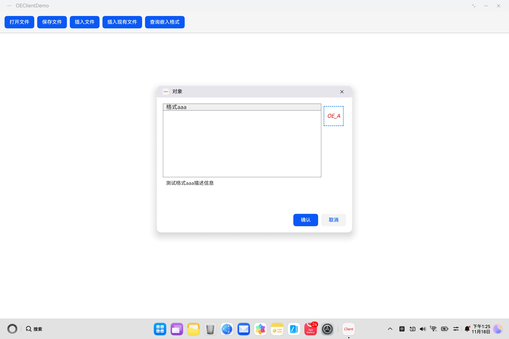
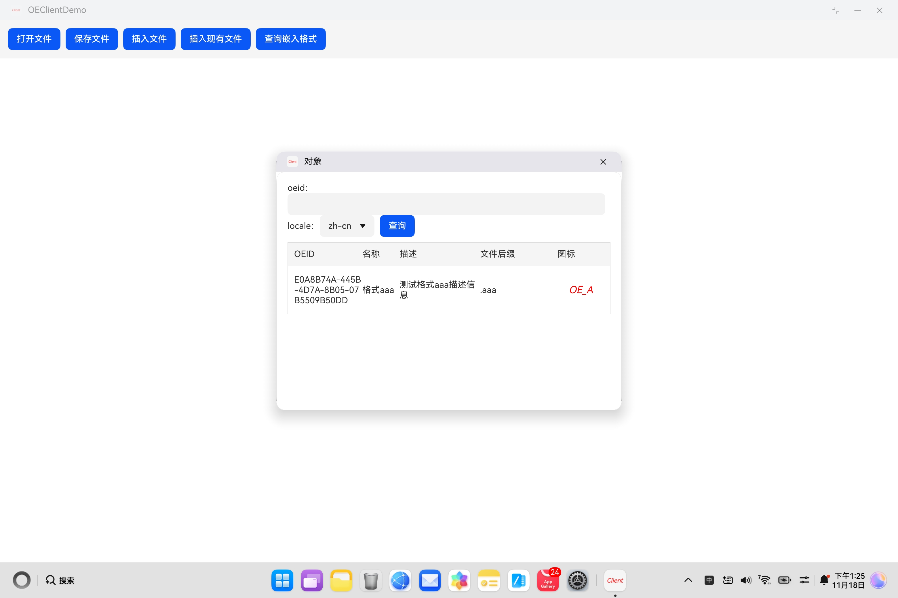

# OEClientDemo

### 介绍

本示例展示了[OH_ContentEmbed](https://gitcode.com/openharmony/docs/blob/master/zh-cn/application-dev/reference/apis-content-embed-kit/capi-contentembed.md)内容嵌入模块客户端的开发方法：作为OE（Object Editor）服务端的客户端，通过[ContentEmbedKit](https://gitcode.com/openharmony/docs/blob/master/zh-cn/application-dev/reference/apis-content-embed-kit/capi-content-embed-proxy-h.md)提供的Native接口，实现查询可嵌入文档格式.创建OE文档.创建客户端OE对象.启动OE Extension编辑文档.获取文档快照.保存与打开`.ole`复合文件等完整客户端能力，对应SysCap：`SystemCapability.ContentEmbed.ObjectEditor`。

本示例完整演示OE客户端开发流程，主要包含：

1. 查询当前设备在指定语言下支持的所有可嵌入文档格式，以及按OEID查询单个格式信息（名称.描述.图标.文件后缀）。
2. 基于OEID创建空白OE文档，或基于本地文件创建嵌入式.链接式OE文档。
3. 创建客户端OE对象（`ContentEmbed_ExtensionProxy`），注册更新.错误.编辑结束.Extension停止四类回调，并通过`OH_ContentEmbed_Proxy_StartWork`启动OE Extension组件。
4. 通过`OH_ContentEmbed_Proxy_DoEdit`通知服务端启动UIAbility编辑文档，通过`OH_ContentEmbed_Proxy_GetSnapshot`获取文档快照用于预览。
5. 以`.ole`复合文件（zlib压缩包，内含`data.json`元数据与`oleObjectN.bin`文档流）形式持久化客户端OE对象列表，支持打开后恢复卡片并按需重新拉起OE Extension编辑。
6. 链接式文档通过`OH_FileShare_PersistPermission`与`OH_FileShare_ActivatePermission`持久化并激活picker URI的读写权限。

应用包名：`com.samples.oeclientdemo`。

### 效果展示






本应用作为OE客户端运行，主界面提供打开`.ole`文件.保存`.ole`文件.插入新对象.插入本地文件.查询格式五个工具栏按钮，并以卡片网格展示当前已创建或已恢复的OE对象。每张卡片显示OE文档快照，双击卡片调用`OH_ContentEmbed_Proxy_DoEdit`拉起OE服务端UIAbility进行编辑，单击卡片显示关闭按钮可销毁客户端OE对象。插入新对象与插入本地文件分别通过子窗口选择格式或选择本地文件并指定嵌入.链接方式，查询格式通过子窗口按OEID与locale查询格式详情。

### 工程目录

```text
entry/src/main/
├── cpp/
│   ├── napi_init.cpp                              // NAPI模块注册，导出queryAll.query.createByOEid.createFromLocal.createDormant
│   ├── CMakeLists.txt                             // CMake构建配置
│   ├── content_embed/
│   │   ├── content_embed_proxy.h                  // ContentEmbedProxyWrapper类声明与content_embed命名空间工厂接口
│   │   └── content_embed_proxy.cpp                // CEProxy核心实现：格式查询.文档创建.代理生命周期.回调分发.休眠与重激活
│   ├── common/
│   │   ├── common.h                               // 日志宏与ContentEmbedFormat结构体定义
│   │   ├── napi_object_parser.h                   // NAPI参数解析工具
│   │   └── utils.h                                // 通用工具函数
│   └── types/libentry/
│       ├── Index.d.ts                             // NAPI接口声明，供ArkTS侧import libentry.so使用
│       └── oh-package.json5
├── ets/
│   ├── abilitystage/
│   │   └── EntryAbilityStage.ets                  // AbilityStage，onAcceptWant按want.uri哈希实现specified复用
│   ├── entryability/
│   │   └── EntryAbility.ets                       // UIAbility，解析want.uri存入AppStorage，加载pages/Index
│   ├── entrybackupability/
│   │   └── EntryBackupAbility.ets                 // 备份Extension
│   ├── common/
│   │   ├── Logger.ets                             // 日志封装，统一TAG前缀[Sample_OEClientDemo]
│   │   ├── CEErrorMap.ets                         // CE错误码到本地化提示的映射
│   │   ├── CECardViewModel.ets                    // @Observed视图模型，桥接CEProxy与FileCard的响应式渲染
│   │   └── Common.ets                             // 公共常量
│   ├── component/
│   │   └── FileCard.ets                           // OE对象卡片组件，展示快照并支持双击编辑.单击删除
│   ├── pages/
│   │   ├── Index.ets                              // 主页面，工具栏与OE对象卡片网格
│   │   ├── ContentEmbedFormat.ets                 // 格式选择子窗口，列出可嵌入文档格式
│   │   ├── FilePickerTab.ets                      // 本地文件选择子窗口，选择嵌入或链接方式
│   │   └── ContentEmbedFormatQuery.ets            // 格式查询子窗口，按oeid与locale查询格式信息
│   └── utils/
│       └── InnerEvent.ets                         // emitter事件ID定义
├── resources/
│   ├── base/profile/
│   │   ├── main_pages.json                        // 页面路由配置
│   │   └── backup_config.json                     // 备份配置
│   ├── base/element/string.json                   // 字符串资源（base.en.zh三套）
│   └── rawfile/arkdata/utd/utd.json5              // 自定义UTD类型声明 com.samples.oeclientdemo.ole
└── module.json5                                   // 模块配置，声明EntryAbility与备份Extension及权限
```

### 使用说明

1. **准备服务端应用**：本客户端需与OE服务端应用（如OEServerDemo）配合使用，服务端负责实现`type: "contentEmbed"`的ExtensionAbility并提供文档编辑能力。
2. **查询可嵌入格式**：点击主界面"查询格式"按钮，在子窗口中输入OEID与locale（留空OEID查询全部），查看格式的名称.描述.图标与支持的文件后缀。
3. **插入新对象**：点击"插入新对象"按钮，在子窗口的格式列表中选择一种格式并确认，客户端基于该OEID创建空白OE文档并启动OE Extension，卡片出现在网格中。
4. **插入本地文件**：点击"插入本地文件"按钮，在子窗口中选择本地文件并选择"复制"（嵌入）或"链接"方式，客户端基于该文件创建OE文档并启动OE Extension。
5. **编辑文档**：双击网格中的卡片，客户端调用`OH_ContentEmbed_Proxy_DoEdit`通知服务端拉起UIAbility编辑文档。编辑过程中服务端通过`OnUpdate`回调通知客户端刷新，客户端自动调用`refresh`更新快照并将文档流写入沙箱。
6. **获取快照**：卡片创建后通过`OnUpdate`回调触发`refresh`获取OE文档快照并展示为缩略图，无需手动操作。
7. **保存与打开`.ole`文件**：点击"保存文件"将当前所有OE对象以`.ole`复合文件（zlib压缩包）形式持久化；点击"打开文件"选择`.ole`文件，客户端解压后用`createDormant`恢复卡片，双击卡片可重新拉起OE Extension继续编辑。
8. **销毁对象**：单击卡片显示关闭按钮，点击关闭按钮调用`destroy`销毁客户端OE对象并从网格移除。

### 具体实现

OE客户端的核心逻辑在Native模块实现，源码参考：[content_embed_proxy.cpp](entry/src/main/cpp/content_embed/content_embed_proxy.cpp)。

- **格式查询**：`QueryAll`通过`OH_ContentEmbed_CreateContentEmbedInfo`与`OH_ContentEmbed_GetContentEmbedInfo`获取指定locale下所有可嵌入格式，遍历每个`ContentEmbed_Format`取出oeid.名称.描述.图标与文件后缀；`Query`通过`OH_ContentEmbed_GetContentEmbedFormatByOEidAndLocale`按OEID查询单个格式，接口参考：[content_embed_common.h](https://gitcode.com/openharmony/docs/blob/master/zh-cn/application-dev/reference/apis-content-embed-kit/capi-content-embed-common-h.md)。
- **Context传递**：`createByOEid`/`createFromLocal`/`createDormant`的第一个参数为ArkTS侧`UIAbilityContext`，native侧通过`napi_unwrap`将其解包为C++指针，供`OH_ContentEmbed_CreateExtensionProxy`建立客户端OE对象与上下文的关联，源码参考：[content_embed_proxy.cpp](entry/src/main/cpp/content_embed/content_embed_proxy.cpp)。
- **OE文档创建**：
    - `createByOEid`调用`OH_ContentEmbed_CreateDocumentByOEid`基于OEID创建空白OE文档。
    - `createFromLocal`调用`OH_ContentEmbed_CreateDocumentByFile`基于本地文件创建OE文档，`isLinking`区分嵌入与链接方式。链接模式下先调用`OH_FileShare_PersistPermission`与`OH_FileShare_ActivatePermission`持久化并激活picker URI的读写权限，避免服务端`CheckUriAuthorization`校验失败。
    - `createDormant`不创建活代理，仅构造`ContentEmbedProxyWrapper`元数据（名称.沙箱路径.快照路径），用于从`.ole`文件恢复卡片后按需重激活。
- **客户端OE对象与回调**：`StartExtensionProxy`调用`OH_ContentEmbed_CreateExtensionProxy`创建代理，注册`OnUpdate`.`OnError`.`OnEditingFinished`.`OnExtensionStopped`四个回调，再调用`OH_ContentEmbed_Proxy_StartWork`启动OE Extension组件。Native回调通过`napi_threadsafe_function`回传ArkTS侧的`setOnUpdate`.`setOnError`注册函数，接口参考：[content_embed_proxy.h](https://gitcode.com/openharmony/docs/blob/master/zh-cn/application-dev/reference/apis-content-embed-kit/capi-content-embed-proxy-h.md)。
- **编辑与快照**：`DoEdit`调用`OH_ContentEmbed_Proxy_DoEdit`通知服务端编辑文档。活代理调用失败时（如SA空闲清理导致远端已死）回退到`DoEditReactivated`，用`OH_ContentEmbed_LoadDocumentFromFile`（`.bin`OE格式文件）或`OH_ContentEmbed_CreateDocumentByFile`（普通文件）从沙箱重建文档并重新`StartExtensionProxy`拉起Extension。`Refresh`调用`OH_ContentEmbed_Proxy_GetSnapshot`刷新快照，并通过`OH_ContentEmbed_Document_Read`把文档流分块写入沙箱`.bin`文件用于持久化。
- **生命周期管理**：`Destroy`调用`OH_ContentEmbed_Proxy_StopWork`与`OH_ContentEmbed_DestroyExtensionProxy`释放资源，并通过NAPI Finalizer兜底清理未显式销毁的代理。`OnError`与`OnExtensionStopped`回调触发`EnterDormant`进入休眠态，保留元数据与ArkTS回调以便后续重激活。

ArkTS侧的界面与业务编排在`pages`与`component`模块实现：

- **主页面**：`aboutToAppear`获取`UIAbilityContext`并创建临时目录，监听`formatSelectedEvent`与`fileSelectedEvent`事件分发到`handleCreateByOEid`与`handleCreateFromLocal`。工具栏提供打开`.ole`文件.保存`.ole`文件.插入新对象.插入本地文件.查询格式五个按钮，源码参考：[Index.ets](entry/src/main/ets/pages/Index.ets)。
- **`.ole`复合文件格式**：采用zlib压缩包，内含`data.json`（卡片元数据name.path.snapshotPath）与`oleObjectN.bin`（OE文档流）。`handleOpenFile`解压后`loadJsonData`用`createDormant`恢复卡片；`handleSaveFile`用`saveJsonData`写元数据后`zlib.compressFiles`压缩回写目标URI。
- **卡片组件**：`FileCard`双击触发`proxy.doEdit()`，单击切换关闭按钮，关闭按钮调用`proxy.destroy()`。通过`CECardViewModel`的`@Track`字段（`name`.`snapshotUri`.`snapshotImage`.`hasSnapshotImage`）响应式展示快照，避免在渲染路径读取非`@Track`的`proxy`字段，源码参考：[FileCard.ets](entry/src/main/ets/component/FileCard.ets)与[CECardViewModel.ets](entry/src/main/ets/common/CECardViewModel.ets)。
- **子窗口页面**：`ContentEmbedFormat`列出`queryAll`结果供选择格式；`FilePickerTab`通过`DocumentViewPicker`选择本地文件并选择嵌入或链接方式；`ContentEmbedFormatQuery`按OEID与locale查询格式详情。选择结果通过`emitter`事件回传主页面，源码参考：[ContentEmbedFormat.ets](entry/src/main/ets/pages/ContentEmbedFormat.ets).[FilePickerTab.ets](entry/src/main/ets/pages/FilePickerTab.ets).[ContentEmbedFormatQuery.ets](entry/src/main/ets/pages/ContentEmbedFormatQuery.ets)。
- **specified复用**：`EntryAbilityStage.onAcceptWant`按`want.uri`哈希返回复用key，使通过`.ole`文件打开启动的`EntryAbility`实例按文件复用，避免重复打开同一文件创建多个实例，源码参考：[EntryAbilityStage.ets](entry/src/main/ets/abilitystage/EntryAbilityStage.ets)。

### 相关权限

本示例涉及以下权限，权限声明在`module.json5`的`requestPermissions`中：

- [ohos.permission.CONNECT_OBJECTEDITOR_EXTENSION](https://gitcode.com/openharmony/docs/blob/master/zh-cn/application-dev/security/AccessToken/permissions-for-all.md)：连接OE ExtensionAbility所需权限，属于system_basic级别，需配置高权限签名，可参考[声明权限](https://gitcode.com/openharmony/docs/blob/master/zh-cn/application-dev/security/AccessToken/declare-permissions.md)。
- [ohos.permission.FILE_ACCESS_PERSIST](https://gitcode.com/openharmony/docs/blob/master/zh-cn/application-dev/security/AccessToken/permissions-for-all.md)：链接模式下持久化picker URI读写权限所需，属于normal级别，system_grant授权方式（安装即授予），声明即可使用；上架应用市场需按受限权限流程申请。

### 依赖

- 需与[OE服务端应用](../OEServerDemo/README.md)配合使用，服务端需实现`type: "contentEmbed"`的ExtensionAbility并提供文档编辑能力。

### 约束与限制

1. 本示例基于API version 26开发，`build-profile.json5`中`compatibleSdkVersion`与`targetSdkVersion`均为`26.0.0`，`compileSdkVersion`为`26.1.0`。
2. 本示例需要使用DevEco Studio 6.1.1及以上版本才可编译运行。
3. 本示例涉及`ohos.permission.CONNECT_OBJECTEDITOR_EXTENSION`权限为system_basic级别，需配置高权限签名才能安装运行，可参考[声明权限](https://gitcode.com/openharmony/docs/blob/master/zh-cn/application-dev/security/AccessToken/declare-permissions.md)。
4. 本示例使用的`OH_ContentEmbed_*`接口属于Content Embed Kit，为系统级SysCap，需确认设备已预置对应系统能力。
5. 需与[OE服务端应用](../OEServerDemo/README.md)配合使用，服务端需已安装并注册对应oeid的ExtensionAbility。

### 下载

如需单独下载本工程，执行如下命令：

```bash
git init
git config core.sparsecheckout true
echo code/DocsSample/ContentEmbedKit/OEClientDemo/ > .git/info/sparse-checkout
git remote add origin https://gitcode.com/openharmony/applications_app_samples.git
git pull origin master
```
