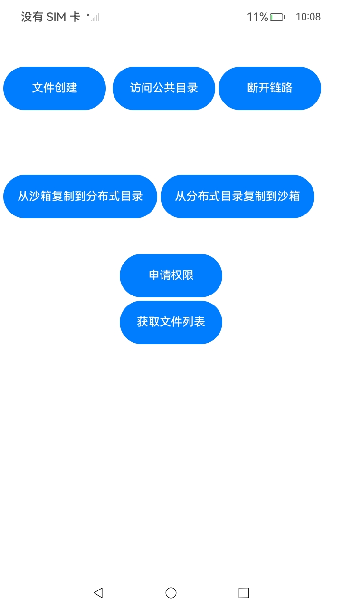

# 分布式文件系统

## 介绍

本实例实现了分布式文件系统的文件跨设备访问和跨设备拷贝，应用包名为 `com.samples.distributedfilesample`。使用两台可信组网设备时，可跨设备访问和拷贝应用分布式目录中的文件。当前创建入口只写入测试文件，未设置文件安全等级；跨设备数据流转仍受设备信任关系及系统安全策略约束。相关接口说明如下。

- [ 跨设备文件访问](https://gitcode.com/openharmony/docs/blob/master/zh-cn/application-dev/file-management/file-access-across-devices.md)
- [ 跨设备文件拷贝](https://gitcode.com/openharmony/docs/blob/master/zh-cn/application-dev/file-management/file-copy-across-devices.md)

## 效果预览

|                      应用界面                      |
| :------------------------------------------------: |
|  |

使用说明：

1. 本应用在进行分布式文件访问之前，需要两台设备进行组网并且都安装了本应用。
2. 测试准备：两台设备连入同一局域网，并依目标系统建立可信关系。实际设备发现和建链结果需在设备上验证，本轮未执行。
3. 启动应用后，设备A在分布式目录下创建测试文件；文件能否跨设备访问取决于组网和系统安全策略，本示例创建入口不配置文件安全等级。
4. 由B设备访问应用公共目录并挂载，向A设备发起建链，设备B可在分布式路径下读取测试文件。
5. 按钮“从沙箱复制到分布式目录”设备A在本地目录下创建一个文件，随后将其拷贝到分布式路径下。
6. 按钮“从分布式目录复制到沙箱”设备A和B在确认组网建链后，由设备B从分布式路径下将测试文件拷贝到设备B的沙箱路径。

## 工程目录

```text
entry/src/
├── main/
│   ├── ets/
│   │   ├── common/Logger.ts
│   │   ├── entryability/EntryAbility.ets
│   │   ├── entrybackupability/EntryBackupAbility.ets
│   │   ├── model/DistributedCopy.ets
│   │   └── pages/Index.ets
│   └── resources/
├── ohosTest/ets/
│   ├── test/                         # UI、生产工作流逻辑与设备 FileIo 用例
│   ├── testability/TestAbility.ets
│   └── testrunner/OpenHarmonyTestRunner.ets
└── test/LocalUnit.test.ets            # 独立记录 API 验证写入与复制组合
```

## 具体实现

1. [生产页面](entry/src/main/ets/pages/Index.ets)提供文件创建、公共目录访问、建链/断链、双向复制、权限请求和文件列表入口；创建功能只写入测试内容，不设置安全等级。
2. 分布式组网需依照目标设备系统完成可信关系建立。本说明使用同一局域网作为测试准备条件，不将历史文档中的账号或音乐同步描述作为本轮已验证条件。
3. 访问跨设备文件，分布式文件系统为应用提供了跨设备文件访问的能力，开发者在两个设备安装同一应用时，通过基础文件接口，可跨设备读写另一个设备该应用分布式文件路径下的文件。
4. 拷贝跨设备文件，由设备A的将文件从沙箱路径拷贝到分布式路径下，再有组网的设备B从分布式路径将文件拷贝到设备B的应用沙箱路径。

## 相关权限

- [ohos.permission.DISTRIBUTED_SOFTBUS_CENTER](https://gitcode.com/openharmony/docs/blob/OpenHarmony-5.0.1-Release/zh-cn/application-dev/security/AccessToken/permissions-for-system-apps.md#ohospermissiondistributed_softbus_center)
- [ohos.permission.ACCESS_SERVICE_DM](https://gitcode.com/openharmony/docs/blob/OpenHarmony-5.0.1-Release/zh-cn/application-dev/security/AccessToken/permissions-for-system-apps.md#ohospermissionaccess_service_dm)
- [ohos.permission.DISTRIBUTED_DATASYNC](https://gitcode.com/openharmony/docs/blob/OpenHarmony-5.0.1-Release/zh-cn/application-dev/security/AccessToken/permissions-for-all.md#ohospermissiondistributed_datasync)
- [ohos.permission.INTERNET](https://gitcode.com/openharmony/docs/blob/OpenHarmony-5.0.1-Release/zh-cn/application-dev/security/AccessToken/permissions-for-all.md#ohospermissioninternet)

## 依赖

不涉及

## 约束与限制

1. 本示例仅支持标准系统上运行，支持设备：RK3568。
2. 本工程采用 Stage 模型、ArkTS 1.x，当前编译、兼容和目标 SDK 均为 OpenHarmony `26.0.0`，需要安装支持该 SDK 的 DevEco Studio。
3. 本轮只验证编译与主机记录 API 边界下的生产逻辑，未确认任何设备镜像、组网、文件安全等级或权限授予；设备执行仍需按目标系统准备可信组网环境。
4. 部分分布式设备接口受系统级权限及签名策略限制，可参考[特殊权限配置方法](https://gitcode.com/openharmony/docs/blob/OpenHarmony-5.0.1-Release/zh-cn/application-dev/security/hapsigntool-overview.md)。本轮不修改 SDK、签名、包名或权限配置，产物为 unsigned HAP；原权限配置中的 `FormAbility` 场景映射及系统级定义保留，不能据编译通过判定设备授权有效。

## 逻辑测试与验证边界

- 测试目录共 73,570 物理行，其中 66,647 行含代码 token；物理行包含注释和空行，token 行不等同纯业务有效行。
- 新增 658 个逻辑用例：512 个三步复制恢复序列、81 个描述符恢复组合、40 个输入校验和 25 个请求快照场景；没有新增 UI 用例。
- 共 688 个设备测试定义（676 逻辑、1 个真实 FileIo 配合连接替身、11 个原 UI）及 1 个本地组合用例。主机仅执行记录 API 边界下的 677 个生产逻辑用例，不执行真实设备、FileIo、URI、组网、权限、TaskSignal 取消或 Hypium 运行时。
- 主包及 ohosTest 已在原 API 26 SDK 编译通过；正式检视后的最终构建、回归、源码/产物哈希和设备排除范围以[测试归档](ohosTest.md)为准。
- 本机回归需要 Node.js 和脚本指定位置的 DevEco Studio TypeScript；运行 `node host-regression.cjs`。本地 `.validation`、`_task26`、构建目录和配置快照不属于可发布内容。

## 下载

```
git init
git config core.sparsecheckout true
echo code/DocsSample/CoreFile/DistributedFileSample > .git/info/sparse-checkout
git remote add origin https://gitcode.com/openharmony/applications_app_samples.git
git pull origin master
```
