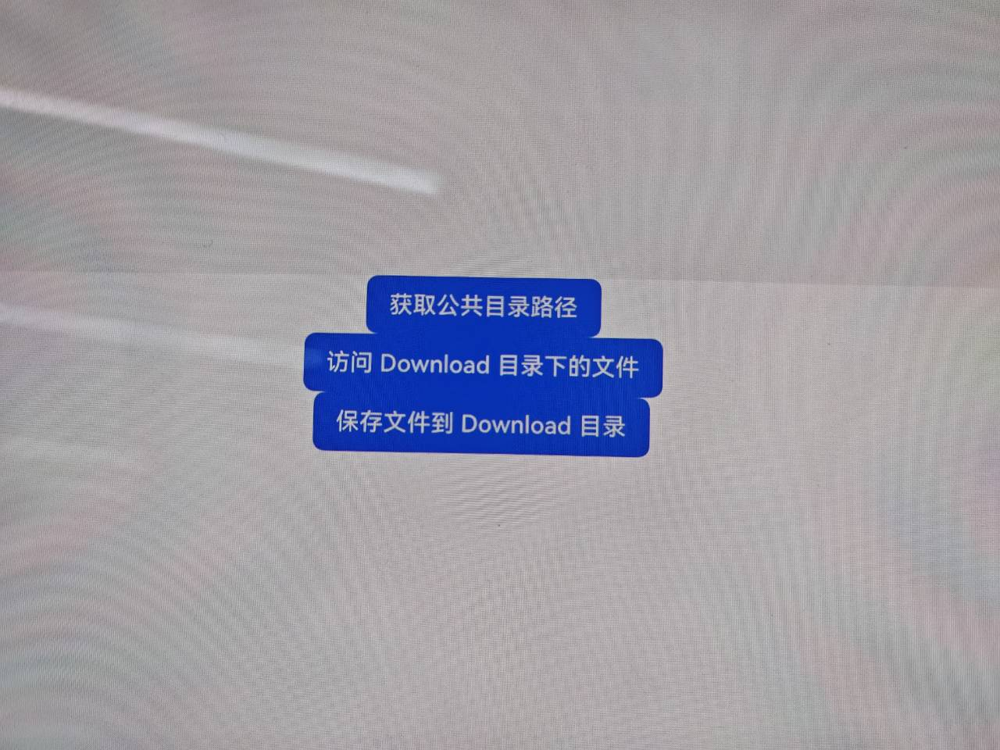
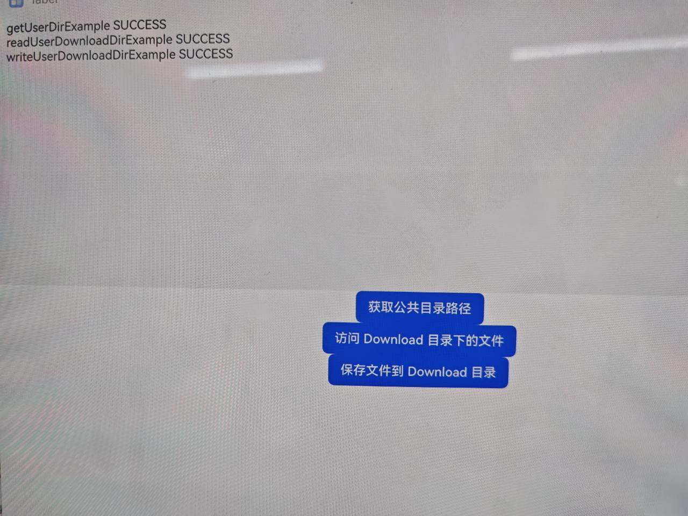

# EnvironmentSample：获取并使用公共目录

## 介绍

本示例的包名为 `com.example.environmentsample`，使用 Stage 模型和动态 ArkTS，通过 `@kit.CoreFileKit` 获取 Download、Documents 公共目录路径，将 Download 中的普通文件导入应用沙箱，并向 Download 中的 `temp.txt` 写入示例内容。

- [获取并使用公共目录](https://gitcode.com/openharmony/docs/blob/master/zh-cn/application-dev/file-management/request-dir-permission.md)

## 效果预览

| 应用启动界面 | 文件访问结果 |
| ------------ | ------------ |
|  |  |

截图为原有示例素材，不作为本次设备或 UI 验证证据。

## 使用说明

1. 在符合下述约束的专用测试设备上启动应用，按需授予 Download 目录权限。
2. 点击“获取公共目录路径”，查询 Download 和 Documents 路径；路径仅写入私有 HiLog 参数。
3. 点击“访问 Download 目录下的文件”，将普通文件导入应用沙箱，目录项不复制。
4. 点击“保存文件到 Download 目录”，写入 `write a message`。此操作会覆盖并截断 `Download/temp.txt`，请提前备份同名文件。
5. 页面仅在操作实际成功时追加 SUCCESS，异常或拒绝访问时追加 FAILED。日志记录错误码，错误详情标为私有参数。

## 工程目录

```text
EnvironmentSample
├── AppScope/app.json5                       # 应用包配置
├── entry/src/main/ets
│   ├── entryability/EntryAbility.ets        # 应用入口及页面加载
│   ├── entrybackupability/EntryBackupAbility.ets
│   ├── model/DownloadFiles.ets              # 文件导入、写入及可注入文件接口
│   └── pages/Index.ets                      # 三个真实示例操作
├── entry/src/main/resources                # 文本与图片资源
├── entry/src/ohosTest/ets
│   ├── testability/TestAbility.ets          # Hypium 启动入口
│   ├── testrunner/OpenHarmonyTestRunner.ets # 启动测试 Ability
│   └── test                                # 基线、74 个矩阵套件和原有 UI 用例
├── entry/src/test                          # 独立本地逻辑用例
└── ohosTest.md                             # 场景、步骤、当前结果和验证边界
```

## 具体实现

- [Index.ets](./entry/src/main/ets/pages/Index.ets) 使用 `Environment.getUserDownloadDir()`、`Environment.getUserDocumentDir()` 获取路径，并使用 UIAbilityContext 的 `filesDir` 定位应用沙箱。
- [DownloadFiles.ets](./entry/src/main/ets/model/DownloadFiles.ets) 在复制前快照并验证完整源列表，拒绝路径穿越与 NUL 名称，只复制普通文件，返回最终沙箱列表的独立快照。
- 写入固定使用 CREATE、READ_WRITE、TRUNC 模式；只有成功打开后才取得描述符，写入后由 `finally` 关闭一次。写入和关闭同时失败时，按原有 finally 语义传播关闭错误。
- [EntryAbility.ets](./entry/src/main/ets/entryability/EntryAbility.ets) 在页面加载成功后设置颜色模式，符合 API26 的调用时机要求。

## 相关权限

获取目录路径不等于取得读写授权。本工程只实际读写 Download，原清单仅声明以下权限，不访问 Documents 文件内容：

```text
ohos.permission.READ_WRITE_DOWNLOAD_DIRECTORY
```

[访问控制](https://gitcode.com/openharmony/docs/blob/master/zh-cn/application-dev/security/AccessToken/request-user-authorization.md)。原清单 `usedScene.abilities` 仍为 `FormAbility`，实际页面属于 `EntryAbility`；本次未改变权限配置，该场景配置及授权行为尚需确认和设备验证。

## 依赖

测试依赖已声明 `@ohos/hypium 1.0.24`、`@ohos/hamock 1.0.0`；未新增依赖或签名配置。

## 约束与限制

1. 现有设备配置为 PC/2in1（`deviceTypes: ["2in1"]`），未扩展为 default/tablet；不声称适配其他设备。
2. 使用 Stage 模型、动态 ArkTS、OpenHarmony runtimeOS；三个 SDK 版本字段均为 `26.0.0`，本机 SDK 为 API26 Release，ETS 组件版本 `26.0.0.38`。
3. 本次实际使用 DevEco Studio `26.0.0.24`（构建号 `261.23567.38.36.260024`）的 Hvigor 和 bundled JBR 完成主包、测试包编译。
4. 本次构建产物未签名。Host 依赖注入回归不代表真实 SDK、设备、ArkUI 或权限集成通过，详见 [ohosTest.md](./ohosTest.md)。

## 下载

```bash
git init
git config core.sparsecheckout true
echo code/DocsSample/CoreFile/EnvironmentSample > .git/info/sparse-checkout
git remote add origin https://gitcode.com/openharmony/applications_app_samples.git
git pull origin master
```

`master` 为下载示例分支；若用于其他目标分支的 PR，请使用对应分支。本次为本地工程检视，未提交代码或 PR。
