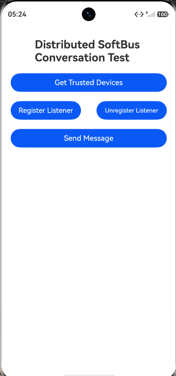

# Distributed Softbus Conversation Demo

## Overview

This sample demonstrates how to use the distributed softbus conversation APIs to
discover trusted devices, register conversation listeners, and exchange messages
between devices.

Bundle name: `com.example.distributedsoftbusconversationdemo`

## Preview



## How to Use

1. Install and launch the application on the target devices.
2. Grant the distributed data sync permission.
3. Tap **Get Trusted Devices** to query trusted devices.
4. Tap **Register Listener** to start receiving messages.
5. Replace `deviceId` in `Index.ets` with the target device network ID or UDID.
6. Tap **Send Message** to send data to the target device.
7. Tap **Unregister Listener** when message receiving is no longer required.

## Source Structure

```text
entry/src/main/ets/
|-- entryability/EntryAbility.ets
|-- entrybackupability/EntryBackupAbility.ets
`-- pages/Index.ets
```

## Implementation

The page implementation is in `entry/src/main/ets/pages/Index.ets`:

- `conversation.getTrustedDevices()` obtains the trusted device list.
- `conversation.registerConversationListener()` registers the message callback.
- `conversation.unregisterConversationListener()` unregisters the callback.
- `conversation.postConversationData()` sends data to the selected device.

## Constraints

1. Two or more devices must be logged in with the same account and connected to the same network.
2. This sample runs on standard-system devices such as RK3568.
3. The sample uses the stage model and requires API version 26 SDK.
4. DevEco Studio 6.0.0 Release or later is required.
5. Replace `deviceId` in `Index.ets` with the target network ID or UDID; `bundleName` and `abilityName` must match the receiving application.
6. The conversation APIs are system APIs and require a system application signature. Set `app-feature` to `hos_system_app` in the signing profile.
7. The sample requests `ohos.permission.DISTRIBUTED_DATASYNC` and `ohos.permission.sec.ACCESS_UDID`; grant them at runtime.

## Permissions

- `ohos.permission.DISTRIBUTED_DATASYNC`
- `ohos.permission.sec.ACCESS_UDID`

The permissions above require the corresponding system application signature.

## Download

```bash
git init
git config core.sparsecheckout true
echo code/DocsSample/DistributedAppDev/DistributedSoftbusConversationDemo > .git/info/sparse-checkout
git remote add origin https://gitcode.com/openharmony/applications_app_samples.git
git pull origin master
```

## Testing

Run the automated test suite:

```bash
aa test -b com.example.distributedsoftbusconversationdemo -m entry_test \
  -s unittest OpenHarmonyTestRunner -s timeout 900000
```

See `ohosTest.md` for the registered suites and case counts.
