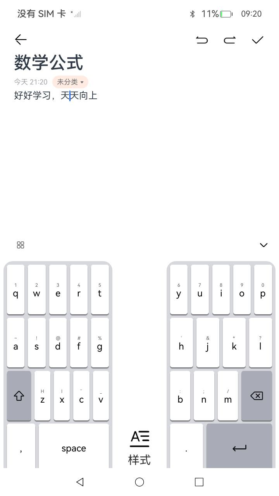

# Kika输入法应用

### 介绍
本示例使用[inputMethodEngine](https://gitee.com/openharmony/docs/blob/master/zh-cn/application-dev/reference/apis-ime-kit/js-apis-inputmethodengine.md)实现一个轻量级输入法应用的分离态键盘，支持在运行OpenHarmony OS的智能终端上。

### 效果预览



使用说明

1.使用hdc shell ime -s切换输入法到当前应用即可使用

### 工程目录

```
KikaInput
├── AppScope                                    
│   └── app.json5                               //APP信息配置文件
├── entry/src/main                              //应用首页
│   ├── ets
│   │   ├── Application
│   │   ├── common
│   │   │   ├── StyleConfiguration.ets         //适配不同设备下的键盘布局
│   │   ├── components                         //输入法软键盘自定义组件
│   │   ├── InputMethodExtensionAbility
│   │       ├── model
│   │       │   ├── HardKeyUtils.ets                //外接键盘KeyCode数据
│   │       │   ├── KeyboardController.ets          //输入法键盘控制
│   │       │   ├── KeyboardKeyData.ets             //输入法键盘数据
│   │   │   ├── InputMethodService.ets          //输入法Ability
│   └── module.json5
```

### 具体实现

* 该示例分为两个模块：
  * 键盘布局
    * 在Index中完成键盘的总体布局。在components中自定不同的按键组件。
    * 源码链接：[Index.ets](./entry/src/main/ets/pages/Index.ets)，[components](./entry/src/main/ets/components)
    * 参考接口：[ArkTs声明式开发范式](https://gitee.com/openharmony/docs/tree/master/zh-cn/application-dev/reference/apis-arkui)
  * 输入法控制
    * 源码链接：[KeyboardController.ets](entry/src/main/ets/model/KeyboardController.ets)
    * 参考接口：[@ohos.inputMethodEngine](https://gitee.com/openharmony/docs/blob/master/zh-cn/application-dev/reference/apis-ime-kit/js-apis-inputmethodengine.md)

### 相关权限

无

### 依赖

不涉及。

### 约束与限制

1.本示例仅支持标准系统上运行。

2.本示例适配API12版本SDK，SDK版本号(API Version 26.1.0 Release)。

3.本示例需要使用DevEco Studio 版本号(26.0.0.24)及以上版本才可编译运行。

5.本示例需要使用@ohos.application.InputMethodExtensionAbility系统权限的系统接口。使用Full SDK时需要手动从镜像站点获取，并在DevEco Studio中替换，具体操作可参考[替换指南](https://gitee.com/openharmony/docs/blob/master/zh-cn/application-dev/faqs/full-sdk-switch-guide.md)。

6.如果安装本示例报错为error：install sign info inconsistent，则有可能是应用已安装在系统中，此时需要卸载安装的应用。


###  下载

如需单独下载本工程，执行如下命令：

```
git init
git config core.sparsecheckout true
echo code/Solutions/InputMethod/KikaInputMethod/ > .git/info/sparse-checkout
git remote add origin https://gitee.com/openharmony/applications_app_samples.git
git pull origin master
```