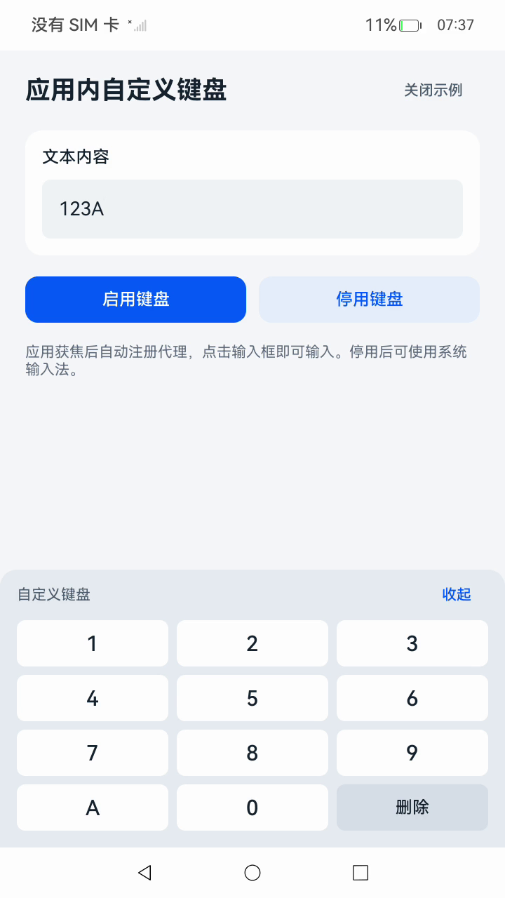

# In-App Custom Keyboard

### Introduction

This sample uses the in-app proxy input method APIs of [inputMethodEngine](https://gitcode.com/openharmony/docs/blob/master/zh-cn/application-dev/reference/apis-ime-kit/js-apis-inputmethodengine.md) to implement a custom keyboard within a standard Stage model application, without developing an InputMethodExtensionAbility. The application draws the keyboard components itself and manipulates the text input field directly. Bundle name: com.example.inappcustomkeyboard.

### Effect Preview



### Usage

1. Open this project in DevEco Studio, select an OpenHarmony SDK that supports API 26.1.0, configure the debug signing, then build and install the entry HAP.

2. Launch the application. The proxy is automatically registered when the app gains focus (you can also manually register by clicking **Enable Keyboard**).

3. Click the text input field to bring up the in-app custom keyboard.

4. Click keyboard keys to input and delete text. The text in the input field updates accordingly.

5. Click **Collapse** to hide the keyboard. Click the input field again to show it.

6. Click **Disable Keyboard** to unregister the proxy. Clicking the input field will then use the system input method. You can click **Enable Keyboard** to register the proxy again.

7. Click **Close Sample** to unregister and clean up before closing the page. Relaunching the app will automatically register the proxy on focus, and clicking the input field will restore the custom keyboard.

### Project Directory

```text
InAppCustomKeyboard
├── AppScope
│   ├── app.json5                               // Application configuration file
│   └── resources/base
│       ├── element/string.json                 // App-level string resources
│       └── media/app_icon.png                  // Application icon
├── entry
│   ├── build-profile.json5                     // Build configuration file
│   ├── hvigorfile.ts                           // Build script
│   ├── oh-package.json5                        // Dependency configuration file
│   └── src
│       ├── main
│       │   ├── ets
│       │   │   ├── entryability/EntryAbility.ets          // Application entry Ability
│       │   │   ├── keyboard/InAppKeyboardSession.ets      // Proxy input method session management
│       │   │   └── pages/Index.ets                        // Keyboard page: draw keyboard, handle input
│       │   ├── module.json5                              // Module configuration file
│       │   └── resources/base
│       │       ├── element/color.json                    // Color resources
│       │       ├── element/string.json                   // Module-level string resources
│       │       ├── media/app_icon.png                    // Module icon
│       │       └── profile/main_pages.json               // Page route configuration
│       └── ohosTest
│           ├── ets/test
│           │   ├── Ability.test.ets                     // Unit test cases
│           │   └── List.test.ets                        // Test suite entry
│           └── module.json5                             // Test module configuration file
├── hvigor/hvigor-config.json5                  // Build configuration file
├── screenshots/devices/main.jpg                // Screenshot
├── build-profile.json5                         // Build configuration file
├── hvigorfile.ts                               // Build script
├── oh-package.json5                            // Dependency configuration file
├── ohosTest.md                                 // Test case documentation
├── README.md                                   // English documentation
└── README_zh.md                                // Chinese documentation
```

### Implementation

* This sample consists of two modules:
  * Session Management
    * Obtains instances via getProxyInputMethodAbility and getProxyKeyboardDelegate, subscribes to onInputStart, onKeyboardShow, onKeyboardHide, and physical key events. When the page is shown, it calls registerInAppProxyIme to register the proxy and listens for window focus events. When the app exits, it unregisters and unsubscribes all callbacks. Upon receiving a passive unregister notification, it cleans up stale references and automatically re-registers.
    * Source: [InAppKeyboardSession.ets](./entry/src/main/ets/keyboard/InAppKeyboardSession.ets)
    * Reference API: [@ohos.inputMethodEngine](https://gitcode.com/openharmony/docs/blob/master/zh-cn/application-dev/reference/apis-ime-kit/js-apis-inputmethodengine.md)
  * Keyboard Page
    * Automatically registers the proxy and listens for window focus events (WindowEventType.WINDOW_ACTIVE) when the page is shown. Draws a text input field and numeric, character, and delete keys in Index. Manipulates the input field text via ProxyTextInputClient. Keyboard components are not focusable. When the hide button is clicked, the component is hidden first before calling hideSelf.
    * Source: [Index.ets](./entry/src/main/ets/pages/Index.ets)
    * Reference API: [ArkTS Declarative Development Paradigm](https://gitcode.com/openharmony/docs/tree/master/zh-cn/application-dev/reference/apis-arkui)

### Permissions

Not required.

### Dependencies

Not required.

### Constraints and Limitations

1. This sample only runs on standard systems.

2. This sample is adapted for API 26.1.0 SDK. An SDK and system that includes the in-app proxy input method APIs are required.

3. This sample only supports the Stage model and does not involve InputMethodExtensionAbility development.

### Download

To download this project separately, run the following commands:

```bash
git init
git config core.sparsecheckout true
echo code/DocsSample/InputMethod/InAppCustomKeyboard > .git/info/sparse-checkout
git remote add origin https://gitcode.com/openharmony/applications_app_samples.git
git pull origin master
```
