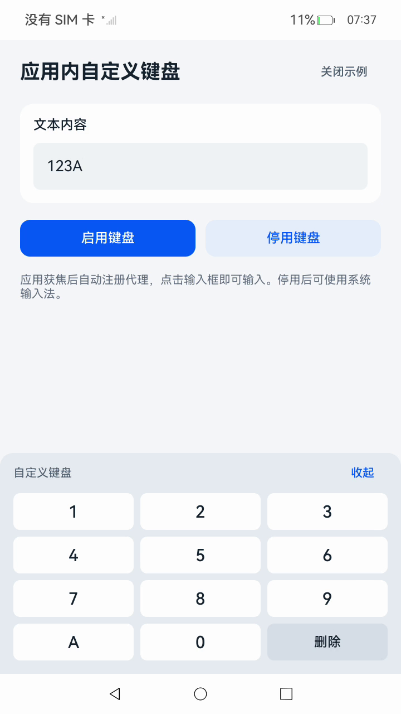

# 应用内自定义键盘

### 介绍

本示例使用[inputMethodEngine](https://gitcode.com/openharmony/docs/blob/master/zh-cn/application-dev/reference/apis-ime-kit/js-apis-inputmethodengine.md)的应用内代理输入法接口，在普通Stage模型应用中实现自定义键盘，无需开发InputMethodExtensionAbility，应用自行绘制键盘组件并操作编辑框文本。包名：com.example.inappcustomkeyboard。

### 效果预览



### 使用说明

1.在DevEco Studio中打开本工程，选择支持API 26.1.0的OpenHarmony SDK，配置调试签名后构建并安装entry HAP。

2.启动应用，应用获焦后自动注册代理（也可点击**启用键盘**手动注册）。

3.点击文本输入框，拉起应用内自定义键盘。

4.点击键盘按键进行输入、删除等操作，编辑框文本随之变化。

5.点击**收起**隐藏键盘，再次点击输入框重新显示。

6.点击**停用键盘**停用代理，再次点击输入框将使用系统输入法；可再次点击**启用键盘**重新注册。

7.点击**关闭示例**，应用完成注销与清理后关闭页面。重新启动应用，获焦后自动注册，点击输入框即可重新使用自定义键盘。

### 工程目录

```text
InAppCustomKeyboard
├── AppScope
│   ├── app.json5                               //应用信息配置文件
│   └── resources/base
│       ├── element/string.json                 //应用级字符串资源
│       └── media/app_icon.png                  //应用图标
├── entry
│   ├── build-profile.json5                     //编译配置文件
│   ├── hvigorfile.ts                           //编译构建脚本
│   ├── oh-package.json5                        //依赖配置文件
│   └── src
│       ├── main
│       │   ├── ets
│       │   │   ├── entryability/EntryAbility.ets          //应用入口Ability
│       │   │   ├── keyboard/InAppKeyboardSession.ets      //代理输入法会话管理：订阅回调、注册/注销代理、编辑会话、退出清理
│       │   │   └── pages/Index.ets                        //键盘页面：监听窗口获焦、绘制键盘组件、处理输入
│       │   ├── module.json5                              //模块配置文件
│       │   └── resources/base
│       │       ├── element/color.json                    //颜色资源
│       │       ├── element/string.json                   //模块级字符串资源
│       │       ├── media/app_icon.png                    //模块图标
│       │       └── profile/main_pages.json               //页面路由配置
│       └── ohosTest
│           ├── ets/test
│           │   ├── Ability.test.ets                     //单元测试用例
│           │   └── List.test.ets                        //测试套件入口
│           └── module.json5                             //测试模块配置文件
├── hvigor/hvigor-config.json5                  //编译构建配置文件
├── screenshots/devices/main.jpg                //效果图
├── build-profile.json5                         //编译配置文件
├── hvigorfile.ts                               //编译构建脚本
├── oh-package.json5                            //依赖配置文件
├── ohosTest.md                                 //测试用例说明
├── README.md                                   //英文说明文档
└── README_zh.md                                //中文说明文档
```

### 具体实现

* 该示例分为两个模块：
  * 会话管理
    * 通过getProxyInputMethodAbility和getProxyKeyboardDelegate获取实例，订阅onInputStart、onKeyboardShow、onKeyboardHide及物理按键事件。页面显示时调用registerInAppProxyIme注册代理并监听窗口获焦事件，应用退出时注销并退订全部回调。收到被动注销通知后清理失效引用并自动重新注册。
    * 源码链接：[InAppKeyboardSession.ets](./entry/src/main/ets/keyboard/InAppKeyboardSession.ets)
    * 参考接口：[@ohos.inputMethodEngine](https://gitcode.com/openharmony/docs/blob/master/zh-cn/application-dev/reference/apis-ime-kit/js-apis-inputmethodengine.md)
  * 键盘页面
    * 页面显示时自动注册代理并监听窗口获焦事件（WindowEventType.WINDOW_ACTIVE），在Index中绘制文本输入框和数字、字母、删除按键，通过ProxyTextInputClient操作编辑框文本。键盘组件不可获焦，点击隐藏按钮时先隐藏组件再调用hideSelf。
    * 源码链接：[Index.ets](./entry/src/main/ets/pages/Index.ets)
    * 参考接口：[ArkTS声明式开发范式](https://gitcode.com/openharmony/docs/tree/master/zh-cn/application-dev/reference/apis-arkui)

### 相关权限

不涉及。

### 依赖

不涉及。

### 约束与限制

1.本示例仅支持标准系统上运行。

2.本示例适配API 26.1.0版本SDK，需使用包含应用内代理输入法接口的SDK和系统。

3.本示例仅支持Stage模型，不支持输入法Extension调用。

### 下载

如需单独下载本工程，执行如下命令：

```bash
git init
git config core.sparsecheckout true
echo code/DocsSample/InputMethod/InAppCustomKeyboard > .git/info/sparse-checkout
git remote add origin https://gitcode.com/openharmony/applications_app_samples.git
git pull origin master
```
