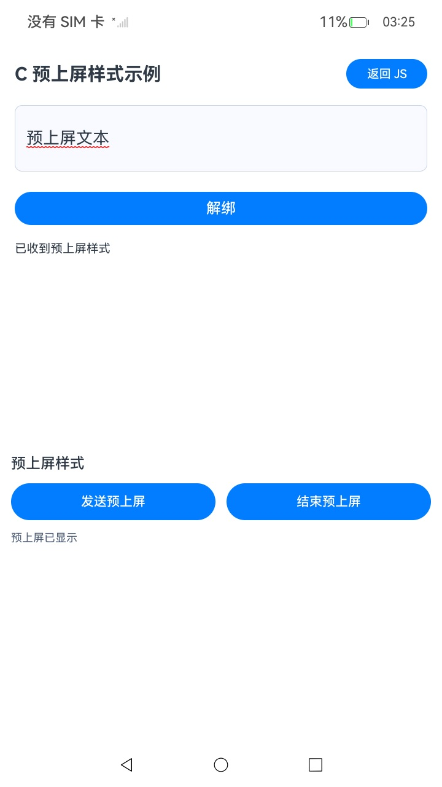

# 预上屏文本样式（ArkTS 与 C）

本工程对应《设置预上屏文本样式》开发指南。一个应用内包含 ArkTS 输入法发送端、ArkTS 自绘编辑器和 C 原生编辑器。主页点击“打开 C 编辑器”进入 C 页面，点击“返回 JS”返回主页；两页共用本工程的输入法发送端，演示真实预上屏回调，红色波浪线，以及结束预上屏后保留文字，清除下划线。

## 示例介绍

应用包名为 `com.samples.previewstylejs`。本示例使用 [IMEKit 输入法接口](https://gitcode.com/openharmony/docs/blob/master/zh-cn/application-dev/reference/apis-ime-kit/js-apis-inputmethod.md) 的输入法扩展、编辑器绑定和预上屏样式接口。工程源码位于 [PreviewTextStyleJS](https://gitcode.com/openharmony/applications_app_samples/tree/master/code/DocsSample/InputMethod/PreviewTextStyleJS)。

## 代码与指南对应

| 指南内容 | 源文件 | 片段标记 |
| -- | -- | -- |
| 获取输入连接 | `entry/src/main/ets/keyboard/PreviewInputMethod.ets` | `preview_style_js_input_start` |
| 异步发送 | `entry/src/main/ets/keyboard/PreviewSender.ets` | `preview_style_js_send` |
| 同步调用的等价写法 | 同上 | `preview_style_js_send_sync` |
| 结束预上屏 | 同上 | `preview_style_js_finish` |
| 接收并绘制样式，同时处理setPreviewText事件 | `entry/src/main/ets/components/PreviewEditor.ets` | `preview_style_js_receive` |
| 注册与取消样式订阅 | 同上 | `preview_style_js_subscribe` |
| 注册基本回调并绑定编辑器 | 同上 | `preview_style_js_attach` |
| C 接收样式 | `entry/src/main/cpp/napi_init.cpp` | `preview_style_c_receive` |
| C 注册样式回调 | 同上 | `preview_style_c_register` |
| C 样式对象生命周期 | 同上 | `preview_style_c_object` |
| C头文件引用 | `entry/src/main/cpp/napi_init.cpp` | `preview_style_c_headers` |
| C编辑回调实现 | 同上 | `preview_style_c_edit_callbacks` |
| C显示键盘 | 同上 | `preview_style_c_show_keyboard` |
| C隐藏键盘 | 同上 | `preview_style_c_hide_keyboard` |

C 页面为 `entry/src/main/ets/pages/PrivatePreview.ets`；原生类型声明为 `entry/src/main/cpp/types/libentry/Index.d.ts`。跳转到 C 页面前先取消 ArkTS 编辑器订阅并解绑，C 页面隐藏或返回时停止轮询，解绑原生编辑器，避免两个编辑器同时占用连接。若 C 编辑器解绑失败，返回按钮会保留当前页面并显示错误码。

发送端从输入法 `inputStart` 事件取得 `InputClient`。页面使用异步发送方法；`sendSync()` 保留同步接口的完整代码示例，不另设测试按钮。发送范围 `{-1, -1}` 替换当前预上屏文本，没有预上屏时插入到光标处。

编辑器在绑定前注册预上屏与结束回调，在绑定成功后注册需要连接的基本编辑回调。解绑或离开页面时，使用原回调对象取消订阅并解绑。同时订阅setPreviewText事件和onSetPreviewTextWithStyle时，避免重复处理预上屏文本内容。编辑器支持指南中的四种线型；省略颜色时使用应用主题色，显式颜色 0 表示黑色，并忽略 Alpha 通道。页面只展示指南的红色波浪线正常流程。

## 构建与运行

1. 使用支持 SDK 26.1.0 的 DevEco Studio 打开本工程。SDK 必须包含本次预上屏样式接口声明，设备必须提供相应输入法与编辑器实现。配置与目标设备匹配的本地签名。
2. 安装后，在设备已开启开发者模式并连接HDC的情况下，依次启用、切换并查询本示例输入法。应用不提供输入法设置按钮，也不会自动切换输入法。以下验证采用完整体验模式；ime工具默认的基础模式会使用隔离环境，需按设备能力另行验证。

   ```shell
   # 以完整体验模式启用本示例输入法
   hdc shell ime -e com.samples.previewstylejs -f
   # 切换至本示例输入法
   hdc shell ime -s com.samples.previewstylejs
   # 确认当前输入法包名为com.samples.previewstylejs
   hdc shell ime -g
   ```

3. 点击“绑定编辑器”，在样例键盘点击“发送预上屏”。编辑器显示“预上屏文本”和红色波浪线。
4. 点击“结束预上屏”，文字保留，下划线消失。结束使用时点击“解绑编辑器”。
5. 在主页点击“打开 C 编辑器”。点击 C 编辑框或“绑定”，再用同一输入法点击“发送预上屏”和“结束预上屏”，观察真实原生回调更新编辑区。点击“返回 JS”回到主页后，可重新绑定 ArkTS 编辑器。

原生模块使用 `entry/src/main/cpp/CMakeLists.txt` 构建 `libentry.so`，工程目标为 SDK 26.1.0，配置 `armeabi-v7a` 和 `arm64-v8a`。只需构建并安装本工程。自绘编辑器仅实现指南流程，不是完整的生产编辑器。

Sample 所属仓为 `openharmony/applications_app_samples`，路径为 `code/DocsSample/InputMethod/PreviewTextStyleJS`；开发指南属于 `openharmony/docs` 的 `zh-cn/application-dev/inputmethod/preview-text-style-guide.md`。

## 效果预览




## 工程目录

```text
PreviewTextStyleJS/
├── AppScope/                         应用名称资源与包配置
├── entry/src/main/ets/components/    自绘编辑器与样式接收
├── entry/src/main/ets/keyboard/      输入法扩展、键盘界面与发送端
├── entry/src/main/ets/pages/         应用入口与编辑页面
├── entry/src/main/cpp/               C编辑器的NAPI与输入法回调
├── entry/src/ohosTest/               UI自动化测试
├── ohosTest.md                       用例和运行说明
├── entry/src/main/resources/         文案、颜色与页面资源
├── screenshots/                      真实运行或构建截图
└── TestReport.md                     测试记录
```

## 具体实现

- [PreviewSender.ets](https://gitcode.com/openharmony/applications_app_samples/blob/master/code/DocsSample/InputMethod/PreviewTextStyleJS/entry/src/main/ets/keyboard/PreviewSender.ets) 从输入法连接取得 `InputClient`，发送带样式的预上屏文本并结束预上屏。
- [PreviewEditor.ets](https://gitcode.com/openharmony/applications_app_samples/blob/master/code/DocsSample/InputMethod/PreviewTextStyleJS/entry/src/main/ets/components/PreviewEditor.ets) 订阅编辑回调，按范围绘制预上屏文字与下划线，解绑时取消订阅。
- [KeyboardPanel.ets](https://gitcode.com/openharmony/applications_app_samples/blob/master/code/DocsSample/InputMethod/PreviewTextStyleJS/entry/src/main/ets/keyboard/KeyboardPanel.ets) 提供发送与结束按钮，实际结果由编辑器回调显示。

## 权限与依赖

工程不申请额外应用权限，使用普通应用能力。源码中使用的接口见 [IMEKit API](https://gitcode.com/openharmony/docs/tree/master/zh-cn/application-dev/reference/apis-ime-kit)。本工程可独立运行，需要配套的输入法框架、ArkUI 组件和 SDK。

## 约束与限制

本示例面向已集成预上屏样式接口的 OpenHarmony 标准系统，验证设备为 RK3568。工程目标 SDK 为 26.1.0，IDE 需支持该 SDK 的构建工具链。按目标设备配置本地调试签名；工程不包含设备证书。

C编辑器解绑失败后会保留代理和错误码。请退出示例进程并重新打开后再尝试绑定。

## 单独下载

```sh
git init
git config core.sparsecheckout true
echo code/DocsSample/InputMethod/PreviewTextStyleJS/ > .git/info/sparse-checkout
git remote add origin https://gitcode.com/openharmony/applications_app_samples.git
git pull origin master
```
