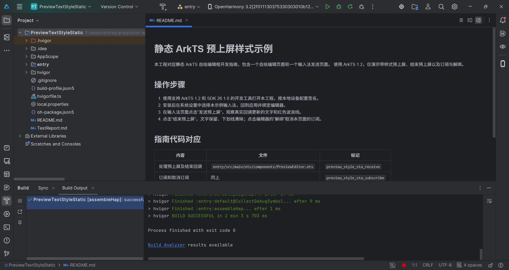

# 验证记录

| 项目 | 结果 |
| --- | --- |
| ArkTS 1.2 CLI 候选编译 | 通过；最终编辑区为 76 vp、两行文字、12 vp 内边距，输入法页面保留发送和结束两个按钮。静态回调通过 EAWorker.postToMain 更新页面状态。 |
| 编译环境 | 使用 26.0.0 静态 SDK 及对应接口兼容声明，源码保持静态接口调用。 |
| SDK 26.1.0.25 日构建 | CLI 编译通过，生成静态 ArkTS 字节码并打包为 HAP。 |
| IDE 候选编译 | DevEco Studio 26.0.0.24 实际构建通过（32 秒）；静态 ABC 与实机验证包一致。下方历史截图不替代本次构建凭证。 |
| 设备运行 | 此前已完成发送、回调更新实际文本、结束后保留文字的验证。编辑区实测 114 px（76 vp），两个按钮间距 18 px；原始运行 JPEG 已保存。7.1.0.22 环境尚未复验这份最终源码。 |

源码中的六处指南标记与静态自绘编辑框指南保持一致。
日构建 SDK 的编译结果与设备运行结果分别记录。

## IDE 构建截图

以下为用户提供的原始候选工程真实 IDE 编译截图。最终源码已由上述 CLI 和 IDE 构建验证；本图保留其原始来源，不作为最终源码的 IDE 截图。

