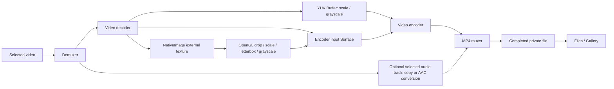
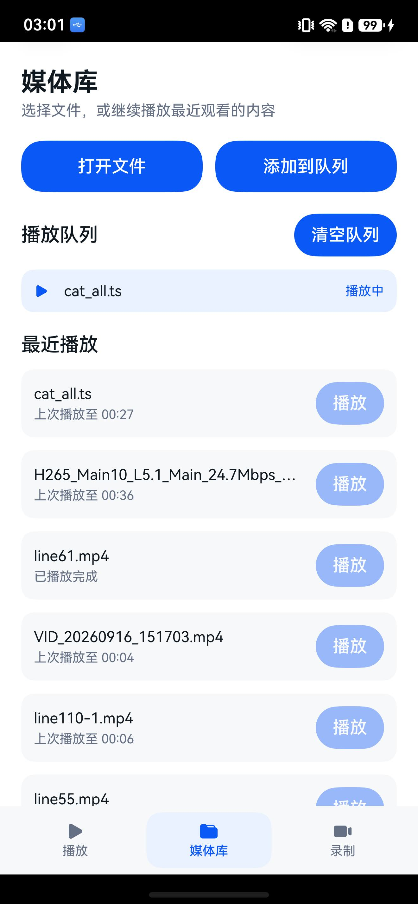
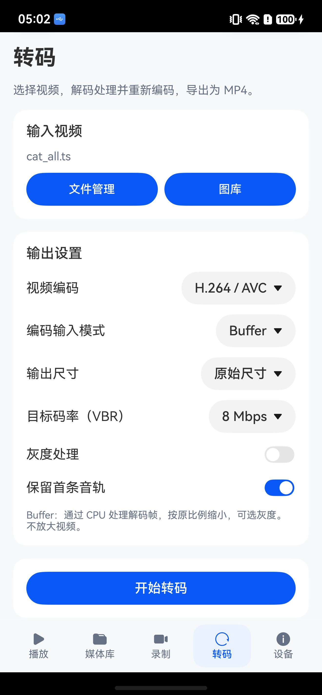

# AVCodecSample

English | [简体中文](./README_zh.md)

### Introduction

AVCodecSample is an API 26 sample for audio/video playback, camera recording, video transcoding and original-stream remuxing.

- Playback pipeline: media file -> demuxer -> audio/video decoder -> graphics/audio output.
- Recording pipeline: camera and microphone capture -> audio/video encoder -> MP4 or FLV muxer.
- Transcoding pipeline: selected video -> demuxer -> decoder -> Buffer processing or encoder Surface -> encoder -> MP4. Open **Transcode** between Recording and Device.
- Original-stream remuxing copies compressed samples to MP4 without decoding or encoding.
- On API 26 devices, recording can also preprocess frames on the encoder Surface (downsampling, center crop, and target-rate dropping), or drive Primary and Secondary video encoders from one camera input to create two files.

Choose playback settings for the problem being investigated:

| Goal | Suggested settings | Why |
|---|---|---|
| Regular playback | Automatic + SurfaceMode direct output + Async | The default path avoids an application-level pixel copy and is the preferred performance/power choice. |
| Investigate hardware decode compatibility | Software decoder + SurfaceMode direct output | Helps determine whether a problem is specific to the device hardware decoder; software decode uses more CPU. |
| Inspect pixels, color, or HDR metadata | Automatic + BufferMode copy output | Gives the application access to decoder output, but adds a pixel copy for every presented frame. |
| Export decoded frames | BufferMode copy output + decoded-frame dump | Intended for debugging. Files are written to the app sandbox and should not remain enabled during ordinary playback. |
| Validate the GLES path | Surface-window OpenGL output | Ordinary 8-bit content is decoded to a NativeImage Surface and drawn through an EGL/GLES external texture. If that path cannot be built, the player falls back to decoder-buffer output. HDR Vivid to BT.709 is unavailable in this mode. |
| Validate the Vulkan path | Surface-window Vulkan output | Sends decoder output to a NativeImage producer Surface, imports each NativeBuffer as OHOS Vulkan external memory, and presents it through a Vulkan Swapchain with rotation-aware aspect-fit. If that chain cannot be built, the Vulkan start fails instead of switching to BufferMode. HDR Vivid to BT.709 is unavailable in this mode. |
| High-frame-rate speed playback | Automatic + smart fluency when available | Speed control is always available. Smart fluency depends on the active decoder, device, and SDK. |

### Basic Terms

| Term | Meaning in this sample |
|---|---|
| Container | The file layout, such as MP4, MKV, MPEG-TS, or FLV. One container may contain several audio, video, or subtitle tracks. |
| Codec / elementary stream | The compressed audio/video format, such as H.264, H.265, AAC, or MP3. The player creates a suitable decoder for each selected track. |
| Track | One independent stream in a container, for example one video track or one of four audio tracks. |
| Demuxing | Reading track metadata and compressed samples from a file. This sample uses `OH_AVSource` and `OH_AVDemuxer`. |
| PTS | The media time at which content should play or appear. Progress, subtitles, A/V sync, and seek all use it. |
| SurfaceMode | The decoder sends pictures directly to the XComponent Surface. The application cannot inspect pixels for each frame. |
| BufferMode | The decoder returns output buffers to the application, which copies them to a NativeWindow before presentation. This enables dump and HDR metadata handling. |
| OpenGL mode | Ordinary 8-bit content is decoded to a NativeImage producer Surface. When a frame arrives, the application draws the external texture to the XComponent window. NativeImage or EGL initialization failure falls back to decoder-buffer output. |
| Vulkan mode | The decoder writes to a NativeImage producer Surface. The app acquires NativeWindowBuffer/NativeBuffer objects, imports them as OHOS Vulkan external memory, and presents them through the Vulkan Surface and Swapchain. If the Surface or external-memory chain cannot be built, this Vulkan playback fails rather than switching to BufferMode. |
| Sync / Async codec mode | How codec buffers are obtained: worker-thread queries or callback queues. It does not mean A/V synchronization is disabled in one mode. |
| EOS | End of stream. After input ends, a codec or muxer still needs time to drain buffered output before it is released. |

<a id="feature-navigation"></a>

### Feature Overview and Navigation

The sample connects file selection, demuxing, four video output paths, A/V synchronization, camera recording, and video transcoding to page controls. The tables below describe each feature and link to its implementation.

#### Configuration, Diagnostics and Structure

| Feature | Behavior in this sample | Details |
|---|---|---|
| Saved configuration and presets | Remembers applied playback, recording, and Dump limits; includes four built-in presets and one custom slot | [Configuration and presets](#configuration-presets) |
| Configuration feedback | Refreshes constraints when draft settings change and checks recording size/rate combinations without claiming runtime success | [Capability feedback](#configuration-feedback) |
| Dump management and cleanup | Groups, exports and removes sample-generated Dump files by session without deleting source media or exported copies | [Dump management and cleanup](#dump-sessions) |
| Session reports | Correlates playback and transcoding settings, output, errors, and timing by session ID | [Session reports](#session-report) |
| Page and controller decomposition | Separates page, component and controller responsibilities for playback, recording and transcoding | [Page decomposition](#page-decomposition) |
| Task coordination and recovery | Keeps media tasks exclusive, waits for actual cancellation completion and restores interrupted records/paused queue items | [Sessions and queue](#task-recovery) |
| Local state files | Paths, writes and recovery boundaries for settings, queues, reports and partial output | [Storage](#state-files) |
| Configuration mapping | Follows UI requests through models, Native options and actual output | [Configuration mapping](#configuration-mapping) |
| Resources and threads | Distinguishes codec/window Buffers, GPU references, fences and descriptors | [Ownership and handoff](#buffer-ownership) |
| Metrics and baselines | Separates media time, call durations and waits; compares completed sessions with matching configurations | [Metric definitions](#diagnostic-definitions) |
| Device capability comparison | Saves/imports codec snapshots and reports added, removed or changed capabilities | [Capability snapshots](#capability-snapshots) |

#### Playback Features

| Feature | Behavior in this sample | Details |
|---|---|---|
| File selection and validation | Select media from File Manager or Gallery; empty and invalid files produce recognizable errors | [Playback entry and structured configuration](#playback-entry) |
| Demuxing | Reads source and track information such as duration, bitrate, dimensions, frame rate, profile, and codec configuration | [Demuxing](#demuxer) |
| Decoder selection | Supports automatic, hardware, and software decoder selection; automatic mode retries with software decoding after initialization failure | [Video decoding](#video-decoding) |
| Synchronous/asynchronous codec mode | Async mode uses callback queues; sync mode actively queries input and output buffers from worker threads | [Video decoding](#video-decoding) |
| SurfaceMode output | The decoder outputs directly to the XComponent Surface and releases frames at the scheduled render time | [SurfaceMode output](#surface-output) |
| Last-frame behavior on stop | Choose whether SurfaceMode retains the last frame or outputs a blank frame when stopped/destroyed | [SurfaceMode output](#surface-output) |
| BufferMode output | The application obtains decoded buffers, copies them to a NativeWindowBuffer with stride awareness, and submits them through graphics APIs | [BufferMode output](#buffer-output) |
| OpenGL output | Ordinary 8-bit content reaches an EGL/GLES external texture through a NativeImage Surface; decoder buffers are converted to RGBA only after a fallback | [OpenGL/Vulkan output](#gpu-output) |
| Vulkan output | Decodes to a NativeImage Surface, imports NativeBuffer as OHOS Vulkan external memory, and presents it with a Swapchain | [OpenGL/Vulkan output](#gpu-output) |
| BufferMode HDR Vivid | Propagates color space and HDR static/dynamic metadata and displays an HDR Vivid watermark after bitstream confirmation | [HDR Vivid detection and output](#hdr-vivid-output) |
| Decoded-frame dump | A single switch is available only in BufferMode. Dumps support independent size/time limits or unlimited writing, with a layout sidecar | [Buffer dump](#buffer-dump), [Dump management](#output-management) |
| Audio decoding and playback | Decodes compressed audio to PCM and continuously feeds AudioRenderer | [Audio decoding and playback](#audio-playback) |
| System audio interruptions and background recovery | Handles calls, audio focus loss, and app background/foreground transitions without mistaking them for codec failures | [Audio interruptions and background recovery](#audio-interruption) |
| Multi-track audio | Lists codec, sample rate, channels, and bitrate; validates a candidate before switching without restarting video | [Audio decoding and playback](#audio-playback) |
| Mute | Mutes or restores the configured volume during playback | [Audio decoding and playback](#audio-playback) |
| External SRT / WebVTT subtitles | Selects an `.srt` or `.vtt` file, displays the cue matching playback position, and supports timing, visibility, size, color, background, and position settings | [External subtitles](#subtitle-playback) |
| Press-and-hold speed | Press and hold the playback window for X2; release to return to X1 | [Variable-speed playback](#playback-speed) |
| Speed menu | Select X1, X2, or X3 during playback | [Variable-speed playback](#playback-speed) |
| Smart fluency | Uses ADAPTIVE frame retention at X2/X3 and FULL at X1; thermal events may switch to UNIFORM | [Smart fluency](#smart-fluency) |
| A/V synchronization | Uses the AudioRenderer playback position as the master clock and waits, schedules, or drops video frames | [A/V synchronization](#av-sync) |
| Video transforms | Supports rotation, horizontal/vertical flip, and combined transforms | [Video transforms](#video-transform) |
| Progress and precise seek | Shows current position and duration; merges rapid seek requests, resumes from a sync frame, and discards output before the requested target | [Playback progress and seek](#playback-seek) |
| Playback controls | Supports pause/resume, precise 15-second double-tap seeks, frame stepping, and replay; when auto-hidden, the first surface tap only reveals the controls, and button actions reset the hide timer | [Playback progress and seek](#playback-seek) |
| Queue, resume, and recovery | Supports sequential, repeat-one, repeat-all, and shuffle modes; restores position and can retry a runtime failure once | [Playback queue and resume](#playback-queue) |
| Fullscreen and display ratio | Recalculates centered fit/fill geometry from video rotation and window size; fill clips the excess | [Fullscreen and display ratio](#display-mode) |
| Playback diagnostics | Inspect output/presented/dropped frames, sync decision offset, PCM/device queues, underruns, interruption count, seek timing, and BufferMode timing; shows the first failed Native operation and its code | [Playback diagnostics](#playback-diagnostics) |
| Operation timeline | Session-relative initialization, pause/resume, seek stages, and completion events, plus Present-call P95/max duration | [Operation timeline](#diagnostic-timeline) |
| A-B loop and frame stepping | Set A/B positions for looping and move one video frame at a time | [A-B loop and frame stepping](#ab-frame-control) |
| Picture-in-picture and background playback | Continue viewing in the system PiP window and optionally enter PiP on home | [Picture-in-picture and background playback](#pip-background) |
| System media controls | Publishes the current item and playback state to AVSession; lock screen, notification center, and headset keys control play/pause, seek, speed, and queue navigation | [System media controls](#av-session) |
| Playback status | Shows state, requested speed, active tracks, and smart-fluency availability | [Playback and media information](#playback-info) |
| Media details | Shows source, track, decoder, output, and raw Source/Track Format information | [Playback and media information](#playback-info) |
| Stop and cleanup | Handles explicit stop, natural completion, and errors through one state machine and release path | [Playback threads and lifecycle](#player-lifecycle) |

#### Recording Features

| Feature | Behavior in this sample | Details |
|---|---|---|
| Camera preview and page navigation | Initializes the encoder or ImageReceiver input Surface, passes its SurfaceId to the recording page, and creates camera output streams | [Camera capture and recording](#camera-recording) |
| Video encoding | Camera Surface input or YUV copied into encoder Buffers; both support synchronous/asynchronous scheduling, H.264/H.265, bitrate and key-frame settings | [Video encoding](#video-encoding) |
| Camera Buffer encoding | Native ImageReceiver supplies YUV frames to encoder input Buffers while reusing audio, muxing, Dump and segment recording | [Buffer recording](#recorder-buffer-input) |
| SDR recording color | Camera, NativeBuffer checks and encoder metadata use BT.709 limited range | [Color configuration](#recorder-color) |
| Pause and resume | Pause single-output SDR Buffer recording within one file, excluding paused time | [Recording pause](#recorder-pause) |
| Encoded video stream dump | Optionally saves the encoder's raw H.264/H.265 output to the app's private files directory; dual-output recording saves each video stream separately | [Video encoding](#video-encoding) |
| Structured recording options | Groups video, audio, preprocessing, secondary output, Dump, and container parameters into a validated startup snapshot | [Recording options](#recorder-options) |
| Runtime recording parameters | Requests bitrate changes and key frames independently on the primary or secondary encoder without rebuilding the session | [Runtime recording parameters](#recorder-live-parameters) |
| Live recording diagnostics | Per-stream recent and session bitrate, output cadence, key frames, retrieval/write timing, file and Dump status, with explicit configuration and measurement sources | [Live recording diagnostics](#recorder-diagnostics) |
| Recording timeline | Initialization, first output, stop, actual EOS, draining, resource release, and file-close stages | [Timeline and results](#recording-session-results) |
| Recording segments | Finalize independent MP4s by duration/size and group their history | [Segment recording](#recording-segments) |
| Recording results and history | Play finalized outputs and inspect basic completion/file metadata; detailed diagnostics remain live during recording | [Results and history](#recording-session-results) |
| Audio diagnostics and storage protection | PCM backlog, AAC output, relative PTS progress, muxer timing, remaining-time estimates, and optional safe stop | [Audio and storage](#recorder-audio-storage) |
| Recording page ownership | Uses one lifecycle phase and separates camera-session, diagnostics, result-display and file-management responsibilities | [Recording page ownership](#recorder-controller-ownership) |
| Preprocessing diagram | Shows the source frame, retained crop area, and primary/secondary target sizes as draft settings change | [Preprocessing visualization](#preprocess-preview) |
| Encoder preprocessing | API 26+ downsampling, center crop, and target-rate frame dropping; downsampling and crop are exclusive, while frame dropping can combine with either | [Encoder preprocessing](#video-preprocessing) |
| One input, dual output | One Primary Surface drives the primary and secondary video encoders; each file has its own muxer and finalization, and the current secondary path defaults to 720P | [One input, dual output](#dual-output) |
| Audio capture and encoding | AudioCapturer collects PCM, AudioCodec encodes AAC, and the result is written to the muxer; sample rate, channel count, and AAC bitrate are configurable | [Audio capture and encoding](#audio-encoding) |
| HDR Vivid recording | Selects P010 and the corresponding color space when device capabilities support HDR recording | [Camera capture and recording](#camera-recording) |
| MP4/FLV muxing | Concurrently writes encoded audio and video; MP4 also stores rotation metadata | [Muxing](#muxing) |
| Recording finalization | Waits for CameraKit, encoder EOS, muxer release, and output-fd closure before returning | [Recording stop flow](#recording-stop) |
| Recent recording outputs | Primary/secondary playback, basic completion state, and finalized-file metadata; measured FPS and bitrate remain in live diagnostics | [Recording statistics](#output-management) |
| Device codec checks | Checks the current size/rate combination and selects a codec name for ordinary recording; recording diagnostics are excluded from device reports | [Device diagnostics](#output-management) |
| Automated and device tests | Hypium covers deterministic logic; device tests cover codecs, output, synchronization, recording, and errors | [Testing](#testing) |

Recording settings use a draft-then-apply flow. Pickers edit temporary values only. **Apply** writes the complete set to `CameraDataModel` and then runs the CameraKit profile check, while **Cancel** discards the draft. This keeps the value shown in the sheet aligned with the configuration that will be passed to Native when resolution, frame rate, or preprocessing is changed.

Confirming a picker updates the draft label and preprocessing diagram immediately, without leaving and reopening the sheet. Applying the draft remains a separate action and does not reconfigure an already running recording.

Encoder configuration is capability-driven. B-frames are optional and remain disabled by default; this sample neither queries nor writes `VIDEO_ENCODER_B_FRAME`, so devices that do not expose the optional feature do not emit an unnecessary warning or reject the default recording path. The API 26 preprocessing and one-input-dual-output options use the same two-stage gate: the settings page checks the system version, then Native checks runtime symbols and codec capability again. A visible option therefore does not imply that every device can run it.

Recording settings follow this path into Native:

| UI option | ArkTS draft value | `SampleInfo` field | Native configuration point |
|---|---|---|---|
| Preprocessing mode | `preprocMode` | `video.preprocMode` | `VideoEncoder::ValidateVideoFeatureConfiguration()`, followed by the downsampling or crop keys |
| Drop target frame rate | `dropToFrameRate` | `video.dropToFrameRate` | `OH_MD_KEY_VIDEO_ENCODER_PREPROC_DROP_TO_FRAME_RATE` |
| Save encoded video stream | `enableVideoDump` | `output.enableVideoDump`, `output.videoDumpPath` | `Recorder::DumpVideoOutput()` before muxer write |
| One input, dual output | `enableDualOutput` | `output.enableDualOutput` | Creates Primary, Secondary, and the second `Muxer` |
| Secondary output fd | Second media-library fd | `output.secondaryOutputFd` | `secondaryMuxer_->Create()` |

Preprocessing changes the encoded frame dimensions. `Muxer::AddVideoTrack()` therefore registers the effective downsampled or cropped size instead of copying the camera profile dimensions. Dual output creates separate tracks and files for the two video encoders. Audio is encoded once, written to both muxers in sequence, and returned to the audio encoder only after both writes finish.

### Playback Capability Summary

| Media type | Containers | Elementary streams |
|---|---|---|
| Video with optional audio | MP4, MKV, MPEG-TS, and other supported containers | Video: hardware AVC/H.264 and HEVC/H.265; software MPEG-2, MPEG-4, H.263, AVC/H.264. Audio: AAC, MP3, FLAC, Vorbis, AMR-NB/WB, G.711 mu-law, and APE |

For the complete list, see [AVCodec supported formats](https://gitcode.com/openharmony/docs/blob/master/en/application-dev/media/avcodec/avcodec-support-formats.md).

This table describes common combinations covered by the sample; it is not a guarantee that every file of the listed type will play on every device. Actual playback also depends on the container, stream format, resolution, frame rate, profile, pixel format, and the currently available hardware/software codec. The player checks capability first and treats codec `Configure()` as the final decision. Unsupported media reports a failure or, in Automatic mode, receives one software-decoder fallback attempt.

### Recording Capability Summary

| Container | Video codec | Audio codec |
|:---:|:---:|:---:|
| MP4 | HEVC/H.265, AVC/H.264 | AAC, MPEG/MP3 |
| FLV | Depends on the selected profiles supported by the device | Depends on the selected profiles supported by the device |

Recording also depends on device capability. The camera profile, encoder's supported resolution/frame-rate/bitrate combination, and selected container must all be valid. The settings page performs the checks that can be queried in advance; Native codec configuration remains the final validation.

#### Transcoding Features

| Feature | Behavior | Details |
|---|---|---|
| Source and destination | Select one or several videos from Files/Gallery; export completed MP4s individually or in a batch | [Transcoding](#transcoding), [Batch operations](#transcode-batch) |
| Buffer processing | Decode to YUV, optionally downscale or convert to grayscale, and submit encoder input buffers | [Buffer path](#transcode-buffer) |
| Surface connection | Decode directly to the encoder input Surface at the original dimensions | [Surface path](#transcode-surface) |
| GPU processing | SDR NativeImage/OpenGL crop, scale, letterbox and grayscale before encoder Surface input | [OpenGL path](#transcode-gpu) |
| Synchronous/asynchronous scheduling | Both video codecs support synchronous queries or callback queues, with Buffer or Surface input | [Codec scheduling](#transcode-codec-mode) |
| Encoding quality | Encoder selection, frame-rate cap, CBR/VBR and keyframe interval | [Quality settings](#transcode-quality) |
| Processing preview | Choose a time and switch between source/processed thumbnails from the same decoded frame | [Preview](#transcode-preview) |
| Sampling quality | Area downsampling and optional streaming low-pass audio conversion, with fast modes retained | [Sampling quality](#transcode-sampling) |
| MP4 remux | Copy original video and one or all audio tracks without codecs; detect but report unsupported subtitle tracks | [Remux](#transcode-remux), [Audio](#transcode-audio) |
| Output verification | Reopen MP4 for metadata checks; optionally decode samples near the start, middle and end and report failed PTS | [Lifecycle and validation](#transcode-lifecycle) |
| Preflight and diagnostics | Source/track analysis, codec limits, stage timings and Buffer waits | [Diagnostics](#transcode-diagnostics) |
| Audio policy | Selected original track, AAC-LC conversion, or no audio | [Audio pipeline](#transcode-audio) |
| Results and storage | History, playback, report export, storage reserve, private usage, per-item deletion and orphan-temp cleanup | [Results](#transcode-results) |
| Implementation walkthrough | Page-to-worker flow, per-frame handoff, EOS, cancellation, remux and preview | [Function-level flow](#transcode-call-flow) |

<a id="transcoding"></a>

### Video Transcoding

The bottom navigation contains Playback, Library, Recording, Transcode, and Device. In Transcode, select a source with **Files** or **Gallery**, choose output settings, and press **Start transcoding**. On completion, use **Save to Files** or **Save to Gallery**. The source file is opened read-only.

The page uses a separate `libtranscoder.so`; it does not start the Player or Recorder singleton. `TranscodeModel.ets` owns request configuration and task state. `TranscodePreviewController`, `TranscodeQueueRunner` and `TranscodeExportController` handle image lifetime/cancellation, queue progression and file export respectively; `TranscodePage.ets` renders the controls. Index retains the model across Tab changes. Leaving the main page cancels its task; this sample does not register background transcoding.

| Setting | Available values and behavior |
|---|---|
| Codec / container | H.264 or H.265 in MP4; the device must provide the requested encoder |
| Encoder input | Buffer, direct Surface or OpenGL → Surface; synchronous queries or asynchronous callbacks |
| Codec scheduling | Synchronous by default; asynchronous mode applies to both video decoding and encoding, and is saved with queue settings |
| Output size | Original, or long edge capped at 1920, 1080, or 720 pixels; Buffer and GPU paths |
| Target bitrate | 2, 4, 8, or 16 Mbps, with VBR or CBR; measured bitrate can differ |
| Frame-rate cap | Source rate, 24, 30, 60 or 120 fps; never raises the source rate |
| Keyframe interval | 1, 2, 3 or 5 seconds; placement remains encoder-dependent |
| Scaling filter | Nearest/bilinear; area sampling for Buffer downscaling |
| Grayscale | Buffer neutral chroma or GPU RGB luma conversion |
| Encoder selection | Automatic, hardware or software; the checked codec name is also used to create the instance |
| Audio | Selected original track, configurable AAC-LC conversion or no audio |
| Time range | Buffer and GPU paths; start time with an optional end defaulting to source end |

The size limit describes the long edge, not the vertical resolution. A 1920 × 1080 source capped at 720 becomes 720 × 404; portrait video becomes 404 × 720. Dimensions are rounded down to even values for YUV 4:2:0. Smaller sources are not enlarged.

Enter the start and end times in seconds at millisecond precision, for example `1.250`. Retain frames where `start <= PTS < end`; the demuxer seeks to a preceding sync frame and output PTS subtracts the selected start. Decoding continues to true source EOS to preserve reordered B frames, so short selections can still decode much of the source. Buffer and GPU paths support this selection; direct Surface and remux process the full file.

Audio passthrough selects compressed packets by PTS, so cut precision depends on source packet lengths. AAC conversion trims decoded PCM samples before encoding. The last AAC-LC frame is padded to 1024 samples per channel when needed, adding less than one frame of tail silence.



<a id="transcode-buffer"></a>

#### Buffer path

`TranscodeJob` selects the first video track, configures the decoder for NV12 output, and configures an NV12 Buffer encoder. The worker obtains decoded frames through synchronous queries or asynchronous callback queues, according to **Codec scheduling**. Pixel processing and submission use the same code in both modes. `TranscodeFrameProcessor.h` reads each side's actual width, height, stride, and slice height; decoder and encoder padding do not have to match.

The processor accepts 8-bit NV12, NV21 and I420 layouts and writes NV12. Nearest-neighbor is the default; bilinear and area modes offer different sampling costs and downscale quality (see [sampling](#transcode-sampling)). Grayscale retains luma and fills chroma with 128. This path reads, writes and copies pixels to demonstrate decoded-frame processing.

Layouts are cached after the first frame and read again on a decoder output-format change. Same-size NV12 uses row copies for both Y and UV, with independent source/destination strides. Source padding is not copied. Only destination padding and grayscale UV need initialization, so normal visible pixels are no longer cleared and overwritten. Scaling, NV21 and I420 retain their conversion branches. There is no additional full-frame intermediate allocation, and decoder buffer ownership is not transferred to the encoder.

Only one decoded frame is retained while waiting for encoder input. After the pixels have been submitted, the decoder output index is returned. The next pass drains encoded output before obtaining more input, keeping codec queues bounded. Input EOS stops feeding compressed samples; the worker continues until encoded output EOS. If a decoded frame contains both pixels and EOS, it submits the pixels first and sends an empty encoder EOS separately.

<a id="transcode-preview"></a>

#### Same-frame before/after preview

The geometry diagram shows crop bounds, output dimensions and padding. Choose a position within the selected range, then preview. One synchronous decoder captures the frame at or after the requested PTS and generates both original and processed thumbnails, each capped at a 640-pixel long edge. The UI switches between them and shows actual source time, crop/content dimensions, output size and algorithm. `TranscodePreviewController` owns both PixelMaps, request invalidation and disposal. Completion from a cancelled/disposed request releases any images it created.

This is a pixel-processing preview for Buffer and GPU requests, computed at thumbnail dimensions; it does not preview compression, container rotation or HDR conversion. It shares the exclusive task lease and a 15-second timeout. Source/processing changes clear both images. After transcoding, source/result playback shortcuts compare actual files. The source shortcut is tied to the current result and is unavailable for historical results whose source authorization was not retained.

<a id="transcode-sampling"></a>

#### Choosing video and audio sampling quality

Buffer video offers nearest-neighbor, bilinear and area sampling. Nearest is the fast default. Bilinear interpolates nearby luma/chroma samples. Area sampling integrates the source footprint of each output pixel with fractional edge weights, independently for Y and UV. This reduces aliasing when detailed 4K frames are reduced to 1080p or 720p. If an axis grows, area mode uses bilinear instead; equal-size NV12 keeps the exact row-copy path. The implementation respects crop bounds and independent stride/slice-height values and allocates no full-resolution intermediate frame.

AAC conversion has separate **Fast linear** and **Low-pass downsampling** choices. The latter uses a 65-tap Blackman-windowed sinc filter with a cutoff at 94% of the output Nyquist limit. `TranscodeLowPassResampler` retains a bounded 67-frame stereo history and 32 source frames of lookahead across decoder Buffers. It processes already downmixed/upmixed S16LE frames. At EOS, edge extension drains the pending tail to exactly `ceil(inputSamples × targetRate / sourceRate)` samples; it does not append a filter-delay interval. AAC frame padding still applies afterwards. Equal-rate conversion and upsampling use the fast path.

Both choices are saved in each queue item's quality snapshot. Higher quality costs CPU time; neither choice changes bitrate control or adds interpolation frames. The spectral regression check measures high-frequency alias rejection and low-frequency preservation rather than only checking output length.

<a id="transcode-quality"></a>

#### Frame rate, bitrate mode and keyframes

The frame-rate cap is applied before CPU processing or Surface submission. Each PTS bucket at the requested rate retains at most one frame. Retained timestamps subtract the common source start offset and selected range start, preserving relative frame spacing; there is no duplication or playback-speed change. The encoder uses the lower of the source rate and selected cap. Dropped frames are counted separately, and a dropped frame carrying EOS still triggers encoder EOS.

VBR is the default. CBR requests the codec's constant-bitrate mode but does not promise identical byte counts in each short interval. Preflight checks the selected encoder's mode, rate and bitrate limits; Configure remains the final check for combined settings. Keyframe interval is passed in milliseconds, not enforced by the application at exact timestamps.

`TranscodeQualityModel.ets` holds these options, video codec scheduling and AAC settings. Queue entries store a separate named snapshot, so later edits do not alter queued tasks. Older entries use the existing defaults: synchronous video codecs, nearest-neighbor, source fps, VBR, two-second keyframe interval, source audio layout and 128 kbps AAC.

<a id="transcode-codec-mode"></a>

#### Synchronous and asynchronous codecs

The scheduling selector is independent of Buffer/Surface input. `TranscodeRequest.codecMode` is `0` for synchronous queries and `1` for asynchronous callbacks; omitted values keep the synchronous default. Video decoding/encoding and AAC decoding/encoding use the selected mode; processed-frame preview always creates a synchronous decoder, and remuxing does not create codecs. The NAPI Promise runs a Native worker in either mode; a Promise by itself does not enable asynchronous codec callbacks.

`RegisterCodecCallbacks()` registers `OH_AVCodecCallback` on both codecs before configuration and Prepare. Asynchronous mode sets `OH_MD_KEY_ENABLE_SYNC_MODE` to `0` and does not call video Query/GetInputBuffer/GetOutputBuffer APIs. `onNeedInputBuffer` and `onNewOutputBuffer` pass their borrowed Buffer/index to separate decoder/encoder input/output queues. The callbacks do not read files, copy pixels, write the muxer, submit input or free output. `AcquireCodecBuffer()` lets the worker consume those queues while keeping the same processing, backpressure and EOS rules as synchronous mode.

Format-change markers are ordered with output events. The callback-scoped `OH_AVFormat *` is not retained: the worker reads its own current description, invalidates decoded layouts, or starts the muxer from actual encoder output metadata. Each queue is capped at 128 events; overflow fails the task instead of silently dropping a borrowed output. Codec errors retain the first error and its decoder/encoder origin, including when no buffer arrives.

When idle, the asynchronous worker waits on a condition variable for up to 2 ms, so audio callback queues and storage checks still advance. A revision captured before pumping avoids losing a callback arriving just before the wait. Cancel closes the queues and wakes the worker; cleanup rejects late events before stopping the codecs and keeps callback contexts alive until both codecs have been destroyed. Buffers still borrowed on failure or cancellation are invalidated by Stop/Destroy, not individually freed from a callback.

<a id="transcode-surface"></a>

#### Surface path

After configuring the encoder, the job gets its input Surface before `Prepare()` and passes that window to `OH_VideoDecoder_SetSurface()`. Decoded output is rendered to the encoder Surface; the application does not read or copy its pixels. Decoder output EOS triggers `OH_VideoEncoder_NotifyEndOfStream()`, and encoded output is still drained before finalization.

This path keeps the original dimensions. Selecting Surface resets size and filter, turns off grayscale and the time range, and disables CPU processing, processed-frame preview and range controls. Frame-rate limiting remains available because frames can be returned without rendering. Container rotation is preserved while decoder rotation is zero, avoiding double rotation. Cleanup destroys the decoder first, then the encoder and its window reference.

<a id="transcode-gpu"></a>

#### SDR processing with OpenGL

Select **OpenGL processing → Surface** to use this independent path:

```text
decoder Surface → NativeImage external texture → OpenGL crop/scale/letterbox/grayscale
    → encoder input Surface → encoded output → MP4
```

`ConnectSurface()` first obtains the configured encoder's input window. `TranscodeGpuProcessor` creates an EGL context/window surface, shader program, external texture and NativeImage on the transcode worker. The decoder receives the NativeImage producer window before Prepare/Start. The processor shares small EGL/shader utilities under `common/graphics`; it has no dependency on the player VideoSink or its lifecycle.

For each retained frame, `SubmitGpuFrame()` saves the rebased PTS and renders the decoder index to NativeImage. At most one rendered frame waits for processing. While the frame-available notification is pending, the job keeps draining encoder output and advancing audio. The callback only increments an atomic counter. The worker calls `UpdateSurfaceImage()`, applies the NativeImage texture matrix and the shared `PlanGeometry()` crop, clears letterbox bars, draws the content viewport, sets the presentation timestamp in nanoseconds and swaps to the encoder. It uses nearest or bilinear texture filtering; area sampling remains a Buffer option.

A data-bearing EOS frame is drawn before encoder EOS is sent. Empty EOS is returned without drawing. GPU output PTS is already rebased and is not shifted a second time during muxing. Stop/Destroy ends decoder use first; then GPU work completes, the listener is removed, NativeImage and GL/EGL resources are released, and finally the encoder and window reference are destroyed.

The source color checks reject HDR Vivid, PQ/HLG and unsupported HEVC profiles. GPU processing also rejects explicit non-BT.709 SDR primaries, transfer functions or matrix coefficients; missing/unspecified descriptors use the BT.709 working-space assumption. The encoder input window is RGBA8888 tagged BT.709 full-range and retains its existing allocation usage plus GPU rendering. NativeImage performs input YUV-to-RGB sampling; this implementation adds no general color-space conversion. It does not implement tone mapping or preserve dynamic HDR metadata. A mid-stream dimension change fails rather than reusing stale crop geometry.

EGL/NativeImage/Surface initialization and frame-processing failures fail the task; selecting another path requires a new request. Window-buffer dequeue waits use a 100 ms timeout. The usual stall detector covers a missing frame notification. These bounds do not measure GPU execution latency. A zero CPU-copy byte count means that the application does not read/copy YUV pixels, not that processing is free.

The preview button still uses the CPU processor on the same chosen frame, including in GPU mode. It verifies the requested geometry and basic effect, while the generated file is needed to judge GPU color conversion, codec behavior and compression.

<a id="transcode-remux"></a>

#### Full-file MP4 remux

**Remux original streams** reads the first video track and an optional selected audio track; it can also copy all audio tracks. Each source description is added to the MP4 muxer, then compressed samples and packet attributes are copied in per-track order. Audio and video subtract the same source start offset before muxing. It creates no codecs and performs no pixel copy. AddTrack determines MP4 compatibility; there is no hidden re-encoding fallback. Rejected audio requires no-audio mode or normal transcoding with AAC conversion.

Remux covers the whole file. Size changes, crop/padding, grayscale, filtering, frame-rate changes, time cuts and AAC conversion are unavailable; switching operation resets incompatible controls. Codec, bitrate and keyframe controls are hidden because they cannot change copied streams. Additional video tracks and attachments are not copied. Source subtitle tracks are reported but not copied: the documented native MP4 muxer API exposes audio/video tracks only, so this sample does not attempt to write an unsupported subtitle track. HDR is not rejected merely for being HDR, but compressed copying does not guarantee preservation of every format-specific HDR metadata item through the muxer.

The worker reuses one 32 MiB video packet buffer and one 1 MiB audio packet buffer; larger packets fail rather than growing an unbounded queue. Cancellation, private `.part` output, storage reserve, finalization, validation and export share the job lifecycle. `TranscodeOperations.cpp` separates remux, preview and PTS frame selection from codec initialization.

<a id="transcode-lifecycle"></a>

#### Task lifecycle, export, and limits

The encoder's actual output description supplies the new video track. Source codec configuration cannot describe newly encoded H.264/H.265 data. Some devices omit MIME and other required muxing fields from the output description, so the track format is completed with the destination MIME, visible dimensions, and frame rate before adding it. Other encoder-provided configuration is preserved. Re-encoding keeps one selected audio track using its source description and compressed samples. If MP4 rejects that format, retry with AAC conversion or no audio. Remux can keep one or all audio tracks. Additional video tracks, subtitles, and attachments are not copied.

Native duplicates the input/output descriptors before queueing its asynchronous work. The job owns those duplicates and closes them after releasing the codecs and muxer. Status polling every 250 ms updates media progress, encoded frame count, video payload bytes, and output dimensions. The byte count excludes audio and MP4 overhead. A 30-second interval with no pipeline progress fails the task; cancellation is checked between codec operations.

`ReadSourceMetadata()` reads `OH_MD_KEY_START_TIME` from the source description. A positive source start becomes the shared timestamp origin; a missing or nonpositive value uses zero. This matters for MPEG-TS files: audio starting at 1,405,333 microseconds and video at 1,440,000 microseconds should become 0 and 34,667 microseconds, keeping their relative offset without adding about 1.4 seconds to MP4 duration. Buffer encoding subtracts the origin before submitting encoder input; Surface encoding and remuxing do so before muxing. AAC conversion also rebases PCM timestamps when processing the full file. Range selection remains relative to the beginning of the file; `ConfigureTimeRange()` adds the source origin when comparing against raw decoder PTS. Sources with a positive origin are decoded from the beginning for range selection: an approximate TS seek can land on a non-keyframe even with `PREVIOUS_SYNC`. This preserves reference frames at the cost of extra decoding. Other sources still seek using file-relative time.

Output is first written to `filesDir/transcodes/transcoded_<timestamp>.mp4.part`. After output EOS, successful muxer finalization and file flush, Native reopens the MP4 and checks positive duration, track count, audio/video MIME and video dimensions. Structural failures prevent publication. It also compares selected duration, rotation, available source color descriptors and requested audio rate/channel count. Duration tolerance is the greater of 250 ms and two output-frame intervals. When the video and an audio track both provide start timestamps, each audio/video start difference over 100 ms is reported with its track ordinal. The optional **Decode-check output samples** setting reopens the output and, near the start, middle and end, seeks to the previous sync frame and decodes through the target PTS. It checks decode success and that decoded PTS is nondecreasing and within the output duration. Sample failures are warnings, not grounds to discard an otherwise valid file; the report records each failed timestamp and reason.

Metadata or sample-decode differences produce a warning rather than deleting a structurally valid file. The result card, TXT and session reports retain the details. Missing source metadata is not invented; unavailable track-start data does not imply synchronization. Sampling checks only three positions; it does not decode the full result, prove every frame is present or establish end-to-end A/V synchronization. Cancellation and failure remove incomplete files. Export copies the completed file to a URI authorized by the system dialog without broad media-write permission. Failed export retains the private copy for retry.

PQ/HLG, HDR10, HDR Vivid, BT.2020 10/12-bit transfer characteristics and HEVC Main 10 re-encoding are rejected. The current pipeline cannot verify high-bit-depth Surface negotiation or guarantee color and HDR metadata preservation; codec profile support alone is not enough to establish a safe path. Preview does not simulate HDR color processing. HEVC profiles that cannot be identified are also rejected rather than treated as SDR. Other SDR inputs are checked against their color description and device capabilities. Full-file remux has the separate limits described above. Codec and Surface support still depends on the device; native `Configure()` is the final check.

`tests/native/TranscodeFrameProcessorTest.cpp` covers fit sizing, independent stride/slice padding, chroma order, grayscale, short buffers and the same-size fast path. `TranscodeDiagnosticsTest.cpp` checks bounded sampling and wait spans. `TranscodeAudioPipelineTest.cpp` uses fake codecs to check PCM framing, backpressure, format events, the first packet, padded tail, EOS and failure cleanup. `TranscodeCodecCallbacksTest.cpp` checks four isolated channels, format/EOS ordering, borrowed buffers, queue limits, error origin, cancellation and late callbacks. `tests/host/TranscodeModels.test.cjs` checks inspection races, task exclusion, cancellation, cleanup, reports, legacy queue compatibility and scheduling restoration. These checks do not replace real-device codec scheduling, output playback, Files or Gallery export verification.

The AAC pipeline test also checks declared 5.1 side/rear channel order, downmix coefficients and rejection when a six-channel layout is unspecified.

<a id="transcode-diagnostics"></a>

#### Media analysis, codec checks and stage diagnostics

`TranscodeQualityTest.cpp` checks bilinear luma/chroma, area downsampling, exact same-size copying, buffer bounds and PCM counts across 64 rate/channel/filter combinations. Spectral tests check alias suppression, passband amplitude and short low-pass tails. Audio pipeline tests cover selected output layouts, output-sample PTS, fractional tails and timestamp gaps. Model tests cover quality snapshots, incompatible restored settings, preview cancellation during PixelMap creation, queue pause/failure policy and partial batch export. These host checks do not establish device-specific remux compatibility, encoded picture quality or real A/V synchronization.

Source selection and output-setting changes trigger an asynchronous Native inspection. It reports source MIME, dimensions, frame rate, duration, audio tracks and target dimensions. Checks cover decoder and encoder size/frame-rate combinations, encoder bitrate limits and NV12 Buffer input. A hardware/software choice does not silently fall back to another category. The capability name is also used to create the codec. Inspection starts no codecs; checks run again at launch, and Configure, Prepare and Start remain the final authority.

The running result shows average output fps, processed media time divided by elapsed wall time, elapsed time and estimated remaining time. ETA stays unknown without source duration/output or during the first second. The report stores time to the first encoded video sample, excluding codec configuration. Initialization affects speed and ETA; neither guarantees a completion time.

| Metric | Measured scope |
|---|---|
| demux | Compressed video sample read call |
| decode-submit | Video decoder input submission call |
| process-copy | Layout read, YUV processing and copy |
| encode-submit | Buffer input submission, or decoded-frame submission to the encoder Surface |
| mux | Video or passthrough-audio sample write call |
| audio | One AAC pipeline pass (queries, PCM framing and audio writes), or original-audio sample reads |

Each stage displays call count, total, average, maximum and P95 over its latest 256 samples. Decoder-output, encoder-input and encoder-output waits are listed separately. See [metric definitions](#diagnostic-definitions) for windows, units and overlapping intervals; adding these call durations does not yield hardware frame latency.

The report distinguishes video payload bytes, audio output bytes, actual file size and visible destination-pixel bytes written by the processor. Pixel bytes exclude padding and are not measured memory bandwidth. Surface video has no application CPU pixel copy, so that counter stays zero.

<a id="transcode-audio"></a>

#### Audio selection and AAC conversion

Normal re-encoding copies the first audio track by default, or one selected track. Remux can copy the first, one selected or all audio tracks. Entries show container track number, MIME, channels and sample rate. No-audio mode creates no audio codec and adds no audio muxer track. Subtitle tracks are reported when found, but are not written to MP4 because the documented native muxer API accepts audio/video tracks only.

Passthrough remuxes compressed samples. AAC conversion uses separate audio decoder/encoder instances in the selected synchronous or asynchronous mode and requests interleaved S16LE PCM. Output rate follows the source or uses 44.1/48 kHz; output channels follow the source where supported or use mono/stereo. Six-channel input defaults to stereo output and requires the user to declare 5.1 side or 5.1 rear channel order. The source format does not expose a reliable layout through the SDK key used for encoder configuration, so channel count alone is not treated as proof of speaker order. The selection is an explicit assumption and does not verify decoded order; missing or unsupported layouts fail before codec startup. Bitrate choices are 64, 128 and 192 kbps. Capability inspection uses the selected output values. Unsupported capability or an unexpected decoded PCM format fails explicitly.

**Codec scheduling** controls video and AAC together. Audio owns a separate `TranscodeCodecCallbacks` instance, so its events do not share the video queues. Callbacks enqueue borrowed Buffers and their indices; the transcode worker performs media processing.

| Stage | Synchronous entry | Asynchronous entry |
|---|---|---|
| Feed compressed audio | `FeedSync()` queries/gets decoder input | `FeedAsync()` consumes decoder input callbacks |
| Obtain PCM | `DecodeSync()` queries/gets decoder output | `DecodeAsync()` consumes decoder output callbacks |
| Submit AAC input | `EncodeSync()` queries/gets encoder input | `EncodeAsync()` consumes encoder input callbacks |
| Write AAC output | `DrainSync()` queries/gets encoder output | `DrainAsync()` consumes encoder output callbacks |

Both modes share PCM framing, resampling, timestamps, first-packet retention and muxing, while Buffer acquisition stays visible in separate methods. Format markers retain queue order. Callback errors identify the decoder or encoder. Failure/cancellation closes event queues before codec Stop/Destroy and keeps callback contexts alive until Destroy returns, rejecting late callbacks. Frame preview stays synchronous; passthrough remuxing creates no codecs.

Decoder PCM buffers need not match AAC frame lengths. `TranscodePcmConverter.h` supports fast linear interpolation and optional [low-pass downsampling](#transcode-sampling), retaining state across Buffers. Mono-to-stereo duplicates samples; stereo-to-mono averages channels. For user-declared 5.1 PCM, front-center and the two surround channels are mixed into left/right at -3 dB, LFE is omitted, and the result is clamped to S16LE before resampling. The selected source layout is saved with queue settings, reset when the source or track changes, and shown in the session configuration. The converter accepts interleaved S16LE mono, stereo and either standard 5.1 order; it does not mix arbitrary multichannel layouts.

`TranscodeAudioPipeline` retains one borrowed decoded output and one 1024-sample-per-channel AAC-LC assembly frame. Output PTS uses the first retained PCM timestamp and an integer output-sample clock. Source timestamp discontinuities greater than the larger of 2 ms and two source sample intervals fail explicitly instead of silently closing gaps. EOS flushes the fractional resampling tail by holding the last source sample, then zero-pads a short final AAC frame. Tail silence remains shorter than one AAC frame; an empty EOS follows separately and encoded output drains to EOS.

Muxing starts only after video and AAC descriptions are ready; the first audio packet is retained while waiting. Backpressure does not build an unbounded PCM queue. Cancellation/failure releases both audio codecs. Re-encoding does not produce multiple audio tracks. Subtitle muxing, loudness processing and gapless tail trimming are not implemented.

<a id="transcode-results"></a>

#### Results, history and storage protection

Completed results can be played, exported again or saved as a TXT diagnostic report. Recent transcodes are restored from private task reports across application restarts. The list initially loads the latest 100 reports and can page through older entries; it does not automatically delete older video files. The page displays private transcode storage usage and the count of incomplete files. Each history item can delete its private video and report; a separate action cleans only orphan `.part` and `.json.pending` files. Deletion accepts exact app-managed filenames and does not affect source files or exported copies. A history card loads that result; successful results offer playback, while failures/cancellations retain final diagnostics. JSON is written to a pending file, flushed and renamed. Exported TXT excludes source URI, source filename and absolute paths; local history retains the title for identification.

Before launch, re-encoded size is estimated from duration, target video bitrate and an audio budget, with 15% headroom. The AAC budget covers at least the selected bitrate. Remux uses source file size plus 15% at Native launch; the preflight UI leaves this estimate unknown. These are estimates, not bounds. Native checks free space at startup and every second, keeping a 64 MiB reserve. Low space fails the task and removes the incomplete file. Export checks local space for another complete copy. Provider/cloud destinations may not expose free-space information, so copy can still fail; the private result remains available for retry.

Transcoding requires idle playback/recording and acquires its task marker before asynchronous file operations. New playback, recording and cleanup are blocked while it runs. Paused playback still owns resources and must be stopped first. Cancellation releases the marker only after Native exits, descriptors close and the report is saved. Other user tasks are never forcibly stopped.

File management scans only generated MP4, part and report filenames in the private transcodes directory. Per-item deletion and orphan cleanup require confirmation. Directory/file types are checked; symlinks and arbitrary external paths are rejected. Source files and exported videos are untouched. Running/exporting tasks block deletion and cleanup, while abandoned part files from a forced exit can be removed when idle.

### Preview

| Playback | Media library | Recording | Start recording | Transcoding |
|---|---|---|---|---|
|  |  |  |  |  |

The transcoding screen shows source selection, codec, Buffer/Surface input, size limit, target bitrate, grayscale, and audio preservation. See [Video Transcoding](#transcoding) for the processing paths and export flow.

<a id="output-management"></a>

### Display, Diagnostics, and Output Files

Use the device diagnostics page to check a codec against the current configuration, read the latest failure, or export Dump files. Recent recordings provide playback entries for primary and secondary outputs.

#### Fit and fill display modes

The outer `PlayerSurface` owns display geometry. It receives demuxed width, height, and rotation, swaps width and height for 90/270-degree content, and computes the scale from the current window:

- **Fit** keeps the XComponent at the parent size and lets the NativeWindow path preserve the aspect ratio.
- **Fill** scales the XComponent by the larger of the horizontal and vertical factors; the parent `Stack` clips the excess and keeps the picture centered.

The same geometry is therefore used by direct Surface output, Buffer copy output, OpenGL NativeImage, and Vulkan NativeImage. Native output code remains responsible for rotation and HDR metadata, so the UI does not rotate or recolor a frame a second time. Window `onAreaChange` recalculates the visible area for fullscreen, portrait, landscape, and window resizing without rebuilding the decoder.

#### Failure details in the page and report

A failed playback no longer collapses into a single “invalid file” message. Native code keeps the first failed stage and exposes:

- demuxer, sink preparation, decoder create/configure/start, codec callback, or final present stage;
- the wrapper error or the original codec callback code;
- MIME, selected codec name, and output mode;
- a short reason suitable for a user-facing message.

`getPlaybackInfo()` carries `failure`. The player page shows a compact message, while the device diagnostics page and its copy/save report retain the complete fields. Cleanup errors cannot replace the first root cause, which makes an unsupported capability distinguishable from a broken Surface chain or a present/release failure.

#### One-input, dual-output entry and recording statistics

The recording page creates one CameraKit encoder input Surface. Native creates a Primary encoder and, when supported, a Secondary encoder derived from the Primary. Each output has its own Muxer and file descriptor. The secondary path defaults to a lower resolution and is useful for preview or upload; the primary path keeps the configured recording size.

Both paths count successfully muxed video frames and bytes. Measured FPS and average video bitrate use the output PTS interval rather than the configured camera rate. After `stopEndNative()` finishes EOS and Muxer cleanup, the page reads these counters and file sizes before closing the descriptors. Recent recordings save the available primary and secondary file entries. Detailed recording diagnostics are shown during recording and are not persisted after finalization.

#### Combination checks for the active configuration

The capability page still groups video decoder, video encoder, audio decoder, and audio encoder capabilities. Expanding a codec card shows width/height, frame-rate, alignment, pixel formats, profiles/levels, bitrate, and channel ranges.

The combination check feeds the current media or recording dimensions and frame rate into the size and size-plus-frame-rate capability queries. It distinguishes a missing codec/MIME, an unsupported size, an unsupported rate for that size, and a combination that is declared supported but still needs `Configure()` as the final authority.

Choosing “use for next decode/encode” stores the codec name. The next session uses the explicit name-creation entry point and reports failure instead of silently switching to another implementation. Named encoding is currently limited to ordinary recording. Preprocessing, frame dropping, and dual output use their dedicated creation path; combining them with a selected codec name is rejected instead of silently ignoring the name.

<a id="configuration-presets"></a>

#### Saved configuration and presets

The diagnostics page contains Configuration and presets. Applying playback or recording settings saves the applied values; changing either Dump limit also saves the selection. The next app launch restores these values. Unapplied sheet drafts are excluded, so Cancel does not change the saved startup configuration.

Four presets cover defaults, Buffer inspection, 720P recording, and 1080P / 60. Loading one replaces both playback and recording settings and is allowed only when media tasks have ended. It does not replace a decoder during playback or reconfigure a running camera. Buffer inspection selects the Buffer path but leaves raw-frame Dump disabled. One custom slot stores a complete set of applied settings for later reuse.

`UserConfiguration` captures reusable model fields and validates array lengths, integer ranges, and enum values before restoring each group. Descriptors, media URIs, track indices, runtime state, and manually selected codec names are not persisted. Loading a preset clears explicit codec selections as well. A preset describes a request, not proof that the current device can run it.

`ConfigurationStore` uses Preferences with one versioned value for the current configuration and another for the custom slot. Each value contains playback, recording, and Dump settings together, preventing a partly failed write from combining new playback settings with old recording settings. Writes run in order and copy arrays before queueing. Read/write failures show a notice without blocking media use. A delayed startup read cannot overwrite newly applied settings or the configuration of an active task.

<a id="configuration-feedback"></a>

#### Capability feedback in settings

Playback settings explain the Buffer-only decoded-frame Dump and the direct-Surface restrictions on last-frame retention and HDR-to-BT.709 conversion. Every recording draft change clears the previous capability result and refreshes constraints for API version, asynchronous Surface encoding, explicit codec names, container format, and frame-drop targets.

Check current combination queries candidate codecs by MIME and any selected codec name, using the effective output dimensions and frame rate. Crop/downsampling use the calculated primary size; a secondary output is checked separately. Query failure is reported as unknown, not unsupported. A matching size/rate declaration does not establish camera, HDR, preprocessing, or concurrent dual-output support; creation and `Configure()` still decide whether recording can start. The launch controller uses the same explicit constraints before creating media assets.

<a id="session-report"></a>

#### Correlating diagnostics by session ID

Each playback or recording initialization creates a session ID shared by the requested configuration, system log, and Dump `.session.txt` metadata. Shareable session reports cover playback and transcoding. Playback records the final path, dimensions, and software fallback. Recording configuration and output details are available in its live diagnostic panel, not in the session report list. Missing output-description fields remain unavailable instead of being filled with requested values.

Playback retains up to 128 timeline events. Recording timeline and parameter-change details are limited to the active recording diagnostic view and are not shared or retained after finalization. Recording history keeps only the file associations and basic result information needed to reopen a result.

<a id="dump-sessions"></a>

#### Dump management and decoded-frame layout

The diagnostics page groups Dump files by session and shows file count, total bytes, stop status, and free storage. Decoded pixels, layout, and status sidecars share one group; primary and secondary encoded streams from one recording also share a group. Only sample-generated files beginning with `VideoDecoderOut_` or `recording_` in the private files directory are scanned. Older files without status metadata remain available for individual export.

Expand a session for individual files, or export the whole group as a ZIP through the system document picker. ZIP creation uses no compression and does not make another source-directory copy or load the stream into the ArkTS heap. The temporary archive lives in the cache directory and is cleaned up after success or failure; cancelling the picker creates no archive. The original Dump files remain untouched. Export checks whether playback or recording is active before opening the picker and again after it returns, then refreshes source sizes and checks cache space before packaging.

Each data file has a `.session.txt` sidecar with written bytes, latest PTS, elapsed time, and configuration. Encoder metadata also includes source/effective dimensions, target rate, bitrate, and crop coordinates. States distinguish completion, size/time limits, low storage, write failure, and layout changes. Updates use a temporary file and rename, at most once per second while writing and once at close. A stale writing state after the task has ended indicates that the previous session may not have closed normally.

A decoded-frame Dump also writes a `.layout.txt` sidecar containing the format, dimensions, source stride, slice height, row bytes, component storage size, rotation, and plane order for I420, NV12, NV21, or RGBA. The pixel rows in the Dump are packed without source padding; the sidecar explains how to reconstruct the frame.

Clean this Dump group requires confirmation and rescans the app-private directory. A strict file-name allowlist selects the group's data, layout, status, and PTS sidecars. Cleanup does not follow symbolic links, accept arbitrary UI-provided paths, process `.pending` files, or remove MP4/FLV recordings and previously exported copies. It checks for idle media tasks before scanning and before each unlink. A shared startup guard prevents playback/recording from starting during cleanup and rejects cleanup while an asynchronous launch is still pending. Errors refresh the remaining-file list rather than claiming full success. No media-library deletion permission is requested.

Playback and recording Dumps default to a per-file limit of 256 MiB or 30 seconds. On the diagnostics page, the size button cycles through 64 MiB, 256 MiB, and unlimited; the duration button cycles through 10 seconds, 30 seconds, and unlimited. The limits are independent, apply to the next session, and are restored on the next app launch. Elapsed time starts at the first write and includes pauses. Reaching either enabled limit stops further Dump writes without stopping playback or recording. Unlimited writing still has a storage guard: writers periodically query free space, recheck near the threshold, and try to retain 128 MiB. A failed space query or insufficient storage stops only Dump. Other processes can still consume storage concurrently, so write errors are handled separately. The current output thread writes before returning the codec Buffer, and no raw codec address is handed to an asynchronous writer. Playback settings have one decoded-frame Dump switch, enabled only in BufferMode and cleared when another output mode is selected. Direct Surface and NativeImage paths do not expose readable pixels. Vulkan requires the Surface chain and does not fall back to BufferMode.

<a id="page-decomposition"></a>

#### Page and controller decomposition

`Index.ets` keeps page state and builders, while flow-specific work moves into controllers:

- `SeekPreviewController` handles throttling, request generations, and PixelMap release;
- `PlaybackQueueController` owns queue paths, current index, and repeat/random selection;
- `RecorderLaunchController` owns media asset creation, primary/secondary descriptors, native initialization, route transition, and failure cleanup;
- `RecorderVideoSession.cpp` groups encoder, preprocessing, dual-output Muxer, and Dump setup.
- `PlaybackSubtitleController` owns subtitle loading and cue lookup; `PlaybackControlsController` owns the auto-hide timer;
- `PlaybackWindowController` owns fullscreen orientation and system-bar changes; `PlaybackAudioController` owns track selection and mute state;
- `PlaybackAbLoopController` owns A-B markers, its monitor timer, and seek generation checks;
- `PlayerViewport` owns the stable XComponent surface, status overlay, HDR/subtitle overlay, and diagnostics overlay; `PlayerPage` owns the gesture layer composition;
- `TranscodeHistoryController` owns history pagination, usage totals and request invalidation; `TranscodeModel` keeps task and cleanup decisions;
- `TranscodeHistoryPanel` observes the history controller through `@ObjectLink`, so asynchronous pagination updates the displayed rows directly;
- `RecorderAudio.cpp` groups audio encoder creation, PCM input and AAC output; sync queries and async callback consumption remain separate methods.

`SettingsDraftModels.ets` now owns playback and recording drafts. Two `@Observed` models load, validate, and apply settings; Index keeps two `@State` draft objects rather than dozens of separate fields. Pickers update object properties, child components receive the matching `@Prop` values, and draft changes invalidate the old capability result. Only Apply writes the applied models. Preset restoration and cancellation reuse the same draft-loading methods.

Persistence, capability explanations, Dump file operations, and runtime recording controls live in `ConfigurationStore`, `ConfigurationFeedback`, `DumpFilesModel`, and `RecorderLiveParameters`. Page builders remain responsible for composition rather than Preferences or deletion logic, and UI components never receive live codec pointers. The playback page keeps the `XComponentController` in `Index.ets` and passes it to `PlayerViewport`; changing tabs or opening a sheet therefore does not create a second surface controller.

Playback uses `PlayOptions`; recording start returns a success flag that the page checks. Descriptor ownership moves to the recording session only after routing succeeds; failed initialization or routing closes descriptors in the launch controller. `Recorder.ets` displays state and coordinates camera, diagnostics and segment controllers. `RecordingSessionController` owns pause/finalization ordering, descriptor closure and history saving. Encoder and Muxer setup belongs to the Native session file.

### Usage

Playback does not require camera or microphone permission. Camera and microphone permissions are requested only when the user taps **Record**. The MP4 or FLV container is selected through **Container format** in recording settings; MP4 is the default.

If a permission is denied, the system may prevent the application from showing the same ordinary runtime-permission dialog again. The sample therefore calls `requestPermissionOnSetting()` to open the permission settings dialog and guide the user through granting the missing permission.

Push a media file to File Manager:

```text
hdc file send xx.mp4 storage/media/100/local/files/Docs
```

Push a media file to Gallery and trigger a media scan:

```text
hdc file send xx.mp4 storage/media/100/local/files
hdc shell mediatool send /storage/media/100/local/files/xx.mp4
```

#### Playback

1. Copy an audio-only, video-only, or audio/video file to the device, or record a new file in the sample application.
2. Tap **Play**, select File Manager or Gallery, and choose the media file.
3. Choose whether playback controls stay visible in Settings. With auto-hide enabled, the progress bar and buttons disappear after five seconds without touch or key input, and a notice appears each time. The first surface tap only reveals the controls; the next single tap pauses or resumes. Touching the surface, dragging the progress slider, or pressing a control resets the five-second timer. Double-tap the left or right half to seek backward or forward 15 seconds. Press and hold for temporary X2 playback and release for X1, or use the speed menu to select X1/X2/X3.
4. Use the progress slider to preview and seek, the transform control to rotate/flip the output, and the information panel to inspect demuxed metadata.

#### Recording

1. Optionally open recording **Settings** and configure container format, encoder, resolution, frame rate, codec mode, video bitrate, CBR/VBR bitrate mode, key-frame interval, AAC sample rate, channel count, and bitrate. Turn on **Save encoded video stream** to write a raw H.264/H.265 bitstream alongside the recording. On API 26 devices, the **Encoder preprocessing** group also provides downsampling, center crop, and a target frame rate. **One input, dual output** creates a primary file and a smaller secondary file from the same camera Surface.
2. Tap **Record**.
3. Select the output location and tap **Save**.
4. Tap **Start Recording**.
5. Tap **Stop Recording** and wait for the recording page to return after the file has been finalized.

With preprocessing enabled, check the output track dimensions rather than assuming they match the camera profile. With dual output enabled, wait for both media-library assets to finish before opening either file; the primary and secondary files are finalized together.

The stream dump is separate from the MP4/FLV recording: it contains encoded video only, without audio or a container index. AVC is saved as `.h264` and HEVC as `.h265` under the app's private files directory. The file names follow `recording_<timestamp>_primary.<extension>` and, for dual output, `recording_<timestamp>_secondary.<extension>`. Turn the option off during ordinary recording when the extra file is not needed.

#### Suggested Media

For a basic playback check, use **M01**: an MP4 containing H.264 + AAC at 1920x1080 and 30 fps. It exercises the common audio/video path. The following media make it easier to verify specific features; the complete material list and test steps are in the [manual test cases](./ohosTest.md).

| Goal | Suggested media |
|---|---|
| Audio-only playback | M04: an AAC, MP3, FLAC, or M4A file |
| Non-MP4 demuxing | M05: MKV, or M06: MPEG-TS |
| Portrait video and scaling | M07: portrait media with rotation metadata |
| A/V sync and speed | M08: visible timecode plus spoken time, or M11: 240 fps material |
| HDR Vivid | M13: HDR Vivid video with valid dynamic metadata |
| Precise seek | M16: a long-GOP video with continuous timecode and spoken time |

<a id="testing"></a>

### Testing

Automated tests are located in `entry/src/ohosTest/ets/test` and use Hypium to cover deterministic logic, including:

- time and recording-duration formatting;
- file-selection indexes, bounds, and empty-file checks;
- camera defaults and codec/resolution updates;
- complete parsing and invalid-value rejection for playback and recording settings;
- playback state, speed, track, time, and seek-boundary formatting;
- source, audio/video track, decoder, and raw Format panel formatting;
- playback, recording, container, dump, and NativeWindow transform configuration;
- playback modes, bounded recovery, seek-request merging, subtitle styles, and system audio/background recovery policies.

In DevEco Studio, select the `entry > ohosTest` target and run the test suite. Demuxing, hardware/software codecs, SurfaceMode/BufferMode output, audio sync/async output, permission dialogs, and camera recording depend on real-device capabilities and are covered by the manual test document: [AVCodecSample Manual Test Cases](./ohosTest.md).

The test HAPs can also be built and run from the command line:

```text
hvigorw --mode module -p product=default -p module=entry@ohosTest assembleHap
hdc install -r entry/build/default/outputs/default/entry-default-signed.hap
hdc install -r entry/build/default/outputs/ohosTest/entry-ohosTest-signed.hap
ability_command=$(printf '\141\141')
hdc shell "${ability_command} test -b com.samples.avcodecsample -m entry_test -s unittest OpenHarmonyTestRunner -s timeout 300000"
```

### Project Structure

```text
AVCodec/
├── README.md                                # English sample guide and implementation notes
├── README_zh.md                             # Chinese sample guide and implementation notes
├── ohosTest.md                              # Manual real-device test cases
└── entry/src/
    ├── main/
    │   ├── cpp                              # Native layer
    │   │   ├── capabilities                 # Media capability wrappers and implementations
    │   │   │   ├── include                  # Codec, muxer, and demuxer interfaces
    │   │   │   ├── audio_capturer.cpp       # Audio capture
    │   │   │   ├── audio_decoder.cpp        # Audio decoding
    │   │   │   ├── audio_encoder.cpp        # Audio encoding
    │   │   │   ├── demuxer.cpp              # Demuxing
    │   │   │   ├── muxer.cpp                # Muxing
    │   │   │   ├── video_decoder.cpp        # Video decoding
    │   │   │   └── video_encoder.cpp        # Video encoding
    │   │   ├── common                       # Shared Native utilities
    │   │   │   ├── dfx                      # Logging and error codes
    │   │   │   ├── codec_buffer.h           # Codec buffer description and thread-safe queue
    │   │   │   ├── codec_user_data.h        # Runtime context shared by callbacks and workers
    │   │   │   ├── sample_callback.cpp      # Codec and AudioRenderer callbacks
    │   │   │   ├── sample_callback.h        # Shared callback declarations
    │   │   │   ├── sample_config.h          # Source, media, codec, and output options
    │   │   │   └── sample_info.h            # Compatibility aggregate for shared media types
    │   │   ├── render                       # XComponent and NativeWindow output
    │   │   │   ├── include                  # Graphics output interfaces
    │   │   │   ├── plugin_manager.cpp       # XComponent/window management
    │   │   │   └── plugin_render.cpp        # Surface lifecycle and interactions
    │   │   ├── sample/
    │   │   │   ├── player/                  # Native player module
    │   │   │   │   ├── core/                # Player control, lifecycle, and seek coordination
    │   │   │   │   │   ├── Player.cpp/.h    # Public controls, queries, and audio-track switching
    │   │   │   │   │   ├── PlayerLifecycle.cpp # Initialization and decoder/worker startup
    │   │   │   │   │   ├── PlayerRelease.cpp # Release worker and native resource teardown
    │   │   │   │   │   └── PlayerSeek.cpp   # Seek timeline switch, video Flush, and audio-path rebuild
    │   │   │   │   ├── output/              # Audio/video output and presentation
    │   │   │   │   │   ├── audio/           # Audio output workers and PCM pump
    │   │   │   │   │   │   ├── AudioOutputPump.cpp/.h
    │   │   │   │   │   │   └── PlayerAudioOutput.cpp
    │   │   │   │   │   ├── pipeline/        # Decoder worker lifecycle helpers
    │   │   │   │   │   │   ├── AudioPipeline.h
    │   │   │   │   │   │   └── VideoPipeline.cpp/.h
    │   │   │   │   │   └── video/           # Video scheduling and presentation
    │   │   │   │   │       ├── PlayerVideoPresentation.cpp
    │   │   │   │   │       ├── PlayerVideoOutput.cpp
    │   │   │   │   │       ├── sink/        # Surface/Buffer presentation strategies
    │   │   │   │   │       │   ├── VideoSink.h
    │   │   │   │   │       │   ├── SurfaceVideoSink.h
    │   │   │   │   │       │   └── BufferVideoSink.h
    │   │   │   │   │       ├── renderer/    # NativeWindow copy and HDR metadata
    │   │   │   │   │       │   ├── BufferRenderer.cpp/.h
    │   │   │   │   │       │   └── HdrMetadataHelper.cpp/.h
    │   │   │   │   │       └── gpu/         # YUV/RGBA conversion and GPU backends
    │   │   │   │   │           ├── VideoFrameConverter.cpp/.h
    │   │   │   │   │           ├── OpenGLVideoSink.cpp/.h
    │   │   │   │   │           └── VulkanVideoSink.cpp/.h
    │   │   │   │   ├── sync/                # Playback clock and synchronization policies
    │   │   │   │   │   ├── PlaybackClock.cpp/.h, AvSyncController.cpp/.h
    │   │   │   │   │   ├── PlaybackDiagnostics.cpp/.h
    │   │   │   │   │   ├── SeekController.cpp/.h
    │   │   │   │   │   └── PlayerStateMachine.cpp/.h
    │   │   │   │   └── napi/                # ArkTS-to-Native boundary
    │   │   │   │       ├── PlayerNative.cpp/.h
    │   │   │   │       ├── NativePlayerContext.h, PlayerAsyncSeek.cpp
    │   │   │   │       ├── PlayerNapiParser.cpp/.h
    │   │   │   │       └── PlayerNapiSerializer.cpp/.h
    │   │   │   ├── transcoder/
    │   │   │   │   ├── TranscoderNative.cpp # Request validation, fd duplication and async work
    │   │   │   │   ├── TranscodeJob.cpp/.h  # Main loop, Buffer/Surface handoff and cleanup
    │   │   │   │   ├── TranscodeCodecIO.cpp # Sync queries or async callback consumption
    │   │   │   │   ├── TranscodeCodecCallbacks.cpp/.h # Bounded callback queues and shutdown
    │   │   │   │   ├── TranscodeOperations.cpp # Rate cap, selected-frame preview and remux
    │   │   │   │   ├── TranscodeFrameProcessor.cpp/.h # YUV layout, resizing, crop and grayscale
    │   │   │   │   ├── TranscodeAudioPipeline.cpp/.h # Audio decoding, AAC framing and encoding
    │   │   │   │   ├── TranscodePcmConverter.h # Streaming resampling and mono/stereo conversion
    │   │   │   │   ├── TranscodeInspection.cpp # Source and codec preflight
    │   │   │   │   ├── TranscodeTimeRange.cpp # Range validation and output filtering
    │   │   │   │   ├── TranscodeOutputValidation.cpp # Reopen and inspect finalized MP4
    │   │   │   │   └── TranscodeDiagnostics.h # Call timings and cross-poll waits
    │   │   │   └── recorder/
    │   │   │       ├── Recorder.cpp         # Recording lifecycle and data flow
    │   │   │       ├── RecorderAudio.cpp    # PCM input and AAC output, separate sync/async workers
    │   │   │       └── RecorderNative.cpp   # Recording NAPI entry
    │   │   ├── types                        # ArkTS declarations for Native modules
    │   │   └── CMakeLists.txt               # Native build entry
    │   ├── ets                              # ArkTS UI and application logic
    │   │   ├── common                       # Constants and utilities
    │   │   ├── entryability/EntryAbility.ets
    │   │   ├── model                        # UI state and settings models
    │   │   │   ├── CameraDataModel.ets      # Camera recording settings
    │   │   │   ├── MediaInfoModel.ets       # Media information formatting
    │   │   │   ├── PlaybackInfoModel.ets    # Playback status formatting
    │   │   │   ├── PlaybackHistoryModel.ets # Playback queue and resume history
    │   │   │   ├── PlaybackModeModel.ets, PlaybackRecoveryModel.ets
    │   │   │   ├── PlayerSettingsModel.ets  # Playback settings and NAPI options
    │   │   │   ├── SubtitleStyleModel.ets
    │   │   │   └── RecorderSettingsModel.ets # Recording settings parsing
    │   │   ├── controller
    │   │   │   ├── PlaybackSessionController.ets # AVSession metadata and system controls
    │   │   │   └── SeekRequestController.ets
    │   │   ├── viewmodel                    # Playback state ViewModel
    │   │   │   └── PlaybackViewModel.ets    # Polling, progress, HDR, and reset state
    │   │   ├── components                   # Reusable UI components
    │   │   │   ├── AvDiagnosticsPanel.ets
    │   │   │   ├── MediaInfoPanel.ets       # Scrollable media information panel
    │   │   │   ├── PlaybackProgressPanel.ets # Status, slider, and seek preview
    │   │   │   └── SubtitleSettingsPanel.ets
    │   │   ├── pages/Index.ets              # Home, playback, and recording entry
    │   │   └── recorder/pages/Recorder.ets  # Camera preview and recording page
    │   ├── resources                        # Localized resources
    │   └── module.json5
    └── ohosTest/                            # Hypium test module
        ├── ets/test
        │   ├── CameraDataModel.test.ets     # Camera configuration model tests
        │   ├── CommonConstants.test.ets     # Playback and recording constants tests
        │   ├── DateTimeUtil.test.ets        # Time formatting tests
        │   ├── List.test.ets                # Suite entry
        │   ├── MediaInfoModel.test.ets      # Media information formatting tests
        │   ├── MediaUtils.test.ets          # File selection and empty file tests
        │   ├── PlaybackInfoModel.test.ets   # Playback status and seek formatting tests
        │   ├── PlaybackHistoryModel.test.ets # Playback queue/history helper tests
        │   ├── PlaybackPolicy.test.ets       # Mode, recovery, and subtitle-style tests
        │   ├── PlaybackViewModel.test.ets   # Playback ViewModel state tests
        │   ├── PlayerSettingsModel.test.ets # Playback setting model tests
        │   ├── SubtitleModel.test.ets       # SRT / WebVTT parsing and cue lookup tests
        │   ├── SeekRequestController.test.ets # Seek coalescing and cancellation tests
        │   ├── RecorderSettingsModel.test.ets # Recording setting model tests
        │   └── TestCaseLogger.ets           # Case naming and Hilog helper
        ├── ets/testability                  # Test Ability and page
        ├── ets/testrunner                   # OpenHarmony test runner
        ├── resources
        └── module.json5
```

The following source entries complement the directory tree for transcoding and shared session handling:

| Source | Responsibility |
|---|---|
| [TranscodePage.ets](entry/src/main/ets/pages/TranscodePage.ets), [TranscodeModel.ets](entry/src/main/ets/model/TranscodeModel.ets) | UI, request construction, job execution, file completion and queue orchestration |
| [TranscodePreviewController.ets](entry/src/main/ets/controller/TranscodePreviewController.ets), [TranscodeQueueRunner.ets](entry/src/main/ets/controller/TranscodeQueueRunner.ets), [TranscodeExportController.ets](entry/src/main/ets/controller/TranscodeExportController.ets) | Paired-image lifetime, sequential queue dispatch/failure policy and per-file export outcomes |
| [TranscodeGpuProcessor.cpp](entry/src/main/cpp/sample/transcoder/TranscodeGpuProcessor.cpp), [EglWindowContext.cpp](entry/src/main/cpp/common/graphics/EglWindowContext.cpp) | Worker-owned NativeImage/OpenGL processing and encoder-window submission, independent of playback |
| [RecorderSegmentController.ets](entry/src/main/ets/controller/RecorderSegmentController.ets), [RecorderOutputController.ets](entry/src/main/ets/controller/RecorderOutputController.ets), [RecorderSettingsController.ets](entry/src/main/ets/controller/RecorderSettingsController.ets) | Segment thresholds/results, asset and descriptor initialization, settings selection outside Index |
| [TranscodeQualityModel.ets](entry/src/main/ets/model/TranscodeQualityModel.ets), [TranscodeQueueModel.ets](entry/src/main/ets/model/TranscodeQueueModel.ets) | Quality snapshots, queue state and restore validation |
| [TranscodeSourcePicker.ets](entry/src/main/ets/model/TranscodeSourcePicker.ets), [TranscodeFilesModel.ets](entry/src/main/ets/model/TranscodeFilesModel.ets) | Source selection, export, history and private files |
| [MediaTaskCoordinator.ets](entry/src/main/ets/model/MediaTaskCoordinator.ets), [MediaFileActivity.ets](entry/src/main/ets/model/MediaFileActivity.ets) | Task leases and compatible launch/cleanup entry points |
| [MediaStateFiles.ets](entry/src/main/ets/model/MediaStateFiles.ets), [MediaSessionStore.ets](entry/src/main/ets/model/MediaSessionStore.ets), [MediaRecoveryFiles.ets](entry/src/main/ets/model/MediaRecoveryFiles.ets) | Ordered state writes, session registration and leftover-file cleanup |
| [MediaSessionReport.ets](entry/src/main/ets/model/MediaSessionReport.ets), [MediaPerformanceBaseline.ets](entry/src/main/ets/model/MediaPerformanceBaseline.ets), [CodecCapabilityMatrix.ets](entry/src/main/ets/model/CodecCapabilityMatrix.ets) | Error classification, sharing filters, baselines and capability snapshots |
| [libtranscoder/index.d.ts](entry/src/main/cpp/types/libtranscoder/index.d.ts) | Native request, result and diagnostic types |

### Implementation

#### End-to-End Architecture

An operation follows this path: **the UI selects a scenario -> ArkTS prepares options and Surfaces -> Native creates media objects -> worker threads move input/output buffers -> graphics, audio, or file consumers receive the result**.

| Scenario | UI entry | Native entry | Main modules | Destination |
|---|---|---|---|---|
| Playback | Play controls and XComponent in `Index.ets` | `PlayerNative.cpp`, `Player.cpp` | `Demuxer`, `VideoDecoder`, `AudioDecoder`, `AudioOutputPump`, `BufferRenderer`, `PluginRender` | Video to XComponent/NativeWindow; PCM to AudioRenderer |
| Recording | Record controls in `Index.ets`; preview in `Recorder.ets` | `RecorderNative.cpp`, `Recorder.cpp` | `VideoEncoder`, `AudioCapturer`, `AudioEncoder`, `Muxer` | Camera video and microphone audio to MP4/FLV |
| Transcoding and remuxing | `TranscodePage.ets`, `TranscodeModel.ets` | `TranscoderNative.cpp`, `TranscodeJob.cpp`, `TranscodeOperations.cpp` | `OH_AVDemuxer`, video decoder/encoder, `TranscodeFrames`, `TranscodeAudioPipeline`, `OH_AVMuxer` | An MP4 in the app sandbox, then optional export to Gallery or File Manager |
| Graphics output | XComponents on playback/recording pages | `PluginManager`, `PluginRender`, `BufferRenderer` | Native XComponent, NativeWindow, NativeBuffer | Direct codec output in SurfaceMode; application copy in BufferMode |
| Demuxing | Selected source file | `Demuxer.cpp` | `OH_AVSource`, `OH_AVDemuxer` | Track metadata and compressed samples to decoders |
| Muxing | Media-library output file | `Muxer.cpp` | `OH_AVMuxer` | Encoded audio/video to the destination file |

The Native layer revolves around these data structures:

- `SampleInfo`, defined in `sample_config.h`, groups source, video, audio, codec, output, and playback-callback options.
- `CodecUserData`, defined in `codec_user_data.h`, is the runtime context shared by codec callbacks and worker threads. `Player` owns playback contexts with `unique_ptr`; C callbacks receive temporary non-owning pointers from `.get()`.
- `CodecBufferInfo` and `CodecBufferQueue`, defined in `codec_buffer.h`, package codec buffer data and provide the thread-safe handoff queue. `sample_info.h` remains as a compatibility aggregate for existing includes.
- `SampleCallback` receives async `OnNeedInputBuffer` and `OnNewOutputBuffer` callbacks and enqueues work in `CodecUserData`.
- `AudioOutputPump` unifies asynchronous queue consumption and synchronous output queries, appends PCM to `renderQueue`, and delegates buffer release and clock accounting to `Player`.

`CodecBufferInfo` keeps a borrowed `OH_AVBuffer*`, its return index and attributes; it neither owns the SDK Buffer nor caches pixel addresses. Queues pass these descriptions. Input access ends at submission; output is handed back to its codec after processing. See [ownership and release order](#buffer-ownership) for each mode's resources, threads and handoff points.

#### Playback, Recording and Transcoding Flow

The later sections describe individual modules and APIs. This section follows one user operation from the page to Native processing and back again. The page prepares input and renders results; Native creates media objects, schedules workers, and releases resources. On failure, the page becomes usable again and Native does not keep a partially initialized codec or worker.

| Feature | Trigger and input | Main processing | Completion, failure, and state boundary |
|---|---|---|---|
| Transcode or remux | Select source/options or execute a queued item | `TranscodeModel` → `TranscoderNative::StartWork()` → `TranscodeJob::Run()`, using codecs or compressed-sample copy by mode | Rename `.part` only after output drain and MP4 validation; cancellation waits for Native cleanup; see [transcode flow](#transcode-call-flow) |
| Open media | The user selects a File Manager or Gallery item | The UI validates its size, opens an fd, builds `PlayOptions` from `PlayerSettingsModel`, and `PlayerNative` parses it before `Player::Init()` | Cancelling only dismisses the picker; an empty file is reported by the UI; source creation, demuxing, capability, or decoder failures return `error` without leaving playback workers half initialized |
| Demuxing and media information | Native receives the fd, offset, and size | `OH_AVSource` reads the source format, `OH_AVDemuxer` enumerates tracks, and the sample stores structured fields plus copied raw Format text | The panel reads an immutable snapshot instead of rereading the file during playback; initialization fails cleanly if no playable audio or video track exists |
| Video decoding | A video track and playback settings are selected | The player creates an automatic, hardware, or software decoder, writes capability-validated fields, and continuously moves compressed input and decoded output through Sync or Async workers | Automatic mode tries software once only after its initial create/capability/configure failure; an explicit hardware failure remains visible and is not silently changed to software |
| Video presentation | A decoder produces an output buffer | `AvSyncController` decides whether to wait, present now, or drop; `VideoSink` then uses a Surface or Buffer copy path | Every codec output buffer is returned whether it is presented, dropped, or fails to present; a destroyed Surface clears its non-owning window reference before later frames are released |
| HDR Vivid and dump | BufferMode receives a decoded frame | `HdrMetadataHelper` checks and propagates color/HDR metadata; an enabled dump writes valid image rows before presentation | Metadata propagation is an enhancement: an unsupported metadata operation keeps normal pixel presentation; dump never extends the lifetime of a codec buffer |
| Audio and audio tracks | Demuxing finds audio, or the user selects another track | AudioDecoder produces PCM, `AudioOutputPump` queues it under lock, and the AudioRenderer callback consumes it; track switching performs a temporary Create + Configure probe first | A failed probe does not remove the current decoder, renderer, or clock, so sound and seek continue; a successful switch rebuilds only the audio path and does not restart video |
| Subtitles | The user selects an external `.srt` or `.vtt` file | The UI parses cue start/end times and text, then maps the polled playback position plus subtitle offset to the active cue | Read, syntax, or timeline errors only produce a prompt and do not change Native playback; media changes, Stop, and no active cue clear the overlay |
| Speed, smart fluency, and sync | A press-and-hold gesture or X1/X2/X3 selection | The page sends a target speed; supported X2/X3 playback uses ADAPTIVE retention; `PlaybackClock` builds an audio-master timeline from AudioRenderer timestamps | Retention does not rewrite PTS or represent audio speed; with audio, video wait/drop follows actual audio progress, while video-only playback advances from presented video PTS |
| Pause, frame step, and seek | Pause, +/-15 seconds, slider, or frame-step control | Pause keeps decoders alive and pauses the renderer; seek stops workers and in-flight presentation, usually Flushes and reuses the video decoder, rebuilds the audio path, then decodes from a sync frame to the target | Pre-target video is returned without presentation; audio is dropped or trimmed to the target sample; a seek failure enters common release, while paused frame steps present only the target frame |
| Queue, resume, and A-B loop | Multi-file selection, reopening history, or setting A/B | Natural EOS advances the in-session queue; preferences store positions; reaching B invokes the same precise seek back to A | Explicit Stop and errors do not advance the queue; near-end history restarts at zero; changing media, Stop, or clearing markers turns off A-B looping |
| Display, PiP, and control hiding | Fullscreen/ratio/PiP selection or no user input | The UI changes window layout, orientation, and control visibility; PiP reuses the XComponent controller and forwards system actions to the player | Display selection does not alter decoded pixels or timestamps; PiP failures are visible but leave page playback intact; every playback-window tap or control action resets the auto-hide timer |
| System media controls | Lock screen, notification center, or headset media keys | `PlaybackSessionController` mirrors the existing Native state into `AVSession` and forwards system commands to page controls | Session errors are logged without interrupting local playback; Stop and page destruction deactivate and destroy the session |
| Diagnostics, state, and release | Polling, EOS, Stop, or error | Native atomics build a read-only snapshot, the state machine validates transitions, and `ReleaseWorker` stops workers and releases renderer/codecs in a fixed order | Diagnostics never affect scheduling; repeated Stop is safe; the completion callback is invoked outside the Player mutex to avoid re-entrant UI deadlocks |
| Camera recording and muxing | The user confirms recording settings and permissions | The UI creates a media-library fd; preview and encoder Surfaces split camera output; audio/video encoder output is serialized through the Muxer | Camera and codec capability checks happen before recording; Stop waits for both EOS paths and muxer finalization before closing the fd |

**Playback initialization.** After a file is selected, the UI opens an fd and sends the valid byte range as offset and size. Gallery and File Manager sources therefore share the same Native input path. `PlayerNapiParser` validates each field before filling the responsibility-oriented `SampleInfo` members. `Player::Init()` accepts only `IDLE`: it creates the source and demuxer, freezes the media snapshot, chooses tracks, creates decoders/AudioRenderer/output policy, and enters `READY` after the required steps succeed. Any earlier failure follows the same cleanup path and returns a reason to ArkTS, so the next task cannot reuse partial objects.

Initialization prepares the pipeline but does not read frames. `Start()` first seeks the Demuxer to zero, starts each decoder that exists, creates its input/output workers, starts the AudioRenderer when audio is present, and enters `PLAYING` only after startup succeeds. A video-only file has no audio renderer or audio workers; an audio-only file has no video decoder or video workers. If starting one side fails after the other side has started, startup rollback stops the active workers and delegates cleanup to the same release path used by Stop.

At playback start, the audio output clock may not yet have a valid hardware timestamp. Video then follows its nominal frame interval until the AudioRenderer timestamp and consumed-frame position stabilize; it does not interpret a zero timestamp as permission to drop a run of frames. Once valid, the audio clock drives video wait/drop decisions. For video-only media, successful video presentation PTS advances the visible position. This is why decoder output count and progress are separate observations: decoded PCM is not yet played until the AudioRenderer consumes it.

```text
File selection -> fd + PlayOptions -> Init / demux / validation -> READY
                                                        |
                                                        v
                           Seek to 0 -> decoder workers -> PLAYING
                                                        |
                    ┌───────────────────────────────────┴──────────────────┐
                    v                                                      v
             Both active outputs drain                              Stop or error
                    └─────────────────────────┬───────────────────────────┘
                                              v
                             ReleaseWorker -> completion callback -> IDLE
```

**Decoder and queue flow.** In Async mode, framework callbacks only enqueue buffer indexes and pointers. They never perform file I/O, sleep, or graphics work on a codec callback thread. In Sync mode, workers query buffers themselves. Both paths converge on the same input, output, and release routines. An input worker reads a compressed Demuxer sample, preserves its PTS, flags, and EOS marker, then pushes it to the codec. An output worker recognizes EOS, seek preroll, and normal frames before it schedules or presents them. EOS on the input side only tells the codec that no more compressed samples follow; delayed decoded frames can still arrive. The track is complete only when its output worker handles EOS. Queue closure, errors, Stop, and Surface destruction wake waiting workers so no thread waits indefinitely for a buffer that can no longer arrive.

**Graphics and buffer ownership.** In SurfaceMode, decoded image ownership remains between the decoder and the Surface; the application only chooses render or free. In BufferMode, the application borrows a decoder buffer only while processing that output callback and must not retain its address for a later frame. `BufferRenderer` requests a separate NativeWindow destination buffer, waits for its fence, maps it, copies rows, unmaps it, sets a desired presentation time, and flushes it. The destination has then returned to the graphics system and the source immediately returns to the decoder. There is no attach/detach or cross-frame shared ownership, so completion of display cannot block codec buffer reuse. Every output index reaches exactly one return point, including frames dropped by sync, discarded as seek preroll, or rejected because a layout or presentation operation failed. A failure changes playback status; it does not transfer buffer ownership to the application.

**Audio master clock.** Writing PCM into `renderQueue` does not mean it has played. Only complete sample frames actually removed by the AudioRenderer write callback increment `audioFramesWritten`. The player combines the renderer timestamp, hardware-consumed frames, and a monotonic-clock anchor to estimate played media time. During renderer startup, route changes, or after Flush, timestamp data may be unstable; the player temporarily uses the nominal video interval rather than using invalid values to drop frames. Video that is far behind audio is dropped and early video waits near its presentation time. All wall-clock waits divide media-time differences by requested speed, preventing X2/X3 from treating media time as real time.

**Playback controls.** A playback-window tap reuses the pause/resume operation only when Native state is `PLAYING` or `PAUSED`; it is ignored during seek, stop, and before a task starts. It shares an exclusive gesture group with press-and-hold speed, so holding the window changes speed without also pausing playback. While the slider is dragged, the UI owns an independent preview position and thumbnail, so periodic real-position polls cannot overwrite the gesture. Releasing the slider submits exactly one Native seek. Thumbnails use a separate fd and `AVImageGenerator`, completely isolated from the active Demuxer/Decoder path. Rewind, forward, replay, previous frame, and next frame reuse precise seek instead of merely changing a UI label or skipping output buffers. Subtitles, A-B looping, diagnostics, queue logic, and resume persistence all observe the same playback position.

##### Entry Points from UI to Native

These are the main entry points to follow in code. Besides logs, Media information, Playback diagnostics, current position, control state, and prompts show whether the expected path is active.

1. **Transactional settings application.** When `Index.ets` opens playback or recording settings, it copies current values into a temporary bottom-sheet model instead of changing a live model. Pickers, switches, and sliders modify only temporary values. Pressing **Apply** lets `PlayerSettingsModel` or `RecorderSettingsModel` parse and validate the whole set before it writes page state. Cancelling, changing media while a sheet is open, or rejecting one invalid parameter combination therefore cannot send a partial configuration to Native. Volume can be applied immediately through `setVolume`; options that change codec or AudioRenderer creation take effect on the next playback.

2. **Media snapshot construction and display.** `Demuxer::Create()` reads the Source Format before reading each Track Format. Structured fields fill `MediaSourceInfo`, `VideoSampleInfo`, and an audio-track snapshot, while each `OH_AVFormat_DumpInfo()` result is copied immediately because the SDK's returned address cannot be retained. `PlayerNapiSerializer` converts this frozen result to `MediaInfo`, and `MediaInfoModel` renders source, video, audio, decoder/output sections. Opening **Info** therefore does not compete with the demux worker or put large Format strings into the 250 ms live polling path.

3. **Track selection and input advancement.** The first valid video and audio tracks are retained as container track IDs. The corresponding input workers call `OH_AVDemuxer_ReadSampleBuffer()` independently; they must not alternate reads through a shared track ID. Each sample's `pts`, `size`, `offset`, and `flags` pass unchanged with the input buffer to its decoder. EOS is also pushed as a normal input buffer flag, allowing an output worker to finish only after a codec has drained its internal frames. Multi-track switching reads and probes a candidate format first, then changes the audio selection only after that probe succeeds.

4. **Decoder creation and software fallback.** Automatic selection first uses the system-recommended decoder and validates size, rate, and pixel format using that decoder's own capability object. Only a create failure, missing capability, or failed `Configure` destroys that failed instance and triggers a single SOFTWARE-category query/create/validation attempt. The outcome is stored in playback diagnostics and media information. It is not retried per frame and never overrides an explicit hardware/software choice. Optional keys such as low latency, decoding-order output, and blank-on-shutdown are written only where their mode and capability preconditions hold, so an unsupported enhancement does not become a general playback failure.

5. **Unified Sync/Async output.** Async callbacks use `SampleCallback` to place `CodecBufferInfo` in `inputBufferQueue` or `outputBufferQueue`; Sync workers issue interruptible timeout queries. `VideoPipeline` and `AudioPipeline` only encapsulate thread creation, startup rollback, and joining; they do not change the codec-mode policy. Regardless of origin, a video frame reaches `ProcessVideoWithAudio()` or `ProcessVideoWithoutAudio()`, while audio reaches `AudioOutputPump`. Normal frames, EOS, seek preroll, and errors all converge on the same output-buffer return point.

6. **SurfaceMode, BufferMode, and transforms.** SurfaceMode obtains the active XComponent window from `PluginManager` before preparing the decoder and calls `OH_VideoDecoder_SetSurface()`; the output frame is handed off with render/free APIs. BufferMode deliberately does not set this Surface, allowing `BufferVideoSink` to read `OH_AVBuffer` image contents and delegate the copy to `BufferRenderer`. Rotation and mirroring change composition through the current window's `SET_TRANSFORM` hint; they do not re-encode frames or change dump files. Output mode changes apply before the next playback rather than changing decoder-buffer ownership midstream.

7. **HDR, color, and diagnostics counter scope.** `HdrMetadataHelper` confirms HDR Vivid only when a frame both declares the HDR Vivid type and carries non-empty dynamic metadata. A container Format declaration is exposed in media information but cannot independently enable the watermark. After confirmation, BufferMode transfers readable color-space and static/dynamic metadata to the destination NativeBuffer. A failed metadata write degrades only that enhancement and does not prevent pixel flush. BufferMode's copy/present count, average time, and failure count cover actual `VideoSink::Present()` work only; dropped and seek-preroll frames are excluded, and a Stop or new task resets the atomics.

8. **Audio queue, mute, and track switching.** Decoded PCM is checked against offset, size, and capacity before entering the byte queue protected by `renderQueueMutex`. When AudioRenderer asks for bytes, `OnRenderWriteData()` copies only present data and fills the remainder with silence; that generated silence is not counted as media samples. Mute adjusts renderer volume without stopping input or the clock. A failed audio initialization falls back to video-only playback when a valid video track exists; an audio-only file still reports initialization failure. After a track switch, PCM before the current position is discarded; the first playable segment establishes the new clock, so video cannot mistake an old-track timestamp for progress on the new track.

9. **Speed, smart fluency, and thermal policy.** `setPlaybackSpeed()` updates the target speed used by both audio output and video scheduling. When the active decoder supports smart fluency, X2/X3 send ADAPTIVE plus the speed key and X1 returns to FULL. A thermal callback uses UNIFORM and a retention ratio only when load reduction is needed, then restores the user-requested speed policy. The application never treats the number of frames retained as audio speed and never rewrites PTS for 240 fps input; RenderService's own refresh-rate limit remains handled by `renderAtTime`.

10. **Seek, thumbnails, frame step, and A-B.** Native seek starts from the sync frame before the target so dependent reference frames can be decoded. It stops and joins codec workers, waits for in-flight sink work, clears codec queues, and Flushes the existing video decoder when it can be retained. The audio decoder and AudioRenderer are recreated; the video decoder is recreated only when it cannot be reused. Video before the target is returned without presentation, and audio before it is discarded or trimmed; neither is displayed or dumped. Some rotated 10-bit HEVC files have an unusable previous-sync index, so a forward seek uses the following sync frame to avoid decoding from a missing reference. UI thumbnails use a separate `AVImageGenerator`, apply media rotation to preview orientation and container ratio, and simply hide the preview on failure. Previous/next frame derive a target from frame rate and preserve pause state. Reaching B calls the same seek API back to A, so diagnostics, subtitles, and progress share one actual position.

11. **Queue, history, fullscreen, PiP, and auto-hide.** `PlaybackHistoryModel` stores recent position, duration, and update time per URI with throttled writes; a position is restored only after a new playback initializes successfully. Fullscreen changes window layout and orientation while retaining the same control-event handlers. PiP playback, pause, forward, and rewind callbacks map to those handlers too. A single XComponent tap only toggles `PLAYING`/`PAUSED`, while a press-and-hold remains the speed gesture. Auto-hide changes only ArkUI visibility and never stops Native workers; tapping or long-pressing XComponent, dragging progress, or pressing any control shows the UI again and resets the five-second timer.

12. **State, recovery, and release order.** `PlayerStateMachine` rejects illegal calls such as a repeated Start or Seek in an error state, while `Player` exposes the resulting state for UI controls. After output has started, the page may restore the same file once after a runtime error. Diagnostics retain the recovery reason, attempt count, and result; startup failures, manual Stop, and page exit never count as recovery. `ReleaseWorker` sets stop flags and notifies every condition variable, joins video/audio workers, marks `CodecUserData` as destroying, and then releases AudioRenderer, its builder, decoders, BufferRenderer, and dump files. The completion callback is posted to ArkTS outside the player lock, so immediately selecting the next item, refreshing UI, or destroying the page cannot deadlock with Native cleanup.

#### Codec Capability Checks and Configuration Feedback

Before writing supported codec parameters to an `OH_AVFormat`, the sample queries the capability of the codec that will actually be used. `OH_AVCodec_GetCapability()` is used for the recommended codec; selecting a hardware or software video decoder uses `OH_AVCodec_GetCapabilityByCategory()` with the matching category. The shared `CodecCapability` module checks video size, size/frame-rate combinations, pixel formats, encoder bitrate mode/range and profile, plus audio sample-rate lists and channel-count ranges.

Capability objects are owned by the framework and are not destroyed by the sample. A failed query or unsupported value stops configuration before the format is submitted and logs the MIME type, direction, category, and offending value. Recording initialization propagates this failure to ArkTS, which tells the user to adjust the codec, resolution, or frame rate. Rotation, sync mode, HDR Vivid metadata, codec configuration bytes, and similar fields have no generic capability query in the Native API; their codec configure return value remains the final check and its error code is logged.

The playback settings expose `OH_MD_KEY_VIDEO_DECODER_BLANK_FRAME_ON_SHUTDOWN`, which selects whether SurfaceMode keeps the last frame or outputs a blank frame when stopped or destroyed. `OH_MD_KEY_ENABLE_SYNC_MODE` follows the Sync/Async selection. Smart-fluency retention mode, target speed, and thermal retention ratio remain runtime policies.

Advanced settings include low-latency decoding, decoding-order output, and HDR Vivid to BT.709 conversion. The first two are checked with `OH_AVCapability_IsFeatureSupported()` before configuration; unsupported codec/device combinations are rejected with a recorded reason. The color-space key `OH_MD_KEY_VIDEO_DECODER_OUTPUT_COLOR_SPACE=OH_COLORSPACE_BT709_LIMIT` is sent only for HDR Vivid media using a decoder Surface. OpenGL's direct NativeImage path and Vulkan's NativeImage/external-memory path do not offer a general HDR Vivid-to-BT.709 conversion contract, so the setting is disabled for those modes rather than relying on an application-side 4K HDR conversion. Requested decoder format and actual output format are retained separately: if a seek must recreate the video decoder, configuration uses the original request, while presentation and dump use the decoder-reported output.

Two API 26 capabilities are enabled by default in the Native build:

- `AVCODEC_SAMPLE_ENABLE_SMART_FLUENCY` for playback frame-retention, speed, and thermal parameters.
- `AVCODEC_SAMPLE_ENABLE_TEMPORAL_LAYER_ID` for reading temporal-layer IDs from encoded video output.

When building with an older Native SDK that does not provide these APIs, disable them with `-DAVCODEC_SAMPLE_ENABLE_SMART_FLUENCY=OFF` or `-DAVCODEC_SAMPLE_ENABLE_TEMPORAL_LAYER_ID=OFF`.

<a id="playback-entry"></a>

#### Playback Entry and Structured Configuration

The UI uses ArkUI's declarative programming model. `Index.ets` is the home and playback page, while `Recorder.ets` is the camera preview and recording page. Both are declared in `main_pages.json`:

```json
{
  "src": [
    "pages/Index",
    "recorder/pages/Recorder"
  ]
}
```

The home page provides both playback and recording entry points:

- Playback uses `XComponent({ id: 'player', type: XComponentType.SURFACE, libraryname: 'player' })`. Loading `libplayer.so` lets the Native module unwrap the XComponent and register Surface callbacks through `PluginManager::Export()`.
- Playback settings are displayed in a scrollable ArkUI `bindSheet`. Decoder type, output mode, and codec mode each occupy one row and open a single-column picker. Decoded-frame dump uses a switch. User-facing labels such as **Automatic**, **Hardware decoder**, **Software decoder**, **SurfaceMode direct output**, and **BufferMode copy output** are mapped to the original Native enum values.
- Opening the settings sheet creates a temporary copy of `PlayerSettingsModel`. **Apply** validates and commits the settings, **Cancel** discards the temporary copy, and **Restore Defaults** resets only the temporary values until Apply is selected. Audio volume is available from 0% to 100% and is applied immediately to the active output through `OH_AudioRenderer_SetVolume()`. Audio output latency can be Normal or Low and is applied through `OH_AudioStreamBuilder_SetLatencyMode()` when the next AudioRenderer is created. Low latency reduces output buffering but increases underrun risk.
- The **Auto-hide playback controls** switch applies to both normal and fullscreen modes. After five seconds without input, controls and the progress bar hide and a notice appears on each hide. A tap, slider drag, or control-button action resets the timer. When controls are hidden, the first playback-surface tap only reveals them; the next tap can pause or resume. Disabling auto-hide keeps controls visible.
- After a source is selected, ArkTS opens the URI with `fileIo.openSync()`, records the fd and file size, and calls the structured `player.play(options, callback)` API.
- The completion callback returns `{ success, reason }`, where `reason` is `completed`, `stopped`, or `error`. Only an actual error produces the invalid-media prompt.
- During playback the main button becomes **Stop**. `player.stop()` moves the UI into a stopping state until the shared Native release path invokes the completion callback.
- `player.getPlaybackInfo()` refreshes state, speed, position, duration, tracks, smart-fluency availability, and confirmed HDR Vivid state.
- `player.getMediaInfo()` opens a scrollable panel containing source, video track, audio track, decoder/output settings, raw Source Format, and raw Track Format sections.
- A translucent **HDR Vivid** watermark is displayed near the upper-right corner only after both `OH_VIDEO_HDR_VIVID` and non-empty `OH_HDR_DYNAMIC_METADATA` are read from an actual output Buffer. BufferMode reads the decoder output directly. Direct Surface output performs a best-effort check of the XComponent's latest flushed Buffer after rendering. A missing result never enables the watermark.
- Press-and-hold temporarily calls `player.setPlaybackSpeed(2)`. The speed menu can select X1, X2, or X3. When smart fluency is available, X2/X3 is identified as smart-fluency playback.
- Transform controls call `player.setTransform(transformHint)`, which applies `SET_TRANSFORM` to the active NativeWindow.

The structured `PlayOptions` object has the following shape:

```ts
{
  inputFileFd,
  inputFileOffset,
  inputFileSize,
  videoDecoderType,
  videoDecoderRunMode,
  videoDecoderSyncMode,
  isSmartFluencySupported,
  enableVideoDump,
  retainLastFrame,
  enableLowLatency,
  outputInDecodingOrder,
  convertHdrVividToBt709,
  audioVolume,
  enableAudioLowLatency
}
```

Audio playback settings also expose volume (0–100%), applied immediately through `OH_AudioRenderer_SetVolume()`, and Normal/Low output latency, applied with `OH_AudioStreamBuilder_SetLatencyMode()` when the next `AudioRenderer` is created. Low latency reduces buffering but may increase underrun risk. Track-derived sample rate, channel count, channel layout, and sample format are not overridden by the UI.

`PlayerNapiParser` reads named fields and fills `SampleInfo`. `PlayerNative` retains NAPI registration,
completion-callback dispatch, and the calls to `Player::Init()` / `Player::Start()`. `PlayerNapiSerializer` converts
playback results, playback state, and media information into ArkTS objects. This keeps parsing, serialization, and
playback orchestration independent while preserving the existing NAPI contract.

<a id="recording-entry"></a>

#### Recording Entry, Page Navigation, and Interaction

Recording also starts from `Index.ets`:

- A separate scrollable settings sheet, sized to 85% of the screen, groups recording options into Container and output, Video encoding, Audio encoding, and Encoding control. Users select MP4 or FLV, video parameters, AAC sample rate/channel count/bitrate, audio capture latency, video stabilization, and sync/async mode there. `RecorderSettingsModel` validates all temporary values and updates `CameraDataModel` only when **Apply** is selected.
- `checkIsProfileSupport()` queries `camera.getCameraManager()` for the selected profile. Surface input can fall back to 1080p or the first supported video profile. Buffer input requires the selected YUV preview profile and never silently changes the input mode or resolution.
- `photoAccessHelper.createAsset()` creates the destination media asset and `fileIo.open()` obtains the output fd.
- `recorder.initNative(...)` creates the encoder and muxer. Surface input returns the encoder SurfaceId through `OH_NativeWindow_GetSurfaceId()`; Buffer input returns the Native ImageReceiver's receiving SurfaceId.
- The home page navigates with `getUIContext().getRouter().pushUrl()` and passes `CameraDataModel`, including that input SurfaceId, to `recorder/pages/Recorder`.

The recording page connects the camera to two Surfaces:

- XComponent `.onLoad()` obtains the preview SurfaceId.
- `createRecorder()` creates CameraManager, CameraInput, VideoSession, display preview output, and either a VideoOutput or a second YUV PreviewOutput.
- The preview stream targets the XComponent Surface.
- Surface input targets the Native encoder Surface. Buffer input targets ImageReceiver, which supplies YUV frames to the encoder's input Buffers.
- Starting recording enables camera video output in Surface mode, then starts the Native recording pipeline. In Buffer mode, both preview outputs already run during preparation; Native start begins copying and submitting frames.
- Stopping waits for camera video output and `frameEnd` in Surface mode, or stops the camera session directly in Buffer mode, then runs `stopBeginNative()` and `stopEndNative()`. The output fd is closed and the camera is released after encoder EOS and muxer finalization.

<a id="graphics-output"></a>

#### Graphics Output and XComponent

Graphics output is implemented by ArkUI XComponent plus Native `PluginManager`, `PluginRender`, and `BufferRenderer`.

When `libplayer.so` is loaded, `PluginManager::Export()`:

1. Reads `OH_NATIVE_XCOMPONENT_OBJ` from the NAPI exports object.
2. Calls `napi_unwrap()` to obtain `OH_NativeXComponent*`.
3. Reads the component ID with `OH_NativeXComponent_GetXComponentId()`.
4. Stores the framework-owned XComponent as a non-owning pointer and creates the matching `PluginRender`.
5. Registers Surface lifecycle callbacks.

Important callbacks:

- `OnSurfaceCreatedCB()` stores the framework-owned `OHNativeWindow*` as a non-owning reference and configures `OH_SCALING_MODE_SCALE_FIT_V2`.
- `OnSurfaceChangedCB()` records the new offset, width, and height.
- `OnSurfaceDestroyedCB()` clears the window reference and releases the corresponding render wrapper. Framework-owned XComponent and NativeWindow objects are not destroyed by the sample.
- Touch callbacks implement press-and-hold speed changes.

<a id="surface-output"></a>

##### SurfaceMode Output

SurfaceMode passes the current XComponent NativeWindow to `OH_VideoDecoder_SetSurface()`. Decoder output buffers circulate between the codec and Surface; the application receives buffer metadata but not the decoded image address. After A/V scheduling, the sample calls `OH_VideoDecoder_RenderOutputBufferAtTime()` to release the frame for display at the requested monotonic timestamp, or frees it without rendering when the frame must be dropped.

This path avoids an application-side pixel copy. It cannot directly dump decoded pixels or inspect per-frame image metadata because the actual image buffer remains in the codec/Surface pipeline.

<a id="buffer-output"></a>

##### BufferMode Output

BufferMode configures the decoder without a Surface. The application obtains the decoded `OH_AVBuffer`, validates its dimensions, pixel format, stride, and slice height, and submits it through `BufferRenderer`:

```text
Decoder output OH_AVBuffer
        ↓
Read valid pixels with decoder stride/slice-height awareness
        ↓
OH_NativeWindow_NativeWindowRequestBuffer
        ↓
Map OH_NativeBuffer / NativeWindowBuffer
        ↓
Copy rows into the destination buffer using destination stride
        ↓
Propagate color space and HDR metadata when available
        ↓
OH_NativeWindow_NativeWindowFlushBuffer
        ↓
OH_VideoDecoder_FreeOutputBuffer
```

The copy keeps decoder output ownership separate from NativeWindow consumer ownership. Reusing the decoder buffer directly would require an attach/detach protocol and a reliable “display completed” fence before returning it to the decoder. The sample instead copies and releases, which also supports optional dump.

`BufferRenderer` requests one destination buffer per frame, copies only valid image rows, flushes it to the window with the scheduled timestamp, and returns the decoder output buffer immediately after submission. Supported layouts include the pixel formats handled by the current decoder configuration, with stride-aware paths for planar/semi-planar YUV and RGBA.

The source and destination buffers have separate lifetimes. Before calculating a source address, the renderer validates offset, stride, slice height, and capacity. After `RequestBuffer`, it waits for the release fence before mapping; a small guard aborts that destination buffer unless a successful Flush transfers it to the graphics system. Fence, map, copy, or Flush failure drops only the current frame and still returns the decoder source buffer. The renderer never attaches a decoder buffer to the window or retains it until a later display fence.

Decoder input and output use separate buffer pools. For input, Async mode delivers an empty buffer and index through `OnNeedInputBuffer()`; Sync mode queries one with `OH_VideoDecoder_QueryInputBuffer()`. The application fills that buffer from Demuxer output, sets its attributes, and calls `OH_VideoDecoder_PushInputBuffer()`. After submission, it must not access the input buffer until the codec provides it again.

For output, Async mode signals `OnNewOutputBuffer()` and Sync mode queries `OH_VideoDecoder_QueryOutputBuffer()`. SurfaceMode output does not expose readable image pixels: the application uses the PTS and flags for EOS, seek, and A/V scheduling, then calls render or free to return the output to the decoder. BufferMode exposes the decoded image during that output step; after metadata handling, optional dump, and NativeWindow copy, the application also calls `OH_VideoDecoder_FreeOutputBuffer()`. The graphics system consumes the copied destination buffer, not the decoder source buffer.

The diagram below shows the ownership rotation around Surface output. Once a buffer is returned, the application must not read its address or retain it for a later frame.


<a id="gpu-output"></a>

##### OpenGL and Vulkan Output

The GPU choices share video scheduling, pause, Seek, and release entry points, but their output ownership differs by design. They are grouped in settings to make graphics backends easy to compare, not because they both read decoder buffers.

**OpenGL.** For ordinary 8-bit content, `OpenGLVideoSink` creates an `OH_NativeImage`, takes its producer `OHNativeWindow`, and configures that window on the video decoder. When the decoder submits a frame, `OnFrameAvailable()` only increments pending-frame state and wakes the presentation worker; it does not issue EGL calls from the codec callback thread. The worker calls `OH_NativeImage_UpdateSurfaceImage()` to bind the latest image to `GL_TEXTURE_EXTERNAL_OES`, uses the transform matrix returned by NativeImage, calculates a rotation-aware aspect-fit viewport, and then draws to the XComponent EGL window surface. NativeImage's matrix already includes codec crop, orientation, and the texture-origin conversion, so the draw path does not apply the container rotation a second time.

This direct Surface path cannot read decoded pixels, so it normally cannot dump decoded frames. If NativeImage, EGL, or window recreation cannot be prepared, the player switches to decoder-buffer output. Only in that fallback does `VideoFrameConverter` validate the output layout, convert it to contiguous RGBA, and upload it as a GLES texture; a later GLES failure falls through to `BufferRenderer`. Each layer is initialized once for a playback task rather than recreated for every frame. HDR Vivid, 10-bit, and dynamic-HDR content stays on a direct XComponent Surface so that an RGBA8 conversion cannot discard color information; the settings page also disables HDR Vivid to BT.709 where that decoder conversion is unavailable.

**Vulkan.** Vulkan first creates `OH_ConsumerSurface_Create()` and passes the NativeImage producer `OHNativeWindow` to `OH_VideoDecoder_SetSurface()`. The decoder therefore writes frames to the Surface instead of returning readable pixel buffers. The NativeImage callback only records pending frames; the presentation worker calls `OH_NativeImage_AcquireLatestNativeWindowBuffer()`, waits for the acquire fence, and converts the window buffer to an `OH_NativeBuffer`.

For every frame, `vkGetNativeBufferPropertiesOHOS()` supplies the external format, allocation size, and compatible memory types. `VkImportNativeBufferInfoOHOS`, `VK_EXTERNAL_MEMORY_HANDLE_TYPE_OHOS_NATIVE_BUFFER_BIT_OHOS`, and a dedicated allocation bind that NativeBuffer to a Vulkan image. YUV external formats use the device's suggested `VkSamplerYcbcrConversion`; the sampler and descriptor layout are reused for one playback session. A bounded four-entry cache reuses the image, memory, image view, and an explicit NativeBuffer reference by `OH_NativeBuffer_GetSeqNum()`; cache entries are replaced only after the previous submission fence completes. The image is sampled in the swapchain render pass. The NativeImage Buffer matrix, which includes crop and stride transforms, is copied to the uniform buffer so portrait video does not become cropped or stretched.

The performance diagnostics panel reports the average time spent waiting for a NativeImage frame, acquiring the NativeWindowBuffer and its fence, importing or reusing the external image, waiting for the previous GPU submission, recording commands, and submitting/presenting the swapchain frame. It also reports cache hits and misses. These values measure application-side stages, not display-compositor refresh latency.

Resource teardown is ordered: wait for the previous submission, destroy all cached external images and release their NativeBuffer references, return the current NativeImage slot, unregister the NativeImage callback after decoder release, then destroy the swapchain, device, and window lease. The old BufferRenderer path is used only when Surface setup or external-memory import is unavailable; it is not selected on every frame after a Surface path has succeeded. This path avoids CPU RGBA conversion and is useful for validating Vulkan external textures, although actual throughput still depends on device Vulkan external-memory, YCbCr, and display-refresh support.

<a id="hdr-vivid-output"></a>

##### HDR Vivid Detection and Output

Container metadata is displayed as reference information, but it does not confirm playback state. The watermark requires both `OH_HDR_METADATA_TYPE == OH_VIDEO_HDR_VIVID` and non-empty `OH_HDR_DYNAMIC_METADATA`. BufferMode can make that decision from the source NativeBuffer for each decoded frame and propagates color space plus HDR static/dynamic metadata to the destination NativeBuffer before Flush. A direct Surface cannot expose the decoder image buffer; after the first frame stabilizes and at low-frequency follow-up points, the player only attempts a positive confirmation from the XComponent's latest flushed buffer. A read failure remains unconfirmed and never changes the decode path.

The UI watermark is enabled only after the decoded output confirms HDR Vivid. This prevents ordinary SDR, HDR10, or a container-only declaration from being mislabeled. The confirmed state remains valid for the current playback session and is cleared when playback ends.

<a id="buffer-dump"></a>

##### Buffer Dump

Decoded-frame Dump is off by default, and the settings sheet permits it only in Buffer mode. Changing output mode clears the option; an internal OpenGL fallback does not enable Dump automatically. Vulkan requires the Surface chain and does not expose decoded pixels. `Player::DumpOutput()` also checks for readable decoder output before creating the file. Its name includes pixel format, dimensions, and timestamp. Dump and display use the same decoded output, while Dump can be disabled independently to avoid storage and I/O overhead.

Frames decoded only as precise-seek preroll are never rendered or dumped.

<a id="demuxer"></a>

#### Demuxing

`Demuxer::Create()` builds `OH_AVSource` and `OH_AVDemuxer` from the selected fd, offset, and size. It reads the source format and each track format, selects audio/video tracks, and fills `SampleInfo` with fields such as:

- duration and file size;
- codec MIME;
- dimensions, frame rate, bitrate, profile, and rotation;
- audio sample format, sample rate, channels, channel layout, and bitrate;
- codec configuration data;
- container HDR Vivid declaration;
- raw source and track Format dumps for the media-information panel.

Compressed samples are read with:

```cpp
OH_AVDemuxer_ReadSampleBuffer(demuxer_, trackId, buffer);
OH_AVBuffer_GetBufferAttr(buffer, &attr);
```

The resulting `OH_AVCodecBufferAttr` and compressed bytes are passed to the matching decoder. EOS is propagated with `AVCODEC_BUFFER_FLAGS_EOS`.

<a id="video-decoding"></a>

#### Video Decoding

The selected decoder MIME and decoder type are used to create and configure `VideoDecoder`. The configuration includes width, height, pixel format, frame rate, codec configuration, run mode, and optional API 26 smart-fluency settings.

- Async mode registers callbacks. Input/output buffer notifications are queued in `CodecUserData`, then consumed by worker threads.
- Sync mode actively queries input/output buffers with bounded timeouts so Stop and Seek do not wait for a multi-second codec timeout.
- SurfaceMode binds the XComponent NativeWindow before the decoder starts.
- BufferMode leaves `sampleInfo.video.window` null and routes decoded pixels to `BufferRenderer`.
- Output release is centralized so rendering, dropping, dump, HDR propagation, playback position, and error handling remain consistent.
- In automatic mode, if the system-selected decoder cannot be created, capability-validated, or configured, the player retries once with a software decoder. An explicit hardware choice never falls back silently. The active decoder type and fallback result are exposed through media information and playback diagnostics.

SurfaceMode also exposes **Retain last frame on stop**. When enabled, the sample sets `OH_MD_KEY_VIDEO_DECODER_BLANK_FRAME_ON_SHUTDOWN` to `0`, so the last displayed image remains after decoder stop or destroy. When disabled, it sets the key to `1`, so the decoder outputs a blank frame and avoids a stale image. This key is SurfaceMode-only and is not configured in BufferMode.

<a id="audio-playback"></a>

#### Audio Decoding and Playback

The demuxer selects the audio track and `AudioDecoder` decodes it to S16LE PCM. `OH_AudioStreamBuilder` creates an AudioRenderer using the media sample rate and channel count.

`AudioOutputPump` removes duplicated sync/async output logic:

```text
Audio decoder output
        ↓
Precise-seek preparation: keep, drop, or trim PCM
        ↓
Optional debug dump
        ↓
Append PCM bytes to CodecUserData::renderQueue
        ↓
AudioRenderer OnWriteData consumes the queue
        ↓
Update audioFramesWritten and audio PTS clock
        ↓
Release decoder output buffer
```

The output path validates `offset`, `size`, and buffer capacity before reading PCM. Async and sync modes share the same preparation, queue, accounting, and release behavior.

When a file contains multiple audio tracks, `Demuxer` selects the first audio track by default and accepts an explicit container track index through `PlayOptions.audioTrackIndex`. The media-information snapshot includes each track's MIME, sample rate, channel count, and bitrate, so the **Audio track** picker provides an identifiable label. Before replacing an active audio pipeline, the player reads candidate metadata without changing the demuxer selection and creates a temporary `AudioDecoder` for a real `Create + Configure` check. An unsupported candidate is rejected without pausing the current renderer or disturbing video, audio clock, or position. Only a validated candidate rebuilds the audio decoder, `AudioRenderer`, and audio workers; video decoding, presentation, and the current playback position continue without restarting the video. The new track first discards audio frames older than the current playback position and resumes A/V synchronization after its clock catches up, preventing the video scheduler from dropping a long run of frames while the replacement audio starts. Single-track files produce an explanatory toast. **Mute/Unmute** calls `OH_AudioRenderer_SetVolume()` immediately; unmute restores the volume saved in playback settings.

The important part of a track switch is preserving the failure path. The old decoder, renderer, and demuxer selection remain live while the candidate is probed. Only after the temporary decoder has completed creation and configuration does the player stop the old audio workers, select the new track, clear stale PCM, and build the replacement renderer. The new track is read near the current media position; audio before that point never reaches the renderer. Once usable PCM establishes a new audio clock, video resumes audio-master scheduling. A MIME, codec-config, or configuration failure therefore leaves the original sound and Seek path usable.

<a id="audio-interruption"></a>

#### Audio Interruptions and Background Recovery

The player registers `OH_AudioStreamBuilder_SetRendererInterruptCallback()` to receive system audio-focus changes. On `PAUSE`, the callback records the interruption, pauses `AudioRenderer`, and wakes the condition variable used by both audio output and video synchronization workers. They wait at a resumable boundary instead of continuing to consume or present data. A system interruption is not reported as a codec failure and does not enter the bounded playback-recovery path. On `RESUME`, the renderer is started again, the interruption flag is cleared, and both pipelines continue from the same media position. `DUCK/UNDUCK` temporarily lowers and restores the renderer volume; `MUTE/UNMUTE` changes volume only. A `STOP` hint keeps the task stopped so a late system callback cannot restart a finished player.

The ability lifecycle forwards foreground/background changes to Native. With **Background playback** disabled, entering the background pauses the renderer, audio output, and video scheduling and marks the diagnostic snapshot as background-paused. Returning to the foreground resumes only this policy pause. With the option enabled, Native does not stop workers merely because the page is backgrounded; whether the system takes over the picture through PiP still depends on device support and PiP settings. User pause, Stop, media changes, and release always take precedence over automatic background recovery.

The diagnostic snapshot exposes the interruption count, the latest interruption hint, whether an interruption is active, and whether playback is paused by the background policy. Atomic flags and a condition variable carry these events between callbacks and workers. During release, callback contexts are marked destroyed before renderer and decoder resources are reclaimed, so a late callback cannot dereference freed state.

<a id="subtitle-playback"></a>

#### External SRT / WebVTT Subtitles

Subtitles are an optional UI-side feature and do not alter the Native decode pipeline. The **Subtitle** control opens `DocumentViewPicker` for an `.srt` or `.vtt` file. `SubtitleModel.parseSubtitle()` selects the parser by extension and reads cue time ranges and multiline text. `PlaybackViewModel` reports the current position every 250 ms and `PlaybackSubtitleController` owns parsing and a `SubtitleTimeline` that tracks the next cue in the sorted cue list. Forward playback advances this index and joins overlapping cues in start-time order. A backward seek or a forward jump over one second uses a binary search of maximum end-time prefixes, so long overlapping cues remain visible. Subtitle settings accept integer offsets from -600000 to 600000 ms; positive values show text later. Timing changes affect only the overlay.

Each usable cue is converted to start/end microseconds and text, then ordered before lookup. WebVTT requires a `WEBVTT` header; simple cue markup becomes plain text, with no WebVTT region, positioning, or CSS rendering. Empty blocks, malformed time lines, and nonpositive ranges are ignored. The page stores only the active overlay text; no subtitle data reaches the decoder or muxer, so selecting a subtitle, changing its style, or applying an offset does not interrupt workers. During a slider drag the lookup uses the preview position, then returns to the Native position after release. The thumbnail, progress control, and subtitle refer to the same visible time.

**Subtitle style** opens a separate scrollable panel. `SubtitleStyleModel` stores visibility, small/medium/large size, white/yellow/cyan text, transparent/translucent-black/dark-black background, and top/bottom placement. A fixed dark text shadow preserves readability even with a transparent background. These settings affect only the ArkUI overlay: they do not recreate a decoder or alter Cue timing. Reset returns to visible, 18fp, white text, translucent black, and bottom placement. Empty, invalid, or unreadable files produce separate prompts; subtitle text is cleared when playback stops or media changes, and follows seek preview while dragging.

<a id="playback-speed"></a>

#### Variable-Speed Playback

Press-and-hold selects X2 and release restores X1. The speed menu supports X1, X2, and X3. The requested speed is applied to AudioRenderer and is also used when converting a media-time A/V difference into wall-clock waiting time.

For video-only playback, the output interval is scaled by the requested speed. For audio/video playback, AudioRenderer remains the master clock and video scheduling follows the speed-aware audio timestamp.

<a id="smart-fluency"></a>

#### Smart-Fluency Playback

When API 26 smart fluency is supported, video playback uses:

- `FULL` at X1;
- `ADAPTIVE` plus the requested decoder speed at X2/X3;
- `UNIFORM` with a retention ratio only for thermal-load reduction;
- restoration of the speed-based mode after thermal recovery.

ADAPTIVE may dynamically retain fewer frames for high-frame-rate content, but retained frame PTS/DTS values stay on the original media timeline. The application therefore synchronizes each retained video PTS directly against the audio master clock. The dynamic frame-retention result is never treated as an audio speed.

<a id="video-transform"></a>

#### Video Transforms

Transform controls map UI selections to NativeWindow transform hints:

```cpp
OH_NativeWindow_NativeWindowHandleOpt(window, SET_TRANSFORM, transformHint);
```

Transforms affect only the display layer. They do not modify decoded pixels, media PTS, or dump files. Repeatedly selecting the same transform is ignored.

<a id="playback-seek"></a>

#### Playback Progress and Precise Seek

The page displays current position, total duration, and a draggable Slider. It polls `getPlaybackInfo()` every 250 ms. While the user is dragging, periodic updates do not overwrite the preview position.

ArkTS uses a separate file descriptor and `AVImageGenerator.fetchFrameByTime()` to generate a preview thumbnail. The first request is immediate; later requests are throttled to at least 100 ms. If a request is already running, only the newest position is retained and processed next.

Codec seek itself is not run synchronously on the ArkTS thread. `seekToAsync()` uses NAPI async work to invoke the existing precise-seek routine on a Native worker. `SeekRequestController` holds one running request and one pending target. Further slider releases, track taps, rewind/forward actions, or A-B-loop requests replace the pending target with the newest position; the replaced Promise resolves as `superseded`, so a burst does not execute every obsolete target. Stop, media change, and page disappearance invalidate pending work, then wait for the active seek operation to finish before releasing the player. This keeps callback contexts valid during teardown.

Rapid requests first pass through a short convergence window, and execution still retains only the newest pending position. Slider releases, double-tap seeks, frame steps, and A-B return therefore share one path rather than maintaining separate UI-only positions or starting overlapping timeline changes. Cancellation removes only work that has not begun; an active seek completes its Flush/audio-path recovery and state restoration before Stop or the next request takes over. Codec callbacks, workers, and old output buffers must all leave the current timeline before the player can switch to another target.

The playback controls provide pause/resume, 15-second rewind, 15-second forward, and replay. A single playback-window tap uses the same pause/resume operation, but only when the player is `PLAYING` or `PAUSED` and no seek or stop is active. A double tap on the left or right half of the video window reuses the same precise seek as the rewind/forward buttons; it gives a short direction prompt and clamps the target to `[0, durationUs]`. Single tap, double tap, and press-and-hold speed are in one exclusive gesture group, so a double tap does not pause playback and a hold changes speed without also pausing it. Pause moves Native playback to `PAUSED`; worker loops wait without destroying decoders while `AudioRenderer` is paused. Resume restarts the renderer and wakes the workers. Replay keeps the selected file and starts a new playback task from 0.

`seekTo()` is accepted in `PLAYING` or `PAUSED`, clamps the target to `[0, durationUs]`, and performs the following sequence:

1. Enter `SEEKING`, pause AudioRenderer, stop codec loops, and wake all queue waits.
2. Join the old input/output threads so no thread can access an old decoder buffer.
3. Quiesce the video sink. If the video decoder and context are still usable, clear its queues under the codec lock and call `VideoDecoder::Flush()`. The sink then discards NativeImage/Vulkan work that belongs to the old timeline.
4. Release AudioRenderer, AudioStreamBuilder, and the audio decoder. The video decoder is released only when it cannot be retained for this seek.
5. Convert the microsecond target to milliseconds and call `OH_AVDemuxer_SeekToTime()`. The normal mode is `SEEK_MODE_PREVIOUS_SYNC`, so decoding starts before the requested time. For a forward seek in a rotated 10-bit HEVC file whose previous-sync index may be incomplete, the player uses `SEEK_MODE_NEXT_SYNC` to avoid a missing reference frame.
6. Recreate the audio decoder and AudioRenderer, clear PCM queues, reset synchronization clocks, and store the exact requested target. A retained video decoder is started with its existing configuration; only a non-retained decoder is created and configured again.
7. Decode video preroll normally, but immediately return every output frame whose PTS is below the target without rendering or dumping it. Only the first frame at or after the target enters A/V scheduling and display. Drop audio PCM buffers that end before the target. If the target lies inside a PCM buffer, calculate complete sample frames from sample rate, channel count, and two bytes per S16LE sample; then adjust `offset`, `size`, and `pts` so playback starts from the first sample frame at or after the target.
8. Restore requested speed, smart-fluency mode, and thermal policy, then restore the state active before seek. A successful return means the timeline and workers are ready again; it does not mean that the first target frame has already reached the sink.

Audio/video seeks use a first-video-frame gate. After the audio path is recreated, the AudioRenderer remains stopped and audio output waits until the first video frame at or after the requested target has been presented. The renderer is then started and the requested speed is restored, preventing audio from resuming noticeably before the video.

Flushing the retained video decoder discards output from the old timeline while keeping its configured Surface and codec settings. `VideoSink::Quiesce()` waits for in-flight GPU work, and `DiscardPendingFrames()` removes frames already queued by the old timeline. Audio is recreated because Seek resets the PCM queue and audio clock; a new AudioRenderer starts from the requested position with fresh timestamp state. SurfaceMode, BufferMode, OpenGL/Vulkan, sync mode, and async mode share this timeline policy, while each sink cleans up its own pending images.

If demuxer positioning, Flush, or playback-path recovery fails, playback enters `STOPPING` and reuses the common `ReleaseWorker` path. A successful seek does not play the preroll interval between the previous sync frame and the requested target.

<a id="playback-queue"></a>

#### Playback Queue and Resume

The queue panel lets the user select multiple media files from File Manager and choose sequential, repeat-one, repeat-all, or shuffle playback. URIs remain in the current-session queue; when a file completes naturally, the completion callback calculates the next index from the selected mode. Shuffle avoids immediately repeating the just-finished item. Explicit stop and playback errors do not advance the queue. The same panel lists recent playback entries.

Recent entries are persisted with `@ohos.data.preferences` and contain the URI, display name, last position, duration, and update time. Position writes are throttled. When a URI is opened again and initialization succeeds, the UI performs one precise seek after the player enters the playback state. Positions close to the end restart from zero, while the Replay button always starts from zero.

**Retry once after a playback error** is enabled by default. A recovery snapshot is recorded only after the task has produced audio or video output; it contains the position, requested speed, and paused state. On a Native `error` completion, the page reopens the same URI at most once. User stop, media change, page disappearance, and errors before any output cancel this path. This handles a transient codec or renderer failure without reopening corrupt input or unsupported configurations repeatedly.

History and recovery deliberately have different scopes. History is keyed by URI, keeps at most 20 recent items, clamps a saved position to the current duration, and treats a position within roughly three seconds of the end as completed playback, so reopening starts at zero. The recovery snapshot exists only for the current runtime task and `takeRetry()` consumes it once. User Stop, invalid media, and failures before initialization produces output cannot turn into repeated automatic reopening.

<a id="display-mode"></a>

#### Fullscreen and Display Ratio

The playback controls provide fullscreen and display-ratio choices. Fullscreen uses the main window's `setWindowLayoutFullScreen(true)` and requests landscape orientation; exiting restores the normal layout and portrait orientation. Fullscreen, normal-page controls, PiP, and AVSession all invoke the same player actions, so changing presentation state neither creates another player nor bypasses Seek, A-B, or speed handling.

XComponent does not expose an `objectFit` attribute. Native output continues to use `OH_SCALING_MODE_SCALE_FIT_V2`. The outer `PlayerSurface` applies fit or fill geometry: fit uses the window dimensions, while fill enlarges the XComponent according to media dimensions and rotation, and a centered Stack clips the excess. Fullscreen and window changes recalculate layout without rebuilding the decoder. Rotation, flips, and HDR metadata remain Native presentation operations.

<a id="playback-diagnostics"></a>

#### Playback Diagnostics

The optional diagnostics overlay reports player state, position/duration, playback speed, decoded output buffers, presentation submissions, dropped frames, approximate output FPS, cumulative drop rate, audio output buffers, smart-fluency/HDR Vivid status, and software-decoder fallback state. In BufferMode, OpenGL, and Vulkan it also reports presentation count, average duration, and failures. Vulkan Surface additionally reports the NativeImage wait, buffer/fence acquire, import/cache, previous-GPU wait, command recording, and submit stages. Timing covers `VideoSink::Present()`: Buffer destination request and copy, GPU external-image import and present, or the decoder-buffer fallback. Dropped frames only return their decoder buffer and do not enter the presentation-duration metric.

The extended snapshot includes A/V sync-decision offset, mean and maximum offset magnitude, queued PCM duration, AudioRenderer device-pending duration, silence-fill callbacks, sync-policy drops, interruption count/latest hint/current state, and seek processing/target-output timing. Offset is sampled before the video worker waits or drops a frame; a positive value means the video PTS is ahead of the audio master clock. It is a scheduling estimate, not a physical screen-to-speaker latency measurement. A presentation submission only confirms that the application submitted a frame to Surface or NativeWindow. `PlaybackDiagnostics` aggregates short-lived values under a Native lock; PCM water level and underruns use atomics. Structured `getPlaybackInfo()` copies the read-only snapshot every 250 ms and does not change scheduling or output order. A new task, stop, failure, or seek resets statistics that no longer describe the active timeline.

Diagnostics avoid the real-time critical path. Frame counts, PCM water level, and underruns use atomics; A/V offsets are summarized at a fixed sampling interval instead of acquiring a shared lock for every output frame. Seek stores timeline-recovery completion and first post-seek output separately. The first value includes worker joining, sink quiescing, video Flush, demuxer positioning, and audio-path recreation; it does not imply that the video decoder was recreated. For video, the second value ends when the first frame at or after the target is submitted; for audio-only media, it ends when the first eligible audio output is processed. Output FPS describes observable application-side output cadence, while presentation count describes submissions to Surface or NativeWindow. Neither measurement is a display-refresh rate or an end-to-end physical latency value.

<a id="diagnostic-timeline"></a>

##### Operation timeline and duration distribution

The diagnostics page has an expandable operation timeline with refresh/copy controls. Generated reports include every currently retained event: sequence, session-relative time, stage, seek ID, and media position. The last 128 events remain available after playback ends and reset at the next initialization. Normal frame submissions do not append timeline entries.

For a slow seek, follow one ID through `seek.begin → seek.workers.stopped → seek.codec.flush.ready → seek.demuxer.positioned → seek.await.output → seek.video.first.submit`. Worker startup has its own event and can return after a fast first submission; the timeline preserves actual ordering. New seeks get new IDs and supersede pending first-output waits. First-output timing is armed only after the old workers stop, Flush completes, and the demuxer is positioned, so an old worker's final frame cannot complete a new seek.

The snapshot also holds the last 512 successful video presentation-call durations. P95 uses the nearest-rank 95th percentile; sorting happens on snapshot reads, not on each submitted frame. The duration covers the synchronous `PresentVideoBuffer()` call and its waits/submission work, not GPU completion or physical display latency. P95/max help expose occasional long calls that an average can hide.

<a id="ab-frame-control"></a>

#### A-B loop and frame stepping

In More playback options, select Set A at the current position and then Set B to enable looping. When playback reaches B, the page calls the structured `seekTo(A)` API. Starting another media item, stopping playback, or clearing the markers resets the loop. B must be later than A.

Previous frame and Next frame derive a frame interval from the media frame rate. If playback is active, the page pauses first, seeks by one frame, and leaves playback paused. During a paused seek, the video workers are temporarily allowed to decode and present the target frame while the audio renderer remains paused; frames before the target are discarded, so the picture, progress, and diagnostics counters update immediately. A 30 fps fallback is used when the container does not expose a valid frame rate.

<a id="pip-background"></a>

#### Picture-in-picture and background playback

The Picture in picture action uses `@ohos.PiPWindow` to create a `VIDEO_PLAY` system PiP controller and reuses the player XComponent's `XComponentController` as the content source. PiP playback, pause, fast-forward, and fast-backward actions are forwarded to the Native player. Unsupported devices and creation failures produce a visible prompt without breaking normal playback.

The Background playback switch controls the PiP controller's `setAutoStartEnabled()` setting and the Native background policy. When enabled, returning home may automatically move the current video into PiP and the Native workers continue running. When disabled, PiP is not entered automatically and entering the background pauses audio, video scheduling, and synchronization until the app returns to the foreground. Manual PiP remains available in either mode.

<a id="av-session"></a>

#### System media controls

When a file starts, `PlaybackSessionController` creates an API 26 `AVSession` with type `video` or `audio`, publishes the file name, duration, queue neighbors, and the 15-second skip interval, then activates the session. If consecutive queue items change between audio-only and video, the old session is safely destroyed and recreated with the matching type. Every 250 ms, the controller mirrors the existing Native playback state, position, duration, and speed; it does not maintain a second clock or decoder state.

The session registers `play`, `pause`, `stop`, `seek`, `fastForward`, `rewind`, `setSpeed`, `playNext`, and `playPrevious`. Each callback calls the same page entry points used by the on-screen controls, so precise Seek request merging, A-B boundaries, pause state, and queue release behavior remain consistent. A system-requested queue change first stops the current Native task, waits for its completion callback, destroys the old session, and then starts the selected item. Explicit stop, playback failure, natural completion without a next item, and page destruction deactivate and destroy the session.

The feature is local to the device: no network metadata or artwork is downloaded. If the system media service rejects a metadata or state update, the error is logged and local playback continues; the AVSession is an optional control surface rather than a prerequisite for decoding.

<a id="playback-info"></a>

#### Playback Status and Media Information

The UI polls a small `PlaybackInfo` snapshot containing:

- player state;
- requested playback speed;
- current position and total duration;
- audio/video track presence;
- smart-fluency availability;
- confirmed HDR Vivid state.

Audio/video media uses the AudioRenderer-consumed PCM position. Video-only media uses the PTS of a successfully submitted video frame. Queries read atomic snapshots and do not lock codec callback contexts or participate in frame scheduling.

The larger `MediaInfo` snapshot is frozen during initialization and contains source size, duration, track count, common audio/video fields, decoder and output configuration, Source Format dump, and every Track Format dump. Separating these snapshots keeps large strings out of the 250 ms polling path.

`Index.ets` handles page orchestration, file selection, settings, and player callbacks. `PlaybackViewModel` handles the 250 ms playback snapshot polling, position normalization, seek-preview state, HDR Vivid marker, and smart-fluency status. `MediaInfoPanel` renders sectioned media details, while `PlaybackProgressPanel` renders the status row, slider, drag callbacks, and thumbnail container. New fields or layout changes can be added in the matching component.

Native playback policies are separated by purpose. `PlaybackClock` stores the AudioRenderer timestamp, monotonic clock anchor, written sample count, and audio-buffer PTS. `AvSyncController` turns video/audio timing, pending audio frames, and playback speed into a wait/drop decision. `SeekController` drops video frames before the requested target and trims PCM sample frames when the target falls inside an audio buffer. `Player` coordinates those policies with Decoder and Renderer lifecycles; Surface/Buffer, SYNC/ASYNC, and speed behavior stay the same.

Video presentation is isolated behind `VideoSink`. `SurfaceVideoSink` uses the decoder's Surface output path and returns the output buffer. `BufferVideoSink` uses `BufferRenderer` to copy decoded pixels into a NativeWindow buffer, propagate HDR/color metadata, and then return the decoder buffer. Both sinks share the existing PTS scheduling, A/V sync, dump, and HDR Vivid bitstream detection logic, so the abstraction does not change SurfaceMode or BufferMode behavior.

`VideoPipeline` and `AudioPipeline` encapsulate input/output thread creation, startup rollback, running-state queries, and joining for their decoder paths. They do not own a decoder or select the SYNC/ASYNC algorithm; `Player` still supplies the worker functions. Callback contexts and the `ReleaseWorker` cleanup order stay the same.

<a id="player-lifecycle"></a>

#### Playback Threads and Resource Lifecycle

The player uses an explicit state machine:

```text
IDLE -> INITIALIZING -> READY -> PLAYING <-> PAUSED -> STOPPING -> IDLE
                                  |                  ^
                                  v                  |
                                SEEKING -------------+
```

- `Init()` accepts only `IDLE` and enters `INITIALIZING`.
- `Start()` accepts only `READY` and enters `PLAYING` after worker startup.
- `Stop()` accepts `PLAYING` or `PAUSED`; a repeated call while stopping is treated idempotently.
- `pause()` accepts `PLAYING` and `resume()` accepts `PAUSED`; neither destroys the active decoders.
- `seekTo()` accepts `PLAYING` or `PAUSED`, temporarily enters `SEEKING`, and restores the state active before seek or transitions to `STOPPING` on failure.
- Natural EOS, explicit Stop, and errors converge on the same release path.

The structured NAPI surface includes `play(options, callback)`, `stop()`, `pause()`, `resume()`, `seekTo(positionUs)`, `getState()`, `getPlaybackInfo()`, and `getMediaInfo()`. The older positional `playNative(...)` API remains for compatibility, while the page uses the structured API.

`ReleaseWorker` waits until active audio and video outputs are complete. Missing tracks are marked complete before startup. The worker then:

1. stops new work and wakes queue waits;
2. joins input and output threads;
3. marks callback contexts as being destroyed;
4. releases the AudioRenderer and builder;
5. releases video and audio decoders;
6. resets `BufferRenderer`, output files, and runtime state;
7. invokes the ArkTS completion callback outside the player mutex.

Worker threads are joined rather than detached. `CodecUserData` is owned by `unique_ptr`, callback entry points check destruction/running state, and `renderQueue` access is consistently protected by its mutex.

`PlayerStateMachine` defines the only legal transitions: `IDLE -> INITIALIZING -> READY -> PLAYING <-> PAUSED -> STOPPING -> IDLE` and `PLAYING/PAUSED <-> SEEKING`. `Player` is no longer a global singleton. The NAPI module owns one `Player` through environment instance data, and environment cleanup destroys it; every NAPI call resolves the player associated with its current environment.

Window resources follow the same release boundary. XComponent and `OHNativeWindow` belong to ArkUI; the player borrows the active window through a generation-aware lease. Surface destruction first withdraws that borrowable reference, and an asynchronous presentation worker releases its lease after the current frame. A rebuilt Surface, Stop, or late graphics callback therefore cannot keep using an old window, while the player never destroys an object owned by the framework.

<a id="camera-recording"></a>

#### Camera Capture and Recording

The default Surface recording pipeline uses a camera preview Surface and an encoder input Surface. [Buffer recording](#recorder-buffer-input) replaces the encoder Surface with ImageReceiver and an explicit YUV copy:

```text
CameraInput
   ├── PreviewOutput -> recording-page XComponent
   └── VideoOutput   -> video encoder Surface

Microphone -> AudioCapturer -> AudioEncoder ┐
Camera     -> VideoEncoder                  ├-> Muxer -> MP4/FLV
                                             ┘
```

The selected camera profile is validated before navigation. The preview page creates a `VideoSession`, attaches preview and recording outputs, and starts the session. The **Encoding control** group exposes disabled/auto video stabilization; auto mode queries `VideoSession` support before it is enabled, and an unsupported device does not block recording. Native recording starts only after the user taps **Start Recording**.

In Surface mode, preview and recording are independent consumers of the same camera input. The recording-page XComponent receives the preview stream, while the encoder Surface receives the recording stream. Before navigation, the selected profile is checked against the active camera. An unsupported Surface profile falls back to the default profile or the first available profile, and that resolved profile is used consistently by CameraKit and the encoder. Buffer mode checks the selected YUV profile, the two-preview combination, and 30 fps support; a failure is reported without falling back. The sample does not switch resolution after recording starts.

For supported HDR recording configurations, the sample selects P010 output and the required color-space/encoder options. Actual availability is device dependent and must be checked against camera and codec capabilities.

The camera and XComponent own their Surface objects. Native code stores non-owning window references where necessary and releases only objects created by the sample itself.

<a id="video-preprocessing"></a>

##### Encoder Preprocessing

The **Encoder preprocessing** settings use the API 26 video encoder preprocessor. Target heights are 360, 480, 720, or 1080; center-crop retention can be 50%, 75%, 90%, or 100%. Defaults remain 720 and 75%. Optional target-rate frame dropping can combine with either downsampling or crop, while those two operations remain exclusive. These operations run on the encoder's camera Surface; the application does not pull every camera frame into CPU memory first:

For API details and parameter definitions, see the video encoding preprocessing API documentation.

```text
CameraKit VideoOutput
        |
        v
OH_VideoEncoder_CreatePrimaryWithPreproc
        |-- dropToFrameRate
        |-- downsampling(width, height)  <exclusive>  crop(left, top, right, bottom)
        v
       Encoded output
```

`VideoEncoder::ValidateVideoFeatureConfiguration()` validates the target rate, crop rectangle, and output dimensions before querying `OH_AVCapability_IsFeatureSupported()` for `VIDEO_ENCODER_PREPROC_DOWNSAMPLING` or `VIDEO_ENCODER_PREPROC_CROP`. Only after the capability check succeeds does `SetOptionalFormatFeatures()` add the `OH_MD_KEY_VIDEO_ENCODER_PREPROC_*` keys to the configure format. Disabled preprocessing writes no such key. API 26 symbols are resolved at runtime, so an older system reports an unsupported option without affecting the ordinary single-output path.

<a id="preprocess-preview"></a>

###### Preprocessing visualization

The recording sheet shows the full source frame in a dark rectangle and the retained primary area in green, followed by input and primary/secondary target dimensions and rates. Changing a resolution, crop percentage, or target height updates this draft diagram immediately. It is a configuration diagram, not a live camera preview, and creates no extra camera output, decoder, or CPU frame copy.

`RecorderPreprocessModel` supplies the diagram, applied settings, and secondary dimensions at launch. Scaling keeps the source aspect ratio without upscaling and rounds dimensions down to even values. Crop origins are also even. A 75% crop of 1920×1080 is 1440×810 at (240, 134), avoiding the invalid YUV origin top=135. The SDK uses inclusive right/bottom coordinates, so right=1679 and bottom=943 are correct and must not be forced to even values.

Secondary height is chosen independently and defaults to 720. It uses the complete camera frame rather than inheriting the primary crop; a target above the source does not upscale it. The diagram shows intended configuration, not a guarantee of device support. Capability checks and Configure still decide availability, and recording statistics show the resulting output dimensions.

The three modes have different contracts:

- With no preprocessing, no preprocessing key is written and the encoder follows the camera dimensions and frame rate.
- Downsampling writes both target dimensions; they must be positive, no larger than the camera input, and supported by the encoder capability query.
- Crop writes `left/top/right/bottom`. For YUV 4:2:0 input, the top-left coordinates and crop width/height must be even. The settings model aligns the center-crop rectangle, and Native validation checks it again for callers outside the UI.
- The drop-frame target must be lower than the camera input frame rate. The setting is disabled for 30 fps input, and the settings model normalizes an invalid combination to “No frame drop”.

The effective dimensions are also used when the muxer adds the video track. If a 1920x1080 primary stream is cropped to 1440x810, the track is registered as 1440x810. Changing only the encoder key while keeping the source dimensions in the container would leave players with inconsistent metadata.

The recording settings page gates these API 26 features with `deviceInfo.sdkApiVersion`. On older systems, preprocessing, frame dropping, and one-input-dual-output remain visible for discoverability but are disabled; applying settings also forces them back to the off state. If any Native initialization step fails, `Recorder` runs one common cleanup path for already-created encoders, muxers, capturer, and callback contexts, so the user can retry without restarting the application.

<a id="dual-output"></a>

##### One Input, Dual Output

The **One input, dual output** option creates two independent files from one camera input. It is intended for a high-quality archive plus a smaller preview or sharing file, without creating a second CameraKit recording output. The primary encoder is created by `OH_VideoEncoder_CreatePrimaryWithPreproc()` and owns the only CameraKit encoder Surface. The secondary encoder is created by `OH_VideoEncoder_CreateSecondaryFromPrimary()`, shares frames from the primary, and does not request another camera input Surface. Each encoder has its own callback context, output worker, video track, and `Muxer`. The UI shares most settings between the two paths. Secondary target height defaults to 720 and can be changed to 360, 480, or 1080; its dimensions follow the source ratio without upscaling, and its preprocessing does not inherit the primary crop:

For API details and the Primary/Secondary relationship, see the one-input, dual-output API documentation.

```text
CameraKit VideoOutput -> Primary encoder (input Surface)
                         |              \
                         |               +-> Primary Muxer -> primary.mp4/flv
                         +-> Secondary encoder -> Secondary Muxer -> secondary.mp4/flv
Microphone -> one AAC encoder --(same encoded audio buffer)------------^ ^
```

The secondary encoder keeps `OH_MD_KEY_WIDTH`/`OH_MD_KEY_HEIGHT` set to the shared input-frame dimensions and specifies its smaller output dimensions through its own downsampling parameters. The muxer track records the effective post-downsampling dimensions, keeping the input contract, encoded output, and container description distinct. The current settings page does not expose independent codec, bitrate, or frame-rate settings for the secondary path; both encoders inherit those values from the selected recording configuration.

Audio is encoded only once. Before returning an AAC output Buffer, the audio worker writes that Buffer to both muxers in sequence; the muxers do not take ownership, so the audio encoder still receives the original index back immediately afterwards. Finalization stops CameraKit first, sends EOS to both video encoders, and waits for both output workers to consume EOS. After all workers are joined, both muxers are finalized, then codecs and capture resources are released in **Secondary -> Primary -> Audio Encoder -> Audio Capturer** order. The primary encoder therefore stays alive until its secondary is destroyed, preventing a late callback from using a destroyed shared input.

The secondary track uses the effective post-preprocessing dimensions. Video-track creation and optional preprocessing writes check their return values, and a secondary EOS failure enters the same abort-and-drain path used by other stop failures instead of leaving a pending stop operation.

The two files also have separate media-library assets and file descriptors. The primary asset keeps the existing recording resource; dual-output mode creates a second asset for the secondary file. The UI closes both descriptors only after both muxers have finalized, so a primary success cannot make an unfinished secondary file look complete.

Dual output requires API 26 Surface asynchronous encoding. A secondary encoder cannot be created on its own or call `GetSurface()`. The lifecycle is fixed as **create Primary -> create Secondary -> get the Primary Surface -> start both -> release Secondary first -> release Primary**. The settings page disables the option on older systems and Native checks the capability again before initialization.

If API 26, camera, or codec capability is missing, initialization returns an unsupported-configuration result and does not leave a partial session running. Both media-library file descriptors stay open until Native EOS handling and muxer finalization have written the container index or trailer.

<a id="recorder-live-parameters"></a>

#### Runtime recording parameters

Once recording starts, the preview offers bitrate and key-frame controls. The bitrate selector cycles through 10, 20, and 30 Mbit/s; Update bitrate submits the selected target. Request key frame sends an I-frame request without changing bitrate. Dual-output recording can address either the primary or secondary encoder. Resolution, input frame rate, crop, and dual-output enablement remain startup settings and are not rebuilt while recording.

The UI calls `updateParameters(sessionId, primary, bitrate, requestKeyFrame)`. NAPI validates types, integer ranges, and the session ID, then runs the native request on a worker. Recorder holds its lifecycle lock, verifies that recording is active and EOS teardown has not started, selects the encoder, and calls `SetParameter()`. Stop closes the update window before draining. A queued request carrying an old session ID cannot modify a new recording.

Success means that the encoder accepted the request. Diagnostics show the accepted target, recent one-second output bitrate, and session average separately. Use the recent output to observe a change; the session average still includes earlier output. Key-frame detection uses output Buffer flags. A key frame observed after an accepted request may also be a periodic key frame, so it does not establish causation. Unsupported or stale requests show a failure without stopping recording. Request values and return codes remain in the live recording diagnostics only.

<a id="recording-session-results"></a>

#### Recording timeline, results, and history

Stop enters a finalizing state and ignores repeated clicks. Camera output stops first. Native then sends video/audio EOS, drains and returns output buffers, releases muxers and codecs, and resolves the stop request. Only then does ArkTS close the media-library descriptors and release the camera. The result page opens after cleanup. Back uses the same finalization task; backgrounding saves the result without unexpectedly navigating to another page.

The result page offers primary/secondary playback, a completion state, and metadata read from finalized files. New Recent recordings items also have a Result action. The result parameters are kept in the page route, not saved as a diagnostic report. Old entries without session IDs retain their playback actions. Failed starts and sub-second recordings can have result entries; empty files are not offered as playable outputs.

The timeline records monotonic milliseconds from initialization:

| Stage | Meaning |
|---|---|
| Initialization begin/end | Resource creation and configuration; the end records its return code |
| Encoder and camera started | Separate events reveal delays between encoder readiness and camera output |
| First primary/secondary/AAC output | First media payload, excluding codec configuration and EOS |
| Stop and camera frameEnd | Stop request and tail-frame observation are distinct; missing frameEnd is recorded as a timeout |
| Primary/secondary/audio EOS | Recorded only after processing and returning the actual EOS buffer, never inferred from worker exit |
| Drain and muxer/native release | A timeout or ended_without_eos stays visible even when cleanup continues |
| File close and camera release | Close failures are separate events and do not skip the remaining cleanup |

A timeline holds at most 128 distinct stages. Parameter changes retain their separate 128-entry bound. Neither stores a per-frame log or retains media buffers. End reasons distinguish user stop, storage protection, startup failure, output failure, and incomplete EOS draining. Failure details remain available alongside the timeline.

The timeline and diagnostics are for the active recording view only. Recording completion does not write a diagnostic JSON/TXT snapshot, and the session reports panel excludes recording details. The recording history retains the output file references, timestamp, duration, and completion state needed to reopen results; existing media files and encoded Dumps are unaffected.

The result page reopens finalized files with independent read-only descriptors to obtain dimensions, duration, container MIME, track count, and audio sample rate. The metadata extractor is released before its descriptor is closed. It does not reuse a descriptor owned by a muxer or player, and missing fields remain unavailable rather than falling back to requested settings. Container metadata does not prove valid HDR Vivid dynamic metadata. API 26 metadata retrieval uses a three-second timeout; a metadata read failure does not affect the recording or its history entry.

<a id="recording-segments"></a>

#### Duration and size based recording segments

Recording settings can limit a segment to 60/180/300 seconds, 256/512/1024 MiB, or leave either limit unlimited. The feature is available for MP4. Reaching either enabled limit starts a switch; dual-output recording checks the larger file and switches both outputs together. File size is checked once per second, so the threshold is a trigger rather than a hard byte ceiling.

`RecorderSegmentController` decides when to switch and groups results. The page first stops camera delivery, requests codec EOS, drains encoded audio/video, finishes the muxers and waits for Native release. Only then are descriptors closed and a fresh recording session created through `RecorderLaunchController`/`RecorderOutputController`. The new codecs begin a separate MP4; compressed packets are not split at an arbitrary boundary or appended into an old file. Camera/codec reinitialization leaves a short gap between segments.

Each completed segment is persisted immediately under the recording group ID in `RecordingHistoryModel`. History shows one recording entry; its result page lists and plays individual primary/secondary files. Duration totals exclude the switching gaps. A later initialization/storage failure keeps prior segments and marks the visible result incomplete. Back navigation, page hiding and manual completion set the ending flag and wait for an in-flight switch, preventing another segment from starting after exit.

Completed segments are independent MP4 files. A process kill can still leave the active segment unfinished; this implementation does not repair that file or provide seamless splitting. Live bitrate changes belong to the active Native session; a new segment uses the applied recording configuration. One recording stops normally after 1000 segments so restored history can retain every segment reference.

<a id="recorder-audio-storage"></a>

#### Audio diagnostics and storage protection

The capture callback counts S16LE bytes and pending PCM, converting them to sample frames and milliseconds with the configured channel count and sample rate. It never writes reports or updates UI. Encoder input PTS comes from successfully submitted sample frames in microseconds and resets each session. Synchronous and asynchronous AAC output share muxer writes, timing, buffer return, and error handling.

| Audio measurement | Interpretation |
|---|---|
| Captured sample frames / queued PCM | One frame contains all channels at one sampling instant |
| AAC frame count, one-second bitrate, output idle time | Excludes codec configuration and EOS; describes application output processing |
| Audio minus primary/secondary video PTS, first/latest | Video timestamps are normalized independently; differences describe relative timeline progress, not physical latency or lip-sync |
| Audio writes to primary/secondary muxers | Independent mean/P95/max and failure counts; failures are distinct from a Dump writer stopping |

The storage summary estimates time before the reserve boundary after at least three growth intervals and three seconds. It averages up to five recent intervals using both container files and Dump growth. Dual output uses the smaller available-space value with combined growth instead of adding shared-volume free space twice. Buffering, rate changes, other writers, and different storage locations affect this conservative estimate. Missing space data, zero growth, or insufficient samples show “--”.

Stop safely when storage runs low is an opt-in recording setting, also saved in configurations/presets. Below the larger of 256 MiB or ten seconds of estimated growth, it requests normal finalization once: EOS, draining, muxer release, then file close. It does not destroy an encoder while the camera is still producing frames. Polling and buffered writes can lag, so this cannot guarantee that storage never fills. Real media write failures still take the error-cleanup path. Dump size/time/space limits stop Dump only.

<a id="recorder-controller-ownership"></a>

#### Recording page ownership

The preview page renders the Surface, controls, and a projection of one phase enum: preparing, ready, recording, finalizing, finished, or failed. Button text no longer decides lifecycle state. Returning during camera preparation/start waits for the in-flight operations before releasing their resources.

| Owner | Responsibility |
|---|---|
| `CameraSessionController` | Camera input, preview/output/session ownership, setup, start, stop, zoom, and idempotent release |
| `RecordingSessionController` | Native finalization, descriptor closure, basic result state, and history; repeated stops share one promise |
| `RecorderDiagnosticsController` | Once-a-second snapshots, storage estimates, and opt-in stop evaluation; removes its timer on exit |
| `RecordingMetadataReader` | Independent finalized-file metadata reads with extractor/descriptor cleanup |
| `RecorderPage` | Recent-recording state and stale-load protection; Index only requests a refresh |
| `RecordingResult` | Current/historical playback actions and finalized-file metadata; does not load a persistent diagnostic snapshot |

Playback remains with the existing playback controllers. Choosing a result passes its URI back to the existing Index playback entry. Recording controllers do not create a player or change Surface/Buffer/OpenGL/Vulkan selection.


<a id="recorder-diagnostics"></a>

#### Live recording diagnostics

During recording, a top overlay updates once a second with each stream's recent output FPS, video bitrate, and container file size. Expand recording diagnostics opens a scrollable detail area without resizing the camera Surface. Stop and runtime parameter controls stay at the bottom. Finalizing the session clears detailed diagnostics; history retains only basic result information.

| Measurement | Source and interpretation |
|---|---|
| Target, recent, and session bitrate | The accepted target comes from Configure and successful SetParameter calls. Recent bitrate uses output-processing monotonic timestamps and bytes; the session average uses successfully muxed video bytes and their PTS span. Deviation from target helps comparison but is not a rate-control or quality pass criterion. |
| Output cadence | Recent FPS, time since the last frame, longest output gap, and PTS regressions. Expected FPS uses the preprocessing drop target when configured, otherwise the input rate. Intentional 60-to-30-fps preprocessing is therefore compared against 30 fps. |
| Key frames and runtime parameters | Key-frame count, latest key-frame PTS, latest interval, accepted request count, accepted/failed update counts, and time from the latest accepted request to an observed key frame. A request still pending at session end remains explicitly unobserved. |
| Retrieval and write stages | Output-retrieval wait, muxer write, Dump write, and application-held output Buffer duration. Each stage includes sample count, mean, P95, and maximum. Shared-queue depth and residence are no longer measured. |
| Files and Dump | Container size, growth over the latest sampling interval, available storage, Dump state, written bytes, and stop reason. Failed space queries remain unavailable rather than appearing as zero free space. |
| Requested and reported configuration | Requested settings, the codec's initial size/rate/bitrate description, and output measurements remain separate. Missing returned fields are unavailable. Bitstream dimensions and HDR remain unverified unless parsed independently. |

The one-second window measures the cadence at which the application processes encoded video output, including worker scheduling and downstream write delays. Before one second has elapsed it uses the elapsed duration, so startup values can fluctuate. If no output arrives for more than one second, recent FPS and bitrate become zero. The session average uses video PTS, a different time basis. File growth also includes audio, container headers, and indexes, and can vary with buffering; it is not a replacement for video bitrate.

Low FPS just after startup or a parameter change needs context. The overlay waits for sufficient output before warning about low FPS, and reports a wait when no new video output has been processed for more than one second. Neither warning claims that the encoder dropped frames. Low space is advisory by default; enabling Stop safely when storage runs low requests normal finalization at the reserve described above. Dump keeps its existing 128 MiB storage reserve and size/time limits; reaching a limit or encountering a write failure closes Dump only.

Timing means and maxima cover the session; P95 uses the most recent 256 samples and sorts only when a snapshot is read. The recent output window retains at most 1024 timestamp/byte samples, with no Buffer or pixel retention. File size and space are sampled at most once per second, with an additional sample after finalization updates the file tail.

Recording workers measure retrieval wait in both synchronous and asynchronous modes, recording only successful retrievals; timeouts and cancelled empty returns are excluded. Shared `CodecBufferQueue` only handles enqueue, dequeue, and cancellation wakeups, without diagnostic timing. Buffer-held duration starts after successful retrieval and ends after release. Retrieval wait includes ordinary waiting for the next frame and is not encoding compute time; muxer duration may include waiting for concurrent audio writes. EOS and codec configuration buffers do not count as recent video frames or key frames, although stage timing can include their processing. Disabled Dump is shown as having no samples.

`RecorderStreamMetrics` maintains each stream's recent window and key-frame state. `RecorderOutputStats` combines cumulative data and read-only snapshots, while `StageTiming` stores bounded timing samples. `RecorderLiveDiagnosticsModel` formats values and warnings without calling the encoder or changing EOS, Buffer return, or muxer finalization. The panel identifies the codec description as an initialization snapshot so its bitrate cannot be mistaken for a later runtime target.

##### How Recording Settings Reach the Two Encoding Paths

<a id="recorder-options"></a>

`RecorderLaunchController` captures applied settings in one typed `RecorderOptions` object and calls `recorder.initNative(options)`. The NAPI entry no longer depends on dozens of positional arguments:

| Group | Fields |
|---|---|
| `video` | MIME, codec name, source size/rate, bitrate, pixel format, HDR, synchronous mode, and `bufferInput` (`false`: Surface; `true`: Buffer) |
| `audio` | Sample rate, channels, bitrate, and capture latency |
| `preprocess` | Mode, downsampling dimensions, drop target, and crop coordinates |
| `secondary` | Enabled flag, output fd, and target dimensions |
| `dump` | Enabled flag, primary/secondary paths, size/time limits |
| `output` | Primary fd and container format |

`ParseRecorderOptions()` runs on the JS thread. It checks required groups and types, finite numbers, integer bounds, fds, and limits before copying the result into `SampleInfo` for asynchronous initialization. Later UI edits cannot mutate an already queued task. These checks validate the input contract; device capability queries and Configure still decide whether the requested combination is supported.

ArkTS owns both output fds. After successful initialization and navigation, the recording page closes them only after Native finalization. If launch fails before navigation, the launch controller releases any initialized session and closes the descriptors. Structured options preserve this ownership and do not expose codec Buffer pointers to the page.

One recording session is prepared in this order:

```text
Draft recording settings
        | Apply and validate
        v
CameraDataModel
        | RecorderLaunchController -> recorder.initNative(options)
        v
ParseRecorderOptions (validate and copy the snapshot)
        v
SampleInfo (source size, preprocessing, output fds)
        v
VideoEncoder::Configure + Muxer::Config
```

Video width, height, and frame rate describe the source frames delivered by CameraKit to the encoder Surface. Preprocessing produces a separate effective size: downsampling uses `downsamplingWidth/Height`, while crop uses `cropRight - cropLeft + 1` and `cropBottom - cropTop + 1`. The encoder Configure format keeps the source dimensions; the muxer video track records the effective output dimensions. This keeps the input contract and container display size from being mistaken for the same value.

Frame dropping has a similarly small contract. A target of zero disables it. A positive target must be lower than the CameraKit input rate. The settings page does not offer a useful drop target for 30 fps input, and switching back to 30 fps resets the draft to **No frame drop**. The Native check remains in place for callers outside the page.

##### Starting, Writing, and Finalizing Dual Output

Dual output does not create two unrelated CameraKit recording outputs. CameraKit writes to one Primary Surface, and the codec service derives the Secondary from that Primary. Recorder keeps two codec contexts and two output workers, but only one camera encoder Surface:

1. Create the primary muxer and add its audio and video tracks. In dual mode, create and configure the secondary muxer as well.
2. Create, configure, and prepare Primary. Its `Config()` obtains the one encoder Surface.
3. Copy `SampleInfo` for Secondary and create it from Primary. Its Configure still describes the shared input dimensions; the smaller output is expressed through the secondary downsampling keys.
4. Configure and prepare Secondary without requesting another Surface, then pass Primary's SurfaceId to the recording page's CameraKit `VideoOutput`.
5. Start both muxers before starting the video encoders, so the first encoded sample always has an initialized destination track.
6. Let each output worker process its own video buffers, timestamps, EOS, and `FreeOutputBuffer()` calls.

Stopping drains the pipeline before releasing anything:

```text
Stop CameraKit VideoOutput
        |
        v
Send video EOS to Primary and Secondary
        |
        v
End the audio input worker and send AAC EOS
        |
        v
Wait for both video workers and the audio worker
        |
        v
Destroy both muxers
        |
        v
Release Secondary, then Primary
        |
        v
Release AudioEncoder, AudioCapturer, and callback contexts
```

The important rule is drain before destroy. An encoder cannot be destroyed while an output worker still holds one of its buffers, and Primary must outlive Secondary because Secondary uses its shared input. `Muxer::Release()` now calls `OH_AVMuxer_Destroy()` directly; it does not call `OH_AVMuxer_Stop()` first. The recording page still owns and closes the file descriptors supplied to Native.

##### Why Dual Output Uses One Audio Encoder

One-input-dual-output duplicates the video path only. There is one audio capturer and one AAC encoder. The audio worker receives one encoded AAC `OH_AVBuffer`, writes it to the primary muxer and then to the secondary muxer, and returns the original `bufferIndex` only after both writes finish. `Muxer::WriteSample()` reads the Buffer but does not take ownership, so sequential writes can consume the same encoded result.

This ownership rule has three consequences: the Buffer cannot be returned after the first muxer write; a failure from either muxer must enter the common abort path; and both files use the same AAC timestamps instead of recalculating the secondary timeline. If a later device implementation cannot read the same Buffer twice, add an explicit copy/fan-out layer rather than letting two muxers retain an encoder-owned Buffer concurrently.

##### Partial Initialization and Retry

Initialization can fail after only part of a session exists, for example after the primary muxer is created or after Primary is prepared but Secondary configuration fails. Recorder handles these cases through one cleanup path: stop new input, cancel queue waits, join any started output workers, then release resources in ownership order, `Muxer -> Secondary -> Primary -> AudioEncoder -> AudioCapturer -> CodecUserData`. ArkTS closes the primary and secondary fds only after Native cleanup completes.

For device testing, keep single-output and dual-output results separate. Check that both files play, that each video track has the effective output size, that audio starts at the same time, and that another recording can start after Stop. Cover Async and Sync modes, MP4 and FLV, H.264 and H.265, 30 and 60 fps, HDR Vivid, and systems below API 26. This separates an unsupported codec feature from a file-finalization or fd-lifetime problem.

<a id="recording-stop"></a>

##### Recording Stop Flow

Stopping recording follows this order:

1. Stop camera video output in Surface mode, or stop the camera session in Buffer mode, so no new frame is submitted.
2. Wait for the camera frame-end signal in Surface mode; Buffer mode has no VideoOutput frame-end event to wait for.
3. Notify the Surface encoder of end of stream, or join the Buffer input thread and submit an empty input Buffer with the EOS flag.
4. Stop audio capture and push audio EOS.
5. Wait for audio/video encoder output threads to consume EOS.
6. Destroy the muxer to finalize and release the container after output has drained.
7. Release encoders and Native resources.
8. Close the media-library output fd.
9. Release camera objects and navigate back to the home page.


<a id="recorder-buffer-input"></a>

#### Camera Buffer Input Recording

**Video encoder input** in recording settings selects Surface (the default) or Buffer. Surface connects the camera directly to the encoder window. Buffer demonstrates acquiring raw camera images, filling encoder-owned `OH_AVBuffer` objects and calling `PushInputBuffer()`. Synchronous/asynchronous scheduling is a separate setting.

```text
CameraKit VideoSession
    +-- PreviewOutput --> XComponent (display preview)
    +-- YUV PreviewOutput --> Native ImageReceiver
                                    | ReadLatestImage
                              Video input worker
                                    | Copy planes into encoder NV12 layout
                              Encoder OH_AVBuffer
                                    | PushInputBuffer
                              Encoded video --> Existing Muxer --> MP4 / FLV
Microphone --> Existing PCM / AAC pipeline --------^
```

| Entry point | Responsibility |
|---|---|
| `CameraSessionController.configure()` | Selects the YUV preview profile, checks the two-preview output combination, commits the session and configures 30fps |
| `Recorder::CreateVideoEncoder()` / `GetCameraInputSurfaceId()` | Configures without an encoder Surface, creates `RecorderFrameReceiver`, and supplies its receiving SurfaceId to the camera |
| `Recorder::VideoEncInputSyncThread()` | Reads the latest Image, actively queries an encoder input Buffer through `VideoEncoder::GetInputBuffer()`, then fills and submits it |
| `Recorder::VideoEncInputAsyncThread()` | Reads the latest Image and dequeues the Buffer/index supplied by `OnNeedInputBuffer` from `inputBufferQueue`, then fills and submits it; does not call synchronous Query/Get APIs |
| `Recorder::SubmitVideoInputImage()` | Validates layout, copies pixels, computes PTS and pushes an already acquired Buffer; does not select a scheduling mode |
| `RecorderFrameReceiver::Copy()` | Checks actual NativeBuffer format, plane offsets, row/pixel strides and capacities; converts NV12/NV21/planar YUV420 into the encoder NV12 layout |
| `Recorder::SendBufferVideoEndOfStream()` | Joins the input worker after camera stop, then submits an empty EOS Buffer while output workers continue draining |
| `Recorder::SendBufferVideoEndOfStreamSync()` / `SendBufferVideoEndOfStreamAsync()` | Acquire the EOS Buffer by active query or input callback queue respectively, then set empty EOS attributes and submit it |

`StartVideoInputThread()` selects one input worker at startup. Buffer acquisition is visible in each worker rather than hidden behind a mode-switching helper. The independent example tags are `recorder_video_buffer_input_sync` and `recorder_video_buffer_input_async`; EOS examples use `recorder_video_buffer_eos_sync` and `recorder_video_buffer_eos_async`. Both workers share camera image retrieval, pixel copying and PTS calculation. Video output acquisition remains separate in `VideoEncOutputSyncThread()` and `VideoEncOutputAsyncThread()`.

Buffer recording requires API 23+, 8-bit SDR, 1280x720 or 1920x1080, and 30fps. Selecting it resets incompatible draft settings and disables HDR, platform encoder preprocessing, target frame dropping and dual output. Switch back to Surface to configure those features. Input mode is persisted with recording settings; older snapshots default to Surface.

The camera must also support simultaneous display and YUV preview outputs. An encoder capability query cannot confirm that stream combination or CPU-readable camera storage. Unsupported profiles/combinations produce an error. Unreadable images, missing NV12 encoder layout, regressing timestamps or a stalled input terminate the recording; the sample does not silently select Surface or reduce the resolution.

Receiver capacity is three. A receiver worker continuously consumes camera output and keeps only the latest Image, including while the page is ready but encoding has not started; this prevents a full receiver from stalling display preview. The encoder input worker takes that image and releases it when no encoder input is available, rather than building a growing frame queue. Pixel copies remain in Native code. Image objects are released after use and mapped NativeBuffers are unmapped before their Image is released. Input Buffers retain their original encoder indices.

`MapPlanes()` may describe semiplanar YUV as two physical planes or three Y/U/V components. For NV21, the U offset is one byte after V, so the second component is not necessarily the start of the chroma plane. `ResolveYuv420Planes()` uses actual offsets and pixel format to identify U/V. Some devices return row and column strides in the opposite direction to the SDK field descriptions; the sample normalizes them only when pixel-step and capacity checks pass. It rejects layouts that cannot be validated.

Camera timestamps are nanoseconds; codec Buffer timestamps are microseconds. The first video frame keeps its offset from Native recording start and subsequent frames retain camera timestamp intervals. Audio keeps its capture-start offset as well. Buffer output bypasses the Surface path's timestamp division, preventing a second unit conversion. This does not establish hardware-level capture synchronization; verify the resulting audio/video alignment on the target device.

Stopping first stops the camera session and both preview outputs, joins the video input worker, and submits an EOS input Buffer. The existing audio, output, muxer, file-descriptor and segment-finalization paths handle the remainder. Surface-only `NotifyEndOfStream()` is not used for Buffer input. CPU pixel copying makes this an encoding example; Surface remains preferable for high-resolution or high-frame-rate recording.

<a id="recorder-color"></a>

##### SDR recording color configuration

`CameraSessionController` requests BT.709 limited range before committing the camera session, checks that the mode is supported, and confirms the active color space after commit. A mismatch fails preparation. `VideoEncoder` writes limited range, BT.709 primaries, transfer and matrix metadata for SDR instead of relying on encoder defaults. HDR Vivid retains its separate metadata.

Buffer capture also reads the NativeBuffer color space before mapping pixels. Explicit metadata that differs from BT.709 limited is rejected. Missing metadata is treated as unknown and relies on the camera-session check; this is not a pixel-level color measurement or color conversion. There is no silent switch to BT.601 or full range.

For interleaved NV12, `CopyChroma()` copies each UV row directly when offsets, strides and pixel steps match. NV21 and planar layouts keep their conversion branches. Only destination row and bottom padding is initialized; valid pixels are written once. Bounds checks run before modifying the destination, and the original encoder index remains responsible for submission. This reduces CPU memory traffic but does not make Buffer capture zero-copy.

<a id="recorder-pause"></a>

##### Pause and resume within one recording

The recording preview offers Pause/Resume for single-output SDR Buffer input, in both codec scheduling modes. Surface direct input, HDR and dual output do not expose Pause. This implementation controls Buffer timestamps and PCM submission; it does not assume that a camera Surface or two independently encoded streams can be paused the same way.

`RecordingSessionController.setPaused()` sends the session ID and target state to Native and changes the displayed phase only after success. Repeated taps share one Promise. Finalization waits for an outstanding pause request, and its completion cannot restore a finishing page to the recording phase. Failure leaves the preceding state visible.

Native serializes the state change with audio/video input submission. Paused camera images are discarded while display preview keeps running; new captured PCM is discarded without growing the audio cache. Video PTS subtracts accumulated pause time, while audio PTS advances only for submitted sample frames. Already submitted frames continue through encoding and muxing. No EOS, new codec, new file or new muxer is created for a pause.

The elapsed display, history duration and duration-based segmentation exclude paused time. Stop works while paused: camera production ends, input workers exit, EOS is submitted, and output is drained before descriptors close. The fixed capture start offset is retained, but pause edges are limited by camera/audio Buffer boundaries, not sample-accurate hardware synchronization.

<a id="video-encoding"></a>

#### Video Encoding

`VideoEncoder` is created from the selected H.264/H.265 MIME and configured with dimensions, frame rate, pixel format, bitrate, CBR/VBR bitrate mode, key-frame interval, and codec mode. The recording settings organize these options under **Video encoding** and provide 10/20/30 Mbps and 100 ms/1 s/2 s presets. Bitrate and bitrate mode are validated through encoder capability query; the encoder validates the key-frame interval when the format is configured. By default, input uses a Surface returned by `OH_VideoEncoder_GetSurface()`. [Buffer input](#recorder-buffer-input) skips GetSurface and lets the application fill and submit encoder input Buffers.

In Surface mode, CameraKit produces frames directly into that Surface. Encoder output is handled in either callback-driven async mode or active-query sync mode:

```text
Camera -> encoder Surface -> OH_VideoEncoder
        -> encoded OH_AVBuffer
        -> normalize PTS from the first sync frame
        -> Muxer::WriteSample(videoTrackId, buffer, attr)
        -> free encoder output buffer
```

Output starts from the first sync frame so the resulting file begins with a decodable sample. When temporal-layer support is enabled, `OH_AVBuffer_GetParameter()` is used to read `OH_MD_KEY_VIDEO_ENCODER_TEMPORAL_LAYER_ID`. If an older Native SDK does not define the key, disable `AVCODEC_SAMPLE_ENABLE_TEMPORAL_LAYER_ID` in CMake.

When **Save encoded video stream** is enabled, `Recorder::DumpVideoOutput()` writes the valid byte range of each encoded video buffer before that buffer is passed to `Muxer::WriteSample()` and returned to the encoder. It checks the buffer address, offset, and size against the buffer capacity first. In dual-output mode, each encoder worker writes to its own file. A dump open or write failure is logged and closes only the affected dump file; the muxer path continues. These are raw elementary streams, not additional MP4/FLV recordings, and they do not include AAC audio.

<a id="audio-encoding"></a>

#### Audio Capture and Encoding

`AudioCapturer` is configured for S16LE PCM using the selected sample rate and channel count. The **Audio encoding** group provides 44.1/48 kHz, mono/stereo, 32/64/128 kbps AAC presets and normal/low-latency capture (default: 48 kHz, stereo, 32 kbps, normal latency). Sample rate and channel count are checked against AAC encoder capability; codec configuration remains the final validation for bitrate and parameter combinations. The selected latency mode is passed to `OH_AudioStreamBuilder_SetLatencyMode()`. Captured bytes are accumulated until a codec input buffer can be filled, then submitted to `AudioEncoder` with monotonically increasing PTS.

```text
Microphone
   ↓
AudioCapturer OnReadData
   ↓
PCM queue protected by mutex/condition variable
   ↓
AudioEncoder input worker
   ↓
AAC output (sync query or async callback queue)
   ↓
Muxer::WriteSample(audioTrackId, buffer, attr)
```

Audio and video encoder outputs may arrive concurrently. The muxer wrapper serializes sample writes and starts only after the required tracks have been added.

Audio input, output and EOS acquisition also have separate entry points:

| Mode | Input worker | Output worker | EOS submission |
|---|---|---|---|
| Synchronous | `AudioEncInputSyncThread()` actively calls `AudioEncoder::GetInputBuffer()` | `AudioEncOutputSyncThread()` actively calls `GetOutputBuffer()` | `SendAudioEndOfStreamSync()` actively acquires an input Buffer |
| Asynchronous | `AudioEncInputAsyncThread()` dequeues input callback Buffers | `AudioEncOutputAsyncThread()` dequeues output callback Buffers | `SendAudioEndOfStreamAsync()` dequeues an input callback Buffer |

`SubmitAudioInputFrame()` fills and submits an already acquired Buffer without a scheduling flag. At stop, `SendAudioEndOfStream()` joins the audio input worker before dispatching to the matching EOS implementation. Each implementation acquires its own Buffer and passes it to `AudioEncoder::NotifyEndOfStream(bufferInfo)` to set and submit EOS, while output workers continue draining. AAC is written to the primary muxer and, when enabled, the secondary muxer before its original output index is returned.

<a id="muxing"></a>

#### Muxing

`Muxer` wraps `OH_AVMuxer` and owns the container-writing lifecycle:

1. Create the muxer using the output fd and selected container format.
2. Add video and/or audio track formats obtained from encoder output descriptions.
3. Start after all required tracks are available.
4. Serialize `WriteSample()` calls from audio and video output threads.
5. Write rotation metadata for MP4 when required.
6. Stop and destroy the muxer only after encoder EOS has been consumed.

Encoded `OH_AVBuffer` objects remain owned by their encoders. The muxer reads them during `WriteSample()`, after which the application promptly returns each buffer to the encoder.

Recording finalization cannot release the encoder immediately after the user taps Stop. The camera may have just submitted its last video frame, and audio capture may still hold PCM that has not filled an encoder input buffer. The page stops camera video output and waits for frame end, then sends video and audio EOS and waits for both output workers to consume EOS. Only then does the muxer write its container finalization data and release codec resources before the media-library fd is closed. Completion waits use a state predicate rather than a single notification, so an EOS that arrives before the page begins to wait cannot leave the recording page stuck.

### Buffer Ownership Summary

Codec input access ends at successful submission. Decoded/encoded output is handed back after its consumer finishes. See the [resource and thread tables](#buffer-ownership) for codec, NativeWindow, NativeImage, GPU and fd lifetimes; a successful submission does not imply that GPU sampling has finished.

<a id="av-sync"></a>

### Audio/Video Synchronization

#### Background

Accurate A/V synchronization is a core playback requirement, especially when the audio route introduces additional latency, such as Bluetooth headsets. The sample uses continuously rendered audio as the master timeline and adjusts video because small video timing corrections are less noticeable than audio interruption, resampling, or pitch changes.

| Term | Full name | Meaning |
|---|---|---|
| PTS | Presentation Time Stamp | The media time at which decoded content should be presented |
| DTS | Decoding Time Stamp | The media time controlling decode order |

Audio and video are independently demuxed and decoded, but frames with matching media timestamps should be presented together. Three general clock strategies exist:

| Strategy | Advantages | Disadvantages |
|---|---|---|
| Audio master clock (used here) | Continuous audio; video timing is comparatively easy to adjust | Unstable video output may require drops or visible frame holds |
| System clock | Can avoid adjusting either stream when both pipelines are tightly controlled | Adds clock anchoring complexity and depends on clock accuracy |
| Video master clock | Can preserve video cadence | Audio waits or acceleration are much more noticeable and harder to implement correctly |

#### Audio Clock

The sample queries:

```cpp
OH_AudioStream_Result OH_AudioRenderer_GetAudioTimestampInfo(
    OH_AudioRenderer* renderer, int64_t* framePosition, int64_t* timestamp);
```

`framePosition` is the speed-aware media sample-frame position submitted to audio hardware. `timestamp` is the corresponding monotonic-clock anchor in nanoseconds.

Important behavior:

1. Immediately after `OH_AudioRenderer_Start()`, valid hardware values may not yet be available. Video temporarily follows its nominal interval until both values are non-zero.
2. `framePosition` already reflects playback speed. The sample's `audioFramesWritten` uses the same unscaled media-frame unit, so the two can be directly compared.
3. AudioRenderer Flush resets timestamp frame position to zero.
4. `OH_AudioRenderer_GetFramesWritten()` has different Flush behavior and is not mixed with `GetAudioTimestampInfo()` in the same calculation.
5. Audio-route changes may reset frame position. Video temporarily uses nominal timing until the new audio anchor stabilizes.
6. ADAPTIVE video retention does not change audio speed and is not part of the audio-clock calculation.

The current audio position is estimated as:

```cpp
int64_t pendingFrames = std::max(audioFramesWritten - framePosition, int64_t { 0 });
int64_t latencyUs = pendingFrames * 1000000 / sampleRate;

int64_t anchorDiffUs = (nowNs - timestampNs) / 1000;
int64_t audioPlayedTimeUs = currentAudioPts - latencyUs + anchorDiffUs * targetSpeed;
```

#### Video Scheduling

For each decoded video frame:

```cpp
int64_t mediaWaitTimeUs = videoPts - audioPlayedTimeUs;
int64_t waitTimeUs = mediaWaitTimeUs / targetSpeed;
```

The first subtraction is in media time. Sleeping and `renderAtTime` use wall-clock time, so the difference must be divided by the requested speed. For example, a 60 ms media lead at X3 requires about 20 ms of real waiting.

The scheduling policy is:

- earlier than `-40 ms`: drop the late video frame;
- `[-40 ms, 0)`: render immediately;
- `[0, +∞)`: wait until near the desired display time;
- cap an excessive wait to prevent a damaged timestamp from blocking indefinitely.

When a frame is early, the worker sleeps until it is near the presentation point and submits it at most two 60 Hz VSync periods in advance:

```cpp
const int64_t renderLeadUs = std::clamp(waitTimeUs, int64_t { 0 }, AvSyncController::renderAheadUs);
if (waitTimeUs > AvSyncController::renderAheadUs) {
    std::this_thread::sleep_for(std::chrono::microseconds(waitTimeUs - AvSyncController::renderAheadUs));
}
return PresentAndReleaseVideoBuffer(bufferInfo, !dropFrame,
    renderLeadUs * NS_PER_US + GetCurrentTime());
```

This avoids queueing too many future frames while preserving the real PTS spacing of frames retained by smart fluency. For 240 fps input, RenderService may consume at up to 120 fps and `renderAtTime` may drop additional frames internally; the application still schedules using the retained frame's original PTS and the audio master clock.

Suggested A/V synchronization targets for X1 playback:

| Grade | Audio-minus-video range | Subjective result |
|---|---:|---|
| S, recommended | `[-80 ms, 25 ms]` | Generally imperceptible |
| A | `[-125 ms, 45 ms]` | May be noticeable |
| B | `[-185 ms, 90 ms]` | Clearly noticeable |

### Variable-Speed Playback Model

An audio frame here means one sample instant across all channels. Stereo S16LE therefore uses four bytes per frame, and 48 kHz audio contains 48,000 such frames per second.

```text
pendingFrames = max(audioFramesWritten - framePosition, 0)
latencyUs = pendingFrames * 1000000 / sampleRate
anchorDiffUs = (nowNs - timestampNs) / 1000
audioPlayedTimeUs = currentAudioPts - latencyUs + anchorDiffUs * targetSpeed
```

The UI always sends an explicit target speed. Smart-fluency ADAPTIVE mode decides which video frames to retain based on speed, motion, and system state, but does not rewrite the media timeline. Normal speed changes do not use a fixed `OH_MD_KEY_VIDEO_DECODER_FRAME_RETENTION_RATIO`; that ratio is reserved for UNIFORM thermal-load reduction.

### Implementation Details That Matter in Practice

The previous sections describe the modules separately. The notes below collect the boundaries that are most useful when reading the code or comparing behavior across devices. They describe the sample's current behavior; they are not extra runtime requirements.

#### How playback initialization avoids half-created objects

After a file is selected, the page does not pass the URI directly to a decoder. `Index.ets` opens the file and obtains its fd, offset, and size. The structured NAPI call passes those values to `PlayerNative::Play()`, which builds the task in this order:

```text
fd / offset / size
        ↓
OH_AVSource + OH_AVDemuxer
        ↓
Source/Track snapshots and valid tracks
        ↓
Video/audio decoders and output strategy
        ↓
Workers, AudioRenderer, and diagnostics
        ↓
READY → PLAYING
```

Every stage has a rollback boundary. A Source or Demuxer failure happens before any codec is created. A file without a video track does not start a placeholder video worker; a file without an audio track marks audio complete before the workers start, so video-only playback can enter `PLAYING`. For an audio-only file the video decoder, video worker, and XComponent presentation are skipped, while AudioRenderer and the audio PTS drive progress. The same Stop, Seek, history, and AVSession state transitions are used for both cases.

Initialization failure and a failure during active playback have different meanings. The first has produced no valid output, so the page only restores the file-selection controls. The second creates one recovery snapshot only after audio or video has actually been submitted. This permits one retry for a transient renderer or codec error without repeatedly reopening corrupt or unsupported media.

#### What the four output modes actually change

| Mode | Decoder target | Application work | Readable pixels | Failure handling |
|---|---|---|---|---|
| Surface | XComponent NativeWindow | Render or free each output at its scheduled PTS | No | Release the frame and finish the task |
| Buffer | No decoder Surface; output `OH_AVBuffer` | Validate layout, copy to NativeWindow, flush | Yes | Abort the destination; still return the source Buffer |
| OpenGL | NativeImage producer Surface | Update the external texture and draw on a dedicated EGL thread | No decoder Buffer | Fall back to `BufferRenderer` when setup fails |
| Vulkan | NativeImage producer Surface | Acquire NativeBuffer, import OHOS external memory, submit a Swapchain frame | No decoder Buffer | Fail this Vulkan initialization if the chain cannot be built; no Buffer fallback |

Surface and Buffer are different decoder output contracts and cannot be mixed in one `Configure()` call. Although OpenGL and Vulkan eventually draw into the XComponent, ordinary 8-bit media first follows decoder -> NativeImage Surface. They are not aliases for converting every decoder Buffer to RGBA. OpenGL enters its readable Buffer fallback only when NativeImage or EGL setup fails. Vulkan currently requires the complete Surface -> NativeImage -> external-memory path; if the Surface, NativeBuffer, or external-image import cannot be initialized, that Vulkan start fails instead of silently switching to Buffer output. This keeps the actual route consistent with the selected mode and avoids treating a Surface-configured decoder as a Buffer decoder.

OpenGL uses the transform matrix returned by NativeImage. That matrix already contains crop, texture origin, and codec orientation, so applying container rotation a second time would rotate portrait media incorrectly. Vulkan writes the NativeImage Buffer matrix to a uniform and combines it with the imported image's crop and stride. Both paths compute an aspect-fit viewport from the rotated display dimensions; a larger window changes the viewport, not the video pixels. `OH_SCALING_MODE_SCALE_FIT_V2` is the NativeWindow fallback and cannot be replaced with an ArkUI `XComponent.objectFit` property.

HDR Vivid, 10-bit, and dynamic-HDR frames do not enter an RGBA8 fallback conversion. OpenGL keeps a direct Surface when metadata preservation is required, and Vulkan samples the external NativeBuffer in its original format. The settings page therefore disables HDR Vivid to BT.709 for these two paths instead of moving a 4K tone-mapping operation into a CPU copy loop.

<a id="video-sink-lifecycle"></a>

#### Why VideoSink Is a Separate Boundary

`VideoSink` does not take over player state or decide A/V synchronization. `Player` still owns demuxing, clocks, frame dropping, and lifetime. A sink handles a frame after the sync decision and owns only the resources needed by its output backend. Adding another backend therefore does not require another decoder worker, and Seek/Stop do not need EGL- or Vulkan-specific branches.

Each `VideoPresentRequest` borrows the decoder, `CodecBufferInfo` and media context, and carries the render decision and target time. A sink does not retain a codec output pointer. Before `Present()` returns it submits or drops that output and checks the handoff result. GPU work can continue afterwards using graphics resources acquired from NativeImage.

```text
Player::PresentAndReleaseVideoBuffer()
    -> Player::PresentVideoBuffer(request)
    -> VideoSink::Present(request)
       |- SurfaceVideoSink / GPU producer-Surface submission
       |  -> FreeOutputBuffer(bufferInfo, render, timestamp)
       |     |- render:  OH_VideoDecoder_RenderOutputBufferAtTime()
       |     `- !render: OH_VideoDecoder_FreeOutputBuffer()
       `- BufferVideoSink
          -> BufferRenderer::Render()
          -> FreeOutputBuffer(bufferInfo, false)
             -> OH_VideoDecoder_FreeOutputBuffer()
```

`FreeOutputBuffer()` is a sample wrapper whose overload and `render` flag select the operation. The three-argument overload calls timed rendering when `render=true`; it does not test whether timestamp is positive to select another API. The two-argument overload uses ordinary `OH_VideoDecoder_RenderOutputBuffer()` when rendering. BufferSink copies to NativeWindow then returns decoder output with `render=false`; OpenGL/Vulkan submit to the producer Surface then consume NativeImage graphics Buffers. Scheduling stays in Player and backend handoff stays in the sink.

The lifecycle is split as well. `PrepareForPlayback()` creates the output target before decoder `Configure()`. `BeginPlayback()` allows new frames, `Quiesce()` waits for in-flight EGL/Vulkan work, `DiscardPendingFrames()` removes NativeImage frames from the old timeline, and only then does `Reset()` destroy callbacks, graphics resources, and the window lease. A Seek usually reuses the configured sink: stop new work, Flush the decoder, discard old-generation frames, then resume. A mode change or invalid window requires a full rebuild. If all of these steps lived in a destructor, an in-flight GPU submission could outlive the NativeBuffer it samples.

#### Timeline Generations, Window Leases, and Late Callbacks

Async work from a previous item or Seek must not change the current timeline. Callback contexts and pending frames carry the generation captured when they were created. A stale generation only returns its resource; it does not update position, diagnostic counters, or UI. Clearing a queue alone is insufficient because a fence, Surface slot, or GPU command may already be outside the queue and still running.

The XComponent `NativeWindow` is also a borrowed, generation-aware lease. After component recreation, page transition, or a window change, the old window must not be passed to a decoder or sink. The new lease is published only when ready; callbacks arriving before then release their resources and return. Replacing a decoder Surface or NativeImage producer follows the same order: stop production, wait for consumption, unregister callbacks, then destroy the old resources.

#### Failure Recovery and Diagnostic Boundaries

Initialization failure, a first-frame timeout, and a presentation failure during playback are different stages. Logs retain the failed stage, actual decoder, sink type, and last successful output. Automatic decoder selection gets one software fallback attempt after Create, capability, or Configure failure. An explicit hardware choice keeps the failure visible. OpenGL records when it falls back to Buffer output; Vulkan ends initialization if its external-memory chain cannot be built.

In diagnostics, an “output frame” is handed off by the codec or Surface, while a “presented frame” is successfully submitted by the sample. The sample does not count actual display-compositor refreshes. GPU sink time includes acquire/fence work, external-image updates, and submission; Buffer sink time includes destination acquisition, stride-aware copying, and Flush. Counts and timings from the old timeline are reset together when new media, a Seek, or recovery starts.

<a id="buffer-ownership"></a>

#### Ownership of one frame and the release order

Decoder input and output use separate Buffer pools. An input callback supplies an empty Buffer and index. The application fills the compressed sample, sets `size`, `offset`, `pts`, and `flags`, then calls `PushInputBuffer()`. Once submitted, it must not read or write that input Buffer until a later callback or query supplies it again. An output callback supplies a completed Buffer; its attributes and pixels are valid only during the current processing window.

| Resource | Provider and user | Return/release boundary |
|---|---|---|
| Codec input `OH_AVBuffer` | Codec pool, filled by input worker | Stop accessing it after successful Push; use it again only when returned by another callback/Query |
| Playback decoded output | Decoder lends it to output worker/sink | Render to Surface or Free a dropped frame; BufferMode completes Dump and destination copy before Free |
| Transcode decoded output | Decoder lends it to `TranscodeJob` | Buffer keeps at most one pending frame until encoder input is submitted; Surface Render hands it to the encoder |
| Encoded output | Encoder lends it to recording/transcode worker | Return the original encoder index after muxer reads the sample; muxer does not own it |
| NativeWindow destination Buffer | Requested by `BufferRenderer` for pixel writes | Flush transfers it; failure uses Abort as appropriate for current ownership; returning source decoder output does not replace this step |
| NativeImage consumer Buffer / Vulkan import | NativeImage lends a consumer slot; GPU backend manages separate import/cache references | Finish in-flight sampling before returning the slot; cache references live until eviction/Reset, not merely submission of the current frame |
| XComponent window / encoder Surface | ArkUI / encoder provides it, player/decoder borrows it | Window lease expires by generation; transcode destroys the borrowing decoder before encoder and acquired window reference |
| Transcode input/output fd | ArkTS opens it; Native duplicates it | Cleanup closes Native duplicates; ArkTS closes its original file objects once |

Converting a NativeWindowBuffer to `OH_NativeBuffer*` does not make the application its exclusive owner. A current-frame borrow and an explicit cache reference have different release rules. The acquire fence signals producer writes are ready; GPU completion signals sampling is finished. One does not replace the other. Close or transfer fence descriptors according to each Acquire/Release path, never by retaining them in the UI and closing them again.

| Execution context | Work | Boundary |
|---|---|---|
| ArkTS page/controller | Drafts, task lease, file objects, status snapshots | No Native pixel pointer retention; cancel request is not completion |
| Playback/recording codec callback | Receive Buffer descriptions and enqueue them | Callback return does not mean output consumption; queue descriptions do not own SDK Buffers |
| Playback/recording worker | Sample reads, Push, sync decisions, Dump, muxing and returns | Use the correct codec's index; do not pass returned Buffers to later async work |
| GPU presentation thread | NativeImage acquire, fences, image import and draw submission | Present submission differs from GPU completion; quiesce before destroying in-flight resources |
| Transcode N-API async worker | Poll video/audio pipelines in one `Run()` | Publish locked snapshots and keep the file/task lease until completion |

See [VideoSink lifecycle](#video-sink-lifecycle) for Stop/Seek and [transcode flow](#transcode-call-flow) for EOS/cancellation/failure. Successfully borrowed output follows one Render/Free handoff. Failed Get/attribute retrieval follows its existing failure path; do not add a speculative extra Free.

#### Why Seek, frame stepping, and dragging share one path

A requested time usually falls on a P or B frame rather than an independently decodable I frame. The player seeks to the previous sync frame, Flushes the retained video decoder when possible, recreates the audio path, and silently returns video and audio output whose PTS is earlier than the requested target. The preroll picture is never shown and the audio queue does not begin with samples from before the target. Rotated 10-bit HEVC forward seeks can use the following sync frame when the previous index does not contain a decodable reference.

`SeekRequestController` allows one active request and keeps only the newest pending target:

```text
User drags: 10s → 20s → 35s → 52s
                              └─ one rebuild at 52s
```

The 100 ms convergence window only lets a gesture settle; it is not a substitute for Native lifetime protection. An active rebuild is allowed to finish. Stop or a media change cancels pending work, waits for the active request, and then enters the common release path. Double-tap skip, previous/next frame, and A-B return use the same entry point, so progress, subtitles, resume history, and diagnostics observe one actual timeline.

Frame stepping while paused does not start audio. The video worker is temporarily allowed to decode once, returns all output before the target, presents the target frame, and waits again. The diagnostic output count therefore changes for a real submitted frame. If the container has no usable frame rate, the UI uses 30 fps only to calculate the step interval; it never rewrites the media timestamps.

#### HDR Vivid confirmation and BT.709 conversion

`OH_MD_KEY_VIDEO_IS_HDR_VIVID` in the media information is a container declaration. It does not prove that decoded frames carry HDR Vivid dynamic metadata. The application watermark requires both:

- `OH_HDR_METADATA_TYPE == OH_VIDEO_HDR_VIVID` on an actual output Buffer; and
- non-empty `OH_HDR_DYNAMIC_METADATA`.

BufferMode can inspect the decoder NativeBuffer for every frame and copy color space, static metadata, and dynamic metadata to the destination NativeWindow Buffer. SurfaceMode, direct OpenGL, and Vulkan external-memory output do not expose a readable decoder Buffer. They only make a low-frequency positive check against the latest flushed destination Buffer after a frame has arrived. A failed read leaves the state unconfirmed and never turns a container declaration into a watermark.

`OH_MD_KEY_VIDEO_DECODER_OUTPUT_COLOR_SPACE=OH_COLORSPACE_BT709_LIMIT` is sent only when the decoder uses a Surface and the device/codec accepts the option. NativeImage OpenGL and Vulkan external-memory paths have no common HDR Vivid conversion contract, so the page disables the setting there. Rebuilding repeatedly or forcing a CPU RGBA conversion is not a safe substitute; it can cause long first-frame stalls, green frames, or incorrect colors.

#### Audio tracks and media with no audio

Demuxing enumerates all tracks and records the container index of each video and audio track. With no video track, the player skips video decoder creation, the video worker, and XComponent presentation. With no audio track, AudioRenderer and the audio worker are marked complete instead of blocking video EOS. For files with multiple audio tracks, a candidate track is first probed with a temporary AudioDecoder using `Create + Configure`; the current track is stopped only after that probe succeeds.

After a successful switch, the new audio decoder reads near the current position, drops PCM before that position, and establishes a fresh audio clock before video scheduling uses it. If the MIME, codec configuration, or decoder setup is unsupported, the old decoder, renderer, Seek behavior, and video position remain untouched. This ordering prevents the common “track switched to silence and progress stopped until the next Seek” failure.

#### How to read the diagnostics panel

The panel groups decoder counts, presentation counts, and clock/queue data. `decodedOutputCount` is the number of outputs delivered by the codec or Surface; `presentedCount` is the number actually submitted to Surface or NativeWindow; `droppedCount` includes frames discarded by the sync policy. OpenGL/Vulkan presentation time includes external-image update, fence waiting, and GPU submission. It is not a display refresh period.

A/V offset is sampled before the video worker waits or drops a frame. A positive value means video PTS is ahead of the audio master clock; a negative value means video is late. PCM queue duration and AudioRenderer device-pending duration help distinguish audio backlog from slow presentation. Seek diagnostics keep timeline-recovery completion and first post-seek output separate. Recovery time includes worker joining, sink quiescing, video Flush, demuxer positioning, and audio-path setup; it does not mean the video decoder was necessarily recreated. For video, the output timer includes waiting for the decoder to produce and present the requested frame; audio-only playback records its first eligible PCM output instead.

The page reads a read-only snapshot every 250 ms. Frame counts, PCM water level, and underruns use atomics or fixed-rate sampling, so the panel does not take a codec lock on the real-time path. Starting a new item, Stop, failure, or a new Seek resets values that belong to the previous timeline. When investigating a stall, collect output FPS, drop rate, presentation failures, PCM water level, and the latest Seek timings together instead of relying on one FPS value.

#### Why recording waits for EOS before closing the file

A stop request ends input; already buffered encoder output still needs to reach the file. [Stopping a recording](#recording-stop) describes camera frame-end, video/audio EOS, muxer finalization and fd closure. See [muxing](#muxing) for concurrent writes and [ownership](#buffer-ownership) for returning codec output.

<a id="transcode-call-flow"></a>

### Transcoding from the Page to Each Frame

Transcoding has its own worker flow; it does not run through the player's real-time presentation threads. `TranscodeModel` handles files, options and results, `TranscoderNative` queues N-API async work, and `TranscodeJob` advances the video and audio pipelines inside that work item.

#### Page-to-worker handoff

```text
TranscodePage / TranscodeModel.start()
  -> execute(): acquire task, register session, open source
  -> transcoder.inspect(): inspect source and requested configuration
  -> create transcodes/transcoded_<timestamp>.mp4.part
  -> request(): build TranscodeRequest
  -> transcoder.start()
     -> TranscoderNative::StartWork()
        -> ReadOptions(): validate options and duplicate descriptors
        -> Execute() -> TranscodeJob::Run()
  <- Complete(): settle the Promise with the final snapshot
  -> on success, rename .mp4.part to .mp4 and record history
```

ArkTS keeps its own open file objects. Before queuing work, Native duplicates the descriptors with `F_DUPFD_CLOEXEC` and closes only those duplicates. Both descriptors refer to the same file; this does not copy media content. The page polls `getStatus()` every 250 ms, while the `start()` Promise supplies the final result. Handled failures and cancellation attempt to remove the partial file; leftovers after process termination are covered by [task recovery](#task-recovery).

`Run()` calls `OpenSource()`, `InspectCodecs()`, `CheckStorage(true)`, `InitializeDemuxer()` and `ConfigureCodecs()`. Source opening rejects an empty source and identical input/output files, then reads tracks, color information and the selected audio track. Demuxer initialization selects tracks, prepares passthrough audio or the AAC pipeline, and seeks to the preceding sync frame for a selected range. Codec setup creates the inspected codec names, registers callbacks only for asynchronous mode, configures the selected scheduling mode, and starts the encoder before the decoder. Configure, Prepare and Start are checked even after capability inspection succeeds.

#### Why output is drained before more input is fed

The full video-transcode loop advances in this order and exits on any failed step:

```text
CheckCodecCallbacks() -> CheckStorage(false)
  -> DrainEncoder()        write encoded output, then return it
  -> SubmitDecodedFrame() submit the already borrowed decoded frame
  -> DrainDecoder()        borrow at most one decoded output
  -> FeedDecoder()         read and submit a compressed video sample
  -> CopyAudio()           advance passthrough or AAC audio
```

Synchronous video Query calls use zero timeout; asynchronous mode takes the callback's Buffer/index from its queue instead. Either an empty queue or Query timeout yields `AV_ERR_TRY_AGAIN_LATER`, leaving that step for the next iteration rather than failing the job. Draining encoded output first reduces input stalls caused by a full output pool. `pendingDecoded_` holds at most one frame awaiting submission; `DrainDecoder()` will not borrow another until it is handled. An iteration without progress waits up to 2 ms (a callback wakes asynchronous mode early); 30 seconds without progress fails the job. Cancellation is checked at loop boundaries.

`DrainEncoder()` waits for the AAC output description when AAC is selected. `StartMuxer()` adds the video track from the actual encoder output description, fills MIME, size and frame rate, and retains the encoder's codec config. The audio track uses the source description or actual AAC description. Source AVC/HEVC codec config must not describe a newly encoded stream.

#### Buffer mode: where a frame is copied

```text
DrainDecoder()
  -> pendingDecoded_ / pendingDecodedIndex_ / pendingDecodedAttr_
SubmitDecodedFrame() -> SubmitBufferFrame()
  -> AcquireCodecBuffer(true, true): Query/GetInputBuffer or queued onNeedInputBuffer
  -> ProcessBufferFrame()
     -> ReadLayout(): actual size, stride and slice height on both sides
     -> TranscodeFrames::Process(): read source pixels, write encoder input
  -> OH_AVBuffer_SetBufferAttr()
  -> OH_VideoEncoder_PushInputBuffer()
  -> OH_VideoDecoder_FreeOutputBuffer(): return source decoded frame
```

Pixel reads and writes occur in `TranscodeFrames::Process()` in `TranscodeFrameProcessor.cpp`. Equal-size NV12 copies visible rows; resizing uses aspect-fit, center crop or letterboxing with optional grayscale and nearest/bilinear/area sampling. `ProcessBufferFrame()` checks source offset/capacity and both actual layouts. Encoder input size comes from the destination layout; a format change invalidates cached layouts.

The processor reads I420, NV12 or NV21 and writes NV12 for encoder input. `RequiredBytes()` validates capacity from stride and slice height; dimensions, stride and slice height require even alignment for YUV420. `PlanGeometry()` aligns crop/content coordinates to chroma samples. Letterboxing fills black luma and neutral chroma; grayscale preserves luma and writes neutral chroma. Equal-size NV12 can copy visible rows; I420/NV21 require UV rearrangement rather than a whole-buffer memcpy across different layouts.

If encoder input is unavailable, the decoded frame remains in `pendingDecoded_`; it is neither returned early nor copied into another frame-sized staging allocation. After successful encoder submission the application stops accessing that input Buffer, then returns the source decoder output. Failures leave through `Cleanup()`; callers must not keep using a cached pixel address.

The page edits seconds, the request carries milliseconds, and Native compares PTS in microseconds. Buffer encoder input uses `max(0, sourcePTS - rangeStart)`. Frames before the start or at/after the end are discarded, but the decoder is still drained to real EOS: compressed PTS may be reordered by B frames. The frame-rate cap drops excess PTS buckets without rewriting retained timestamps from a frame counter.

`CopyAudio()` advances audio in the same async work item, without the player's AudioRenderer or audio master clock. Passthrough writes compressed audio samples to the muxer; AAC uses `TranscodeAudioPipeline`; no-audio is already audioDone. See [audio processing](#transcode-audio) for PCM framing, rate conversion, output timestamps and tail padding. Video EOS still waits for audio completion; 99% page progress is not permission to close the file.

#### Surface input and its different handoff

`ConnectSurface()` obtains the encoder input Surface and passes it to the decoder with `OH_VideoDecoder_SetSurface()`. `SubmitSurfaceFrame()` calls `OH_VideoDecoder_RenderOutputBuffer()` for an output carrying a picture, sending it to the encoder Surface. Empty EOS output is freed, and `OH_VideoEncoder_NotifyEndOfStream()` ends Surface input. This video path does not read or copy pixels on the application CPU.

Direct Surface mode retains source dimensions and does not offer pixel resizing, grayscale or range trimming. The separate OpenGL Surface mode adds SDR processing through NativeImage. All three modes drain encoded output, write MP4 and return encoded indices.

#### Input EOS, cancellation and a completed file

Input EOS only sets `decoderInputDone_`. Processing continues until both encoded-video EOS (`encoderOutputDone_`) and audio completion (`audioDone_`). If the final decoded Buffer carries data and EOS, Buffer mode first submits the picture as a normal frame, then submits a separate empty EOS input in a later iteration so the encoder does not lose the tail picture.

Normal completion calls `FinalizeOutput()`: require video samples, stop the muxer, `fsync` the file and reopen the MP4 for validation. Invalid MIME/dimensions, track count or nonpositive duration fail the job. Color, rotation, audio-layout or duration differences can produce `validationNotes` and a warning result. This validates container metadata, not frame-by-frame decoded picture quality. ArkTS renames the partial file only after Native succeeds; a rename failure remains a file-operation failure.

Cancellation and failure skip normal finalization and enter `Cleanup()`. Cleanup destroys the audio pipeline and stops/destroys the video decoder. GPU mode then unregisters the frame callback, finishes GL work and destroys NativeImage and EGL before releasing the encoder. Finally it releases the encoder Surface reference, muxer, application-owned temporary Buffers and demuxer/source, then closes Native's fd duplicates. Direct Surface mode also ends the decoder's use of the encoder Surface before releasing that Surface. Playback, export and history treat the final file as the successful result, not the `.part` file.

#### Remuxing and preprocessing preview

`RunRemux()` builds MP4 tracks from source descriptions. `CopyVideoSample()` writes compressed demuxer samples to the muxer; audio is copied or omitted. No video codec is created, but compressed bytes still pass through application Buffers. The current operation covers the full file, without range trimming, resizing, grayscale or AAC conversion. An MP4-incompatible source track fails explicitly.

`RunPreview()` creates only a synchronous video decoder and obtains the first retained frame at or after the chosen preview time within the selected range. `CapturePreview()` reuses that decoded Buffer to build original and processed thumbnails, caps each long edge at 640 and converts both to RGBA. `TranscodePreviewController` owns the paired PixelMaps and releases late results. Preview is cancellable and has a 15-second timeout; it creates neither a video encoder nor an output MP4. It checks composition and basic effects, not GPU color conversion, encoded quality, full-job duration or compatibility of every frame.

<a id="task-recovery"></a>

### Session Coordination, Recovery and the Transcode Queue

`MediaTaskCoordinator` keeps one active lease on the ArkTS thread, recording task kind, ID and start time. `acquire()` fails while another lease is active; running, cancelling and release operations check its ID. A late completion from an old task cannot release a newer task. Native queues, worker synchronization and GPU lifetime remain the responsibility of their own modules.

| Task | Lease acquired by | Released after |
|---|---|---|
| Playback | Playback launch in `Index.ets` | Failed-launch cleanup or playback completion handling |
| Recording | `RecorderLaunchController` | Failed-launch cleanup, or `RecordingSessionController` after a successful handoff |
| Transcoding | `MediaFileActivity.beginTranscode()` | Native Promise completion and file/report handling, through `endTranscode()` |
| File cleanup | `MediaFileActivity.beginCleanup()` | The cleanup `finally` calls `endCleanup()` |

`MediaFileActivity` also counts launches to block cleanup between starting a launch and publishing its active state. Entry points check actual player/recorder state too. A Tab change is not task completion. Controller disposal must stop or cancel its task through the owning flow rather than merely clearing UI busy state.

Cancelling a transcode sets `cancelRequested`, pauses the queue, marks the lease cancelling and calls Native `cancel()`. The worker observes cancellation and cleans up before returning. ArkTS then closes its files, records the result and releases the lease. Another media task cannot start during this interval.

<a id="transcode-batch"></a>

#### Batch selection, ordering and export

The queue can select several Files or Gallery videos at once, up to its remaining capacity of 30 tasks. Every selected URI gets a separate settings/quality/range snapshot. Source dimensions, audio-track availability and codec compatibility are checked again when that task executes; an option suitable for one file is not assumed to work on all files.

Move up/down swaps only waiting tasks. Running and finished tasks keep their positions. Each card shows codec, input path, output limit, bitrate, scheduling, filter, geometry and time range. **Pause on failure** stops before the next task; turning it off lets failed tasks remain visible while the queue continues. Cancel always pauses. “Pause after the current task” lets the active Native job finish and finalizes its MP4 before stopping queue progression.

`TranscodeQueueRunner` owns dispatch and pause/failure policy, while the model supplies typed callbacks for task execution, persistence and resource checks. Queue contents and the failure policy are saved separately in `transcode_queue.json` and `transcode_queue_policy.json`. Restore keeps the queue paused; it does not automatically restart codecs.

Batch export passes completed private files to one system save/asset-creation dialog. `TranscodeExportController` copies each authorized destination and records saved/failed/cancelled outcomes. A copy or close failure affects that file; later entries are still attempted. Private completed files remain available, so export can be retried. An exported MP4 is separate from its local diagnostic report.

#### What recovery restores

`MediaSessionStore.begin()` writes task ID, kind and start time to `pending_sessions.json`; `finish()` removes it during completion. The device page hides the currently active lease and shows other pending entries for interruption acknowledgement. Acknowledging playback or transcoding can create an interrupted report; recording only removes its pending entry and does not create a shareable recording report.

`TranscodeQueueModel` keeps each source URI/title, basic option array, quality snapshot, selected range, state and result path. Enqueue captures the settings; later edits to the current page do not rewrite queued requests. Execution restores each item's options and runs items sequentially. The queue holds up to 30 entries; the active entry cannot be removed. Retry changes failed, cancelled or interrupted items to waiting at zero progress and starts them from the beginning. Overall progress is a simple average of item percentages, not weighted by duration or file size.

`restoreQueue()` validates records, changes prior running entries to interrupted with zero progress, and keeps the restored queue paused until the user continues it. Expired file permission or moved media requires selecting and reassociating the source. Recovery does not recreate an old fd, resume at an encoded frame or append to an unfinished MP4.

`MediaRecoveryFiles` lists only regular files named `transcoded_<timestamp>.mp4.part` under the app's `filesDir/transcodes/`, without following symlinks. Cleanup acquires the cleanup lease and rechecks each file. It does not repair MP4 indexes, remove successful `.mp4` files or scan Gallery/source files.

<a id="state-files"></a>

#### Configuration and task storage

`filesDir` below comes from the current application context. Do not hardcode it for another application or device.

| Storage | Contents and owner | Written/read when |
|---|---|---|
| Preferences: `avcodec_configuration_v1` | `ConfigurationStore` values `current.snapshot` and `custom.snapshot`, with a version and playback/recording/Dump arrays | Applied/saved presets; validated on startup; no running fd |
| `filesDir/media_state/pending_sessions.json` | Up to 30 unfinished task registrations | Added on start, removed at completion, read by the device page |
| `filesDir/media_state/session_reports.json` | Up to 30 final playback/transcode reports | Saved at completion and read/exported by the device page; excludes recording |
| `filesDir/media_state/transcode_queue.json` | Queue entries and captured requests | Saved during queue operations/state changes; validated and restored paused |
| `filesDir/media_state/capability_snapshot.json` | Versioned `CodecCapabilityMatrix` snapshot | Replaced when the user saves a snapshot for later comparison |
| `filesDir/media_state/baselines.json` | Completed reports selected as baselines, up to 20 in the panel | Saved on selection and matched when displaying reports |
| `filesDir/transcodes/transcoded_<timestamp>.mp4` and matching `.json` | Completed video and transcode history; failed/cancelled attempts can retain JSON without a successful video | Written at completion and read by history; video has a `.part` suffix while being generated |

`MediaStateFiles` serializes JSON writes through one Promise chain; reads wait for queued writes. Each write uses `.pending`, `MediaFileWriter.writeAll()` for partial writes/zero-progress detection, `fsync`, close and rename. It rejects symlink directories/files and allows only lowercase letters/underscores followed by `.json` as state filenames. Reads are limited to 8 MiB; write snapshots to 2 Mi string code units. A missing file returns the caller's default. Invalid existing files and IO errors propagate to the caller; a failed write does not block subsequent writes.

Single-file replacement is not a cross-file transaction. Session completion saves the report before removing pending registration; interruption between them can leave both records. Capability/report parsers also validate versions, field ranges and record counts. `MediaReports.shareable()` replaces URI/path patterns before sharing; review remaining device information and text yourself.

<a id="configuration-mapping"></a>

#### From a page selection to Native options

Playback/recording sheets edit drafts and apply them to their models. Transcoding captures options when creating a request or enqueuing an item. Page values describe the request; output descriptions/status provide actual results. Follow the complete mapping when adding an option.

| Option | Model to request | Applied in Native | Actual result and limits |
|---|---|---|---|
| Video codec | `codecIndex` → `mime`: `video/avc` or `video/hevc` | `InspectCodecs()` selects instances; `ConfigureEncoderFormat()` builds Format | `StartMuxer()` reads actual encoder output; file validation checks MIME again |
| Size and filtering | `sizeIndex` → `longEdge`, `resizeMode`, `quality.filter` → `scalingFilter` | Size calculation and `TranscodeFrames::Process()` or GPU `PlanGeometry()` | Buffer nearest/bilinear/area; GPU nearest/bilinear; direct Surface retains source size |
| Frame-rate cap | `quality.frameRate` → `frameRateLimit`: 0/24/30/60/120 | PTS buckets in `DropFrame()`; encoder request uses `OutputFrameRate()` | 0 follows source; no interpolation; distinguish requested rate from output counts |
| Bitrate and keyframes | `bitrateIndex` → bit/s, `bitrateMode` → VBR/CBR, keyframe choice → ms | `OH_MD_KEY_BITRATE`, `OH_MD_KEY_VIDEO_ENCODE_BITRATE_MODE`, `OH_MD_KEY_I_FRAME_INTERVAL` | Inspection and Configure are checked; a target bitrate is not a promise for each short window |
| AAC output layout | `quality.audioRate/audioChannels/audioBitrate/audioSourceLayout` → Hz, output channels, bit/s and an explicit six-channel input order | `TranscodeAudioPipeline::Configure()` and streaming PCM conversion | AAC conversion only; rate/channel 0 follows source where supported; six-channel input requires a declared 5.1 order, output remains mono/stereo |
| Selected range | Page seconds → `startTimeMs/endTimeMs` → Native microseconds | Previous-sync seek, decoded-frame filtering, true EOS draining and PTS rebasing | Buffer/GPU only; remux processes the full file |

<a id="diagnostic-definitions"></a>

### Time Domains, Metrics and Baselines

Media time locates content; elapsed time measures execution. `Date.now()` supplies millisecond record timestamps/names, transcode stage durations use `steady_clock`, and the nanosecond target for `RenderOutputBufferAtTime()` comes from playback scheduling. A file PTS is not an absolute system render time.

| Field/metric | Unit and source | Interpretation |
|---|---|---|
| Buffer `pts`, Native range and position | Microseconds from sample attributes/timeline | UI range requests use ms and display uses seconds; convert at boundaries |
| `PlaybackTimelineEvent.elapsedUs` / report `elapsedMs` | Session-relative microseconds / serialized milliseconds | Event time in a session, not file PTS |
| `avOffsetUs` | Microseconds before video sync decision | Positive means video ahead, negative late; unavailable audio clock cannot yield a valid sync conclusion |
| `seekRebuildUs` / `seekFirstOutputUs` | Timeline recovery / first eligible output, microseconds | Includes reuse/Flush paths; does not mean decoder recreation; unknown is not zero |
| Present P95/max and `VideoSinkDiagnostics` | Microseconds for application submission/backend stages | Present P95/max use up to 512 recent records; sink averages use their cumulative counts; neither measures GPU frame-completion latency |
| Transcode calls/total/average/max | Per-stage count and milliseconds in `TranscodeDiagnostics` | Total/average/max cover recorded calls in the job; P95 uses only the latest 256 samples |
| Decoder-output / encoder-input / encoder-output wait | Milliseconds from TRY_AGAIN to that channel's next non-TRY_AGAIN result | Includes polling gaps and other work; intervals can overlap and are not additive frame latency |
| Transcode frames/fps/speed/ETA | Valid video outputs and media/elapsed-time estimates | Codec config is excluded; initialization is included; ETA is unknown without usable output |
| copiedBytes, video/audio bytes, file size | Accumulated bytes | copiedBytes counts visible destination pixels without padding; payload counters differ from container size |

Playback reads a snapshot every 250 ms; the session, Seek and each diagnostics module control their own resets. Transcode creates diagnostics per job, publishes roughly every 250 ms, and closes pending wait intervals before a final snapshot. UI polling frequency is not per-frame sampling frequency. Match session ID, actual output path and units before comparing FPS or duration.

`MediaPerformanceBaseline` compares completed reports only when operation, device, api, requested and observed all match. Metrics match by name and unit; the baseline must be positive and the current value nonnegative and finite. Delta is `(current - baseline) / baseline × 100%`. A changed request/result summary can prevent a match. Higher FPS and higher duration mean different things; this comparison displays differences without a statistical-significance test or an automatic regression verdict.

<a id="capability-snapshots"></a>

### Comparing Device Capability Snapshots

The device page captures queried codecs as a `CodecCapabilityMatrix` snapshot with version, capture time, device, API and rows. Row identity is `codecType:mime:codecName`. Pixel/profile/level/sample-rate lists are sorted before formatting, avoiding false differences caused by enumeration order. Comparison reports added, removed and changed rows. Imported JSON is validated for version, count, keys and field types first.

Unknown ranges remain `?`, not zero or unsupported. These snapshots record system declarations. Independent maximum-instance, resolution and frame-rate values cannot be multiplied into a guaranteed concurrent configuration. Combination queries and actual Create/Configure/Start still validate each use. Snapshots help explain device/system changes; they do not mean every combination has been exercised.

### Where to Make Changes

Playback settings, Native configuration, and page feedback form one data path. Adding a control to the settings panel is only the first step. Confirm when it takes effect, whether it belongs in media information or diagnostics, and whether applying it requires rebuilding an active codec.

| Change | Layers to update | Boundary to preserve |
|---|---|---|
| Add a transcode option | `TranscodeModel`/`TranscodeQualityModel` → `TranscodeRequest` type → `TranscoderNative::ReadOptions()` → `TranscodeOptions` → Native processing stage | Update queue snapshots/validation, preflight, actual results and preview. State Buffer/Surface/remux applicability; a label change alone is insufficient. |
| Add recovery/report fields | Model snapshot → `MediaStateFiles` and report validation → queue restore/device panel | Update version/range checks and share filtering. Recovery does not reuse an old fd; one-file replacement is not a multi-file transaction. |
| Add a playback setting | `PlayerSettingsModel` validates and creates `PlayOptions` → `PlayerNapiParser` parses it → `SampleInfo` stores it → `Player` or decoder applies it | Distinguish immediate changes from next-playback settings. Volume can update the current renderer; Surface, decoder type, and low-latency configuration must be decided when the relevant object is created. The settings sheet edits draft values, so Cancel must not modify saved settings. |
| Add a media-information field | `Demuxer` reads Source/Track Format → copies values into `MediaSourceInfo` or an audio/video track structure → `PlayerNapiSerializer` creates the JS object → `MediaInfoPanel` displays it | Format objects and strings returned by `OH_AVFormat_DumpInfo()` are temporary. Copy the values that the UI needs; do not retain an `OH_AVFormat*` or a pointer into its storage after the format is destroyed. |
| Add live playback status | Native `PlaybackInfo` or diagnostics snapshot → `PlayerNapiSerializer` → `PlaybackViewModel` → the relevant UI panel | Keep frequent polls small. Do not put raw Format dumps, PCM blocks, or codec buffers into the 250 ms snapshot. Use atomics or short-lived locks for cross-thread counters; rendering callbacks must not wait for UI work. |
| Add a presentation backend | Implement `VideoSink` → prepare the decoder output target in `PrepareForPlayback()` → report the output contract through `UsesSurfaceDecoder()` → consume the frame in `Present()` → register the mode in `Player` | The sink must state whether the decoder produces Surface output or readable Buffers. After the output worker exits, call `Quiesce()`; after codec Flush, discard frames from the old timeline; call full `Reset()` only when the decoder no longer uses the producer Surface. Return each decoder output index exactly once. |
| Add recording parameters | Settings draft → `RecorderSettingsModel` validation → CameraKit profile / encoder capability query → Native `SampleInfo` → encoder `Configure()` | Early capability queries only rule out known unsupported combinations. The codec's `Configure()` result remains final. The camera profile and encoder input dimensions must match; changing only the UI label does not update either runtime configuration. |
| Add repeatable tests | Hypium/model tests for data rules; `tests/native` for pure geometry; manual cases for real codecs, Surfaces, camera, and system permissions | Pure calculations do not replace device testing. Codec support, HDR color output, audio interruptions, and CameraKit behavior must be checked on the target device. |

#### Carrying a playback option through the stack

The settings page edits a value, but Native code determines runtime behavior. For a new decoder parameter, follow the value through each layer:

```text
Settings draft
    ↓ validate when Apply is tapped
PlayerSettingsModel.createPlayOptions()
    ↓ structured NAPI object
PlayerNapiParser
    ↓ Native type and range checks
SampleInfo::codec / output
    ↓ apply before decoder Configure or Start
Codec behavior
    ↓ update MediaInfo or PlaybackInfo when needed
ArkTS state model and panel
```

Some values describe the source file, some are user requests, and others describe what the device actually did. Keep them separate. For example, “automatic decoder” is a request. If automatic creation fails and the player falls back to software, media information should expose the active decoder and whether fallback occurred. Likewise, an HDR Vivid container declaration is source metadata, not proof that decoded output has valid dynamic metadata.

Check when each option takes effect. Window, Surface, pixel format, and codec type participate in decoder creation or configuration; changing them during playback means rebuilding the relevant objects. Volume, mute, and speed use runtime renderer or decoder APIs. The UI should disable an unsupported combination or explain it before submission instead of sending a configuration that must fail and then presenting the result as a damaged media file.

#### Defining Buffer handoff for a new VideoSink

`VideoSink` keeps A/V scheduling separate from output backends. Its `Present()` receives a `VideoPresentRequest` with the decoder, current output Buffer, media configuration, runtime context, and a flag that says whether the frame should be rendered. The sink renders or drops the frame and returns its output index before the call ends. It must not keep an `OH_AVBuffer*` for the next frame.

When a backend uses a producer Surface, prepare it before decoder `Configure()`, because the decoder's output Surface is fixed during configuration. If `PrepareForPlayback()` returns a window, `Player` passes it to the decoder. `UsesSurfaceDecoder()` tells the caller that this path does not expose an ordinary readable decoder Buffer. If setup fails and the player chooses Buffer output, clear `sampleInfo.video.window` before creating the decoder; otherwise a window borrowed by the previous run could be passed to a new codec.

GPU frame callbacks should only notify the presentation worker that a frame is available. Do not bind EGL, wait on a fence, or submit Vulkan commands from a codec callback. Stop and Seek have separate boundaries: once the presentation worker stops, `Quiesce()` finishes in-flight GPU work and returns acquired graphics buffers; after codec Flush, pending frames from the old timeline are discarded; only after the decoder stops using the producer Surface should the sink unregister callbacks and destroy NativeImage, external images, the Swapchain, and its window lease. Combining these phases in one destructor can free a Buffer while the GPU is still sampling it.

Test a new renderer independently for window extent, video aspect ratio, container rotation, texture origin, and crop. Rotation changes display coordinates; stride and slice height describe storage layout. They must not share one compensating transform. Start with a fixed window and 0/90/180/270-degree inputs, then check centered aspect fit. Use real padded NativeBuffers to validate texture bounds, and repeat after controls hide, fullscreen changes, and the output window is resized.

#### Carrying diagnostics to the UI

A diagnostic field should name the event it measures. “Decoder output” means a Buffer delivered by the decoder; “presentation submission” means the app submitted a frame to Surface or NativeWindow; “displayed frame” requires actual display feedback from the system. This sample cannot use the first two as a count of physical screen refreshes.

Decide where each counter changes: increment output after successfully retrieving an output Buffer; increment dropped frames when the sync policy decides to discard one; increment presentation submissions only after the backend accepts the frame. Define presentation duration from entry to `VideoSink::Present()` through submission or failure. Handle seek-preroll frames, EOS Buffers, and failures before the sink according to the field definition rather than counting them twice.

The field must pass through `PlaybackDiagnosticsInfo`, `Player::GetPlaybackInfo()`, the NAPI serializer, `PlaybackInfoModel` / `PlaybackViewModel`, and the diagnostics panel. Reset values when they stop describing the active timeline. A cumulative interruption count and per-timeline frame counters may need different reset rules. New text in the panel also needs both Chinese and English resource entries; do not hardcode labels in ArkTS.

#### Test by risk level

Model tests are useful for deterministic behavior such as index bounds, setting parsing, playback-state formatting, and Seek merging. `VideoPresentationGeometryTest.cpp` checks fit regions and texture matrices for fixed window sizes, media dimensions, and rotation values. It can catch a centering, crop, or orientation regression quickly, but it cannot verify that a Vulkan driver imports the device's NativeBuffer successfully.

Device cases should cover boundaries between components: default Surface playback for ordinary SDR; Buffer mode for stride copying and HDR metadata; OpenGL/Vulkan for the actual decoder target, orientation, aspect fit, and resource recreation after Stop/Seek; audio-only, video-only, A/V, and multitrack files; and recordings that can be reopened by the system player. Change one major condition at a time. Keep the source and mode fixed while changing decoder or sync mode so logs can narrow the cause.

### Tracing a Symptom to Its Stage

When playback fails, first confirm the active mode and tracks, then inspect the path from UI → NAPI → Source/Demuxer → codec → sink. A final image or one error line rarely distinguishes initialization failure from an output Buffer that was not returned or a graphics Surface that never received a frame.

| Symptom | Check first | Then inspect |
|---|---|---|
| No first frame after file selection | Completion `reason`, Native state, tracks in media information, and active decoder type | Determine whether Source/Demuxer creation failed or decoder `Create/Configure/Start` failed. Then check whether compressed input advances after `Start()` and whether the output queue receives a frame. Software fallback applies only to automatic selection; explicit hardware selection does not silently switch. |
| Audio only or video only | `hasAudioTrack` / `hasVideoTrack`, output-buffer counts, audio underruns, and presentation submissions | Audio-only media has no video worker or XComponent frames. Video-only progress follows PTS from submitted video frames when there is no AudioRenderer clock. If media information lists a track but its counter stays at zero, check that decoder's input and EOS progress. |
| Silence or frozen progress after switching audio tracks | New track MIME, codec config, audio output count, PCM queue duration, and AudioRenderer timestamp | Check candidate preflight, old audio-worker exit, Demuxer selection, and whether PCM before the current position was discarded. If video output continues but no new audio clock is established, inspect the audio path before assuming the UI progress means Native Seek completed. |
| Seek fails or the picture takes a long time to move | Whether the request was `superseded`, timeline-recovery time, first target-frame time, and nearby sync frames | Separate a request merged by a newer drag position, an unusable sync-frame index, slow Flush/audio-path recovery, and a late target frame after recovery. Long-GOP media must decode preroll from a sync frame; do not display preroll or treat the UI slider as Native completion. |
| OpenGL/Vulkan output is black, green, or incorrectly scaled | Sink type in logs, `UsesSurfaceDecoder()`, whether the decoder received the NativeImage producer Surface, and presentation failures/duration | Confirm the run did not fall back to Buffer output. Check NativeBuffer acquire and fences, external-image import, window extent, crop/stride matrix, and rotation. If the problem remains after Stop or switching media, verify the previous sink was quiesced, old Buffers returned, and the window lease refreshed. |
| HDR Vivid watermark is absent | Separately inspect the container declaration, output Buffer HDR type, dynamic-metadata read, and confirmed UI state | The container declaration is only shown as media information; the app watermark indicates output-metadata confirmation. Surface/GPU paths may not expose the decoder output Buffer, so “unconfirmed” does not prove the system is not displaying HDR. The BT.709 conversion result must be checked separately. |
| Recording file exists but cannot be opened | Camera frame-end, audio/video EOS, Muxer Stop/Destroy, and fd-close order | Ensure both encoder output workers consume EOS before stopping the muxer, and close the fd only after container finalization. Destroying the muxer while audio is still being captured or encoded can leave an incomplete container. |

When collecting logs, include device and system versions, container and track information, decoder/output/sync modes, speed or HDR options, and whether the issue occurred on first play, track switch, Seek, or Stop. Start the reproduction from a fresh app launch and change one setting at a time. If several files and modes were switched in sequence, record their order and timestamps so a retained frame or diagnostic count from the previous task is not mistaken for current output.

### Troubleshooting

**Which settings suit a basic playback check?** Leave the defaults: Automatic, SurfaceMode direct output, Async, and no dump. Verify ordinary media before selecting Software decode or BufferMode for a focused investigation.

**I returned from the picker and playback did not start.** Returning without a file shows a "No media file selected" prompt. If a selected file still fails, verify that it is not zero bytes and can be opened by the system player. Then use Media information and logs to distinguish source creation, demuxing, capability, and decoder-configuration failures.

**Why can a file in the capability table still fail?** A table entry is not sufficient by itself. A specific file must also satisfy container, stream, resolution, frame rate, profile, pixel-format, and device-codec constraints. Automatic mode performs one software fallback attempt; an explicit hardware selection does not silently change strategy.

**Why are BufferMode, OpenGL, and Vulkan slower than SurfaceMode?** SurfaceMode gives output directly to the XComponent Surface. BufferMode copies into a destination buffer. OpenGL updates and draws a NativeImage external texture through EGL. Vulkan acquires a NativeImage buffer, waits for its fence, imports it as external memory, and samples it in a Swapchain render pass. These modes add synchronization and composition work, so use them to inspect Buffer behavior or validate a graphics backend rather than as the default playback path.

**Why is there no HDR Vivid watermark?** The watermark requires an actual output Buffer that confirms both HDR Vivid type and non-empty dynamic metadata. A container declaration alone, HDR10 content, or output whose metadata cannot be read does not enable the application-side marker. Direct Surface output uses its latest flushed Buffer as a best-effort confirmation source.

**What happens when an audio track is unsupported?** The player probes the candidate with a temporary AudioDecoder before replacing the active pipeline. If the probe fails, current audio, video, position, and seek remain available. MIME, sample rate, channels, and bitrate are available in Media information.

**The build cannot find smart-fluency or temporal-layer Keys.** The installed Native SDK is missing that optional API. Upgrade the SDK, or disable `AVCODEC_SAMPLE_ENABLE_SMART_FLUENCY` or `AVCODEC_SAMPLE_ENABLE_TEMPORAL_LAYER_ID` in CMake. Disabling either switch removes only the optional enhancement, not basic playback or recording.

### Environment Configuration

#### OpenHarmony

After switching to an OpenHarmony project and signing it, a missing system-capability error may appear. Add the required capability to `entry/src/main/syscap.json`.


### Permissions

- [ohos.permission.CAMERA](https://docs.openharmony.cn/pages/v4.1/en/application-dev/security/AccessToken/permissions-for-all.md#ohospermissioncamera)
- [ohos.permission.MICROPHONE](https://docs.openharmony.cn/pages/v4.1/en/application-dev/security/AccessToken/permissions-for-all.md#ohospermissionmicrophone)

### Dependencies

- ArkUI XComponent
- CameraKit
- AVCodec, AVSource/AVDemuxer, AVMuxer
- OHAudio AudioRenderer and AudioCapturer
- NativeWindow and NativeBuffer

### Constraints

1. The sample is intended for standard-system devices, including phones and RK3568-based development devices.
2. It uses the Stage model and targets API 26 or later. The current project expects SDK 6.1.0.31 or later and a compatible system image.
3. DevEco Studio 6.0 or later is recommended for building and running the sample.
4. Hardware codecs, HDR Vivid, smart fluency, camera profiles, and exact pixel formats depend on device capabilities.

### Download

To download only this sample with sparse checkout:

```text
git init
git config core.sparsecheckout true
echo code/DocsSample/Media/AVCodec/AVCodec/ > .git/info/sparse-checkout
git remote add origin https://gitcode.com/openharmony/applications_app_samples.git
git pull origin master
```
