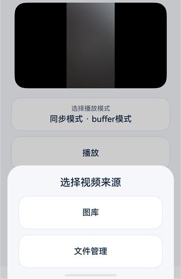

# AVCodecSample_VideoPlayer

English | [简体中文](README_zh.md)

## Introduction

This sample uses ArkUI and the native AVCodec APIs to play the video track of a local file. The home page has two buttons, **Choose playback mode** and **Play**. Choose a decoding mode and an output mode, then pick a video from Gallery or File Manager. The application bundle name is `com.samples.avcodecsample_videoplayer`. [App configuration](AppScope/app.json5)

For a first run, play a short 8-bit H.264 MP4 using the default **Asynchronous mode · Surface mode**. Check that the picture moves and that **Play** becomes available again when the video ends.

## Preview

| Choose a video source |
| --- |
|  |

## Usage

1. In DevEco Studio, open the `AVCodecSample_VideoPlayer` project, configure debug signing for your device, and run the `entry` module.
2. Put a short 8-bit H.264 MP4 in Gallery or File Manager on the device.
3. Tap **Choose playback mode** and select one of the four combinations. The second line of the button shows the selected combination.
4. Tap **Play**, choose **Gallery** or **File Manager**, and select the video. Playback starts after selection. Wait for the video to end before selecting another file or changing modes.

| Decoding mode | Surface mode | Buffer mode |
| --- | --- | --- |
| Synchronous mode | Synchronous mode · Surface mode | Synchronous mode · Buffer mode |
| Asynchronous mode | Asynchronous mode · Surface mode (default) | Asynchronous mode · Buffer mode |

Use the same video to compare the four combinations. [Test steps](ohosTest.md)

## Project Structure

```text
AVCodecSample_VideoPlayer/
├── AppScope/                            # App-level configuration and resources
├── entry/src/
│   ├── main/
│   │   ├── cpp/
│   │   │   ├── types/libentry/           # ArkTS declarations for the native module
│   │   │   ├── player_napi.cpp           # Playback task and file descriptor ownership
│   │   │   ├── player.cpp                # Demuxing, decoding, and playback timing
│   │   │   ├── video_output.cpp          # Pixel copy to the output window
│   │   │   └── CMakeLists.txt
│   │   ├── ets/
│   │   │   ├── entryability/             # Stage model entry point
│   │   │   └── pages/Index.ets           # Mode selection, pickers, and XComponent
│   │   ├── resources/                   # UI text and colors
│   │   └── module.json5
│   └── ohosTest/                        # On-device test for the home page
├── screenshots/                         # App screenshots taken on a physical device
└── ohosTest.md                           # Test steps
```

## Implementation

1. **Select the video.** The page uses `PhotoViewPicker` from `@kit.MediaLibraryKit` for Gallery and `DocumentViewPicker` from `@kit.CoreFileKit` for File Manager. It opens the selected URI read-only and passes the file descriptor, file size, selected mode, and XComponent Surface ID to Native. [Index.ets](entry/src/main/ets/pages/Index.ets)
2. **Start the decoder.** The Native API (N-API) bridge duplicates the file descriptor and schedules the playback task on a worker thread. The worker uses `OH_AVSource` and `OH_AVDemuxer` to select the video track and creates a decoder for its MIME type. In synchronous mode the worker queries buffer indexes. In asynchronous mode the decoder passes the indexes to the worker through callbacks. [player_napi.cpp](entry/src/main/cpp/player_napi.cpp) · [player.cpp](entry/src/main/cpp/player.cpp)
3. **Display frames.** Surface mode uses `OH_VideoDecoder_RenderOutputBufferAtTime` to schedule display from the video timestamps. Buffer mode copies decoded NV12 or NV21 frames to the NativeWindow. Both modes use `OH_SCALING_MODE_SCALE_FIT_V2` to preserve the aspect ratio. [player.cpp](entry/src/main/cpp/player.cpp) · [video_output.cpp](entry/src/main/cpp/video_output.cpp)
4. **Release resources.** Destroying the XComponent requests cancellation. After playback ends, fails, or is cancelled, Native releases its decoder, demuxer, media source, window reference, and duplicate file descriptor before returning the result. ArkTS closes the original descriptor and restores the buttons if the page is still open. [player_napi.cpp](entry/src/main/cpp/player_napi.cpp) · [Index.ets](entry/src/main/ets/pages/Index.ets)

## Permissions

Gallery and File Manager grant access to the file selected through their system pickers. The module declares no additional permissions. [Module configuration](entry/src/main/module.json5)

## Constraints

- The app uses the Stage model. It targets standard-system devices and tablets with the APIs provided by OpenHarmony SDK 26.0.0. Build with a DevEco Studio release that supports this SDK, such as 26.0.0.851. [Build profile](build-profile.json5) · [Module configuration](entry/src/main/module.json5)
- The system demuxer must recognize the file container, and the device must support the video profile and selected mode. Use 8-bit SDR video for Buffer mode, which accepts decoded NV12 and NV21 frames.
- The sample plays one local video track from start to finish. The controls cover mode selection and starting playback. The Native module links to system media and window libraries. [Native build configuration](entry/src/main/cpp/CMakeLists.txt)

## Download

After the sample is merged into `master`, run these Bash commands from a new, empty directory. Then open `code/DocsSample/Media/AVCodec/AVCodecSample_VideoPlayer` relative to that directory.

```bash
git init
git config core.sparsecheckout true
mkdir -p .git/info
echo code/DocsSample/Media/AVCodec/AVCodecSample_VideoPlayer/ > .git/info/sparse-checkout
git remote add origin https://gitcode.com/openharmony/applications_app_samples.git
git pull origin master
```
