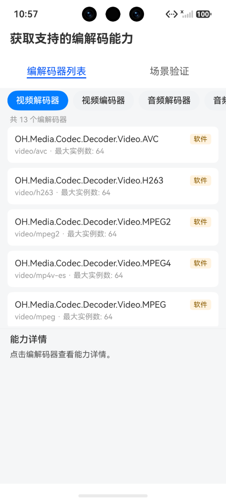
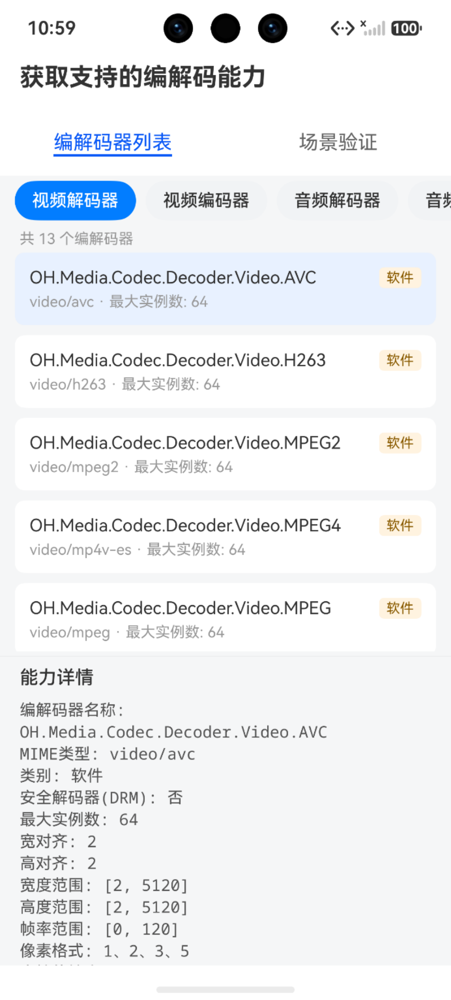
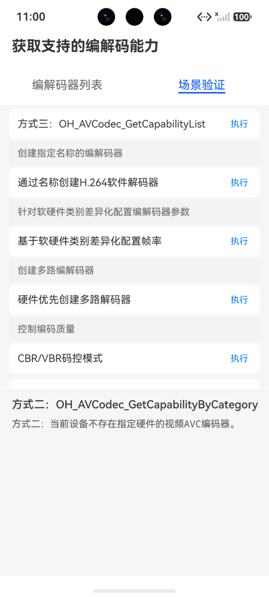
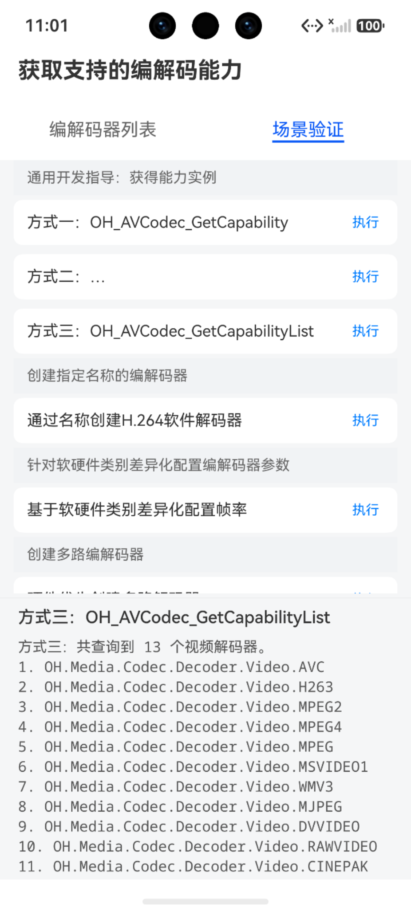

# CodecCapabilitySample（获取支持的编解码能力）

## 简介

本示例展示了通过 AVCodec Kit 的 OH_AVCapability 接口查询系统支持的编解码器及能力规格的开发方法，与开发指南《[获取支持的编解码能力](../docs/zh-cn/application-dev/media/avcodec/obtain-supported-codecs.md)》《[典型场景的视频编码配置](../docs/zh-cn/application-dev/media/avcodec/video-encoding-configuration-typical-scenarios.md)》《[B帧视频编码](../docs/zh-cn/application-dev/media/avcodec/video-encoding-b-frame.md)》《[时域可分层视频编码](../docs/zh-cn/application-dev/media/avcodec/video-encoding-temporal-scalability.md)》配套使用，示例代码以 `[Start xxx]` / `[End xxx]` 标记嵌入各场景函数中，供文档通过代码片段名引用。

主要能力：

- 查询系统全部编解码器列表（视频/音频、编码/解码），展示名称、MIME类型、软硬件类别、DRM解码器标记与最大实例数。
- 查看单个编解码器的详细能力：宽高对齐与范围、帧率范围、码率/质量/复杂度范围、码控模式支持情况、档次与级别、像素格式、长期参考帧特性、音频采样率与通道数范围等。
- 逐项运行开发指南中的场景化示例：指定名称创建编解码器、软硬件差异化配置、多路创建、CBR/CQ/SQR/CBRHQ 码控配置、档次级别校验、宽高与帧率校验、DRM解码器筛选等。
- 逐项运行视频编码配置类指南的场景化示例：低时延/CBRHQ/直播/离线转码等典型场景的基础参数配置、动态请求IDR帧、B帧能力校验与最大B帧数配置、全局时域可分层特性校验/参数配置/动态使能与去使能、时域层级解析、LTR能力校验、参考帧数量配置与随帧通路回调注册（Buffer/Surface输入模式）。

## 效果预览

| 编解码器列表 | 能力详情 | 场景验证 | 执行结果 |
| :---: | :---: | :---: | :---: |
|  |  |  |  |

## 使用说明

1. 使用 DevEco Studio 26.0.0 Release 打开本工程，连接真机或模拟器。
2. 点击运行，应用首页分为“编解码器列表”与“场景验证”两个页签。
3. “编解码器列表”页签下切换编解码器类别，点击列表项查看能力详情。
4. “场景验证”页签下点击场景条目，执行对应的开发指南示例并查看结果。

## 工程目录

```
CodecCapabilitySample
├── AppScope                             # 应用级配置
├── entry/src/main/cpp                   # native侧代码
│   ├── capability
│   │   ├── include                      # 头文件
│   │   ├── CapabilityQuery.cpp          # 场景：获取能力实例与编解码器创建
│   │   ├── CapabilityConfigQuery.cpp    # 场景：码控/复杂度/音频参数
│   │   ├── CapabilityVideoQuery.cpp     # 场景：档次级别/宽高/帧率/像素格式/特性/DRM
│   │   ├── EncodingConfigQuery.cpp      # 场景：典型场景编码基础参数配置
│   │   ├── BFrameQuery.cpp              # 场景：B帧能力校验与配置
│   │   ├── TemporalScalabilityQuery.cpp # 场景：时域可分层与LTR
│   │   ├── CodecList.cpp                # 编解码器列表与详情查询
│   │   └── CapabilityQueryNative.cpp    # NAPI桥接层
│   ├── common/dfx                       # 日志与错误码
│   └── types/libcapability              # native接口声明
├── entry/src/main/ets                   # 应用侧代码
│   ├── common/utils                     # 日志工具
│   ├── controller                       # 控制器
│   ├── model                            # 数据模型
│   ├── entryability                     # 入口Ability
│   └── pages                            # 页面
└── entry/src/ohosTest                   # 单元测试
```

## 具体实现

- 页面 UI 实现位于 [Index.ets](entry/src/main/ets/pages/Index.ets)，通过 `Tabs` 展示“编解码器列表”与“场景验证”两个页签，列表数据由 [CapabilityController](entry/src/main/ets/controller/CapabilityController.ets) 提供。
- 编解码器类别名称与场景分组数据定义在 [CodecModel.ets](entry/src/main/ets/model/CodecModel.ets)，页面层通过 `$r('app.string.xxx')` 引用资源实现国际化。
- 编解码器列表与详情查询由 [CapabilityController.ets](entry/src/main/ets/controller/CapabilityController.ets) 封装 native 接口，调用 `libcapability.so` 中的 `getCodecList` 与 `getCodecDetail`。
- 场景化示例在 native 层分模块实现：
  - [CapabilityQuery.cpp](entry/src/main/cpp/capability/CapabilityQuery.cpp)：获取能力实例、按名称创建编解码器、软硬件差异化配置、多路创建。
  - [CapabilityConfigQuery.cpp](entry/src/main/cpp/capability/CapabilityConfigQuery.cpp)：码控模式、复杂度、音频参数配置。
  - [CapabilityVideoQuery.cpp](entry/src/main/cpp/capability/CapabilityVideoQuery.cpp)：档次级别、宽高、帧率、像素格式、特性、DRM 安全解码器筛选。
  - [EncodingConfigQuery.cpp](entry/src/main/cpp/capability/EncodingConfigQuery.cpp)：低时延、直播、离线转码等典型场景基础参数配置。
  - [BFrameQuery.cpp](entry/src/main/cpp/capability/BFrameQuery.cpp)：B 帧能力校验与配置。
  - [TemporalScalabilityQuery.cpp](entry/src/main/cpp/capability/TemporalScalabilityQuery.cpp)：全局时域可分层与 LTR 特性校验。
  - [CodecList.cpp](entry/src/main/cpp/capability/CodecList.cpp)：编解码器列表与详情查询。
  - [CapabilityQueryNative.cpp](entry/src/main/cpp/capability/CapabilityQueryNative.cpp)：NAPI 桥接层，向 ArkTS 侧暴露接口。

## 相关权限

本示例仅查询系统编解码能力信息，不涉及用户隐私数据或敏感权限，无需额外申请权限。

## 约束与限制

- 本示例仅支持在标准系统上运行。
- 本示例需要使用 DevEco Studio 26.0.0 Release 及以上版本编译运行。
- 场景执行结果会缓存，避免重复创建编解码器实例；重新启动应用后缓存重置。

## 下载

如需单独下载本工程，执行如下命令：

```
git init
git config core.sparsecheckout true
echo code/DocsSample/Media/AVCodec/CodecCapabilitySample/ > .git/info/sparse-checkout
git remote add origin https://gitcode.com/Helinshan/applications_app_samples_7127.git
git pull origin master
```
