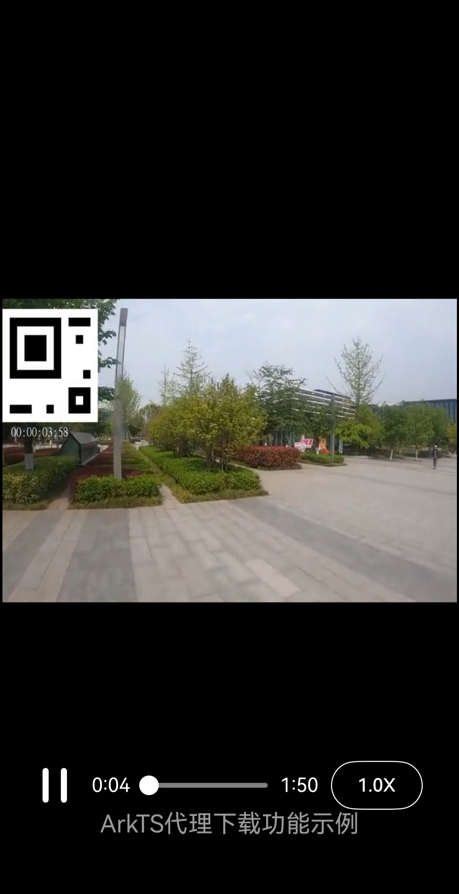

# AVPlayerArkTSMediaSource

## 浠嬬粛

鏈ず渚嬩负濯掍綋->Media Kit(濯掍綋鏈嶅姟)->[浣跨敤AVPlayer璁剧疆鎾斁MediaSource(ArkTS)](https://gitcode.com/openharmony/docs/blob/master/zh-cn/application-dev/media/media/playback-url-setting-method.md)鐨勯厤濂楃ず渚嬪伐绋嬨€?

鏈ず渚嬪睍绀轰簡濡備綍浣跨敤AVPlayer鍦ㄦ挱鏀炬椂浣跨敤浠ｇ悊涓嬭浇鍔熻兘銆?
## 鏁堟灉棰勮

| 鎾斁鏁堟灉                                      | 
| -------------------------------------------- | 



## 宸ョ▼鐩綍

```
AVPlayerArkTSMediaSource
entry/src/main/ets/
鈹斺攢鈹€ pages
    鈹斺攢鈹€ Index.ets (鎾斁鐣岄潰)
鈹斺攢鈹€ components
    鈹斺攢鈹€ download.ets (涓嬭浇浠ｇ悊缁勪欢)
entry/src/main/resources/
鈹溾攢鈹€ base
鈹?  鈹溾攢鈹€ element
鈹?  鈹?  鈹溾攢鈹€ color.json
鈹?  鈹?  鈹溾攢鈹€ float.json
鈹?  鈹?  鈹斺攢鈹€ string.json
鈹?  鈹斺攢鈹€ media
鈹?      鈹溾攢鈹€ ic_video_play.svg  (鎾斁閿浘鐗囪祫婧?
鈹?      鈹斺攢鈹€ ic_video_pause.svg (鏆傚仠閿浘鐗囪祫婧?
鈹斺攢鈹€ rawfile
    鈹溾攢鈹€ test.m3u8    (m3u8璧勬簮)
    鈹溾攢鈹€ test1.mp4 锛堣棰戣祫婧愶級
    鈹斺攢鈹€ test_01.mp3 锛堥煶棰戣祫婧愶級
entry/src/ohosTest/ets/
鈹斺攢鈹€ test
    鈹溾攢鈹€ Ability.test.ets (UI娴嬭瘯浠ｇ爜)
    鈹斺攢鈹€ List.test.ets (娴嬭瘯濂椾欢鍒楄〃)
```

## 鍏蜂綋瀹炵幇

1. 浣跨敤XComponent浣滀负瑙嗛娓叉煋琛ㄩ潰锛岄€氳繃media.createAVPlayer()鍒涘缓鎾斁鍣ㄥ疄渚?
2. 閫氳繃MediaSource + MediaResourceLoaderDelegate瀹炵幇浠ｇ悊涓嬭浇鍔熻兘锛氭挱鏀惧櫒璇锋眰鏁版嵁鏃惰Е鍙憃pen/read/close鍥炶皟锛屽簲鐢ㄩ€氳繃HTTP Range璇锋眰鑾峰彇鏁版嵁鍚庨€氳繃respondHeader鍜宺espondData鍥炰紶缁欐挱鏀惧櫒;
3. 鏀寔鏈湴鏂囦欢鎾斁锛坒dSrc锛夊拰缃戠粶娴佸獟浣撴挱鏀句袱绉嶆ā寮?
## 鐩稿叧鏉冮檺

ohos.permission.INTERNET锛氬厑璁镐娇鐢↖nternet缃戠粶銆?ohos.permission.GET_WIFI_INFO锛氬厑璁稿簲鐢ㄨ幏鍙朩i-Fi淇℃伅鍜屼娇鐢≒2P鑳藉姏銆?
## 渚濊禆

涓嶆秹鍙?
## 绾︽潫鍜岄檺鍒?
1. 鏈ず渚嬫敮鎸佹爣鍑嗙郴缁熶笂杩愯锛屾敮鎸佽澶囷細RK3568;

2. 鏈ず渚嬫敮鎸丠armonyOS SDK 26.0.0 Release锛屽師鏍峰寘鍚玂penHarmony SDK Ohos_sdk_public 26.0.0.105 (API Version 26.0.0 Release)锛岀増鏈彿锛?6.0.0.105;
   
3. 鏈ず渚嬪凡鏀寔浣緿evEco Studio 26.0.0 Release (鏋勫缓鐗堟湰锛?6.0.0.851锛屾瀯寤?2026骞?鏈?2鏃?缂栬瘧杩愯

## 涓嬭浇

濡傞渶鍗曠嫭涓嬭浇鏈伐绋嬶紝鎵ц濡備笅鍛戒护锛?
```
git init
git config core.sparsecheckout true
echo code/DocsSample/Media/AVPlayer/AVPlayerArkTSMediaSource/ > .git/info/sparse-checkout
git remote add origin https://gitcode.com/openharmony/applications_app_samples.git
git pull origin master
```