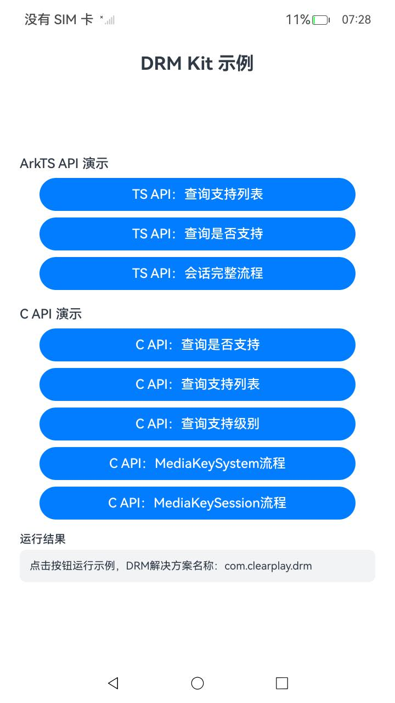

# DrmAVPlayer

## Introduction

DrmAVPlayer is a sample project for DRM Kit, demonstrating how to play DRM content with AVPlayer (`@kit.DrmKit` + `@kit.MediaKit`):

- Creating an AVPlayer instance and listening for DRM information updates (the `mediaKeySystemInfoUpdate` event).
- Matching and creating MediaKeySystem/MediaKeySession instances by the UUID in the DRM information.
- Generating media key requests and processing media key responses.
- Setting the decryption configuration (`setDecryptionConfig`) and releasing resources.

The DRM solution name used in this sample is `com.clearplay.drm`, and the media type is `video/mp4`. Both can be changed according to the DRM plug-ins installed on the device.

## Effect Preview

|Main Page|
|--------------------------------|
||

## Directory Structure

```
DrmAVPlayer
├── AppScope                          # Application information
├── entry
│   └── src/main
│       ├── ets
│       │   ├── entryability          # Entry ability
│       │   └── pages
│       │       └── AVPlayerDrm.ets   # AVPlayer DRM playback sample and UI
│       └── resources                 # Strings, colors, icons, and other resources
├── README.md
└── README_zh.md
```

## Usage

1. Open this project in DevEco Studio, complete signing, and build and run it on an OpenHarmony device.
2. Enter the URL of the DRM content on the playback page and tap **Play**. The sample creates an AVPlayer instance, listens for DRM information updates, creates MediaKeySystem/MediaKeySession instances based on the DRM information, generates media key requests and processes media key responses, and sets the decryption configuration in sequence.
3. Tap **Release** to release the AVPlayer instance and destroy the MediaKeySession and MediaKeySystem instances in the released event.
4. The status and error codes of each step are displayed in the text area at the bottom of the UI.

## Required Permissions

No permissions are required for this sample.

## Constraints and Limitations

1. This sample runs only on standard systems, with device types phone/tablet.
2. This sample is developed based on OpenHarmony API 20 and must be compiled with a matching SDK version.
3. DevEco Studio 6.0.1 or later is required to build and run this sample. Configure signing before running.
4. Playing DRM content requires a real DRM content source and a matching license service. Without a real source, only the call flow can be demonstrated (each step's status and error codes are recorded on the UI).

## Related Documentation

- [Playing DRM Content with AVPlayer (ArkTS)](https://gitcode.com/openharmony/docs/blob/master/en-us/application-dev/media/drm/drm-avplayer-arkts-integration.md)
- [DRM Kit API Reference](https://gitcode.com/openharmony/docs/blob/master/en-us/application-dev/reference/apis-drm-kit/Readme.md)

## Download

To download this project separately, run the following commands:

```
git init
git config core.sparsecheckout true
echo code/DocsSample/Media/Drm/DrmAVPlayer/ > .git/info/sparse-checkout
git remote add origin https://gitcode.com/openharmony/applications_app_samples.git
git pull origin master
```
