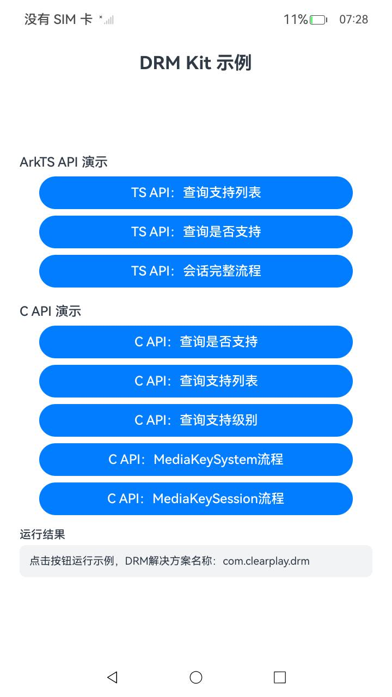

# DrmAVPlayer

## 简介

DrmAVPlayer 是 DRM Kit 的示例工程，演示基于 AVPlayer 播放 DRM 节目（`@kit.DrmKit` + `@kit.MediaKit`）的用法：

- 创建 AVPlayer 实例并监听 DRM 信息上报（`mediaKeySystemInfoUpdate` 事件）。
- 根据 DRM 信息中的 uuid 匹配并创建 MediaKeySystem/MediaKeySession。
- 生成媒体密钥请求与处理媒体密钥响应。
- 设置解密配置（`setDecryptionConfig`）以及释放资源。

示例中使用的 DRM 解决方案名称为 `com.clearplay.drm`，媒体类型为 `video/mp4`，均可按实际设备上安装的 DRM 插件修改。

## 效果预览

|主界面|
|--------------------------------|
||

## 目录结构

```
DrmAVPlayer
├── AppScope                          # 应用信息
├── entry
│   └── src/main
│       ├── ets
│       │   ├── entryability          # 入口 Ability
│       │   └── pages
│       │       └── AVPlayerDrm.ets   # AVPlayer播放DRM节目示例与界面
│       └── resources                 # 字符串、颜色、图标等资源
├── README.md
└── README_zh.md
```

## 使用说明

1. 使用 DevEco Studio 打开本工程，完成签名后编译运行到 OpenHarmony 设备。
2. 在播放页输入 DRM 节目地址后点击"播放"，依次执行创建 AVPlayer 实例、设置 DRM 信息监听、根据 DRM 信息创建 MediaKeySystem/MediaKeySession、生成媒体密钥请求与处理媒体密钥响应、设置解密配置。
3. 点击"释放"销毁 AVPlayer 实例，并在 released 事件中销毁 MediaKeySession 和 MediaKeySystem 实例。
4. 每一步的状态与错误码展示在界面下方文本区。

## 相关权限

本示例无需申请任何权限。

## 约束与限制

1. 本示例仅支持标准系统，设备类型为 phone/tablet。
2. 本示例基于 OpenHarmony API 20 开发，需使用配套版本的 SDK 编译。
3. 本示例需使用 DevEco Studio 6.0.1 及以上版本编译运行，运行前需自行完成签名配置。
4. 播放 DRM 节目需提供真实的 DRM 节目源及配套许可证服务，无真实源时仅能演示调用流程（界面记录各步骤状态与错误码）。

## 相关文档

- [基于AVPlayer播放DRM节目(ArkTS)](https://gitcode.com/openharmony/docs/blob/master/zh-cn/application-dev/media/drm/drm-avplayer-arkts-integration.md)
- [DRM Kit API 参考](https://gitcode.com/openharmony/docs/blob/master/zh-cn/application-dev/reference/apis-drm-kit/Readme-CN.md)

## 下载

如需单独下载本工程，执行如下命令：

```
git init
git config core.sparsecheckout true
echo code/DocsSample/Media/Drm/DrmAVPlayer/ > .git/info/sparse-checkout
git remote add origin https://gitcode.com/openharmony/applications_app_samples.git
git pull origin master
```
