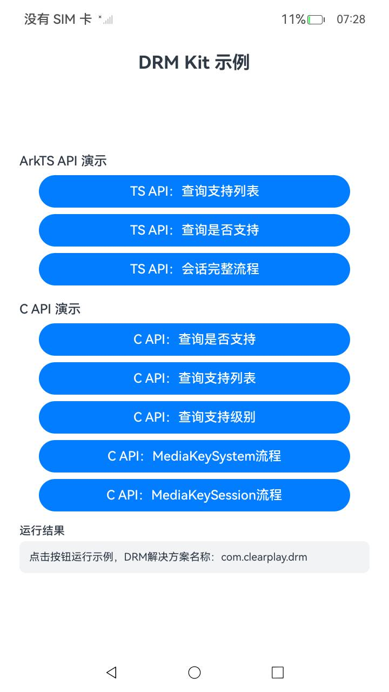
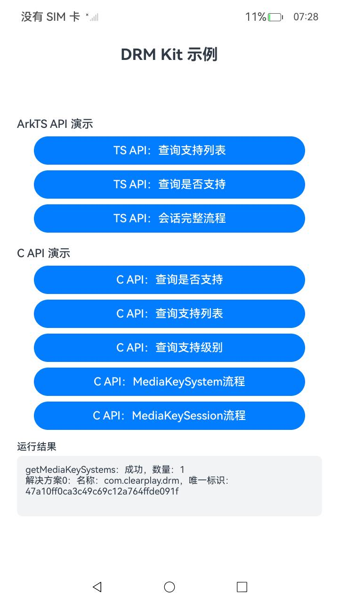

# DrmArkTS

## Introduction

DrmArkTS is a sample project for DRM Kit, demonstrating the usage of the digital rights management (DRM) ArkTS APIs (`@kit.DrmKit`):

- **Query Supported List**: obtaining the list of DRM solution names and UUIDs supported by the device.
- **Query If Supported**: querying whether the device supports a specified DRM solution (three overloads).
- **Complete Session Flow**: the complete usage flow of MediaKeySystem and MediaKeySession, including creating instances, setting state listener events, generating device DRM certificate requests and responses, generating media key requests, processing media key responses, restoring offline media keys, checking media key status, offline media key management, clearing media keys, and destroying instances.

The DRM solution name used in this sample is `com.clearplay.drm`, and the media type is `video/mp4`. Both can be changed according to the DRM plug-ins installed on the device.

## Effect Preview

|Main Page|Querying the Supported List|
|--------------------------------|--------------------------------|
|||

## Directory Structure

```
DrmArkTS
├── AppScope                          # Application information
├── entry
│   └── src/main
│       ├── ets
│       │   ├── entryability          # Entry ability
│       │   └── pages
│       │       └── Index.ets         # ArkTS API sample and UI
│       └── resources                 # Strings, colors, icons, and other resources
├── README.md
└── README_zh.md
```

## Usage

1. Open this project in DevEco Studio, complete signing, and build and run it on an OpenHarmony device.
2. **Query Supported List** calls `drm.getMediaKeySystems`.
3. **Query If Supported** calls the three overloads of `drm.isMediaKeySystemSupported`.
4. **Complete Session Flow** creates a MediaKeySystem/MediaKeySession, sets state listener events, generates device DRM certificate requests and responses, generates media key requests, checks key status, manages offline media keys, clears keys, and destroys the instances in sequence.
5. The result of each step (success/failure and error code) is displayed in the text area at the bottom of the UI.

## Required Permissions

No permissions are required for this sample.

## Constraints and Limitations

1. This sample runs only on standard systems, with device types phone/tablet.
2. This sample is developed based on OpenHarmony API 20 and must be compiled with a matching SDK version.
3. DevEco Studio 6.0.1 or later is required to build and run this sample. Configure signing before running.
4. The complete flows depend on a DRM plug-in (such as `com.clearplay.drm`) installed on the device. If it is not installed, the related steps return error codes.

## Related Documentation

- [DRM Kit Overview](https://gitcode.com/openharmony/docs/blob/master/en-us/application-dev/media/drm/drm-overview.md)
- [DRM Kit API Reference](https://gitcode.com/openharmony/docs/blob/master/en-us/application-dev/reference/apis-drm-kit/Readme.md)

## Download

To download this project separately, run the following commands:

```
git init
git config core.sparsecheckout true
echo code/DocsSample/Media/Drm/DrmArkTS/ > .git/info/sparse-checkout
git remote add origin https://gitcode.com/openharmony/applications_app_samples.git
git pull origin master
```
