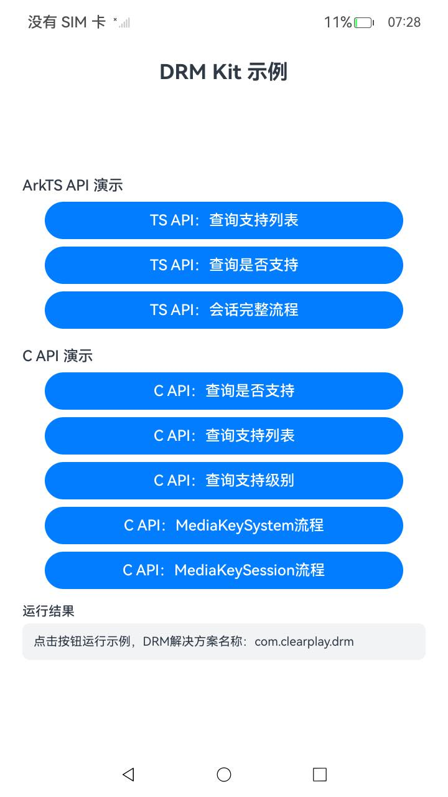
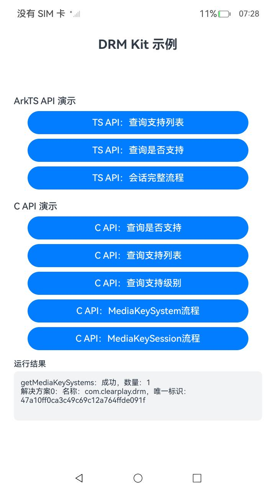

# DrmArkTS

## 简介

DrmArkTS 是 DRM Kit 的示例工程，演示数字版权保护（DRM）ArkTS API（`@kit.DrmKit`）的用法：

- **查询支持列表**：获取设备支持的 DRM 解决方案名称和唯一标识的列表。
- **查询是否支持**：查询设备是否支持指定的 DRM 解决方案（三种重载）。
- **会话完整流程**：MediaKeySystem 与 MediaKeySession 的完整使用流程，包括创建实例、设置状态监听事件、生成设备 DRM 证书请求与响应、生成媒体密钥请求、处理媒体密钥响应、恢复离线媒体密钥、检查媒体密钥状态、离线媒体密钥管理、清除媒体密钥以及销毁实例。

示例中使用的 DRM 解决方案名称为 `com.clearplay.drm`，媒体类型为 `video/mp4`，均可按实际设备上安装的 DRM 插件修改。

## 效果预览

|主界面|查询支持列表|
|--------------------------------|--------------------------------|
|||

## 目录结构

```
DrmArkTS
├── AppScope                          # 应用信息
├── entry
│   └── src/main
│       ├── ets
│       │   ├── entryability          # 入口 Ability
│       │   └── pages
│       │       └── Index.ets         # ArkTS API 示例与界面
│       └── resources                 # 字符串、颜色、图标等资源
├── README.md
└── README_zh.md
```

## 使用说明

1. 使用 DevEco Studio 打开本工程，完成签名后编译运行到 OpenHarmony 设备。
2. **查询支持列表** 调用 `drm.getMediaKeySystems`。
3. **查询是否支持** 调用 `drm.isMediaKeySystemSupported` 的三种重载。
4. **会话完整流程** 依次执行创建 MediaKeySystem/MediaKeySession、设置状态监听事件、生成设备 DRM 证书请求与响应、生成媒体密钥请求、检查密钥状态、离线媒体密钥管理、清除密钥、销毁实例。
5. 每一步的调用结果（成功/失败及错误码）展示在界面下方文本区。

## 相关权限

本示例无需申请任何权限。

## 约束与限制

1. 本示例仅支持标准系统，设备类型为 phone/tablet。
2. 本示例基于 OpenHarmony API 20 开发，需使用配套版本的 SDK 编译。
3. 本示例需使用 DevEco Studio 6.0.1 及以上版本编译运行，运行前需自行完成签名配置。
4. 完整流程演示依赖设备上已安装对应 DRM 插件（如 `com.clearplay.drm`），未安装时相关步骤会返回错误码。

## 相关文档

- [DRM Kit 简介](https://gitcode.com/openharmony/docs/blob/master/zh-cn/application-dev/media/drm/drm-overview.md)
- [DRM Kit API 参考](https://gitcode.com/openharmony/docs/blob/master/zh-cn/application-dev/reference/apis-drm-kit/Readme-CN.md)

## 下载

如需单独下载本工程，执行如下命令：

```
git init
git config core.sparsecheckout true
echo code/DocsSample/Media/Drm/DrmArkTS/ > .git/info/sparse-checkout
git remote add origin https://gitcode.com/openharmony/applications_app_samples.git
git pull origin master
```
