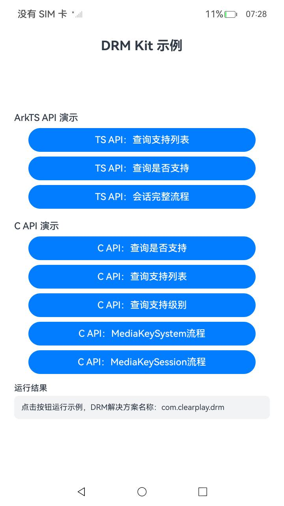

# DrmNDK

## Introduction

DrmNDK is a sample project for DRM Kit, demonstrating the usage of the digital rights management (DRM) C APIs (`multimedia/drm_framework/` headers, bridged via NAPI):

- `OH_MediaKeySystem_IsSupported` and `OH_MediaKeySystem_IsSupported3`: querying whether the device supports a specified DRM solution.
- `OH_MediaKeySystem_GetMediaKeySystems`: obtaining the list of DRM solution names and UUIDs supported by the device.
- **MediaKeySystem flow**: creation, event callback setup, certificate status query, device DRM certificate request generation and response processing, maximum content protection level query, statistics query, offline media key management, and destruction.
- **MediaKeySession flow**: session creation, callback setup, secure decoder query, media key request generation, media key response processing, offline media key restoration, media key status check, media key clearing, and destruction.

The DRM solution name used in this sample is `com.clearplay.drm`, and the media type is `video/mp4`. Both can be changed according to the DRM plug-ins installed on the device.

## Effect Preview

|Main Page|
|--------------------------------|
||

## Directory Structure

```
DrmNDK
├── AppScope                          # Application information
├── entry
│   └── src/main
│       ├── cpp                       # C API sample (NAPI)
│       │   ├── napi_init.cpp         # NAPI module registration and interface bridging
│       │   ├── drm_sample.h/.cpp     # DRM C API call flows
│       │   └── types/libdrmsample    # Type declarations referenced by the ArkTS side
│       ├── ets
│       │   ├── entryability          # Entry ability
│       │   └── pages
│       │       └── Index.ets         # C API sample UI
│       └── resources                 # Strings, colors, icons, and other resources
├── README.md
└── README_zh.md
```

## Usage

1. Open this project in DevEco Studio, complete signing, and build and run it on an OpenHarmony device.
2. **C API demo** (buttons):
   - **Query If Supported** calls `OH_MediaKeySystem_IsSupported`.
   - **Query Supported List** calls `OH_MediaKeySystem_GetMediaKeySystems`.
   - **Query Support Level** calls `OH_MediaKeySystem_IsSupported3`.
   - **MediaKeySystem flow** performs creation, content protection level query, certificate status query, statistics query, offline media key management, and destruction in sequence.
   - **MediaKeySession flow** performs session creation, secure decoder module query, media key request generation, key status check, key clearing, and destruction in sequence.
3. The result of each step (success/failure and error code) is displayed in the text area at the bottom of the UI.

## Required Permissions

No permissions are required for this sample.

## Constraints and Limitations

1. This sample runs only on standard systems, with device types phone/tablet.
2. This sample is developed based on OpenHarmony API 20 and must be compiled with a matching SDK version.
3. DevEco Studio 6.0.1 or later is required to build and run this sample. Configure signing before running.
4. The complete flows depend on a DRM plug-in (such as `com.clearplay.drm`) installed on the device. If it is not installed, the related steps return error codes.

## Related Documentation

- [Digital Rights Management (C/C++)](https://gitcode.com/openharmony/docs/blob/master/en-us/application-dev/media/drm/drm-c-dev-guide.md)
- [DRM Kit API Reference](https://gitcode.com/openharmony/docs/blob/master/en-us/application-dev/reference/apis-drm-kit/Readme.md)

## Download

To download this project separately, run the following commands:

```
git init
git config core.sparsecheckout true
echo code/DocsSample/Media/Drm/DrmNDK/ > .git/info/sparse-checkout
git remote add origin https://gitcode.com/openharmony/applications_app_samples.git
git pull origin master
```
