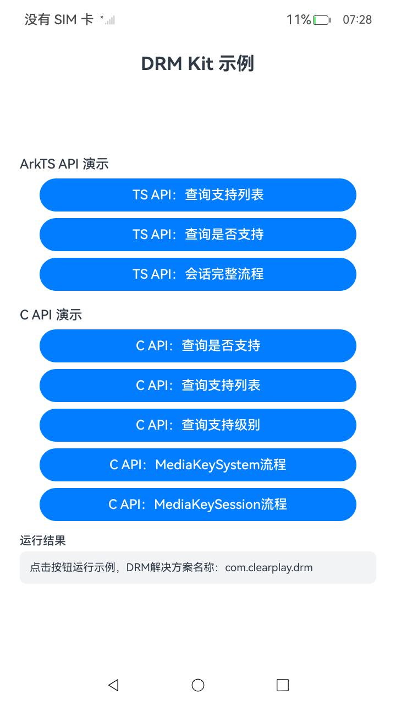
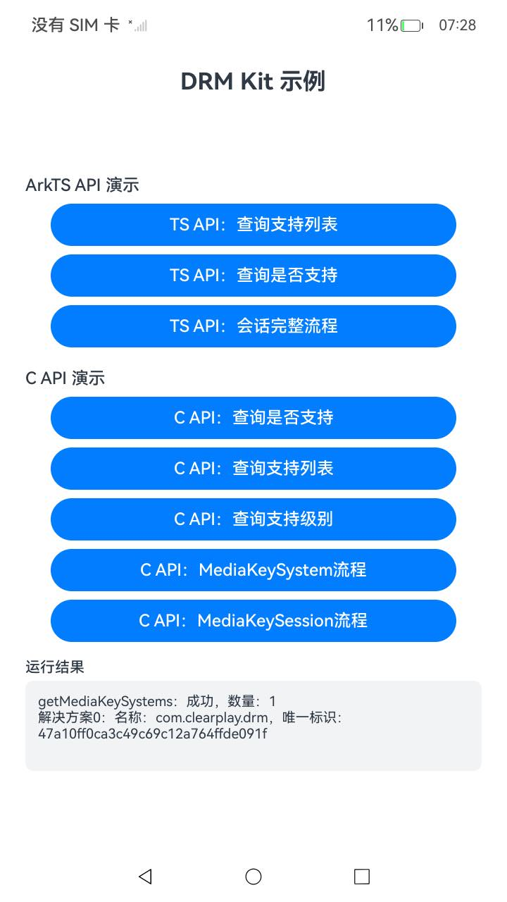

# DrmSample

## 简介

DrmSample 是 DRM Kit 的示例工程，演示数字版权保护（DRM）能力的两套接口用法：

- **ArkTS API（`@kit.DrmKit`）**：查询设备是否支持指定的 DRM 解决方案、创建 MediaKeySystem/MediaKeySession 实例、生成媒体密钥请求、检查媒体密钥状态、清除媒体密钥以及销毁实例。
- **C API（`multimedia/drm_framework/` 头文件，经 NAPI 桥接）**：演示 `OH_MediaKeySystem_IsSupported`、`OH_MediaKeySystem_GetMediaKeySystems`、`OH_MediaKeySystem_Create`、`OH_MediaKeySystem_GetMaxContentProtectionLevel`、`OH_MediaKeySystem_GetCertificateStatus`、`OH_MediaKeySystem_GetStatistics`、`OH_MediaKeySystem_CreateMediaKeySession`、`OH_MediaKeySession_GenerateMediaKeyRequest`、`OH_MediaKeySession_CheckMediaKeyStatus`、`OH_MediaKeySession_RequireSecureDecoderModule`、`OH_MediaKeySession_ClearMediaKeys` 以及两个 Destroy 接口的调用流程。
- **AVPlayer 播放 DRM 节目（`@kit.DrmKit` + `@kit.MediaKit`）**：创建 AVPlayer 实例、监听 DRM 信息上报、根据 DRM 信息中的 uuid 匹配并创建 MediaKeySystem/MediaKeySession、生成媒体密钥请求与处理媒体密钥响应、设置解密配置以及释放资源。

示例中使用的 DRM 解决方案名称为 `com.clearplay.drm`，媒体类型为 `video/mp4`，均可按实际设备上安装的 DRM 插件修改。

## 效果预览

|主界面|查询支持列表|
|--------------------------------|--------------------------------|
|||

## 目录结构

```
Drm
├── AppScope                          # 应用信息
├── entry
│   └── src/main
│       ├── cpp                       # C API 示例（NAPI）
│       │   ├── napi_init.cpp         # NAPI 模块注册与接口桥接
│       │   ├── drm_sample.h/.cpp     # DRM C API 调用流程
│       │   └── types/libdrmsample    # 供 ArkTS 侧引用的类型声明
│       ├── ets
│       │   ├── entryability          # 入口 Ability
│       │   └── pages
│       │       ├── Index.ets         # ArkTS API 示例与界面
│       │       └── AVPlayerDrm.ets   # AVPlayer播放DRM节目示例
│       └── resources                 # 字符串、颜色、图标等资源
├── README.md
└── README_zh.md
```

## 使用说明

1. 使用 DevEco Studio 打开本工程，完成签名后编译运行到 OpenHarmony 设备。
2. **ArkTS API 演示**（按钮）：
   - **查询是否支持** 调用 `drm.isMediaKeySystemSupported` 的三种重载。
   - **会话完整流程** 依次执行创建 MediaKeySystem/MediaKeySession、生成媒体密钥请求、检查密钥状态、清除密钥、销毁实例。
3. **C API 演示**（按钮）：
   - **查询是否支持** 调用 `OH_MediaKeySystem_IsSupported`。
   - **查询支持列表** 调用 `OH_MediaKeySystem_GetMediaKeySystems`。
   - **查询支持级别** 调用 `OH_MediaKeySystem_IsSupported3`。
   - **MediaKeySystem 流程** 依次执行创建、内容保护级别、证书状态、统计信息、销毁。
   - **MediaKeySession 流程** 依次执行创建会话、安全解码查询、生成密钥请求、密钥状态检查、清除密钥、销毁。
4. 每一步的调用结果（成功/失败及错误码）展示在界面下方文本区。
5. **AVPlayer 播放 DRM 节目演示**（首页底部按钮进入）：
   - 在播放页输入 DRM 节目地址后点击"播放"，依次执行创建 AVPlayer 实例、设置 DRM 信息监听、根据 DRM 信息创建 MediaKeySystem/MediaKeySession、生成媒体密钥请求与处理媒体密钥响应、设置解密配置。
   - 点击"释放"销毁 AVPlayer 实例，并在 released 事件中销毁 MediaKeySession 和 MediaKeySystem 实例。

## 相关权限

本示例无需申请任何权限。

## 约束与限制

1. 本示例仅支持标准系统，设备类型为 phone/tablet。
2. 本示例基于 OpenHarmony API 20 开发，需使用配套版本的 SDK 编译。
3. 本示例需使用 DevEco Studio 6.0.1 及以上版本编译运行，运行前需自行完成签名配置。
4. 完整流程演示依赖设备上已安装对应 DRM 插件（如 `com.clearplay.drm`），未安装时相关步骤会返回错误码。
5. AVPlayer 播放 DRM 节目需提供真实的 DRM 节目源及配套许可证服务，无真实源时仅能演示调用流程（界面记录各步骤状态与错误码）。

## 相关文档

- [数字版权保护(C/C++)](https://gitcode.com/openharmony/docs/blob/master/zh-cn/application-dev/media/drm/drm-c-dev-guide.md)
- [基于AVCodec播放DRM节目(C/C++)](https://gitcode.com/openharmony/docs/blob/master/zh-cn/application-dev/media/drm/drm-avcodec-integration.md)
- [基于AVPlayer播放DRM节目(ArkTS)](https://gitcode.com/openharmony/docs/blob/master/zh-cn/application-dev/media/drm/drm-avplayer-arkts-integration.md)
- [DRM Kit API 参考](https://gitcode.com/openharmony/docs/blob/master/zh-cn/application-dev/reference/apis-drm-kit/Readme-CN.md)

## 下载

如需单独下载本工程，执行如下命令：

```
git init
git config core.sparsecheckout true
echo code/DocsSample/Media/Drm/ > .git/info/sparse-checkout
git remote add origin https://gitcode.com/openharmony/applications_app_samples.git
git pull origin master
```
