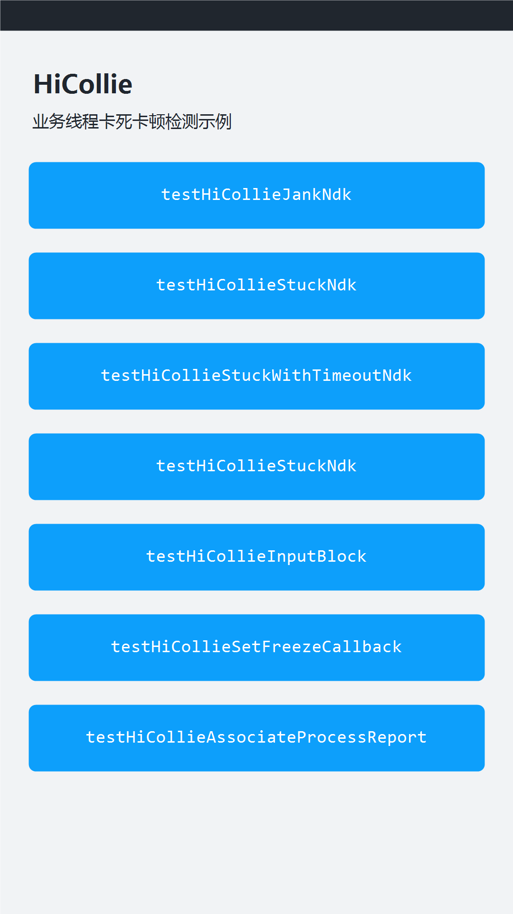

# HiCollie 卡死卡顿检测

###  介绍

本示例主要展示了HiCollie对外提供的业务线程卡死、卡顿检测，输入无响应上报，以及冻屏回调接口的使用。本示例的应用包名为com.example.hicollie。

该工程中展示的代码详细描述可查如下链接：

- [使用HiCollie检测业务线程卡死卡顿问题（C/C++）](https://gitcode.com/openharmony/docs/blob/master/zh-cn/application-dev/dfx/hicollie-guidelines-ndk.md)

###  效果预览

|                             主页                             |
| :----------------------------------------------------------: |
|  |

#### 使用说明

1. 在DevEco Studio中运行本示例，主界面共提供7个按钮，覆盖HiCollie对外提供的6个示例接口；其中“testHiCollieStuckNdk”按钮出现两次，分别用于“应用线程卡死检测”和“应用输入无响应上报”两个使用场景。

2. 在DevEco Studio底部切换到“Log”窗口，日志过滤选择“No filters”，搜索内容设置为“Sample_Hicollie”。

3. 依次点击按钮，即可在“Log”窗口看到对应接口的日志输出。

- 按钮“testHiCollieJankNdk”：注册并执行应用线程卡顿检测任务，周期性输出卡顿检测结果。

- 按钮“testHiCollieStuckNdk”：注册应用线程卡死检测任务，检测线程超过3s未执行时上报BUSINESS_THREAD_BLOCK_3S告警事件，超过6s时上报BUSINESS_THREAD_BLOCK_6S卡死事件。

- 按钮“testHiCollieStuckWithTimeoutNdk”：注册自定义检测时间的应用线程卡死检测任务，本示例中检测阈值为5s。

- 第4个按钮“testHiCollieStuckNdk”：配合“testHiCollieInputBlock”使用，先点击该按钮注册卡死检测任务，再持续点击“testHiCollieInputBlock”按钮。

- 按钮“testHiCollieInputBlock”：业务线程卡死时上报应用输入无响应事件。

- 按钮“testHiCollieSetFreezeCallback”：设置冻屏事件的自定义日志回调。

- 按钮“testHiCollieAssociateProcessReport”：主动上报进程执行超时事件。

###  工程目录

```text
Hicollie
|-----AppScope
|     |-----app.json5                                   // 定义应用唯一的包名："bundleName": "com.example.hicollie"
|-----entry
      |-----src/main/cpp
      |     |-----CMakeLists.txt                        // 导入so链接
      |     |-----napi_init.cpp                         // HiCollie接口示例功能函数
      |     |-----types/libentry/Index.d.ts             // 对外导出的ArkTS接口声明
      |-----src/main/ets
      |     |-----entryability/EntryAbility.ets         // 应用入口Ability
      |     |-----entrybackupability/EntryBackupAbility.ets  // 备份恢复扩展能力
      |     |-----pages/Index.ets                       // 主页，提供7个按钮
      |-----src/mock
      |     |-----Libentry.mock.ets                     // libentry.so的mock实现，用于本地单元测试
      |-----src/ohosTest
      |     |-----ets/test/Ability.test.ets             // HiCollie接口自动化测试用例
      |-----src/test
            |-----LocalUnit.test.ets                    // 本地单元测试用例
```

###  具体实现

1. 在“entry > src > main > cpp > CMakeLists.txt”中，通过target_link_libraries链接libohhicollie.so与libhilog_ndk.z.so。

2. 在“entry > src > main > cpp > napi_init.cpp”中，实现卡顿检测、卡死检测、输入无响应上报以及冻屏回调等示例代码，并通过napi_module注册“entry”模块。

3. 在“entry > src > main > cpp > types > libentry > Index.d.ts”中，声明6个对外导出的ArkTS接口。

4. 在“entry > src > main > ets > pages > Index.ets”中，通过“libentry.so”调用上述6个接口，并为每个接口添加对应的按钮点击事件。

5. 在“entry > src > ohosTest”中，对6个HiCollie接口进行用例覆盖，用例执行结果记录在ohosTest.md中。

###  相关权限

不涉及。

###  依赖

不涉及。

###  约束与限制

1. 本示例仅支持标准系统上运行，支持设备：RK3568；

2. 本示例支持API 26版本SDK，SDK版本号(API Version 26)，镜像版本号(6.0)。

3. 本示例建议使用DevEco Studio(6.0.0.858)及以上版本编译运行。

4. 本示例的bundleName为com.example.hicollie。

5. OH_HiCollie_Init_JankDetection、OH_HiCollie_Init_StuckDetection从API version 12开始支持；OH_HiCollie_Init_StuckDetectionWithTimeout从API version 18开始支持；OH_HiCollie_ReportInputBlock、OH_HiCollie_SetFreezeCallback、OH_HiCollie_AssociateProcessReport从API version 24开始支持。

6. OH_HiCollie_Init_StuckDetection、OH_HiCollie_Init_StuckDetectionWithTimeout、OH_HiCollie_Init_JankDetection、OH_HiCollie_Report接口需要在非主线程中使用。

### 下载

如需单独下载本工程，执行如下命令：

```text
git init
git config core.sparsecheckout true
echo code/DocsSample/PerformanceAnalysisKit/Hicollie/ > .git/info/sparse-checkout
git remote add origin https://gitcode.com/openharmony/applications_app_samples.git
git pull origin master
```
