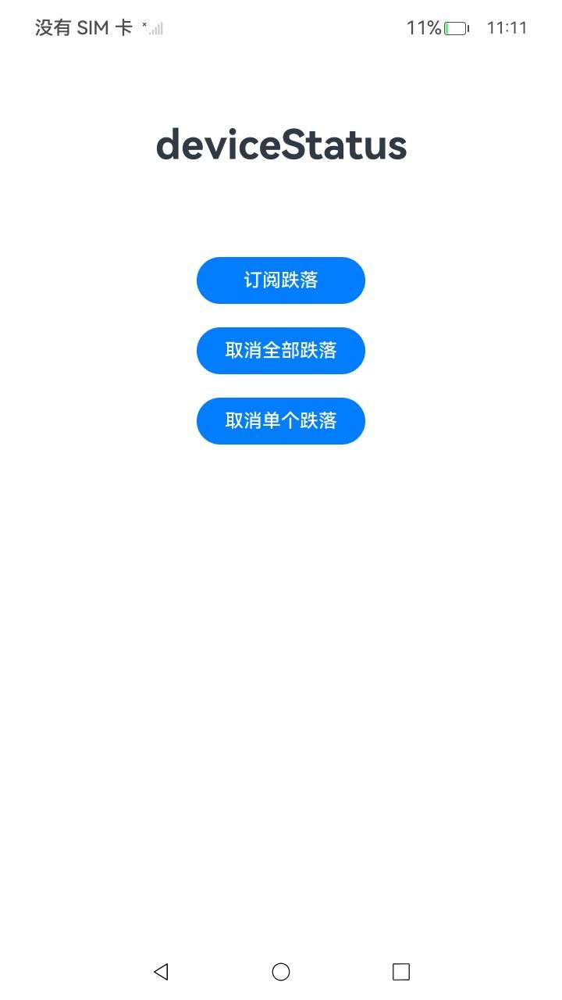
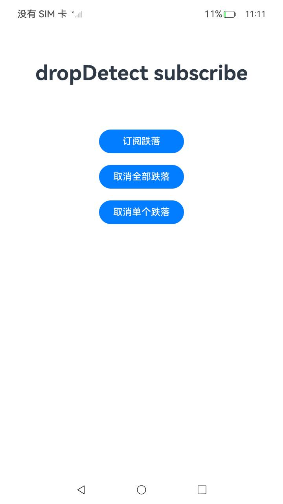
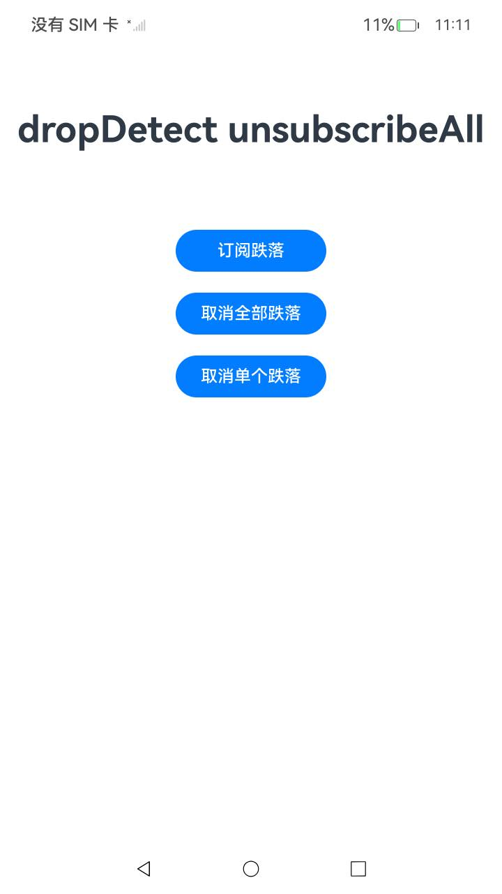
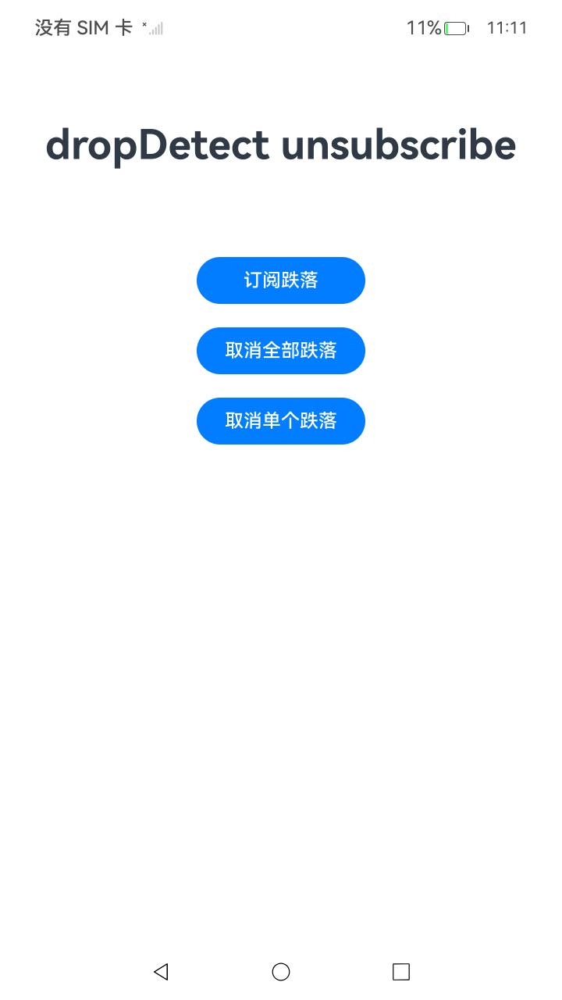

# DeviceStatusSta（设备状态感知静态示例）

### 介绍

工程目录为 `DeviceStatusSta`，应用显示名为 `DeviceStatusStaticSample`，包名为 `com.samples.devicestatussta`。

1.DeviceStatus（设备状态感知）模块提供设备状态感知能力，本示例演示手机跌落检测事件的订阅与取消订阅。

详细的接口介绍请参考[deviceStatus接口](https://gitcode.com/openharmony/docs/blob/OpenHarmony_feature_sta_20260331/zh-cn/application-dev/reference/apis-multimodalawareness-kit/js-apis-awareness-deviceStatus.md)。

2.实现对以下指南文件中 [设备状态感知开发指导](https://gitcode.com/openharmony/docs/blob/OpenHarmony_feature_sta_20260331/zh-cn/application-dev/device/stationary/deviceStatus-guidelines.md)示例代码片段的工程化。保证指南中示例代码与sample工程文件同源。

### 效果预览

|         页面说明          |                                          截图                                          |
|:---------------------:|:------------------------------------------------------------------------------------:|
|      **index页面**      |  |
|      **订阅跌落**      |  |
|      **取消全部跌落订阅**      |  |
|      **取消单个跌落订阅**      |  |


### 使用说明

1. 在主界面，点击订阅跌落按钮使能手机跌落检测功能。订阅成功后，可以点击取消全部跌落按钮取消全部订阅，或点击取消单个跌落按钮取消之前注册的回调。
2. 接口调用失败时，页面显示对应的 `failed` 提示，以及错误码 `code` 和错误信息 `message`；没有有效订阅时点击取消单个跌落按钮，页面显示 `dropDetect unsubscribe failed: no active subscription`。

### 工程目录

```
entry/src/
 ├── main
 │   ├── ets
 │   │   ├── entryability
 │   │   └── pages
 │   │       └── Index.ets                   // DeviceStatus调用
 │   ├── module.json5
 │   └── resources
 └── ohosTest
     └── ets
         └── test
             └── Ability.test.ets        // 自动化测试代码
```

### 具体实现

页面实现见 [Index.ets](entry/src/main/ets/pages/Index.ets)：

1. 保存稳定的跌落检测回调，通过 `deviceStatus.onDropDetect` 订阅事件，避免重复订阅同一回调。
2. 通过不带参数的 `deviceStatus.offDropDetect()` 取消全部订阅，或传入原回调取消单个订阅；仅在调用成功后更新订阅状态。
3. 将跌落检测状态显式映射为 `number` 类型的数值（正常为 0、跌落为 1），通过 hilog 的 `%{public}d` 格式符直接输出状态值；未知状态记录告警日志。
4. 捕获 `BusinessError<void>`，通过 hilog 记录错误码 `code` 和错误信息 `message`，并在页面区分成功、失败和无有效订阅的状态。

应用入口见 [EntryAbility.ets](entry/src/main/ets/entryability/EntryAbility.ets)，
3 条 UI 自动化用例见 [Ability.test.ets](entry/src/ohosTest/ets/test/Ability.test.ets)。
系统接口统一使用 `@kit.*` 导入方式。

### 相关权限

不涉及。

### 依赖

不涉及。

### 约束与限制

#### 手机跌落检测

1.本示例仅支持标准系统上运行，支持设备：Phone;

2.本示例为Stage模型，支持API26版本SDK，SDK版本号(API Version 26)。

3.本示例需要使用DevEco Studio 版本号(6.0.0 Release)版本才可编译运行。

4.设备需要支持手机跌落检测能力。

### 下载

如需单独下载本工程，执行如下命令：

````
git init
git config core.sparsecheckout true
echo code/DocsSample/Stationary/DeviceStatusSta > .git/info/sparse-checkout
git remote add origin https://gitcode.com/openharmony/applications_app_samples.git
git pull origin OpenHarmony_feature_sta_20260331
````
