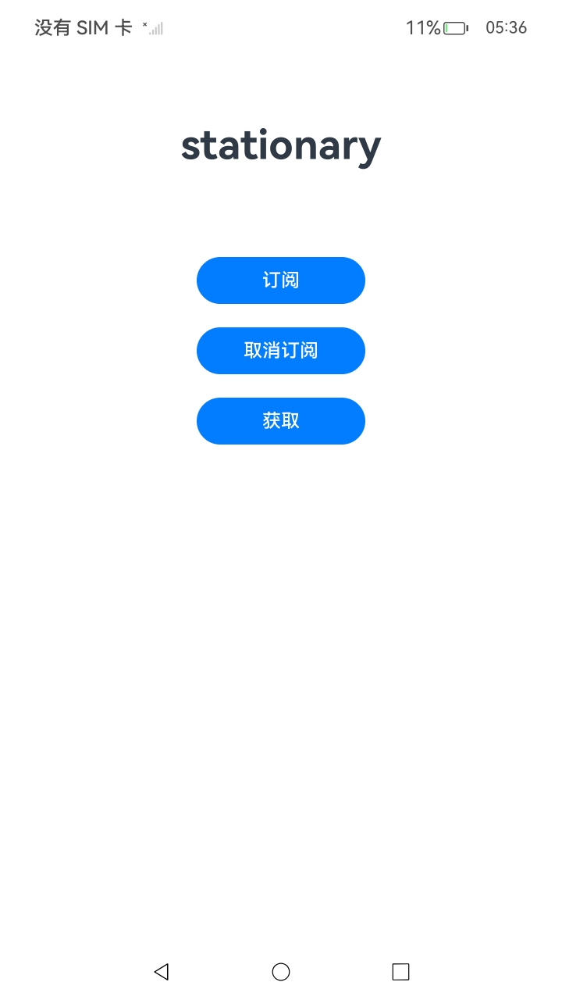
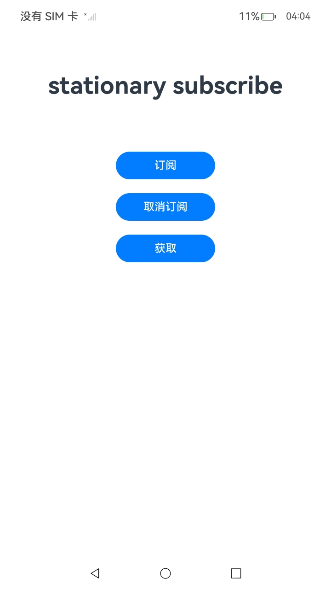
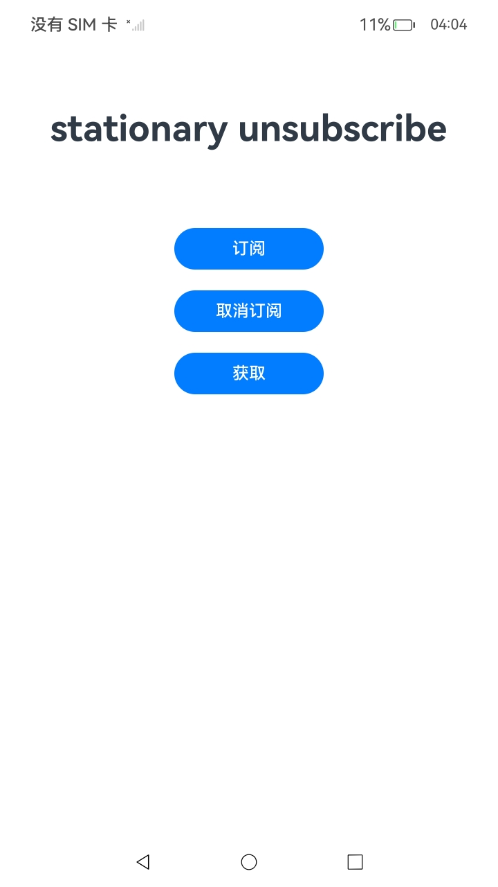
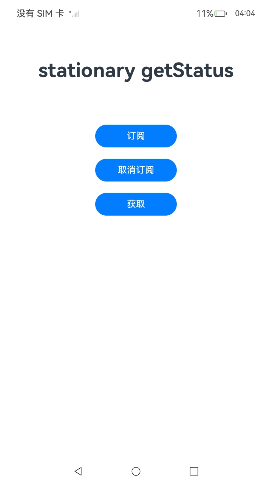

#  Stationary服务

### 介绍

1.当应用需要获取当前设备状态时，可以调用Stationary模块。

详细的接口介绍请参考[Stationary接口](https://gitcode.com/openharmony/docs/blob/master/zh-cn/application-dev/reference/apis-multimodalawareness-kit/js-apis-stationary.md)。

2.实现对以下指南文件中 [Stationary开发指导](https://gitcode.com/openharmony/docs/blob/master/zh-cn/application-dev/device/stationary/stationary-guidelines.md)示例代码片段的工程化。保证指南中示例代码与sample工程文件同源。

### 效果预览

|    页面说明     |                                          截图                                          |
|:-----------:|:------------------------------------------------------------------------------------:|
| **index页面** |  |
|   **订阅**    |  |
|  **取消订阅**   |  |
|   **获取**    |  |


### 使用说明

1. 在主界面，点击订阅按钮使能功能，点击取消订阅按钮去使能功能，点击获取按钮获取当前状态。

### 工程目录

```
entry/src/
 ├── main
 │   ├── ets
 │   │   ├── entryability
 │   │   ├── entrybackupability
 │   │   └── pages
 │   │       └── Index.ets                   // Stationary调用
 │   ├── module.json5
 │   └── resources
 └── ohosTest
     └── ets
         └── test
             ├── List.test.ets                       // 测试套件注册入口
             ├── StationaryUiSupport.ets             // 页面驱动与断言辅助
             ├── StationaryManifest.test.ets         // 安装后模块声明契约
             ├── StationaryApiContract.test.ets      // 接口与枚举契约
             ├── StationaryApiRobust.test.ets        // 运行时错误语义
             ├── StationaryApiInterleave.test.ets    // 订阅/取消交错矩阵
             ├── StationaryUiMatrix.test.ets         // 单动作与文案映射
             ├── StationaryUiSequenceMatrix.test.ets // 有序序列矩阵
             ├── StationaryUiRepeat.test.ets         // 重复与交替点击
             ├── StationaryUiLabel.test.ets          // 按钮与状态文案
             ├── StationaryPerf.test.ets             // 响应耗时与渲染稳定性
             ├── StationaryLifecycle.test.ets        // 重复拉起恢复
             ├── StationaryAbilityContract.test.ets  // Ability/备份扩展契约
             └── StationaryAppContext.test.ets       // 包信息与窗口上下文
```

### 相关权限

不涉及。

### 依赖

不涉及。

### 约束与限制

1.本示例仅支持标准系统上运行，支持设备：Phone;

2.本示例为Stage模型，最低支持API10版本SDK，SDK版本号(API Version 10)；当前已升级至API26版本SDK，SDK版本号(API Version 26)。

3.本示例需要使用DevEco Studio 版本号(4.0 Release)及以上版本才可编译运行。

4.设备需要支持加速度传感器；目前只提供了算法框架，如需具体能力，则算法需要开发者实现。

### 下载

如需单独下载本工程，执行如下命令：

````
git init
git config core.sparsecheckout true
echo code/DocsSample/Stationary/Stationary > .git/info/sparse-checkout
git remote add origin https://gitcode.com/openharmony/applications_app_samples.git
git pull origin master
````