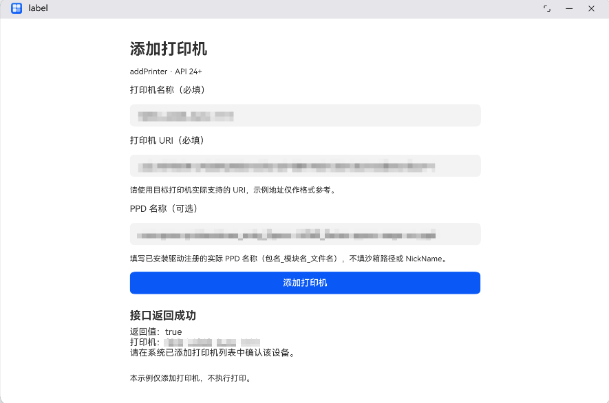

# 应用内添加打印机指南文档示例

### 介绍

本示例通过使用[应用内添加打印机指南文档](https://gitcode.com/openharmony/docs/blob/master/zh-cn/application-dev/basic-services/print/add-printer-in-app-guide.md)中的开发示例，展示在工程中，帮助开发者更好地理解应用内添加打印机接口addPrinter的使用。

### 效果预览



### 使用说明

1. 在主界面，可以查看应用已成功拉起。

2. 在输入框中填写真实打印机的名称和连接地址（URI），可选填写已安装驱动的PPD名称，点击"添加打印机"按钮调用addPrinter接口将打印机添加到系统的打印机列表。

3. 根据页面展示的返回值与错误码（如201, 13100003）确认添加结果，并在系统的打印机列表中查看新增打印机。

4. 本示例仅添加打印机，不执行打印。

### 工程目录

```
entry/src/main/ets/
|---entryability
|---entrybackupability
|---pages
|   |---Index.ets                       // 应用主页面，调用addPrinter接口添加打印机
entry/src/main/
|---module.json5                         // 模块配置，声明PRINTER_DRIVER权限
entry/src/ohosTest/
|---ets
    |---test
        |---AddPrinter.test.ets          // 测试代码
```

### 具体实现

1、声明权限：在module.json5中声明ohos.permission.PRINTER_DRIVER权限，未声明权限时调用addPrinter接口会抛出201错误。

2、参数校验：调用接口前对打印机名称和连接地址做非空校验，为空时在页面提示补全必填信息，避免无效调用。

3、调用addPrinter：PPD名称为空时仅传入打印机名称和URI，使用IPP Everywhere自动驱动模式；PPD名称非空时额外传入PPD名称，使用指定PPD驱动模式。

4、结果处理：根据接口返回的boolean结果展示添加成功或失败；捕获BusinessError并解析错误码，针对201（权限未声明）和13100003（添加失败）给出排查提示。

### 相关权限

1.申请ohos.permission.PRINTER_DRIVER允许应用将打印机添加到系统中。权限级别为system_basic，授权方式为system_grant。

### 依赖

不涉及。

### 约束与限制

1.本示例仅支持标准系统上运行, 支持设备：RK3568。

2.本示例为Stage模型，仅支持API24及以上版本SDK。

3.本示例需要使用DevEco Studio 6.0.1 Beta1及以上版本才可编译运行。

4.验证添加打印机功能需准备一台支持网络打印或USB连接的真实打印机，且与设备处于同一局域网或已通过USB连接到设备。

5.本示例涉及ohos.permission.PRINTER_DRIVER权限为system_basic级别的受限权限，需要申请ACL并配置高权限签名，权限申请方式参考[申请使用受限权限](https://gitcode.com/openharmony/docs/blob/master/zh-cn/application-dev/security/AccessToken/declare-permissions-in-acl.md)。

### 下载

如需单独下载本工程，执行如下命令：

````
git init
git config core.sparsecheckout true
echo code/DocsSample/print/AddPrinterInApp > .git/info/sparse-checkout
git remote add origin https://gitcode.com/openharmony/applications_app_samples.git
git pull origin master
````
