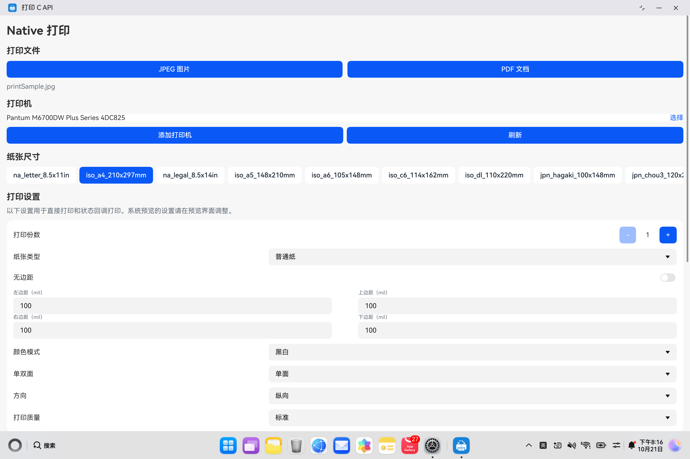
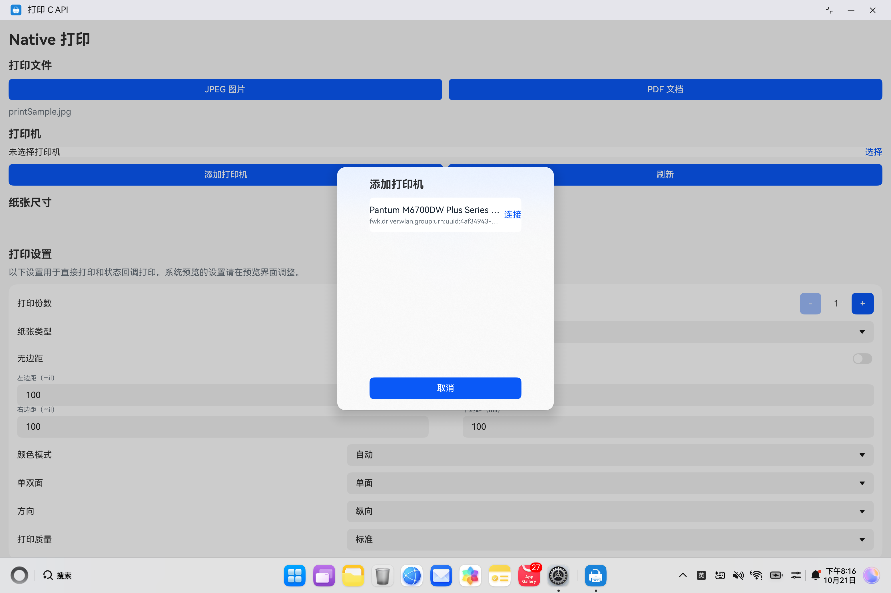
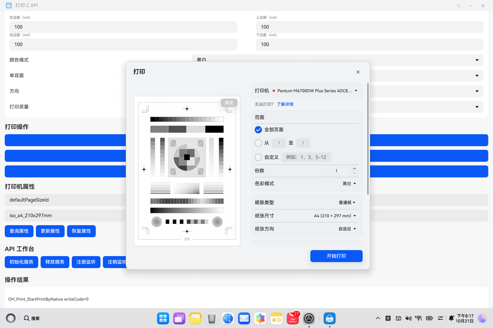

# NativePrintFile

## 介绍

本示例展示如何通过 Print C API 初始化打印服务、发现并连接打印机、查询打印机信息和属性，以及使用系统预览打印 PDF、直接打印和状态回调打印 JPEG/PDF 文件。

相关开发指南：[文件打印（C/C++）](https://gitcode.com/openharmony/docs/blob/master/zh-cn/application-dev/basic-services/print/native-print-file.md)。

接口使用 [BasicServicesKit/ohprint.h](https://gitcode.com/openharmony/docs/blob/master/zh-cn/application-dev/reference/apis-basic-services-kit/capi-ohprint-h.md)，ArkTS 页面通过 `libentry.so` 调用 Native 封装，文件读写使用 `@kit.CoreFileKit` 中的 `fileIo`。

## 效果预览

以下为 HUAWEI MateBook Pro 上运行本示例同源代码的实机截图，调试使用独立 `print_ndk_demo` 工程的既有签名；Sample 工程仍保持未签名。

| 首页打印设置 | 打印机选择 | 系统 PDF 预览 |
| --- | --- | --- |
|  |  |  |

系统预览展示内置 PDF 的实际渲染结果，不代表已经出纸。执行范围与结果见 [测试记录](ohosTest.md)。

## 使用说明

1. 启动应用，按以下入口选择文件和设置：

   | 打印入口 | 文件 | 打印机与设置 |
   | --- | --- | --- |
   | 系统预览打印（PDF） | 选择内置 `printDemo.pdf` | 在系统预览界面选择打印机并调整设置；页面中的纸张、份数、边距等设置不传入该入口 |
   | 直接打印 / 状态回调打印 | 内置 `printSample.jpg` 或 `printDemo.pdf` | 等待发现结果，点击“添加打印机”连接目标打印机，再设置页面中的打印参数 |

2. 点击对应打印按钮，查看“操作结果”。选择 JPEG 后点击系统预览会提示选择 PDF，不会自动替换文件。此示例直接复制现有 PDF，未演示 JPEG 转 PDF 或根据布局属性重新生成文档。
3. API 返回 `code=0` 表示调用成功。预览的 `writeCode` 是文件生成结果（0 成功、1 失败）；预览 `state=0/5/6` 是预览销毁，不能当作打印成功。预览状态 `1/2/3/4` 与 API 24 状态回调的 `0/1/2/3` 分别表示成功、失败、取消、阻塞，两套数值不要混用。实际出纸应在打印机上确认。
4. API 工作台提供生命周期、监听、发现、列表、详情和打印管理接口入口。退出页面时释放本示例持有的监听、回调和文件描述符。

### 纸张类型和打印机列表

- “纸张类型”支持普通纸（`stationery`）和相片纸（`photographic-glossy`），选择值传给直接打印和状态回调打印的 `Print_PrintJob.mediaType`。这两个选项用于演示参数传递，不表示所有打印机都支持；应选择目标打印机支持的纸张类型。
- 纸张类型与无边距分别设置；启用无边距后四边距归零并禁用输入。是否支持对应的纸张、类型和无边距组合，需要由实际打印机验证。
- 打印机弹窗通过 `@Link` 绑定发现列表；弹窗保持打开时，新增、丢失和状态变化会更新列表，无需关闭重开。连接结果和选中的打印机由系统回调更新。
- 同一打印机的状态或详情更新会保留已选纸张；仅在切换打印机或原纸张不再受支持时重新选择。首次连接后应核对纸张尺寸，列表首项不一定是 A4。

### 打印机属性操作

属性区域演示查询、更新和恢复接口的调用。查询 Key 和更新 Key 不一定相同，应先按目标系统的属性定义及支持情况选择输入，可参考 [打印 C API 属性接口](https://gitcode.com/openharmony/docs/blob/master/zh-cn/application-dev/reference/apis-basic-services-kit/capi-ohprint-h.md#oh_print_queryprinterproperties)。初始 Key `defaultPageSizeId` 用于更新默认纸张，Value 应取自目标打印机实际支持的纸张 ID；不能据此认定同名 Key 一定可以查询。更新后应通过目标系统支持的查询方式或打印机设置界面检查实际值。

查询返回非空数组时，页面显示第一项的值；数组为空或调用失败时保留页面原值，并显示返回码。Native 封装的 `PrinterPropertiesResult.properties` 始终是数组，参数错误或查询失败时为空数组。未选择打印机时页面提示 `24300005`；直接调用 Native 查询时，空打印机 ID 等无效参数返回 `401`。

“恢复属性”入口演示 `OH_Print_RestorePrinterProperties` 的调用及返回值，实际支持范围由目标系统实现决定。查询 `code=0` 但结果为空，不代表读到了属性；更新或恢复返回 `code=0` 也应核对实际属性值，不能仅凭返回码认定已生效。

## 工程目录

```text
entry/src/main
├── cpp
│   ├── types/libentry/Index.d.ts
│   ├── CMakeLists.txt
│   └── napi_init.cpp
├── ets
│   ├── entryability/EntryAbility.ets
│   ├── pages/Index.ets
│   └── print
│       ├── components/PrintSettings.ets
│       ├── dialogs/PrinterDialog.ets
│       ├── model/PrintModels.ets
│       └── utils/PrintFileUtils.ets
└── resources
    ├── base/element
    ├── en_US/element
    ├── zh_CN/element
    └── rawfile
```

## 具体实现

- [Index.ets](entry/src/main/ets/pages/Index.ets)：初始化和释放打印服务，处理发现/连接回调，维护页面状态，并调用三种打印入口。
- [PrintSettings.ets](entry/src/main/ets/print/components/PrintSettings.ets) 和 [PrinterDialog.ets](entry/src/main/ets/print/dialogs/PrinterDialog.ets)：分别提供打印参数设置、响应式打印机列表；纸张类型经 [PrintModels.ets](entry/src/main/ets/print/model/PrintModels.ets) 组装进请求。
- [napi_init.cpp](entry/src/main/cpp/napi_init.cpp)：解析 ArkTS 参数、调用 Print C API，通过线程安全函数回传事件，并管理查询结果和文件描述符的释放。`BuildPrintJob` 将纸张类型等参数写入 `Print_PrintJob`。
- [PrintFileUtils.ets](entry/src/main/ets/print/utils/PrintFileUtils.ets)：把内置文件写入应用沙箱并打开为只读文件；调用方在 `finally` 中关闭文件。系统预览由 Native 复制文件描述符，以便在异步布局回调中写入 PDF。

## 相关权限

- [ohos.permission.PRINT](https://gitcode.com/openharmony/docs/blob/master/zh-cn/application-dev/security/AccessToken/permissions-for-all.md#ohospermissionprint)：访问打印服务。

## 依赖

- 不依赖其他 Sample。
- Native 链接 `libace_napi.z.so`、`libhilog_ndk.z.so` 和 `libohprint.so`；构建所需库由 SDK 提供。
- UI 自动化使用工程中声明的 `@ohos/hypium` 和 `@kit.TestKit`，执行前需安装测试包。

## 约束与限制

- 支持手机（default）、tablet 和 2in1。
- 支持 OpenHarmony API 24 及以上版本。
- 本次使用的开发工具为 DevEco Studio 6.1.1.280，SDK 为其提供的 OpenHarmony API 24 组件（6.1.1.125）。工程保持 `runtimeOS: OpenHarmony`，不使用 HarmonyOS 字符串版本配置。
- 发现和连接打印机依赖系统中已安装且可用的 Print Extension。
- 本示例未配置签名。安装到设备前，需在本地配置适用于目标 OpenHarmony 设备的签名，不要提交签名材料和 `local.properties`。

## 构建与测试

使用上述开发环境打开本目录，完成依赖同步后构建 `entry`。已安装 DevEco CLI 时，也可在本目录执行：

```shell
devecocli build --modules entry
devecocli build --modules entry@ohosTest
```

OpenHarmony SDK 路径需指向本机已安装 API 24 的 SDK 根目录，通过 `local.properties` 的 `sdk.dir` 或构建进程的 `OHOS_BASE_SDK_HOME` 指定；`local.properties` 仅用于本机，不随 Sample 提交。未配置签名时仅验证编译和打包，不代表可以安装或已完成运行验证。

现有 4 条 UI 自动化用例位于 [print.test.ets](entry/src/ohosTest/ets/test/print.test.ets)，覆盖核心控件和弹窗、文件切换、打印设置以及未选打印机的安全失败。测试场景、执行状态和必须真机验证的项目见 [ohosTest.md](ohosTest.md)。

## 下载

```shell
git init
git config core.sparsecheckout true
echo code/DocsSample/print/NativePrintFile > .git/info/sparse-checkout
git remote add origin https://gitcode.com/openharmony/applications_app_samples.git
git pull origin master
```
